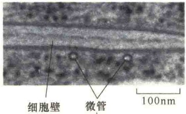
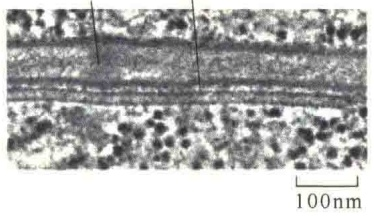

图 4-47 植物细胞壁的层次结构（引自 Kleinsmith and Kish, 1995）。某些植物的细胞壁只有初生壁；有些既有初生壁，也有次生壁。

生长时期形成的。初生壁的厚度为 100～200nm，与动物细胞的基膜相当。初生壁由纤维素、半纤维素、果胶和糖蛋白等松散组成。在初生壁中，果胶对于初生壁的弹性是十分重要的，使细胞在生长过程中进一步扩展。

次生壁是在细胞停止生长后分泌形成的，主要是增加细胞壁的厚度和强度。次生壁位于初生壁的内层，纤维素和木质素是次生壁的主要成分，但基本不含果胶，这使得次生壁非常坚硬。次生壁由几层纤维素微纤维组成，各自形成密集结实的层。

## 4.4.2 细胞壁的化学组成

细胞壁是由大分子构成的复杂的复合物，构成细胞壁的分子是由细胞壁所包围的细胞分泌出来的，从这种意义上来说，植物的细胞壁相当于动式图。

纤维素（cellulose）赋予植物初生壁的张力强度。每一个纤维素至少是由500个葡萄糖残基相互间通过氢键共价连接成线性类似丝带的结构，并通过链内的氢键使其保持稳定。此外，相邻纤维素分子间的氢键可使各纤维素分子平行排列，并形成约由16个纤维素链组成的束，组成束的纤维素链的极性相同。这种高度有序的晶体聚合体称之为纤维素微纤维（cellulose microfibril），约有几微米长。这种微纤维具有堪比钢一样的抗张强度（tensile strength）。微纤维的直径一般为5～15nm，长约几微米（图4-49）。

不同植物的细胞壁在组成、厚度等方面都有差异。例如，棉花的细胞壁几乎全是纤维素纤维构成的，而木本植物的细胞壁中纤维素仅占50%，某些植物幼苗的细胞壁中纤维素的含量不到1%。

虽然纤维素是细胞壁的关键成分，但是细胞壁不只是纤维素的集合体，还包括其他一些大分子，这些生物大分子大致分为4类:半纤维素、果胶、木质素、糖蛋白。

半纤维素（hemicellulose）是由几种不同类型的单糖构成的异质多聚体，这些糖是五碳糖和六碳糖，包括木糖、阿拉伯糖、甘露糖和半乳糖等。半纤维素木聚糖在木质组织中占总量的50%，它结合在纤维素微纤维的表面，并且相互连接，这些纤维构成了细胞相互连接的网络。

果胶（pectin）是由半乳糖醛酸和它的衍生物组成的具分支的多糖，带负电，类似动物细胞的糖胺聚糖，很容易形成水合胶。在细胞壁的中间层（middle lamella），果胶特别丰富。果胶在细胞壁中的作用主要是纤维间的填充物，将纤维素包埋在水

质。所不同的是，动物细胞的细胞外基质的主要成分是蛋白质分子；植物细胞壁的主要成分是多糖，其中最重要的是纤维素，它赋予植物细胞的硬度和强度，与动物细胞的细胞外基质中的胶原具有相似的作用。图4-48是植物细胞壁的主要化学组成及结构模

图 4-48 植物细胞壁的组成（引自 Karp，2010）。A. 洋葱细胞壁的纤维素微纤维与半纤维素交联的电镜照片，样品中除去了果胶聚合体。B. 植物细胞壁的结构组成。

图 4-49 纤维素分子与纤维素微纤维（引自 Alberts et al., 2015）。A. 纤维素分子是由葡萄糖以 β（1→4）连接形成的链状多聚体；B. 由纤维素链组成纤维素微纤维。

合胶中。

木质素（lignin）是由聚合的芳香醇构成的一类物质，主要存在于木质组织中，其作用是通过形成交织网来硬化细胞壁。木质素主要存在于纤维素微纤维之间，具有抗压作用。在木本植物中，木质素占25%，是世界上第二位最丰富的有机物（纤维素是第一位）。

植物细胞壁中含有一些蛋白质，总量占细胞壁干重的5%。最重要的一种糖蛋白叫伸展蛋白（extensin），这种蛋白质与其他的相关蛋白一起，与纤维素等形成交叉网络，产生一种加固蛋白质-多糖复合物的力。有些蛋白质是酶，负责细胞壁的周转（turnover）和重建，特别是在生长期尤其如此。还有些蛋白质是穿膜的蛋白激酶，参与信号转导，这对于植物的免疫反应具有重要意义。

除了上述成分外，细胞壁中也有少量的脂，包括蜡质及其他的脂类。这些脂质常位于细胞壁的外表面，并且形成角质层，保护细胞免受损伤。细胞壁中还有矿物盐，如钙和钾等。

通过拟南芥的基因测序估计，大约有700个基因参与植物细胞壁的合成、装配与重建。

## 4.4.3 微管在纤维素微纤维装配中的作用

在植物细胞壁的纤维素微纤维装配过程中，微管（microtubule，MT）对于新合成的微纤维的定向具有引导作用。1963年，Ledbetter和Porter发现在形成细胞壁的质膜下有一层微管，后来的研究证实了这一发现，推测在细胞壁形成时，微管对于指导纤维素微纤维的方向具有重要作用（图4-50）。

图 4-50 新合成的微纤维在微管指导下的定向（引自 Alberts et al., 2015）。A. 大的纤维素合成酶复合物是一类整合膜蛋白，在细胞质膜的外侧面连续合成纤维素微纤维。坚硬的微纤维的远端整合在细胞壁结构中，近端在合成酶的作用下沿着质膜不断合成延长。在质膜的胞质侧有微管的存在，并且纤维素微纤维通过连接蛋白与微管相连，因此，微管对微纤维具有定向指导作用。B～C. 显示皮质微管与质膜关联的两幅电子显微镜照片。B 是横切面照片，C 是纵切面照片，两幅照片都显示质膜与微管之间约有 20nm 的间隙，但连接分子不清楚。

## 本章小结

多细胞生命有机体中的细胞组成不同的组织，在这些组织中，通过细胞相互间以及细胞与细胞外环境的相互作用调节着细胞的迁移、生长及组织的三维结构。

动物是由多种类型的细胞组成的有机体，而且不同类型的细胞通常要组成固定的组织。在多数组织中，细胞要向细胞外分泌一群大分子，这些大分子在细胞间交织连接形成网状结构，将这种结构称为细胞外基质。

细胞外基质的组成可分为三大类:①蛋白聚糖，它们能够形成水性的胶状物；②结构蛋白，如胶原和弹性蛋白，它们赋予细胞外基质一定的强度和韧性；③黏着蛋白，如纤连蛋白和层粘连蛋白，它们促使细胞与基质结合。

细胞识别是指细胞对同种或异种细胞、同源或异源细胞、自己和异己物质的认识和鉴别。细胞黏附则是指相邻细胞或细胞与细胞外基质以某种方式黏附在一起，组成组织或与其他组织分开，这种黏附的方式比较松散。另外，从事件发生的次序来说，细胞识别在先，细胞黏附在后，识别是黏附的基础。介导细胞黏附的蛋白质有四类:整联蛋白、钙黏着蛋白、选择蛋白、免疫球蛋白超家族。

细胞在识别和黏附的基础上进行细胞连接。细胞连接有3种方式:紧密连接、锚定连接、通讯连接。比较复杂的是锚定连接，它又可分为4种连接方式:黏着带、黏着斑、桥粒、半桥粒。对它们的区别主要是根据连接蛋白与细胞骨架的关系，以及是细胞与细胞的连接，还是细胞与细胞外基质的连接。

植物细胞壁是由大分子构成的复杂复合物, 相当于动物细胞的细胞外基质。纤维素是细胞壁的主要成分, 此外还包括半纤维素、果胶、木质素、糖蛋白等。植物细胞壁不仅给整体植物提供机械强度, 还可保护植物免受微生物等的侵染, 以及植物形态决定等作用。

## 思考题

（1）如何从社会学的角度理解细胞环境与互作的意义？

（2）比较四类细胞锚定连接的特点与意义。

(3) 什么是透明质酸？其结构与功能有什么特点？

（4）间隙连接的渗透性（permeability）受 $\mathrm{Ca^{2+}}$ 的调节。你认为当细胞内的 $\mathrm{Ca^{2+}}$ 浓度高于正常值时，间隙连接是打开还是关闭？这种调节机制有什么优越性？

(5) 假定你合成了一段含有 RGD 模体 (motif) 的寡肽序列。当你将这种寡肽添加到已经通过纤连蛋白贴壁的成纤维细胞培养液中后, 对成纤维细胞的生长会有什么影响? 是如何发生的?