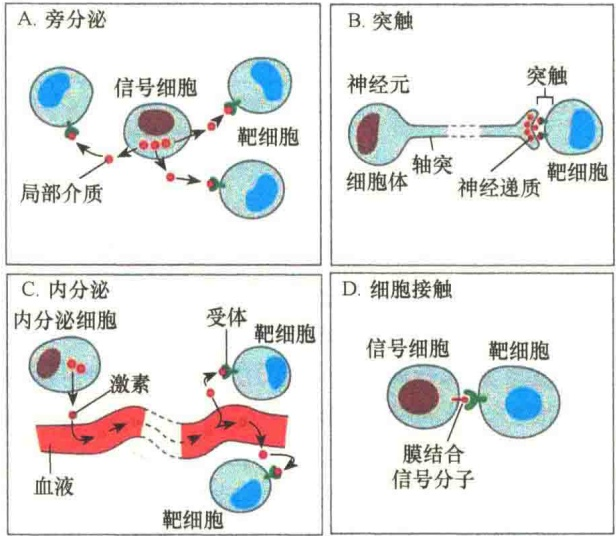
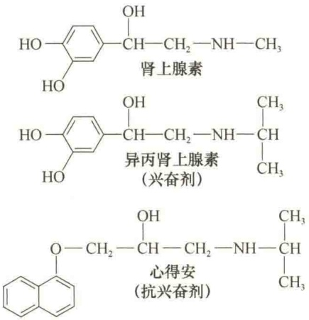
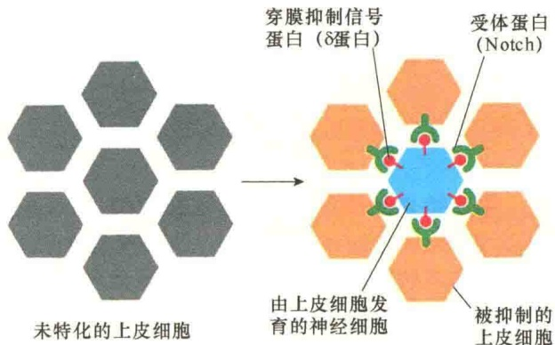
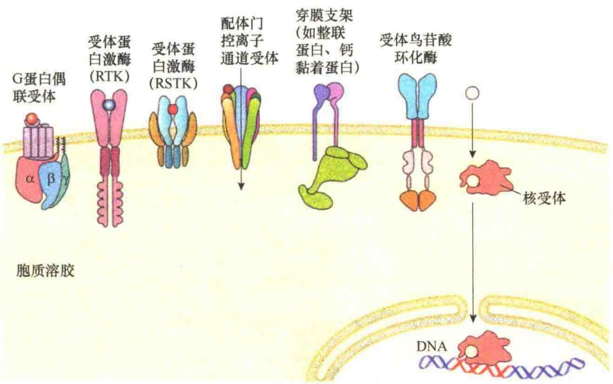
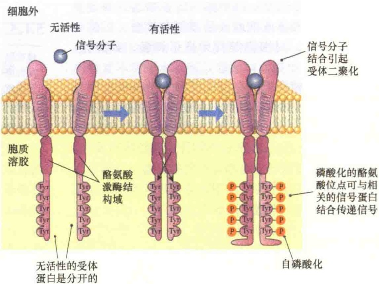
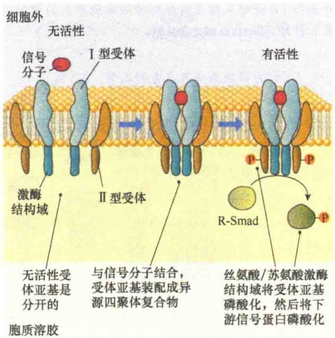

其实，信号分子本身并不直接作为信息，它的基本功能只是提供一个正确的构型及与受体结合的能力，就像钥匙与锁一样，信号分子相当于钥匙，因为只要有正确的形状和缺齿就可以插进锁中并将锁打开。至于锁开启后干什么，由“开锁者”决定。

并非所有的细胞通讯都需要由分泌到细胞外的信息分子来传递，有些信号细胞产生的信号分子并不释放到细胞外，而是继续留在信号细胞的表面，这种信号需要与靶细胞的表面受体接触进行通讯。

## 5.1.2.2 信号分子的通讯方式

从细胞外信号分子引起细胞通讯的距离来说，既有近距离的通讯，也有远距离的通讯。根据通讯方式的不同，将细胞通讯分为4种类型，即旁分泌通讯、突触通讯、内分泌通讯和接触依赖性通讯（图5-5）。

1）旁分泌通讯 在大多数情况下，通讯细胞会向细胞外液中分泌信号分子，通常将这种分泌的分子称为局部介质（local mediator），它仅作用于信号细胞所在的局部环境的细胞，通常将这种通讯称之为旁分泌通讯（paracrine signaling）。通常，在旁分泌通讯中的信号细胞与靶细胞是不同类型的细胞；但有时也可能是通讯细胞分泌的信号作用于自身的同类细胞，若是这种情况，则称之为自分泌通讯（autocrine signaling）。例如，癌细胞常常分泌细胞外信号刺激自身的生存与增殖。旁分泌的通讯距离也是很短的。

图 5-5 细胞通讯的 4 种类型（引自 Alberts et al., 2015）。
A. 旁分泌通讯；B. 突触通讯；C. 内分泌通讯；D. 接触依赖性通讯。

局部介质中除了蛋白质和肽类分子外，还有氨基酸和脂肪酸衍生物（表 5-1）。前列腺素（prostaglandin, PG）是由前列腺合成分泌的脂肪酸衍生物（主要是由花生四烯酸合成的），它不仅能够控制邻近细胞的活性，也能作用于合成前列腺素细胞自身，通常将由自身合成的信号分子作用于自身的现象称为自分泌信号传导（autocrine signaling）。

表 5-1 某些局部介质的性质和功能

| 名称 | 来源 | 化学性质 | 主要作用 |
| --- | --- | --- | --- |
| 表皮生长因子(EGF) | 多种细胞 | 蛋白质 | 刺激表皮和多种其他类型细胞的增殖 |
| 血小板生长因子(PDGF) | 多种细胞,包括血小板 | 蛋白质 | 刺激多种类型细胞增殖 |
| 神经生长因子(NGF) | 各种神经组织 | 蛋白质 | 帮助某些神经元的生存,促进这些神经元轴突的生长 |
| 组胺 | 肥大细胞 | 组氨酸的衍生物 | 引起血管扩张渗漏,导致炎症 |
| 一氧化氮(NO) | 神经细胞、血管内皮细胞 | 溶解气体 | 引起平滑肌松弛,调节神经细胞的活性 |

2）突触通讯 大型的多细胞生物，如人类自身，需要远距离的通讯协调不同组织间的行为，因此进化形成了具有远距离通讯作用的特化的细胞类型。最精巧的就是神经细胞，或称神经元，它延伸得很长，而且可以分支，可通过化学突触（chemical synapse）释放神经递质（neurotransmitter）。这种通讯方式称为突触通讯（synaptic signaling）。

神经递质是从神经末梢释放出来的小分子物质，是神经元与靶细胞的化学信使，在它们作用于靶细胞之前，突触必须与靶细胞挨得很近，这是因为神经递质扩散的距离有限。另外，为了引起邻近靶细胞的反应，还必须产生一种电信号，所以神经递质仅作用于与之相连的靶细胞。神经递质释放后，作用速度快，部位精确，维持时间短，与受体的亲和力低。由于神经递质是神经细胞分泌的，所以这种信号传导又称为神经通讯（neuronal signaling）。表 5-2 是两种常见的神经递质。

3）内分泌通讯 内分泌细胞（endocrine cell）进行的超长距离的通讯采用的是完全不同的通讯策略，它们能够分泌自身的称为激素（hormone）的信号分子进入血液中，通过血液的流通将激素带向远方，作用于身体的任何部位的靶细胞。这种通讯称为内分泌通讯（endocrine signaling）。

表 5-2 两种神经递质的性质和功能

| 名称 | 来源 | 化学性质 | 主要作用 |
| --- | --- | --- | --- |
| 乙酰胆碱 | 神经末梢 | 胆碱衍生物 | 在多种神经肌突触和中央神经肌肉系统产生兴奋的神经递质 |
| γ-氨基丁酸(GABA) | 神经末梢 | 谷氨酸衍生物 | 在中央神经系统抑制神经递质 |

激素是由内分泌细胞（如肾上腺、睾丸、卵巢、胰腺、甲状腺、甲状旁腺和垂体）合成的化学信号分子，这些信号分子被分泌到血液中后，经血液循环运送到体内各个部位作用于靶细胞。激素经血液循环系统运到全身的速度很快，通常只需几分钟时间。每种激素都有与其相配的一种或几种受体；一种内分泌细胞基本上只分泌一种激素。参与细胞通讯的激素有3种类型:蛋白质和肽类激素、类固醇激素、氨基酸衍生物。表5-3是某些激素的性质和功能。

表 5-3 某些激素的性质和功能

| 名称 | 合成部位 | 化学性质 | 主要作用 |
| --- | --- | --- | --- |
| 肾上腺素 | 肾上腺 | 酪氨酸衍生物 | 提高血压、心律,增强代谢 |
| 皮质醇 | 肾上腺 | 类固醇 | 在大多数组织中影响蛋白质、糖、脂的代谢 |
| 雌二醇 | 卵巢 | 类固醇 | 诱导和保持雌性副性征 |
| 胰高血糖素 | 胰α细胞 | 肽 | 在肝、脂肪细胞刺激葡萄糖合成、糖原断裂、脂断裂 |
| 胰岛素 | 胰β细胞 | 蛋白质 | 刺激肝细胞等葡萄糖吸收、蛋白质及脂的合成 |
| 睾酮 | 睾丸 | 类固醇 | 诱导和保持雄性副性征 |
| 甲状腺素 | 甲状腺 | 酪氨酸衍生物 | 刺激多种类型细胞的代谢 |

（1）蛋白质和肽类激素（protein and peptide hormone）。此类激素在脊椎动物细胞中占80%，甚至更多。组成此类激素的肽链长度变化很大，短的为3个氨基酸残基，多的有几百个氨基酸残基。

此类激素通常只与细胞质膜受体结合。

（2）类固醇激素（steroid hormone）。该类激素是在滑面内质网上利用胆固醇酶促合成的。由于此类激素不溶于水，所以通常与血液中蛋白质结合，然后通过血液循环运送到靶细胞。与蛋白质或肽激素不同的是，类固醇激素能够穿过靶细胞的质膜作用于靶细胞内部受体。

（3）氨基酸衍生物（amino acid derivative）。其主要是由酪氨酸衍生而来的小分子激素，如肾上腺素和甲状腺素。肾上腺素是由肾上腺及一些神经细胞合成的，因此属于神经递质激素；肾上腺素和它的衍生物（图5-6）作用于膜受体，而甲状腺素则穿过细胞质膜与细胞内受体结合。

图5-6 肾上腺素及其合成的衍生物。

通过激素传递信息是最广泛的一种信号传导方式，这种通讯方式的距离最远，覆盖整个生物体。在动物中，产生激素的细胞是内分泌细胞，所以将这种通讯称为内分泌信号传导（endocrine signaling）。

4）接触依赖性通讯 顾名思义，接触依赖性通讯（contact-dependent signaling）需要借助于细胞的接触才能发生通讯。有些细胞的信号并不分泌到细胞外，而是保留在细胞质膜中，只有通过细胞接触才能进行信号通讯。此类细胞通讯的距离较短，仅能作用于邻近的细胞。

此类信号通讯包括通过整联蛋白介导的细胞间黏附、细胞与细胞外基质的黏附、连接子（动物细胞）及胞间连丝（植物细胞）介导的信号传导。

在通过细胞接触进行的通讯中，位于质膜上的“信号分子”与分泌到细胞外的信号分子的作用是不一样的，如通讯连接的连接子或胞间连丝只是为两个细胞提供了通路，这样，接触的两个细胞能够共享信息。而质膜中的整联蛋白通过与相邻细胞的受体或细胞外基质组分接触，可感知环境的变化，对细胞的行为进行调整，或连接，或黏附。

接触依赖性通讯在细胞发育及免疫反应中具有特别重要的作用。例如，在果蝇发育中，δ蛋白（delta protein）是一类依赖于细胞接触的信号分子，是穿膜蛋白，位于神经元及各种胚性细胞质膜上。这些部位的细胞开始时都是相同的，通过依赖于细胞接触进行的信号传导作用，分别进入不同的分化途径形成特化的细胞（图 5-7）。

图 5-7 果蝇神经细胞发育期间由 Notch 蛋白与穿膜抑制信号蛋白（δ 蛋白）信号传导对神经细胞产生的侧向抑制作用（引自 Alberts et al., 2015）。

## 5.1.3 受体

受体（receptor）在细胞生物学中是一个广义的概念，信号分子受体意指任何能够与激素、神经递质、药物或细胞内的信号分子结合并能引起细胞功能变化的生物大分子。

在细胞通讯中，由通讯细胞送出的信号分子必须被靶细胞接收才能触发靶细胞的应答，接收信息的分子称为受体，信号分子被称为配体（ligand）。在细胞通讯中受体通常是指位于细胞膜表面或细胞内（核内）与信号分子结合的蛋白质。

位于细胞质膜上的受体称为表面受体（surface receptor），位于胞质溶胶、核基质中的受体称为细胞内受体（intracellular receptor）。细胞表面受体主要是识别周围环境中的活性物质或被相应的信号分子所识别并与之结合，将外部信号转变成内部信号，以启动一系列反应而产生特定的生物效应。细胞内受体通常都是核受体，并且是基因转录调控因子，接收信号后调控基因的表达；由于核内空间有限，细胞核受体通常被隔离在细胞核外的胞质溶胶中，信号分子的作用是解除这种隔离。

常见的与信号分子结合的受体可分为以下6种类型（图5-8）。

图 5-8 6 种基本类型的受体（引自 Plopper，2016）。

## 5.1.3.1 G蛋白偶联受体

G 蛋白偶联受体（G protein coupled receptor, GPCR）是最大的一类细胞表面受体，可与细胞外的蛋白质、肽，以及具有氨基酸结构的信号结合，能够介导很多细胞外信号的转导，包括激素、局部介质和神经递质。由于这种受体参与的信号转导作用要与GTP结合的调节蛋白相偶联，因此将它称为 G 蛋白偶联受体。配体与受体结合后激活相邻的 G 蛋白，被激活的 G 蛋白又可激活或抑制一种产生特异第二信使的酶、离子通道，引起膜电位的变化。

此类受体的一个最重要的特点是，一旦受体被激活，它能同时激活多个相同的G蛋白。发生这种情况的原因是被激活的G蛋白会立即与受体分开，留下的空位被未激活的G蛋白占据，此后又被激活，如此反复，可将多个相同拷贝的G蛋白激活。

这类受体的种类很多，在结构上都很相似，即都是一条多肽链，并且有7次 $\alpha$ 螺旋穿膜区。该受体蛋白的超家族包括视紫红质（脊椎动物眼中的光激活光受体蛋白）和脊椎动物鼻中的嗅觉受体。

G 蛋白偶联受体的进化地位相当原始，不仅存在于亲缘关系较远的真核生物（如酵母）中，即使在细菌中也存在于 G 蛋白偶联受体相似的膜蛋白中。例如，细菌的菌紫红质，它的作用是光驱动的  $H^{+}$ 泵，但细菌中的此类蛋白质并不具有 G 蛋白偶联受体的功能，因为细菌中没有 G 蛋白，推测其偶联系统并不相同。

## 5.1.3.2 受体蛋白激酶

受体蛋白激酶（receptor kinase）是一种穿膜蛋白，由于这种受体蛋白既是受体又是酶，一旦被配体激活即具有酶活性并将信号放大，故又称为催化受体（catalytic receptor）或酶联受体。

与 GPCR 不同的是，受体蛋白激酶至少有两个亚基，因此具有四级结构，每个亚基都有一个单次穿膜的  $\alpha$  螺旋结构域，所以它们很容易在质膜中进行扩散，这是一个非常重要的调节特点:非活性的亚基相互脱离，当与相应的配体结合时，才结合成二聚体，进行信号转导。

图 5-9 RTK 反式自磷酸化（引自 Plopper，2016）

受体蛋白激酶的第二个特点是:它们的细胞质尾部含有蛋白激酶结构域，它能够将磷酸基团加到特定的氨基酸侧链上。

受体蛋白激酶可分成两类。第一类是受体酪氨酸激酶（receptor tyrosine kinase，RTK），它含有两个亚基，每一个亚基的细胞质结构域都含有一个酪氨酸激酶，在很多情况下，两个亚基可以相互将对方细胞质结构域的酪氨酸残基磷酸化，将这种行为称为反式自磷酸化（trans-autophosphorylation）（图5-9）。

第二类是受体丝氨酸 / 苏氨酸激酶（receptor serine/threonine kinase, RSTK），这类受体在结构上比受体磷酸激酶更具异质性，并且大多数都不会进行反式磷酸化，而是将不同的信号蛋白磷酸化（图 5-10）。

图 5-10 受体丝氨酸 / 苏氨酸激酶激活后将信号蛋白磷酸化（引自 Plopper，2016）。图中显示的是转化生长因子 β（tansforming growth factor β）触发其受体磷酸化，以及后续下游信号蛋白（R-Smad）的磷酸化。

## 5.1.3.3 配体门控离子通道受体

具有离子通道作用的细胞质膜受体称为配体门控离子通道受体（ligand gated ion channel receptor）。配体门控离子通道受体不是酶，也就是说不具有