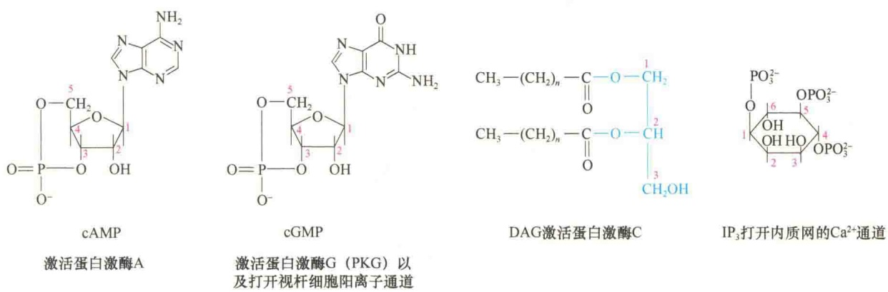
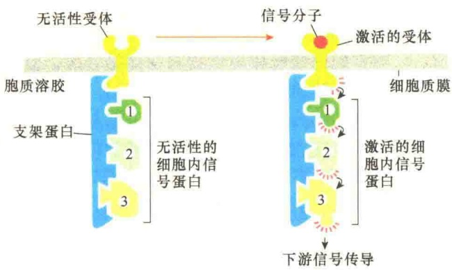
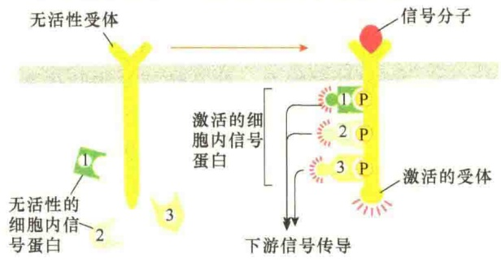
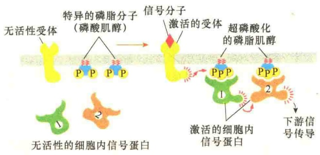
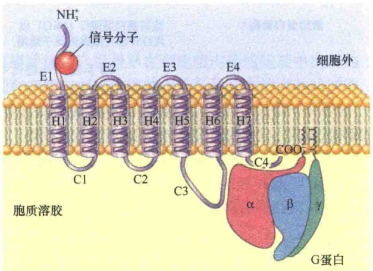
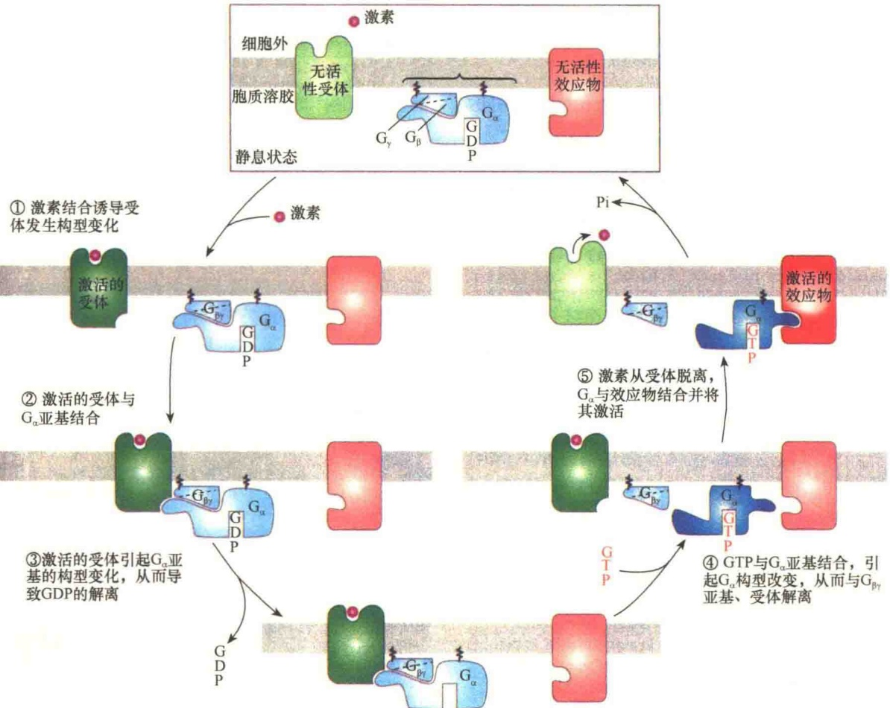
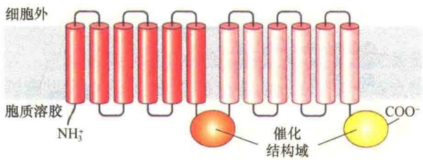
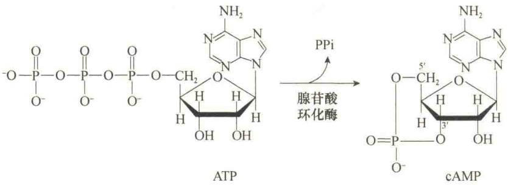

图5-18 细胞内4种第二信使的结构。

过信号分子将信号级联放大（signaling cascade）或级联反应。

组成级联反应的各个成员称为一个级联系统（cascade）。通过级联放大作用，使引起同一级联反应的信号得到最大限度的放大。

## 5.1.4.4 细胞内信号复合物

上面讨论的信号蛋白与第二信使都是一对一的向下传递。其实，细胞还有一种简单且更为有效的增强信号分子之间作用的特异性策略，就是将信号蛋白相对集聚在细胞的同一个部位或是组织在一个大的蛋白复合物中，以确保同一个通路中信号蛋白相互作业，避免与不适合的信号蛋白发生串流（cross-talk）。这种机制常常涉及支架蛋白。如同前面讨论的穿膜支架，同一信号途径中的细胞内的相关蛋白也聚集到细胞质支架，组成信号复合物（signaling complex），因此能以较高的局部浓度使信号转导快速有序进行。由于形成的信号复合物仅是对细胞外信号反应的临时组织的复合物，当信号消失后会快速解离。它们往往聚集在受到信号激活的受体区域进行装配，之所以如此，是因为受到信号激活的受体细胞质结构域的尾部发生了自我磷酸化，而磷酸化了的氨基酸可以作为其他信号蛋白装配的锚定位点。

A. 在受体支架蛋白上预先形成信号传导复合物

图 5-19 三种类型的细胞内信号复合物（引自 Alberts et al., 2015）。A. 将受体及其将要激活的信号蛋白复合物按顺序预先装配在一个支架上，便于按顺序激活。B. 当有细胞外信号分子与受体结合并将其激活时，将细胞内的信号蛋白临时装配到受体上成为信号蛋白复合物；受体通过自我磷酸化，再将锚定在受体上的细胞内信号蛋白磷酸化而激活。C. 受体激活后引起质膜上一个相邻特异的磷脂多磷酸化，这些磷酸化的位点可作为细胞内特异信号蛋白的锚定位点，这些信号蛋白锚定成为复合物后，可提高信号蛋白的相互作用。

细胞内有三种不同类型的信号复合物装配方式，包括在受体支架蛋白上预装配信号传导复合物、在激活受体的细胞质结构域装配成信号传导复合物、在磷酸化的锚定位点上装配信号传导复合物（受体激活产生修饰的磷脂作为锚定位点）（图 5-19）。

B. 在激活受体细胞质结构域上装配信号传导复合物

C. 在磷酸化的锚定位点上装配信号传导复合物

## 5.2 G 蛋白偶联受体介导的信号转导

G 蛋白偶联受体（GPCR）是细胞表面受体的最大家族，它们介导大多数来自细胞外及其他细胞的信号转导，包括激素信号、神经递质与局部介质。我们的视觉、嗅觉、味觉都依赖于 GPCR 的信号转导。人类有 800 多种 GPCR，而老鼠仅与嗅觉相关的 GPCR 就多达 1000 多种。作用于 GPCR 的信号分子种类繁多，包括蛋白质、小分子肽，以及氨基酸与脂肪酸的衍生物等。而且，相同的信号分子能够激活不同的 GPCR 家族成员。例如，肾上腺素（adrenaline epinephrine）能够激活至少 9 种不同的 GPCR，乙酰胆碱可以激活 5 种，神经递质 5-羟色胺至少激活 14 种 GPCR。接受相同信号的不同受体是由不同的细胞表达的，因而产生不同的信号应答。

GPCR 超家族成员也包括脊椎动物眼组织中的光激活蛋白视紫红质，以及鼻组织中大量的嗅觉受体。在单细胞生物中也有很多 GPCR 家族成员，如酵母中识别分泌交配因子的受体。

对 GPCR 的研究具有重要的临床应用价值，很多药物都是通过 GPCR 或是其通讯途径发挥作用的。

## 5.2.1 G蛋白偶联受体的结构与作用机制

如上所述，大多数细胞表面受体都是 GPCR，在人体中，GPCR 被用于检测细胞外多种信号并作出应答，包括神经递质、涉及糖原与脂肪代谢的激素等。所有 GPCR 的信号转导途径都具有三个共同的特点:①受体都含有 7 个穿膜的 α 螺旋；②与三体 G 蛋白偶联，偶联的 G 蛋白通过自身“开”与“关”的循环，作为信号转导的开关；③有一个与之关联的膜结合的效应物蛋白。此外，有一些参与信号转导的反馈调节或脱敏（desensitization）的蛋白质参与信号途径的调节，在很多 GPCR 途径中会涉及第二信使。GPCR 途径在细胞中通过对已经存在的蛋白质、酶或离子通道进行修饰，产生短期效应。因此，这些途径帮助细胞对多变的细胞外环境中的信号作出快速反应。

## 5.2.1.1 G蛋白偶联受体的结构特点

所有的 GPCR 在质膜中都有相同的定向，并且都含有 7 次穿膜的  $\alpha$  螺旋区（seven transmembrane α-helical region) (H1～H7)，而 N 端总是位于细胞外侧，C 端总是位于细胞质侧；有 4 个细胞外片段（E1～E4）和 4 个细胞质片段（C1～C4）（图 5-20）。受体胞质面的 C3、C4 片段参与同三体 G 蛋白相互作用。多数 G 蛋白偶联受体在进化上较为保守，大多数 GPCR 在氨基酸序列结构上都比较相似。

图 5-20 GPCR 的结构（引自 Plopper，2016）。信号分子与受体 N 端的外环 E1 结合，G 蛋白的  $\alpha$  亚基与受体 H5～H6 之间的环 3 及羧基端的环 4 结合并被激活。

## 5.2.1.2 三体G蛋白 $\alpha$ 亚基的激活

三体 G 蛋白是膜结合蛋白，其  $G_{\alpha}$ 、 $G_{\gamma}$  亚基是与脂共价连接的，通常  $\beta$  亚基与  $\gamma$  亚基总是结合在一起，故将它们称为  $G_{\beta\gamma}$  亚基。在静息状态下，因为没有配体与受体结合， $G_{\alpha}$  结合一个 GDP，并与  $G_{\beta\gamma}$  形成三体复合物。

当有配体或配体类似物与受体结合时，受体就会改变细胞质面环的构型，并与 $G_{\alpha}$ 亚基结合。由于受体的结合，使 $G_{\alpha}$ 结合的GDP被释放，代之的是与GTP结合，因此，激活的受体充当了鸟苷交换因子（GEF）的作用。由于GTP与 $G_{\alpha}$ 结合使得 $G_{\alpha}$ 的构型发生改变，从而减弱了 $G_{\alpha}$ 亚基与受体及 $G_{\beta\gamma}$ 亚基的结合，并最终与受体和 $G_{\beta\gamma}$ 亚基脱离。在大多数情况下， $G_{\alpha} \cdot GTP$ 保持与质膜的结合，通过与激活型效应物蛋白相互作用，并将效应物激活，引起信号转导；而在另一些情况下， $G_{\alpha} \cdot GTP$ 与抑制型效应物蛋白相互作用，抑制信号转导。

激活的  $G_{\alpha} \cdot GTP$  的活性时间比较短暂，因为  $G_{\alpha}$  亚基自身具有 GTPase 活性，可以在几分钟之内将 GTP 水解成 GDP，此时  $G_{\alpha}$  开关又恢复到无活性的  $G_{\alpha} \cdot GDP$  状态，阻断了效应物蛋白继续发挥作用。另外，与  $G_{\alpha} \cdot GTP$  结合的效应物可起 GTPase-激活蛋白（GAP）的作用，促进  $G_{\alpha} \cdot GTP$  结合的 GTP 水解。这一机制对于调节信号转导的时间是非常重要的，因为在信号转导过程中，必须有快速终止机制，避免细胞过度反应。

在很多情况下，还有一种类型的GAP，即G蛋白信号调节子（regular of G protein signaling, RGS），能够加速  $G_{\alpha} \cdot GTP$  中 GTP 的水解，从而进一步缩短效应物的作用时间。GTP 水解后， $G_{\alpha} \cdot GDP$  快速与  $G_{\beta\gamma}$  亚基结合成三体复合物，恢复原来的状态，准备新的反应。图 5-21 显示了反应的基本机制。

图 5-21 GPCR 对 G 蛋白激活作用（引自 Lodish et al., 2013）。①当受体与激素信号分子结合后，受体即被激活并发生构型变化；②激活的受体与 $G_{\alpha}$ 亚基结合；③与受体结合的 $G_{\alpha}$ 亚基发生构型改变，从而导致与其结合的 GDP 脱离；④ GTP 与 $G_{\alpha}$ 亚基结合，引起 $G_{\alpha}$ 亚基的构型发生改变，并与 $G_{\beta \gamma}$ 亚基、受体脱离；⑤激素从受体脱离，结合有 GTP 的 $G_{\alpha}$ 亚基与效应物结合并将其激活。

## 5.2.1.3 三体G蛋白与效应物

GPCR 途径中所有的效应物要么是膜结合的离子通道，要么是能够催化生成第二信使的膜结合酶。表 5-5 列出了哺乳动物中主要的具有不同  $G_{\alpha}$  亚基的三体 G 蛋白及其功能。

表 5-5 哺乳动物中主要的三体 G 蛋白与效应物

<table><tr><td>类型</td><td>作用亚基</td><td>相关的效应物</td><td>第二信使</td><td>受体(举例)</td></tr><tr><td> $G_{as}$ </td><td> $\alpha$ </td><td>激活腺苷酸环化酶,激活  $Ca^{2+}$ 通道</td><td>cAMP(提高浓度)</td><td> $\beta$ -肾上腺素能(肾上腺素)受体;胰高血糖素、血清素、升压素受体</td></tr><tr><td rowspan="2"> $G_{ai}$ </td><td> $\alpha$ </td><td>抑制腺苷酸环化酶</td><td>cAMP(降低浓度)</td><td> $\alpha_{2}$ -肾上腺素能受体</td></tr><tr><td> $\beta\gamma$ </td><td>激活  $K^{+}$ 通道</td><td>膜电位改变</td><td>毒蝇碱性乙酰胆碱受体</td></tr><tr><td> $G_{\alpha \text{olf}}$ </td><td> $\alpha$ </td><td>激活嗅觉神经中腺苷酸环化酶</td><td>cAMP(提高浓度)</td><td>鼻中的气味受体</td></tr><tr><td> $G_{\alpha q}$ </td><td> $\alpha$ </td><td>磷脂酶 C-β</td><td> $IP_3$ , DAG(提高浓度)</td><td> $\alpha_1$ -肾上腺素能受体</td></tr><tr><td> $G_{\alpha o}$ </td><td> $\alpha$ </td><td>磷脂酶 C-β</td><td> $IP_3$ , DAG(提高浓度)</td><td>内皮细胞乙酰胆碱受体</td></tr><tr><td></td><td> $\beta \gamma$ </td><td>激活  $K^+$ 通道</td><td></td><td></td></tr><tr><td></td><td></td><td>失活  $Ca^{2+}$ 通道</td><td></td><td></td></tr><tr><td> $G_{\alpha t}$ </td><td> $\alpha$ </td><td>cGMP 磷酸二酯酶</td><td>cGMP(降低浓度)</td><td>杆状细胞中的视紫红质(光受体)</td></tr></table>

从表 5-5 中可以看到，不同的 GPCR 激活不同的 G 蛋白，而不同的 G 蛋白被激活后，可调节不同的效应物。如不同类型的肾上腺素能受体与不同  $G_{\alpha}$  亚基偶联，则影响不同效应物，并且对靶细胞的行为产生不同影响。两种  $\beta$ -肾上腺素亚型受体，即  $\beta_{1}$  肾上腺素能受体、 $\beta_{2}$ -肾上腺素能受体，均与刺激型的 G 蛋白（stimulatory G protein，Gs 蛋白）偶联，Gs 蛋白的  $\alpha$  亚基（ $G_{\alpha s}$ ）激活膜结合的腺苷酸环化酶（adenylate cyclase，AC），该酶被激活后能够催化 ATP 生成 cAMP。与此相反， $\beta$ -肾上腺素亚型  $\alpha_{2}$  系统受体与抑制型的 G 蛋白（inhibitory G protein，Gi 蛋白）偶联，Gi 蛋白的  $\alpha$  亚基（ $G_{\alpha i}$ ）则抑制腺苷酸环化酶的活性。

此外， $G_{\alpha q}$  亚基与  $\alpha_{1}$ -肾上腺素能受体偶联，激活的是另一种效应物的酶——蛋白激酶 C，它能够产生两个第二信使，即  $IP_{3}$  与 DAG。

## 5.2.2 PKA系统的信号转导机制

在动物体中，葡萄糖是以不溶的糖原形式储存起来的。脊椎动物中糖原的分解受激素控制，如胰高血糖素和肾上腺素。胰高血糖素和肾上腺素都是很小的水溶性的胺，它们在结构上没有相同之处，为什么能引起相同的生物学效应？研究发现，它们都是通过作用于膜受体后，激活G蛋白偶联系统，产生cAMP后，激活蛋白激酶A（protein kinase A，PKA）进行信号放大。

cAMP 作为第二信使主要是通过激活蛋白激酶 A 进行信号放大的，故将 cAMP 引起的信号转导系统称为 PKA 系统（protein kinase A system）。在该系统中，细胞外激素信号作用于 G 蛋白偶联受体，再通过 G 蛋白激活效应物腺苷酸环化酶，再由腺苷酸环化酶催化 ATP 生成细胞内的第二信使 cAMP，由 cAMP 作用于蛋白激酶 A，再由蛋白激酶 A 磷酸化特异的靶蛋白进行应答。

## 5.2.2.1 腺苷酸环化酶与cAMP

腺苷酸环化酶是一种多次穿膜的膜蛋白，它含有两个大的细胞质结构域（图 5-22），具有将 ATP 转变成 cAMP 的催化活性。

图 5-22 哺乳动物腺苷酸环化酶的结构示意图（引自 Lodish et al., 2013）。腺苷酸环化酶含有两个类似的催化结构，它们能够在细胞质面将 ATP 转变成 cAMP，每一个结构域有 6 个穿膜  $\alpha$  螺旋区。

当激活的  $G_{\alpha s} \cdot GTP$  与腺苷酸环化酶结合时，腺苷酸环化酶即被激活，并将 ATP 转变成 cAMP（图 5-23），cAMP 作为第二信使进行信号的级联反

图 5-23 腺苷酸环化酶催化 ATP 生成 cAMP。