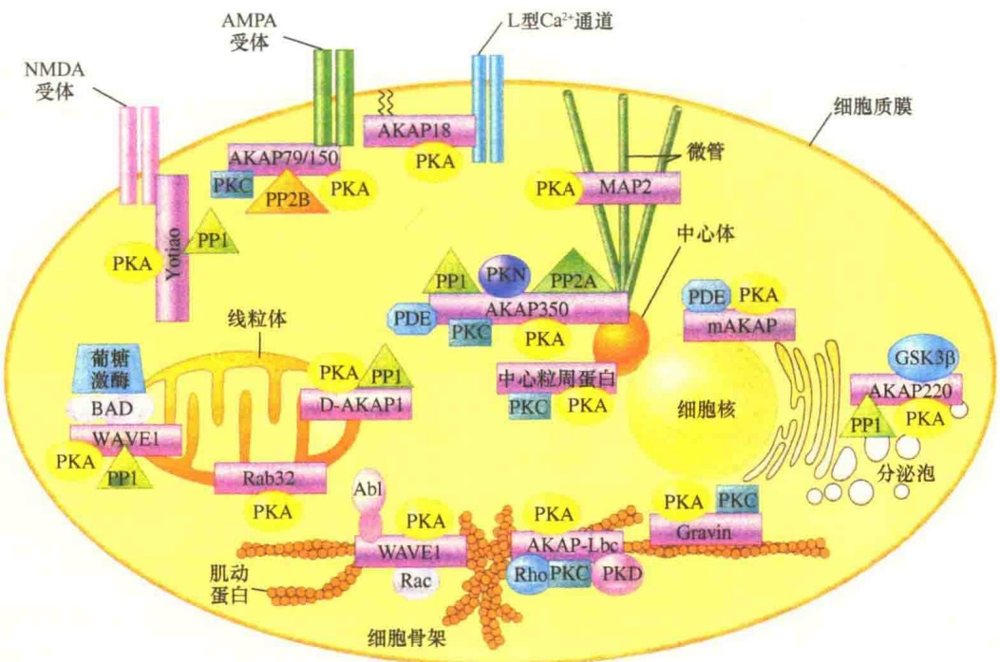
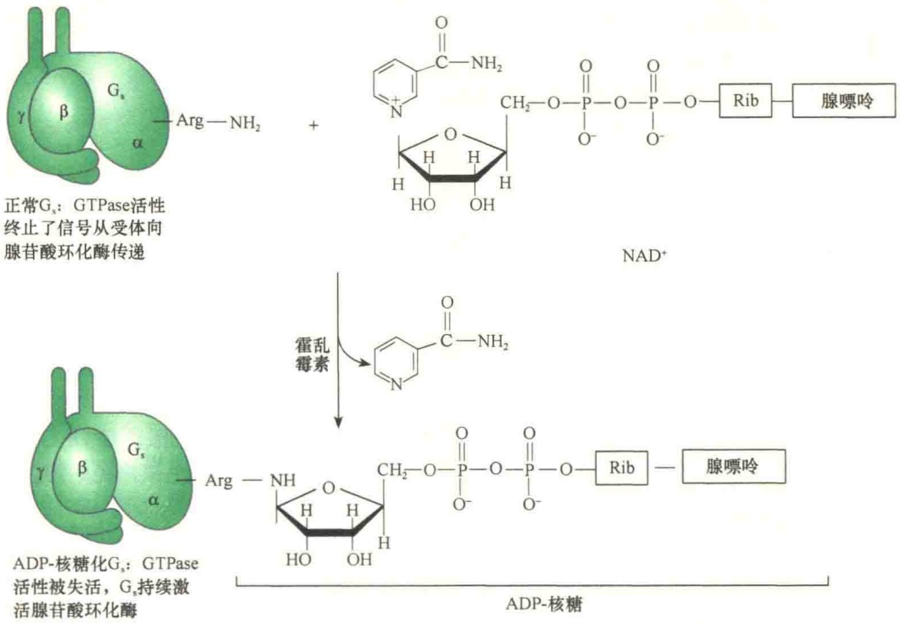
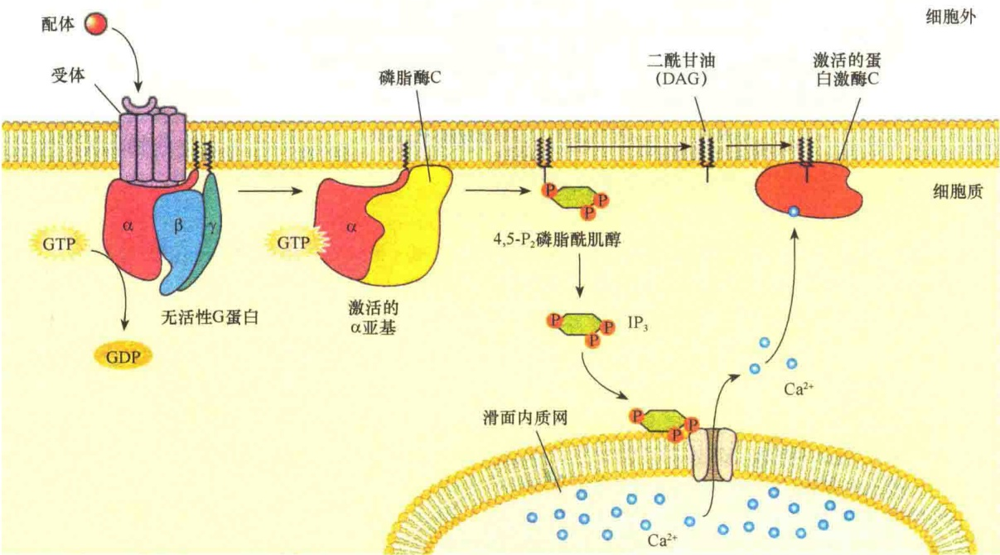
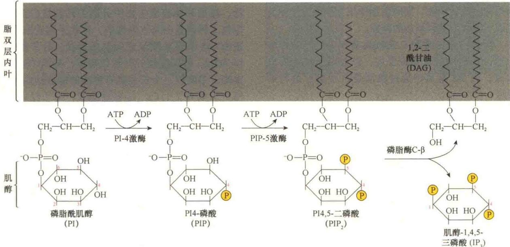

图 5-29 AKAP 组成通讯复合物启动细胞内亚细胞区室进行 PKA 系统的应答（引自 Karp，2010）。在这一机制中 AKAP 起支架作用，它将 PKA、PKA 的作用底物及磷酸酶都结合在同一个复合物中，既方便快速启动反应，又可快速使激酶失活。图中横式棒状结构是不同的 AKAP。

图 5-30 霍乱毒素对 G 蛋白活性的影响（引自 Nelson and Cox，2013）。

糖化了的亚基不能进行 GDP-GTP 的交换，从而阻断了  $G_{i\alpha}$  对腺苷酸环化酶的抑制，同样会引起 cAMP 的过量产生。百日咳杆菌通过呼吸道感染，在呼吸道中破坏了纤毛状上皮细胞（该细胞的正常功能是清除黏液）。如果没有了这种纤毛细胞的作用，就必须通过严重的咳嗽来清理呼吸道。至于 G 蛋白缺陷是如何杀死纤毛细胞的，目前尚不清楚。

## 5.2.3 PKC系统的信号转导机制

在 G 蛋白偶联系统的信号转导中，除了以 cAMP 作为第二信使外，某些信号分子作用于受体后，可产生磷脂酰肌醇作为第二信使，故此称为磷脂酰肌醇信号途径（phosphatidylinositol signal pathway）。

在这一信号转导途径中，膜受体与其相应的第一信使分子结合后，激活膜上的Gq蛋白（G蛋白的一种），然后由Gq蛋白激活磷脂酶C-β (phospholipase C-β, PLC-β), 将膜上的磷脂酰肌醇二磷酸 (phosphatidylinositol biphosphate, $\mathrm{PIP}_2$) 分解为两个细胞内的第二信使: 二酰甘油 (diacylglycerol, DAG) 和肌醇三磷酸 (inositol triphosphate, $\mathrm{IP}_3$ )。$\mathrm{IP}_3$ 动员细胞内钙库释放 $\mathrm{Ca}^{2+}$ 到细胞质中与钙调蛋白结合, 随后参与一系列的反应; 而 DAG 在 $\mathrm{Ca}^{2+}$ 的协同下激活蛋白激酶 C (protein kinase C, PKC), 然后通过蛋白激酶 C 引起级联反应进行细胞的应答。该通路也称 $\mathrm{IP}_3$ 、DAG、$\mathrm{Ca}^{2+}$ 信号通路, 或称 PKC 系统 (protein kinase C system) (图 5-31)。

图 5-31 激活蛋白激酶 C 的 PIP₂ 信号途径（引自 Plopper，2016）。

## 5.2.3.1 作用于PKC途径的信号、受体、G蛋白与效应物

如同 cAMP 信号转导途径，磷脂酰肌醇信号转导系统也是由三个膜蛋白组成:与 Gq 蛋白偶联的受体、Gq 蛋白和效应物。Gq 蛋白也是异源三体，其  $\alpha$  亚基上具有 GTP/GDP 结合位点，作用方式与 cAMP 系统中的 G 蛋白完全相同。该系统的效应物是磷脂酰肌醇特异的磷脂酶 C- $\beta$  (phosphatidylinositol-specific phospholipase C- $\beta$ , PI-PLC- $\beta$ )，此处的  $\beta$  表示磷脂酶 C 的一种异构体。

作用于 PKC 系统的信号种类很多，包括乙酰胆碱、 $\alpha_{1}$ -肾上腺素类似物、肾上腺素激动剂、血管生成素（angiogenin）、血管紧张素（angiotensin）、组胺、血小板衍生生长因子、加压素（vasopressin）等。

## 5.2.3.2 第二信使的产生

磷脂酰肌醇信号途径的关键反应是  $PIP_{2}$  水解成两种第二信使: $IP_{3}$  和 DAG。由于该途径中的关键酶——蛋白激酶 C 的激活是 DAG 和  $Ca^{2+}$  共同作用的结果，所以  $Ca^{2+}$  是该途径的第三种信号分子，基本过程包括磷脂酶 C- $\beta$  的激活、 $IP_{3}/DAG$  的生成、 $Ca^{2+}$  的释放。

1）磷脂酶 C-β 的激活 磷脂酶 C-β 相当于 cAMP 系统中的效应物腺苷酸环化酶，也是膜整合蛋白，它的活性受 Gq 蛋白调节。当信号分子识别并与受体结合后，使受体激活。激活的受体由于构型的改变，细胞质面结构域与 Gq 蛋白结合，从而将 Gq 蛋白的亚基激活。激活的 Gq 蛋白 α 亚基上发生 GTP 与 GDP 的交换并导致结合有 GTP 的 α亚基从 Gq 蛋白上释放出来，激活的 Gq 的  $\alpha$  亚基通过扩散与磷脂酶 C- $\beta$  接触，并将磷脂酶 C- $\beta$  激活。

2）第二信使 $\mathrm{IP}_3 / \mathrm{DAG}$ 的生成 被激活的磷脂酶 C- $\beta$  水解质膜上的  $PIP_{2}$ ，产生  $IP_{3}$  和 DAG（图 5-32），这两种小分子具有第二信使作用，将细胞外的信号进一步放大。

图 5-32 磷脂酶 C- $\beta$  催化  $PIP_{2}$  水解生成 DAG 和  $IP_{3}$ （引自 Lodish et al., 2013）。 $PIP_{2}$  是质膜上磷脂酰肌醇（phosphatidylinositol, PI）的衍生物，由 PI 激酶将 PI 磷酸化，生成 PIP，然后由 PIP 激酶将 PIP 进一步磷酸化，生成  $PIP_{2}$ 。激活的磷脂酶 C- $\beta$  将  $PIP_{2}$  降解成  $IP_{3}$  和 DAG。

3）$\mathrm{IP}_{3}$ 启动第二信使 $\mathrm{Ca}^{2+}$ 的释放 由 $\mathrm{PIP}_{2}$ 水解后产生的 $\mathrm{IP}_{3}$ 是水溶性的小分子，它可以离开质膜并迅速在胞质溶胶中扩散。$\mathrm{IP}_{3}$ 与内质网膜上特异的 $\mathrm{IP}_{3}$ 受体结合，使 $\mathrm{IP}_{3}$-闸门 $\mathrm{Ca}^{2+}$ 释放通道打开，使 $\mathrm{Ca}^{2+}$ 从内质网中释放出来，导致细胞内 $\mathrm{Ca}^{2+}$ 浓度瞬间增高。释放出的 $\mathrm{Ca}^{2+}$ 作为第二信使能够引起许多不同的细胞反应。最直接的作用有两个:第一是协同 DAG 激活蛋白激酶 C；第二是 $\mathrm{Ca}^{2+}$ 与钙调蛋白结合引起细胞的其他反应。

内质网上的  $IP_{3}$  受体是一种由分子质量为 260kDa 的糖蛋白组成的同质四聚体，4 个亚基组成一个穿膜的通道，每个亚基都有  $IP_{3}$  结合的位点，当 3～4 个位点被  $IP_{3}$  占据时，受体复合物构型发生改变，打开离子通道，储藏在内质网中的  $Ca^{2+}$  随即释放，进入胞质溶胶。

## 5.2.3.3 蛋白激酶C的激活

第二信使 cAMP 的作用对象是 cAMP 依赖性的蛋白激酶 A，而第二信使  $IP_{3}/DAG$  的信号级联反应则要通过蛋白激酶 C（PKC），所以由  $IP_{3}/DAG$  进行的信号转导又称为 PKC 途径。这一途径中的关键步骤是磷脂酶 C 的激活。

蛋白激酶C的激活涉及一系列复杂的反应过程，是三种第二信使共同作用的结果。蛋白激酶C在非活性状态下是水溶性的，游离存在于胞质溶胶中，激活后成为膜结合的酶。蛋白激酶C的激活是脂依赖性的，需要膜脂DAG的存在，同时又是 $Ca^{2+}$ 依赖性的，需要胞质溶胶中 $Ca^{2+}$ 浓度的升高。当DAG在质膜中出现时，胞质溶胶中的蛋白激酶C被结合到质膜上，然后在 $Ca^{2+}$ 的作用下被激活。

细胞质膜中的磷脂酶 C 被 Gq 蛋白激活后水解  $PIP_{2}$  生的 DAG 是脂溶性的，一直处于质膜中，为蛋白激酶 C 与质膜的结合提供了结合位点。而  $IP_{3}$  生成后进入胞质溶胶，并作为内质网膜中  $Ca^{2+}$  通道的配体与配体闸门通道结合，将  $Ca^{2+}$  通道打开， $Ca^{2+}$  从内质网中释放出来，为蛋白激酶 C 的激活创造了另一个必要的条件。

## 5.2.3.4 蛋白激酶C的作用

蛋白激酶 C 是一个家族或一类相关蛋白的总称，其中有些仅有第二信使（如 DAG）就可以被激活，有些则需要同时有  $Ca^{2+}$  作为辅助因子才能被激活，这就是名称中 C 的含义。

蛋白激酶 C 是将靶蛋白的丝氨酸和苏氨酸残基磷酸化的酶，如同蛋白激酶 A，蛋白激酶 C 也是属于多功能丝氨酸和苏氨酸激酶。

细胞内的蛋白激酶 C 有多种异构体，在细胞内有不同的组织定位、不同的靶蛋白，以及不同的作用。它们的靶蛋白包括细胞骨架蛋白、酶等，参与生化反应的调控，同时也能作用于细胞核中的转录因子，参与基因表达的调控。

因此，蛋白激酶 C 家族具有十分广泛的细胞功能，影响神经脊免疫反应，以及调节细胞的分裂等。表 5-8 是某些通过激活蛋白激酶 C 进行的反应。

表 5-8 不同组织中通过诱导细胞质中 ${\mathrm{{Ca}}}^{2 + }$ 浓度提高引起细胞反应

| 靶组织 | 信号分子 | 细胞反应 |
| --- | --- | --- |
| 胰腺 | 乙酰胆碱 | 消化酶的分泌(如淀粉酶、胰蛋白酶原) |
| 腮(唾液)腺 | 乙酰胆碱 | 淀粉酶的分泌 |
| 血管或胃平滑肌 | 乙酰胆碱 | 收缩 |
| 肝 | 加压素 | 糖原转变成葡萄糖 |
| 血小板 | 凝血酶 | 凝血 |
| 肥大细胞 | 抗原 | 组胺分泌 |
| 成纤维 | 肽生长激素 | DNA合成,细胞分裂 |

## 5.2.3.5 第二信使 $\mathrm{Ca^{2+}}$ 及 CaM 蛋白激酶的作用

由  $IP_{3}$  动员释放到细胞内的  $Ca^{2+}$  作为第二信使，除了参与蛋白激酶 C 的激活以外，还可以与钙调蛋白结合，将钙调蛋白激活后进一步激活 CaM 蛋白激酶，激活 CaM 蛋白激酶在细胞的生命活动中具有重要作用，包括细胞分裂、分泌活动、内吞作用、受精、突触传递、代谢及细胞运动。

在静息状态的细胞中，$\mathrm{Ca^{2+}}$ 浓度通常维持在非常低的水平。之所以如此，主要是因细胞质膜及内质网膜中钙泵的作用。质膜中的钙泵将钙离子输出到细胞外，而内质网膜中的钙泵将钙离子输入到内质网的腔。除了钙泵以外，某些细胞的质膜中还有$\mathrm{Na^{+}-Ca^{2+}}$ 交换泵，将$\mathrm{Na^{+}}$ 输入到细胞质，而将$\mathrm{Ca^{2+}}$ 从胞质溶胶中输出；此外，线粒体膜也能将钙离子运输到线粒体基质。对于大多数处于静息状态的细胞，通过钙泵的作用，可以将细胞质中的$\mathrm{Ca^{2+}}$ 浓度维持在大约$1\times10^{-4}\mathrm{mmol/L}$。

1) 钙调蛋白 $\mathrm{Ca^{2+}}$ 能够作用的效应物有很多不同的类型。依据细胞的不同, 钙能够激活或抑制不同的酶或运输系统, 改变膜的离子通透性, 诱导膜的融合, 或者改变细胞骨架的结构和功能。钙离子的这些功能并不是通过自身的直接作用, 而是通过与一些钙结合蛋白（calcium-binding protein）的结合，其中有一种钙结合蛋白叫做钙调蛋白（calmodulin, CaM）。

钙调蛋白只存在于真核生物中，从不同的动物、植物和真核微生物中分离的钙调蛋白都非常相似。钙调蛋白是水溶性的，存在于胞质溶胶中，是由148个氨基酸组成的单条多肽，分子质量为16.7kDa。钙调蛋白的外形似哑铃，有两个球形的末端，中间被一个长而富有弹性的螺旋结构相连，每个末端有2个 $Ca^{2+}$ 结合结构域，每个结构域可以结合一个 $Ca^{2+}$ ，这样，一个钙调蛋白可以结合4个 $Ca^{2+}$ ，钙调蛋白与 $Ca^{2+}$ 结合后的构型相当稳定。在非刺激的细胞中，钙调蛋白与 $Ca^{2+}$ 结合的亲和力很低，然而，如果由于刺激使细胞中 $Ca^{2+}$ 浓度升高时， $Ca^{2+}$ 与钙调蛋白结合形成钙-钙调蛋白复合物（calcium-calmodulin complex），就会引起钙调蛋白构型的变化，增强了钙调蛋白与许多效应物结合的亲和力。

2）$\mathrm{Ca^{2+}}$ /钙调蛋白复合物的信号放大作用 在不同的细胞中，$\mathrm{Ca^{2+}}$ /钙调蛋白复合物可以与蛋白激酶、cAMP磷酸二酯酶及质膜中的 $\mathrm{Ca^{2+}}$ 运输蛋白等结合。在众多的 $\mathrm{Ca^{2+}}$ /钙调蛋白的靶蛋白中，有一类特别重要的底物，称为 CaM - 蛋白激酶，这是一类依赖 $\mathrm{Ca^{2+}}$ /钙调蛋白的蛋白激酶（$\mathrm{Ca^{2+}}$ /calmodulin-dependent protein kinase, CaMK）。结合有 $\mathrm{Ca^{2+}}$ 的 $\mathrm{Ca^{2+}}$ /钙调蛋白与该酶结合，并将其激活（图 5-33）。

依赖  $Ca^{2+}$ /钙调蛋白的蛋白激酶是一个大家族，可使靶蛋白中的丝氨酸和苏氨酸磷酸化，参与很多细胞活动。例如，有一种依赖  $Ca^{2+}$ /钙调蛋白的蛋白激酶能够将肌球蛋白的轻链磷酸化，引起肌收缩。

另一些由  $Ca^{2+}$ /钙调蛋白激活的蛋白激酶，包括 CaM 家族，该家族能够磷酸化很多不同的蛋白质，包括代谢酶、离子通道及转录因子等。有一种 CaM 激酶在神经系统中特别丰富，它调节神经递质的合成与释放。此外，CaM 激酶也能磷酸化转录因子进行基因转录的调节。有趣的是，有一种 CaM 磷酸化的转录因子是 CREB，该转录因子也能被蛋白激酶 A 磷酸化，而且磷酸化的位点也相同，这说明， $Ca^{2+}$  与 cAMP 的信号传导之间有相互交叉。还有一些例子，包括  $Ca^{2+}$ /钙调蛋白对腺苷酸环化酶及磷酸二酯酶的调节、cAMP 对  $Ca^{2+}$  通道的调节等也说明  $Ca^{2+}$  与 cAMP 的细胞内信号途径是协同的。

3）植物细胞中  $Ca^{2+}$  的调节作用 在植物细