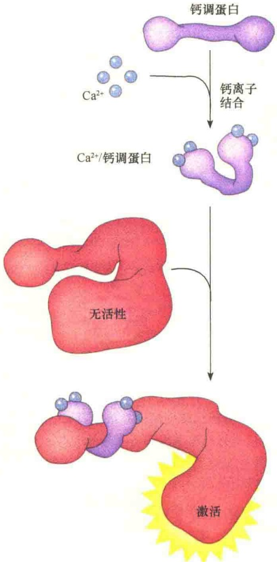
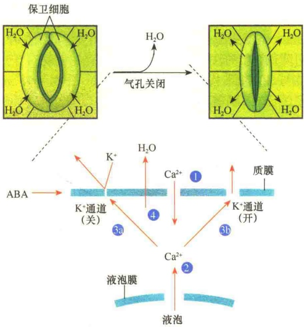
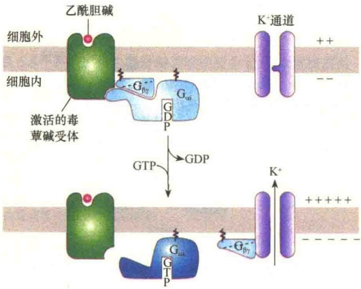
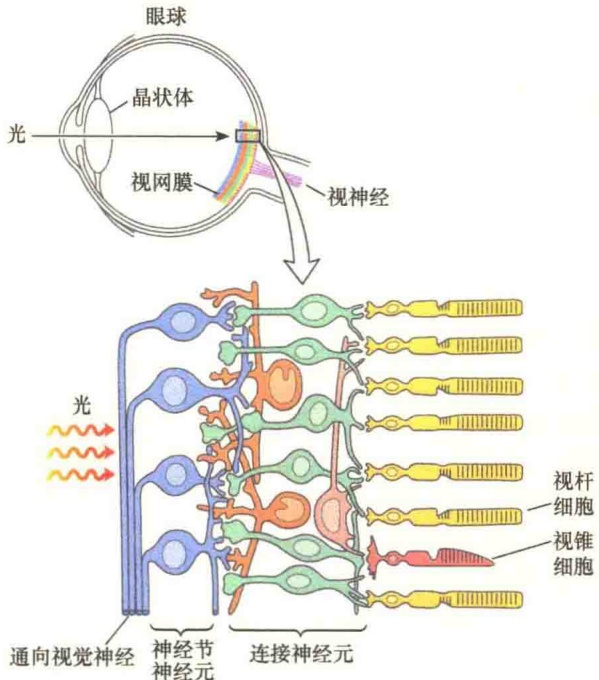
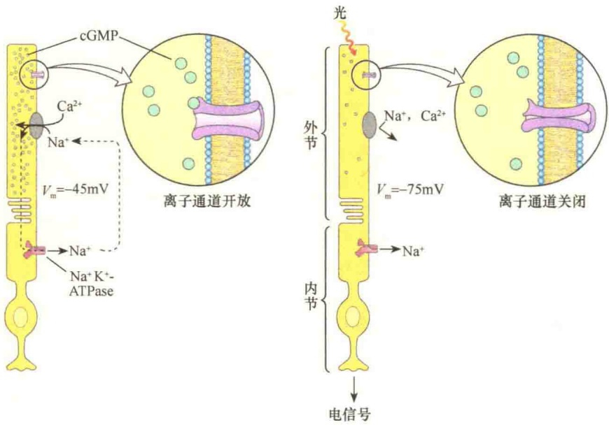
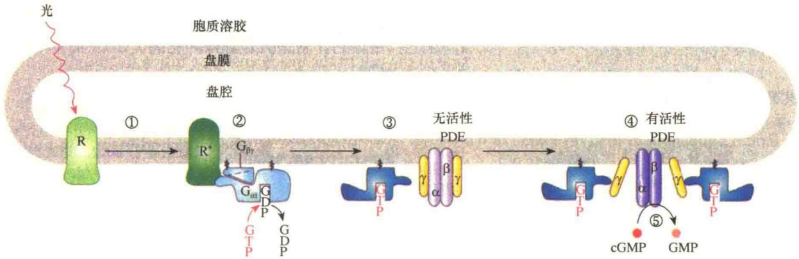
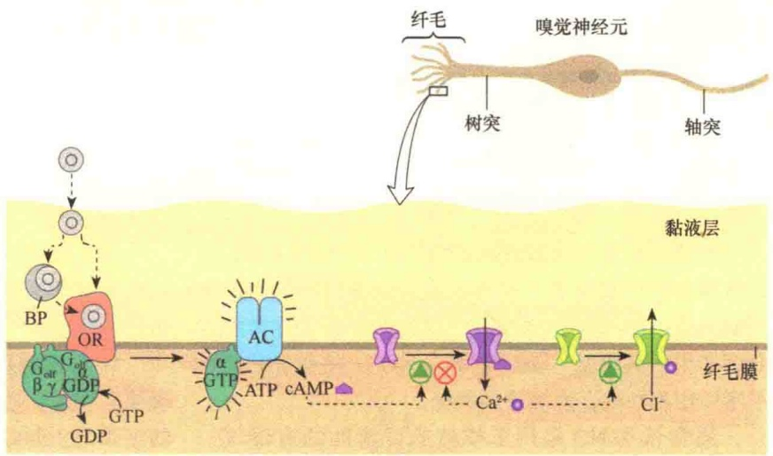
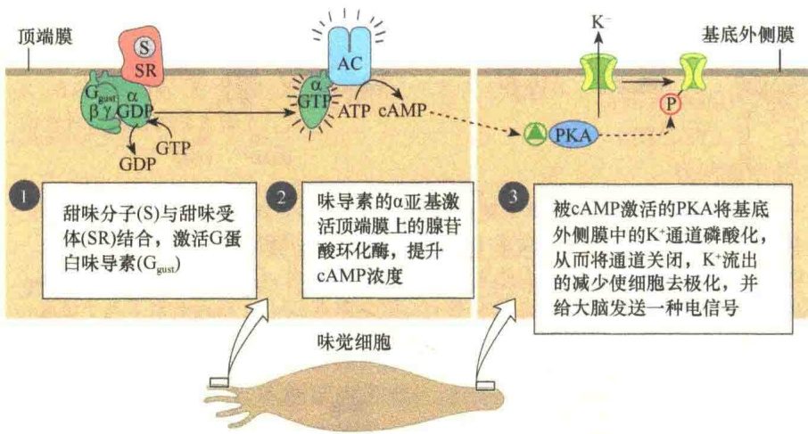

依赖 $Ca^{2+}$ /钙调蛋白的蛋白激酶

图 5-33 依赖  $Ca^{2+}$ /钙调蛋白的蛋白激酶的激活（引自 Cooper and Hausman，2013）。钙调蛋白的哑铃结构，可以结合 4 个  $Ca^{2+}$ ， $Ca^{2+}$ /钙调蛋白与非活性的  $Ca^{2+}$ /钙调蛋白依赖性的蛋白激酶结合，形成有活性的依赖  $Ca^{2+}$ /钙调蛋白的蛋白激酶。

胞中  $Ca^{2+}$  也是重要的第二信使。在光、压力、引力及各种植物激素的刺激下，植物细胞中的  $Ca^{2+}$  浓度发生急剧变化。在静息状态下，植物细胞主要是通过质膜和液泡膜中的  $Ca^{2+}$  运输泵维持胞质溶胶中的低  $Ca^{2+}$  浓度。

植物叶片中气孔直径大小的调节主要是通过$\mathrm{Ca^{2+}}$ 的第二信使作用调控的。植物叶的气孔是水分蒸发的主要部位，为了避免脱水，孔径的大小要受严格控制。当保卫细胞（guard cell）中膨压（turgor pressure）降低时，孔径缩小，而保卫细胞中的膨压降低主要是由离子浓度降低引起的。不利条件（如高温、低湿）可刺激脱落酸的释放，导致保卫细胞质膜中$\mathrm{Ca^{2+}}$通道打开。$\mathrm{Ca^{2+}}$进入胞质溶胶触发细胞内膜性细胞器中储备的$\mathrm{Ca^{2+}}$释放，提高了胞质溶胶中$\mathrm{Ca^{2+}}$浓度。胞质溶胶中的高$\mathrm{Ca^{2+}}$浓度导致质膜的$\mathrm{K^{+}}$输入通道的关闭，并打开$\mathrm{K^{+}}$输出通道（图 5-34）。这些变化的结果是  $K^{+}$  过度外流，从而使细胞的膨压下降，叶孔缩小。

图 5-34  $Ca^{2+}$  在植物叶保卫细胞关闭中的第二信使作用（引自 Karp，2010）。当脱落酸（ABA）的水平升高时，质膜中  $Ca^{2+}$  通道打开，由于  $Ca^{2+}$  的流入，导致细胞内储备的  $Ca^{2+}$  释放到胞质溶胶。结果使胞质溶胶中的  $Ca^{2+}$  浓度大大升高，最后使细胞内的  $K^{+}$ 浓度降低。由于胞质溶胶中的离子浓度降低，水分会丧失，此时立即关闭气孔。

## 5.2.4 作用于离子通道的 G 蛋白偶联受体信号转导途径

上面详细讨论了与 G 蛋白偶联的 PKA 及 PKC 信号转导途径。除此之外，还有很多其他与 G 蛋白偶联的信号途径，包括调节离子通道的 G 蛋白偶联受体、GMP 偶联受体等。

某些 G 蛋白可直接控制离子通道的通透性，一个典型的例子是通过神经递质乙酰胆碱调节心肌收缩。神经冲动是将周围环境信息，如光、气味刺激等传递到脑并引起肌肉运动的最基本反应。在神经脉冲期间，离子通道的打开与关闭可引起膜电位的变化。很多神经递质的受体是配体门控离子通道，与配体结合时打开通道。

有些神经递质的受体是 G 蛋白偶联受体，它们的效应物是  $K^{+}$ 或  $Na^{+}$ 通道。神经递质与这些受体结合，引起通道的打开或关闭，引起膜电位变化。还有一些受体，如鼻中气味受体、眼的光受体也是 G 蛋白偶联受体，经由第二信使间接修饰离子通道的活性。

## 5.2.4.1 心肌中乙酰胆碱受体经由G蛋白打开 $\mathbf{K}^{+}$ 通道

心肌细胞含有很多毒蝇碱型乙酰胆碱受体（muscarinic acetylcholine receptor），当受体被激活时，可降低心肌的收缩。此类受体与Gi蛋白偶联，当受体与 $G_{\alpha i}$ 结合时， $G_{\beta\gamma}$ 亚基与 $G_{\alpha i}$ 脱离，进而与 $K^{+}$ 通道结合，从而将 $K^{+}$ 通道打开（图5-35）。

图 5-35 毒蝇碱型乙酰胆碱受体及其心肌中的效应物  $K^{+}$ 通道的激活（引自 Lodish et al., 2013）。神经递质乙酰胆碱与心肌细胞的膜受体结合，使得 Gi 蛋白的  $\alpha i$  亚基与  $\beta\gamma$  亚基分开；激活的  $\beta\gamma$  亚基复合物与  $K^{+}$ 通道结合并将  $K^{+}$ 通道打开； $K^{+}$ 通透性改变，导致膜电位发生变化，从而降低心肌的跳动。

## 5.2.4.2 GPCR与脊椎动物眼睛的光信号转导

在脊椎动物中，通过眼睛的瞳孔进入的光被聚焦到一个高度组织化的光敏感神经元的部位（图 5-36）。光敏感神经元有两种类型:①视杆细胞（rod cell）:每个视网膜大约有 $10^{9}$ 个，它对光的敏感性较低，而且不能区别颜色；②视锥细胞（cone cell）:每个视网膜大约有 $3 \times 10^{6}$ 个，它对光不敏感，但是能够区别颜色。这两种类型的细胞都是长的、窄的、特化的感觉神经元。它们各具有两个不同的细胞区间:外侧片段，含有很多膜状的圆盘，其上有很多受体蛋白及光敏感生色团——视黄醛（retinal）；内侧片段含有细胞核，还有很多线粒体，用于产生光转导所需的 ATP。

像其他的神经元一样，杆状细胞与锥形细胞都具有膜电位（ $V_{m}$ ），是由内侧片段中的 $Na^{+}/K^{+}$ 交换泵产生的；另外，外侧片段膜中的离子通道对膜电位的建立也有贡献，它允许 $Na^{+}$ 或 $Ca^{2+}$ 通过。由于该离子通道是cGMP门控通道，在黑暗条件下，杆状细胞含有足够的 cGMP，保持通道打开，此时的膜电位由  $Na^{+}/K^{+}$  交换泵决定。

图 5-36 脊椎动物眼睛中的光受体（引自 Nelson and Cox, 2013）。晶状体将光聚焦在由多层神经元组成的视网膜上，光信号必须穿过神经节神经元、中间连接神经元，才能从光神经到达脑。

视杆及视锥细胞进行的光信号转导是基于光诱导的cGMP浓度下降，由于cGMP浓度降低，导致cGMP门控通道的关闭，从而使细胞超极化（图5-37）。

视网膜中的光受体视紫红质（rhodopsin）是G蛋白偶联受体，此系统的G蛋白（Gt蛋白）又叫转导素（transducin），是一种能够激活cGMP特异性磷酸二酯酶的G蛋白。当视紫红质中一种小分子的11-顺式视黄醛（11-cis-retinal）吸收光后，转变成反式异构体，诱导视紫红质蛋白构型的变化而活化。活化的视紫红质可激活G蛋白，并由G蛋白激活磷酸二酯酶（PDE）将cGMP水解，从而降低了细胞中cGMP的浓度。光受体细胞中cGMP水平的变化直接影响cGMP门控 $\mathrm{Na^{+}}$ 通道的通透性。在黑暗的条件下，这些通道由于cGMP的结合而保持开启。在光诱导下，由于cGMP的水解，导致cGMP的浓度降低，使得cGMP门控 $\mathrm{Na^{+}}$ 通道关闭，膜两侧的膜电位超极化（hyperpolarization），从而将光信号转变成了神经冲动，完成光信号的传递（图5-38）。

## 5.2.4.3 GPCR与嗅觉、味觉信号转导

检测气味、味道的感官细胞与视觉有共同的机制。人类能够区别 10 000 多种不同气味。气味神经元有较长的、细细的纤毛，从细胞的一端伸向覆盖在细胞上的黏膜层，这些纤毛提供了巨大的表面积与气味信号相互作用。气味刺激的受体是纤毛的膜蛋白，属于 7 次穿膜的 G 蛋白偶联受体家族成员。

图 5-37 视杆细胞的超极化（引自 Nelson and Cox，2013）。

气味刺激物通过空气扩散到达感官细胞。在覆盖有气味神经元的黏膜里，气味分子可直接与一种气味受体结合，或是先与特异的蛋白质结合，然后被转移到特异的受体（图 5-39）。

气味分子与受体的相互作用，使受体的构型发生改变，结果发生了与G蛋白结合的GDP被GTP替换，与气味受体偶联的是 $G_{olf}$ 蛋白。激活的 $G_{olf}$ 蛋白将纤毛膜的腺苷酸环化酶激活，并将ATP催化生成cAMP。cAMP将纤毛膜中的cAMP门控 $Na^{+}$ 和 $Ca^{2+}$ 通道打开。由于 $Na^{+}$ 和 $Ca^{2+}$ 的流入，产生轻微的去极化，或称受体电位（receptor potential）。如果有足够数量的气味分子作用于受体，则受体电位越来越强，并促使神经元产生动作电位。随后通过几个不同阶段转移到脑并作为特殊气味进行注册。整个过程在100～200ms内完成。

图 5-38 光激活的视紫红质途径（引自 Lodish et al., 2013）。在黑暗条件下，高浓度的 cGMP 使得 cGMP 门控离子通道打开，导致视杆细胞质膜的去极化。①在光的激发下，光受体（R）中的视紫红质异构化成为活性状态（ $R^{*}$ ）；② $R^{*}$ 与结合有 GDP 的 $G_{\alpha t}$ 结合，介导 GDP 与 GTP 的交换；③产生的 $G_{\alpha t} \cdot GTP$ 通过与 cGMP 磷酸二酯酶（PDE）的两个抑制型 $\gamma$ 亚基结合；④将 PDE 的 $\alpha\beta$ 亚基激活；⑤激活的 PDE 将 cGMP 水解成 GMP，从而关闭了离子通道，导致杆状细胞的超极化。

图 5-39 气味信号转导的机制（引自 Nelson and Cox，2013）。同心圆:气味分子；BP:气味分子结合蛋白，OR:气味分子受体；绿色三角圆:激发；叉圆:抑制。

脊椎动物对味道的感觉是舌表面味蕾中成簇的味觉神经的作用。在这些感觉神经元中，GPCR与异源三体G蛋白相偶联，这种G蛋白被称为味导素（gustducin），简写成 $G_{gust}$ 。甜味分子与甜味的味蕾结合。味导素也是通过GDP与GTP交换而激活，然后激活腺苷酸环化酶（AC）产生cAMP，继而激活蛋白激酶A，蛋白激酶A将质膜中的 $K^{+}$ 通道磷酸化，使 $K^{+}$ 通道关闭，降低 $K^{+}$ 的流出，从而使细胞去极化（图5-40），并向脑传送电信号。其他一些特异的味蕾可分别与特异的分子结合，如苦味（bitter）、酸味（sour）、咸味（salty）等，并通过不同的第二信使与离子通道进行信号转导。

图 5-40 甜味的转导机制（引自 Nelson and Cox，2013）。

体。研究表明，NO 是一种能够进入细胞直接作用于酶并引起快速反应的气体信号分子，并且与  $Ca^{2+}/cGMP$  组成信号转导通路。

## 5.2.5.1 NO的性质及形成

早在 1958 年，有人发现一种特别的突变鼠，这种突变鼠的吞噬细胞不能吞噬异常的细胞和细菌。用正常小鼠做实验，在细菌感染引起炎症的同时，分泌到尿液中氮的含量升高，而用突变小鼠做实验则没有此反应。当时对于为什么炎症会引起尿液中氮含量升高的原因并不清楚，后来发现培养的巨噬细胞的杀菌作用与培养基中精氨酸有关。如果没有精氨酸，巨噬细胞就不能吞噬病原体。后来很快发现精氨酸是 NO 合酶（nitric oxide synthase）的底物（图 5-41），该酶能够将精氨酸氧化成 NO，这是第一次探明 NO 是一种重要的生物分子。

## 5.2.5.2 鸟苷酸环化酶受体与第二信使 cGMP

在 NO 引起的信号反应中还涉及 cGMP 的信号作用，它是由鸟苷酸环化酶（GC）催化 GTP 生成的。

细胞内至少存在两种形式的鸟苷酸环化酶:与

细胞膜结合的膜结合型 GC 和胞质可溶型 GC。此处涉及的是细胞内水溶性的 GC，可催化 GTP 生成 cGMP（图 5-42）。而 cGMP 可作为第二信使激活依赖 cGMP 的蛋白激酶 G（cyclic GMP-dependent protein kinase G），被激活的蛋白激酶 G（protein kinase G，PKG）可使特定蛋白质的丝氨酸或苏氨酸残基磷酸化，从而引起细胞反应。cGMP 除了激活 PKG 外，也作为离子通道的配体，调节离子通道的开放与关闭。

## 5.2.5 $\mathrm{Ca^{2+}/NO / cGMP}$ 信号转导途径

早在 100 多年前就发现硝酸甘油（nitroglycerin）能够治疗心绞痛患者（这种绞痛是由血液不适当地流向心肌引起的）。现在知道，硝酸甘油能够在体内分解产生一氧化氮（nitric oxide, NO），使血管壁的平滑肌细胞松弛，血液流通顺畅。

通常认为NO是汽车排放的可溶性的有毒气

## 5.2.5.3 $\mathrm{Ca^{2+} / NO / cGMP}$ 信号途径与血管平滑肌的松弛

为了获得 NO 调节平滑肌松弛的确切证据，用乙酰胆碱作为外加信号，研究信号诱导与平滑肌松弛的机制。

将乙酰胆碱加入到围绕血管平滑肌细胞的实验体系中，将乙酰胆碱直接用于平滑肌细胞，预期的结果是引起收缩，但是将乙酰胆碱添加到少量分