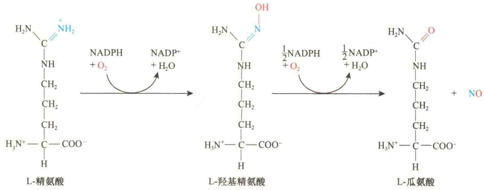
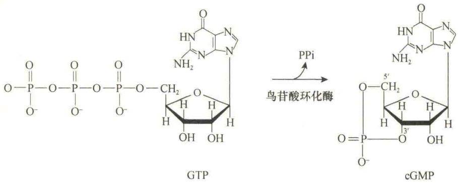
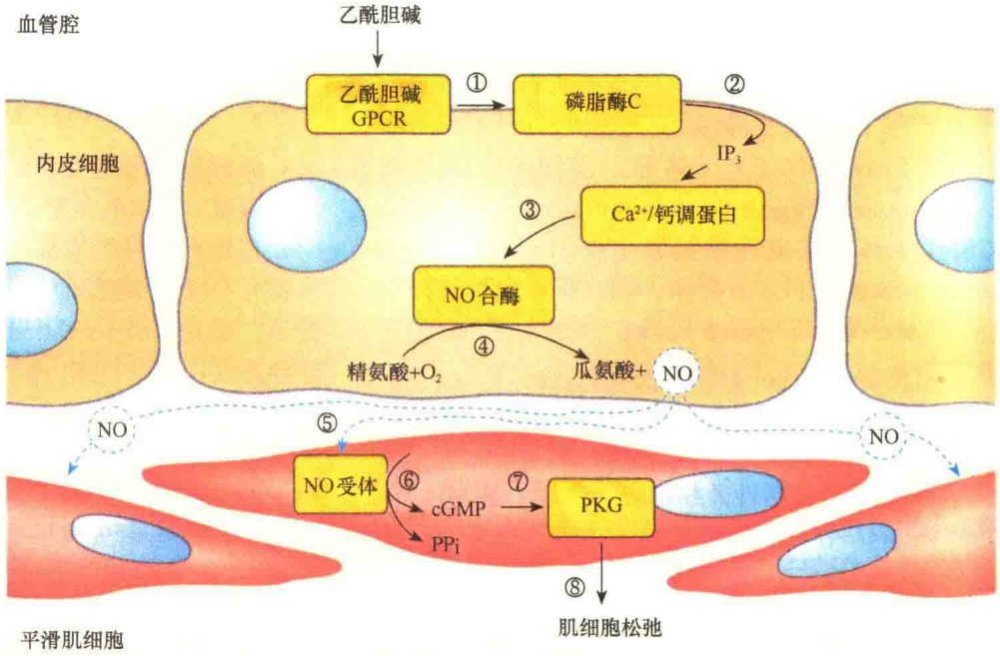
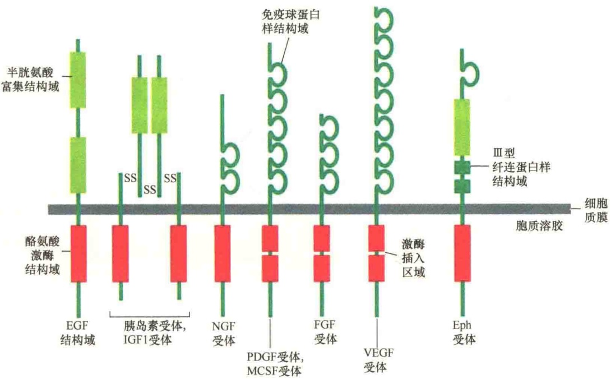
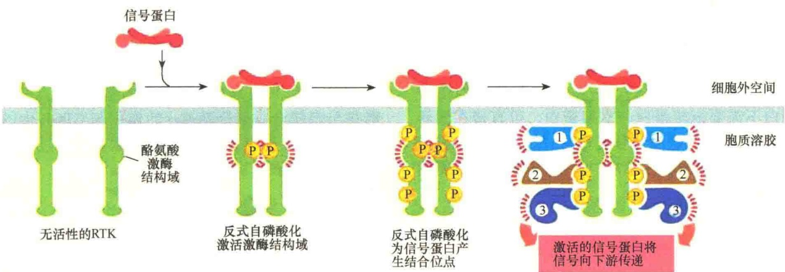
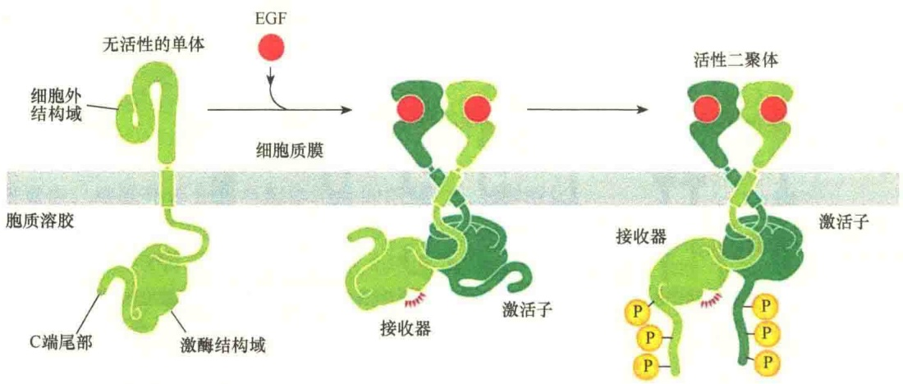
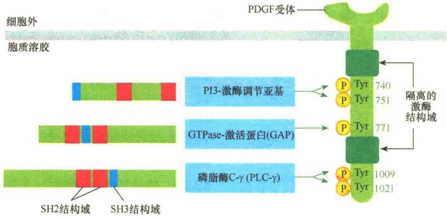

图 5-41 NO 合酶催化 NO 的形成。

图 5-42 鸟苷酸环化酶催化 GTP 生成 cGMP。

离的血管腔内，则引起了平滑肌的松弛，而不是收缩。后来的研究表明，在应答乙酰胆碱的反应中，位于血管腔中的内皮细胞释放了一些物质，这些物质能够引起肌细胞松弛。这些物质转变成了NO。

现在知道，内皮细胞含有与乙酰胆碱结合的 Go 蛋白偶联受体，与乙酰胆碱结合后能够激活磷脂酶 C，

图 5-43  $Ca^{2+}/NO/cGMP$  信号途径与动脉平滑肌的松弛（引自 Lodish et al., 2013）。①乙酰胆碱与乙酰胆碱受体结合；②激活磷脂酶 C；③产生第二信使  $IP_{3}$ ，导致细胞质中  $Ca^{2+}$  提高，激活钙调蛋白；④  $Ca^{2+}/$  钙调蛋白激活 NO 合酶，产生 NO；⑤ NO 扩散进入平滑肌；⑥ NO 与 NO 受体结合，该受体是鸟苷酸环化酶；⑦鸟苷酸环化酶催化 GTP 生成 cGMP；⑧ cGMP 激活 PKG 引起肌细胞松弛。

导致细胞质  $Ca^{2+}$  浓度的提高， $Ca^{2+}$  与钙调蛋白结合，产生的复合物激活 NO 合酶，从而产生了 NO。NO 虽然半衰期很短（2～30s），但能够进行局部扩散。实际上，NO 从内皮细胞扩散到平滑肌细胞，引起平滑肌的松弛。

NO 在内皮细胞中的作用是由第二信使 cGMP 介导的。内皮细胞中有 NO 的受

体——鸟苷酸环化酶，一旦与 NO 结合即被激活，进而催化 GTP 生成 cGMP，使细胞质中的 cGMP 浓度升高，cGMP 激活蛋白激酶 G（PKG）。在血管平滑肌中，PKG 激活一个信号途径，该途径对肌动蛋白-肌球蛋白复合物产生抑制，导致细胞松弛、血管扩张（图 5-43）。

## 5.3 酶联受体信号转导

与 G 蛋白偶联受体（GPCR）一样，酶联受体也是穿膜蛋白，细胞外部分有与配体结合的结构域。但是其细胞内结构域可以作为酶，或是与其他的一些蛋白质组成复合物后行使酶的作用。GPCR 是 7 次穿膜的受体，而酶联受体仅是一次穿膜。GPCR 与酶联受体也常常催化一些相同的信号转导途径，不过，酶联受体信号转导（signaling through enzyme-coupled receptor）的反应比较慢（通常要几小时），并且需要许多细胞内的转换步骤。

## 5.3.1 受体酪氨酸激酶信号转导的特点

受体酪氨酸激酶（RTK）是具有酪氨酸激酶活性的受体。所以，受体酪氨酸激酶既是受体又是酶，它能够与配体结合，并将靶蛋白的酪氨酸残基磷酸化。

## 5.3.1.1 作用信号与受体的结构特点

细胞外有很多通过受体酪氨酸激酶进行信号转导的信号蛋白，包括分泌的或是结合在细胞表面的蛋白质，这些信号蛋白往往控制细胞发育或是成年动物的行为。一些常见的信号蛋白及它们的受体列于表 5-9。

表 5-9 某些经由 RTK 起作用的信号蛋白

| 信号蛋白家族 | 受体家族 | 引起的代表性反应 |
| --- | --- | --- |
| 表皮生长因子(EGF) | EGF 受体 | 刺激细胞生存、生长、增殖,或分化成不同细胞类型,作为发育的诱导信号 |
| 胰岛素 | 胰岛素受体 | 刺激糖的利用与蛋白质合成 |
| 胰岛素样生长因子1(IGF1) | IGF1 受体 | 在多种类型细胞中刺激细胞生存与生长 |
| 神经生长因子(NGF) | Trk 受体 | 刺激某些神经元的生存与生长 |
| 血小板衍生生长因子(PDGF) | PDGF 受体 | 刺激各种不同类型的细胞生存、生长、增殖与迁移 |
| 巨噬细胞集落刺激因子(MCSF) | MCSF 受体 | 刺激单核细胞 / 巨噬细胞增殖与分化 |
| 成纤维细胞生长因子(FGF) | FGF 受体 | 刺激各种类型的细胞增殖,抑制某些细胞前体的分化,作为发育的诱导信号 |
| 血管内皮生长因子(VEGF) | VEGF 受体 | 刺激血管生成 |
| 肝配蛋白 | Eph 受体 | 刺激血管生成,引导细胞与轴突迁移 |

在人体中已发现60多种不同的RTK，根据结构特点，可分成约20个不同的亚家族。主要的几种类型包括:①表皮生长因子（epidermal growth factor，EGF）受体；②胰岛素（insulin）和胰岛素样生长因子1（insulin-like growth factor 1，IGF1）受体；③神经生长因子（nerve growth factor，NGF）受体；④血小板衍生生长因子（platelet-derived growth factor，PDGF）受体和巨噬细胞集落刺激因子（macrophage colony stimulating factor，M-CSF）受体；⑤成纤维细胞生长因子（fibroblast growth factor，FGF）受体；⑥血管内皮生长因子（vascular endothelial growth factor，VEGF）受体；⑦肝配蛋白（ephrin，Eph）受体等。

所有的 RTK 都是由三个部分组成的:含有配体结合位点的细胞外结构域、单次穿膜的疏水  $\alpha$  螺旋区、含有 RTK 活性的细胞内结构域（图 5-44）。

图 5-44 中所示的 RTK 结构上除了都有细胞外结构域、单次穿膜区、细胞内酪氨酸激酶结构域外，还有各自的特点:有的细胞外部分富含半胱氨酸，有些有免疫球蛋白样结构域，还有Ⅲ型纤连蛋白样结构域。细胞内结构域虽然都具有酪氨酸激酶结构域，但NGF、FGF、VEGF的酪氨酸激酶结构域被一段插入区分隔成两部分。比较特别的是胰岛素及胰岛素样受体，实际上它们是一个四聚体。

## 5.3.1.2 受体二聚化与磷酸化

细胞外信号与受体结合后如何激活 RTK 细胞质结构域的酪氨酸激酶活性呢?

在没有信号的情况下，受体是以单体存在的。当信号分子与 RTK 的细胞外结构域结合时，诱导受体二聚化（dimerization）。受体的二聚化有两种介导方式:一是直接由配体诱导，二是由结合了配体的受体介导。

1）配体介导的二聚化 早期研究发现有些与细胞生长、分化有关的因子，如血小板衍生生长因子、集落刺激因子等具有两个与受体结合的位点，当这种配体与受体结合时就会诱导配体二聚化。由于受体形成二聚体，将两个受体细胞内激酶结构域靠近在一起并相互接触而激活，被激活的激酶可以相互将酪氨酸残基磷酸化，这一过程又称反式自磷酸化（trans-autophosphorylation）。磷酸化位点可作为细胞内特异的信号蛋白的结合位点，进行下游信号转导。图 5-45 显示的是配体介导的 RTK 二聚化及反式自磷酸化。

图 5-44 动物细胞中主要的 RTK（引自 Alberts et al., 2015）。

图 5-45 配体介导的 RTK 二聚化及对 RTK 的激活（引自 Alberts et al., 2015）。

受体细胞质结构域相互磷酸化有两个效应:一是通过磷酸化，能够将受体完全激活；二是磷酸化的酪氨酸位点可以为信号蛋白提供锚定位点。

2）受体介导的二聚化 并非所有的生长因子都具有两个与受体结合的位点，并直接介导受体二聚化。有些生长因子，如表皮生长因子只能与一个受体结合，在这种情况下，与配体结合的受体通过构型的变化介导与另一个配体结合的受体二聚化，将这种二聚化称为受体介导的二聚化。图 5-46是 EGF 与受体结合后，导致受体构型发生变化，从而介导了受体的二聚化。

## 5.3.1.3 信号复合物的装配与下游途径的激活

一旦 RTK 二聚体的激酶结构域被激活，它们就会将受体细胞质结构域多个酪氨酸位点磷酸化。磷酸化的酪氨酸位点为细胞内信号蛋白提供了高亲和力的锚定位点。不同的信号蛋白都含有不同的识别结构域，识别并与 RTK 受体磷酸化的酪氨酸位点结合，装配成信号复合物（signaling complex），启动下游途径。

图 5-46 EGF 受体激酶的激活（引自 Alberts et al., 2015）。没有细胞外配体时，EGF 受体以非活性的单体存在，配体结合导致构型变化，促进了两个单体的二聚化。与其他 RTK 受体不同的是，二聚化的 EGF 受体激酶结构域没有被自我磷酸化而激活，代之的是二聚化后将细胞内的结构域调整为不对称的二聚体，其中一个激酶结构域作为激活子（activator），另一个作为接收器（receiver），激活子使接收器的构型转变成激活状态，激活的接收器将两个受体细胞质结构域的 C 端酪氨酸位点磷酸化。

可能有 10～20 种不同的细胞内信号蛋白可与激活的 RTK 结合，这些与激活的 RTK 结合的信号蛋白不仅结构不同，功能也不相同:既有酶，也有转录因子，还有衔接蛋白和支架蛋白，它们通过与激活的 RTK 装配成不同的复合物，启动不同的下游信号转导。

最为常见的一种信号复合物的装配是直接在激活的 RTK 上进行的。一些具有酶活性的信号蛋白不需要衔接蛋白与支架蛋白，可直接在激活的 RTK 上装配成酶信号复合物。例如，血小板衍生生长因子受体被激活后，其 5 个磷酸化的酪氨酸位点能够为3种信号蛋白提供锚定位点，装配成信号复合物（图5-47）。第一个锚定到受体上的细胞质酪氨酸激酶是磷脂肌醇3-激酶（phosphoinositide 3-kinase，PI3-kinase），它通过对受体740位和751位两个磷酸化的酪氨酸位点的识别而结合。第二个与激活的RTK受体结合的是GTPase激活蛋白（GTPase-activating protein，GAP），它是通过与771位酪氨酸的识别而锚定的。第三个是磷脂酶C-γ（phospholipase C-γ，PLC-γ），通过对受体1009位和1021位两个磷酸化的酪氨酸位点的识别并与之结合。磷脂酶C-γ的作用与GPCR中的PLC-β相同，激活肌醇磷脂信号途径。通过该途径，RTK能够提高细胞质中的 $Ca^{2+}$ 浓度，并激

图 5-47 含有 SH2 结构域的细胞内信号蛋白与激活的 RTK 结合（引自 Arbelts et al., 2015）。图中显示的是血小板衍生生长因子（PDGF）受体有 5 个锚定的位点，其中 3 个在激酶分隔区，2 个在 C 端的尾部。有 3 个细胞内信号蛋白识别各自磷酸化的酪氨酸位点并与之结合。数字显示的是通过重组 DNA 技术测得的受体肽链中磷酸化的酪氨酸位置。3 个细胞内信号蛋白都含有 SH2、SH3 结构域。