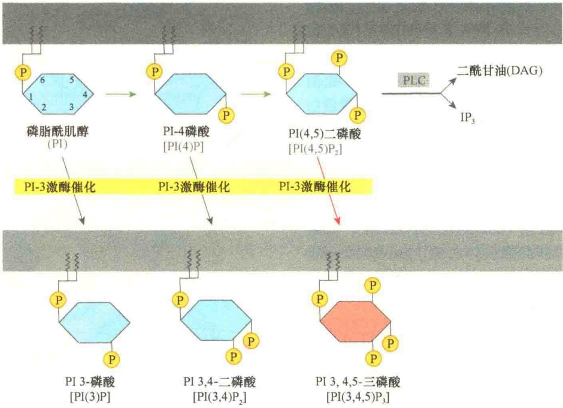
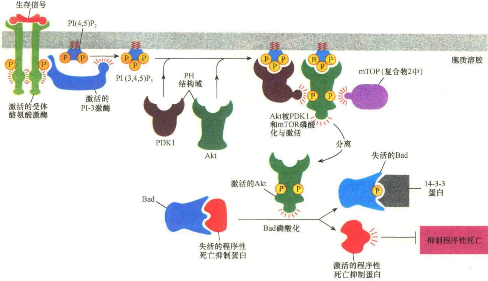
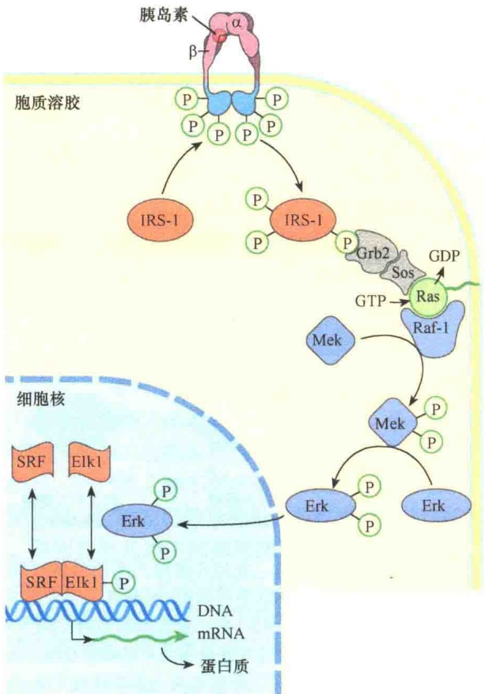
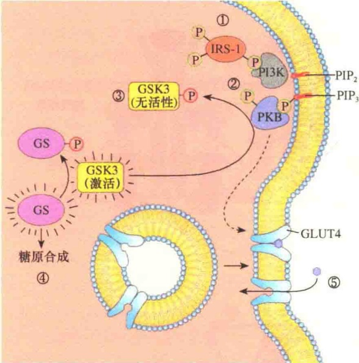
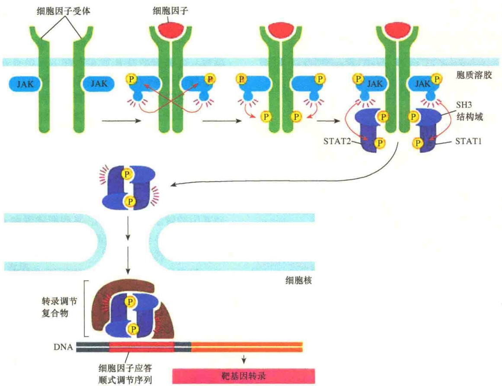

图 5-53 由 PI-3 激酶产生的磷脂酰肌醇锚定位点（引自 Alberts et al., 2015）。PI-3 激酶在肌醇环的 C3 磷酸化，可产生 PI（3）P；若在肌醇环的 C3-C4 磷酸化，可产生 PI（4,5）P₂；若在肌醇环的 C3-C5 磷酸化，可产生 PI（3,4,5）P₃，磷酸化的位点可作为信号蛋白在膜中的锚定位点。如果 PI（4,5）二磷酸未被磷酸化，则被磷脂酶 C（PLC）分解成两个第二信使（IP₃ 与 DAG），进入 PKC 的信号转导途径。

图 5-54 PI-3 激酶促进细胞生存的一种方式（引自 Alberts et al., 2015）。细胞外的一种生存信号激活了 RTK，激活的 RTK 招募并激活 PI-3 激酶。PI-3 激酶在质膜中产生 PI（3,4,5）P$_{3}$，并作为具有 PH 结构域的丝氨酸/苏氨酸型的两种蛋白激酶 Akt 与 PDK1 的锚定位点，将它们招募到质膜上。二者在质膜中相距很近，Akt 中的丝氨酸被复合物 2 中的 mTOR 激酶磷酸化；由于丝氨酸的磷酸化，导致 Akt 的构型发生变化。Akt 的构型变化后，PDK1 得以将 Akt 的苏氨酸磷酸化，从而将 Akt 激活。激活的 Akt 与质膜脱离，并磷酸化各种靶蛋白，包括 Bad 蛋白。Bad 被磷酸化后，释放出被抑制的程序性死亡抑制蛋白，从而促进细胞更好地“活下去”。

四聚体，由两个α亚基和两个β亚基通过二硫键连接成一个整体，所以，胰岛素受体没有二聚化过程。两个α亚基位于细胞质膜的外侧，其上有胰岛素的结合位点；两个β亚基是穿膜蛋白，起信号转导作用。无胰岛素结合时，受体的酪氨酸蛋白激酶没有活性。当胰岛素与受体的β亚基结合并改变了β亚基的构型后，酪氨酸蛋白激酶才被激活，激活后可催化两个反应:①使四聚体复合物的另一个β亚基中特异位点的酪氨酸残基磷酸化，这种过程称为自磷酸化（autophosphorylation）；②磷酸化的酪氨酸为胰岛素受体底物（insulin receptor substrate，IRS）提供锚定位点，并将其磷酸化，启动下游信号转导。

## 5.3.4.2 胰岛素通过 MAP 激酶级联途径调节基因表达

被胰岛素激活的受体 C 端酪氨酸自我磷酸化后，为 IRS-1 提供了锚定位点，使 IRS-1 与之结合。IRS-1 与受体结合后，被激活的受体激酶将其若干个酪氨酸残基磷酸化。磷酸化的 IRS-1 即成为一个核心将相关的信号蛋白组成复合物。其中有一条通路是通过与衔接蛋白 Grb2 结合，经由 Sos，与质膜中的 Ras 蛋白一起装配成信号复合物，被 Sos 结合的 Ras 蛋白发生构型变化，导致结合的 GDP 被 GTP 替换而激活。激活的 Ras 蛋白通过 MAP 激酶级联反应调控相关基因的表达（图 5-55）。

## 5.3.4.3 胰岛素通过PI-3激酶调节糖原合成

前面讨论了胰岛素样生长因子通过 PI-3 激酶途径（PI3-kinase pathway）调控细胞的生存与生长。实际上，被胰岛素激活的受体酪氨酸激酶磷酸化的 IRS-1 也可通过 PI-3 激酶途径参与细胞的葡萄糖吸收与糖原合成的调节。

磷脂酰肌醇3激酶（PI3K）具有SH2结构域，能够与磷酸化的IRS-1结合并被激活。激活的PI-3激酶能够将质膜中磷脂酰肌醇4,5-二磷酸（$\mathrm{PIP}_2$）进一步磷酸化，生成磷脂酰肌醇3,4,5-三磷酸（$\mathrm{PIP}_3$）。$\mathrm{PIP}_3$ 的头部朝向细胞内侧面，由于头部高度带电性，从而为蛋白激酶B（PKB）提供了结合位点，PKB与$\mathrm{PIP}_3$结合。与此同时，另一个与$\mathrm{PIP}_3$结合的磷酸肌醇依赖的蛋白激酶1（PDK1）将PKB磷酸化并将其激活，激活的PKB启动了与糖原合成相关的信号转导通路（图5-56）。激活的PKB将糖原合成酶激酶3（glycogen synthase kinase 3，GSK3）的Ser或Thr残基磷酸化，从而将 GSK3 失活。由于 GSK3 的失活，从而防止了肝细胞与肌细胞中糖原合成酶（glycogen synthase, GS）的失活，这也是胰岛素诱导糖原合成的一种机制。在肌细胞与脂肪组织中，PKB 促进网格蛋白膜泡内吞的葡萄糖转运蛋白回归细胞质膜，从而促进了细胞对葡萄糖的吸收。

图 5-55 胰岛素信号与基因表达调控（引自 Nelson and Cox，2013）。胰岛素受体（INSR）在细胞外侧有两个α亚基、两个穿膜的β亚基。胰岛素与受体α亚基结合，触发受体发生构型变化，从而导致β亚基细胞质结构域的酪氨酸残基自我磷酸化。自我磷酸化的位点招募胰岛素底物1（IRS-1），并将IRS-1磷酸化。磷酸化的IRS-1可与衔接蛋白Grb2结合并将Ras激活，这样进一步启动MAP激酶级联反应。Raf-1被Ras激活后，将Mek两个位点的丝氨酸残基磷酸化；经磷酸化激活的Mek是双特异性激酶，将Erk中的丝氨酸与酪氨酸残基磷酸化；磷酸化激活的Erk进入细胞核，调节基因表达。

## 5.3.5 其他酶联受体信号途径

以上讨论了受体酪氨酸激酶信号转导途径的特点及几个典型的例子。还有其他一些酶联受体虽然自身不具酪氨酸激酶活性，但能够借助于与之结合的酶进行自身磷酸化，如 JAK-STAT 途径；有些受体激活后具有其他的酶活性，如鸟苷酸环化酶受体；此外，还有丝氨酸/苏氨酸酶联受体。

图 5-56 胰岛素促进糖原合成及促进 GLUT4 运输蛋白对葡萄糖的转运（引自 Nelson and Cox，2013）。①被胰岛素受体磷酸化的 IRS-1 与 PI-3 激酶（PI3K）结合，并将其激活；激活的 PI-3 激酶将 PIP₂ 磷酸化生成 PIP₃；②被 PDK1（未显示）磷酸化的 PKB 与 PIP₃ 结合，从而被激活；激活的 PKB 通过将 GSK3 的丝氨酸磷酸化而将其失活；③失活的 GSK3 不能通过将 GS 磷酸化而使其失活，GS 继续保持活性；④在 GS 的作用下，糖原合成加速；⑤PKB 激发葡萄糖运输蛋白 GLUT4 从内部膜泡移向质膜，增强细胞对葡萄糖的吸收。

## 5.3.5.1 细胞因子受体激活的JAK-STAT信号途径

细胞因子（cytokine）是细胞分泌的小分子蛋白（如干扰素、白细胞介素等），能与特定细胞的表面受体结合，并引发细胞进行应答，包括细胞的分化或增殖。

细胞因子受体（cytokine receptor）是一个大家族，包括很多局部介质受体，以及某些激素（如生长素）受体，这些受体能够与称之为詹纳斯激酶（Janus kinase, JAK）的细胞质酪氨酸激酶稳定结合，它们能够磷酸化并激活叫做 STAT 的转录调节蛋白（signal transducer and activator of transcription，信号转导及转录激活蛋白）。STAT 定位于细胞质，磷酸化激活后进入细胞核行使调节基因转录的功能，所以又将 STAT 称为潜伏的转录调节蛋白。

细胞因子受体是二聚体或三聚体，并能与4个JAK（JAK1、JAK2、JAK3及Tyk）中的1个或2个成员稳定地结合。细胞因子与受体结合后，改变了排列方式，拉近了两个JAK的距离，并相互磷酸化，进而提高了酪氨酸激酶结构域的活性。磷酸化激活的 JAK 将受体细胞质尾部酪氨酸磷酸化，从而为 STAT 的结合提供了磷酸化的位点。

哺乳动物细胞中至少有6种STAT，每一种都含有一个SH2结构域，具有两个作用。第一，SH2结构域介导STAT与磷酸化的细胞因子受体结合，一旦结合，JAK立即将STAT的酪氨酸磷酸化，STAT被磷酸化后即与受体脱离；第二，SH2结构域介导两个磷酸化的STAT形成同质或异质二聚体。STAT二聚化后，通过核定位信号转移到细胞核，在细胞核中与相关的转录因子组成复合物，启动基因的转录（图5-57）。某些衔接蛋白（如Grb）也能够与受体磷酸化的酪氨酸位点结合，启动相关途径的信号转导。

已经发现有 30 多种细胞因子或激素，它们与细胞因子受体结合后，通过 JAK-STAT 途径引起细胞的各种反应。表 5-12 列出部分 JAK-STAT 途径的细胞因子及所引起的细胞应答。

## 5.3.5.2 TGF- $\beta$ 信号转导途径

转化生长因子- $\beta$ （transforming growth factor- $\beta$ , TGF- $\beta$ ）超家族是一类结构相关、分泌在细胞质中的二聚体蛋白。人类大约有33种不同的TGF- $\beta$ 蛋白，它们有些是激素，有些作为局部介质，在细胞中具有广泛的作用，包括影响细胞的发育模式、细胞的增殖和分化，以及细胞外基质的生成、细胞死亡等。在成年人体中，它们参与组织修复、免疫调节等生命活动。

TGF- $\beta$ 超家族有两个亚家族:TGF- $\beta$/活化素（activin）家族和较大的骨形态发生蛋白（bone morphogenetic protein，BMP）家族。

所有 TGF- $\beta$ 家族成员都是通过丝氨酸 / 苏氨酸酶联受体起作用，此类受体是单次穿膜，并且在细胞质部分具有丝氨酸 / 苏氨酸激酶结构域。已经鉴定了三种类型的丝氨酸 / 苏氨酸激酶受体:Ⅰ型、Ⅱ型与Ⅲ型，它们是三种不同的多肽，分子质量分别是 55kDa、85kDa 和 280kDa。

Ⅲ型受体，也叫β聚糖（β-glycan），是一种细胞表面的蛋白聚糖，属于单次穿膜糖蛋白。在三类β受体中，Ⅲ型受体最为丰富，它的作用是与合成的TGF-β结合，富集后促进TGF-β与Ⅱ型受体结合。

I型与Ⅱ型受体在细胞质膜上分别以同源二聚体存在。不同的TGF-β家族成员与特异的I型和Ⅱ型二聚体结合，并诱导它们的激酶结构域相互靠近，Ⅱ型受体将I型受体磷酸化并将其激活，最后形成有活性的四聚体受体复合物。

图 5-57 由细胞因子激活的 JAK-STAT 信号途径（引自 Alberts et al., 2015）。由于细胞因子的结合导致两个分离的受体多肽链二聚化，二聚化后可相互磷酸化，使它们完全激活。磷酸化为 STAT 的 SH2 结构域提供了结合位点。STAT 蛋白经 JAK 磷酸化后，与受体脱离，形成二聚体进入细胞核启动基因表达。

表 5-12 某些细胞外信号蛋白通过 JAK-STAT 信号途径引起的反应

| 信号蛋白 | 受体结合的JAK | 激活的STAT | 引起的反应 |
| --- | --- | --- | --- |
| 干扰素-γ(INF-γ) | JAK1,JAK2 | STAT1 | 激活巨噬细胞 |
| 干扰素-α(INF-α) | Tyk2,JAK2 | STAT1,STAT2 | 增强细胞对病毒感染的抗性 |
| 促红细胞生成素(EPO) | JAK2 | STAT5 | 刺激红细胞生成 |
| 催乳素 | JAK1,JAK2 | STAT5 | 刺激乳汁产生 |
| 生长激素(GH) | JAK2 | STAT1,STAT5 | 通过诱导IGF1的生成促进生长 |
| 粒细胞巨噬细胞集落生长因子(GMCSF) | JAK2 | STAT5 | 刺激粒细胞及巨噬细胞生长 |

研究者从突变的果蝇中鉴定到 TGF- $\beta$  受体信号途径的下游转录因子，后来从脊椎动物中也鉴定到与果蝇相关的转录因子，此类因子被命名为 Smad 因子，如同 STAT 因子，在没有活性时存在于细胞质中，激活后被转移到细胞核参与基因转录调控，所以，Smad 因子也是隐蔽性的转录因子。

在 TGF- $\beta$  信号转导途径中，有三种类型的 Smad 蛋白，分别行使不同的作用:①受体调节的 Smad（receptor-regulated Smad，R-Smad），包括

Smad2 和 Smad3；② co-Smad，如 Smad4；③抑制型 Smad（inhibitory Smad，I-Smad）。

I 型受体被磷酸化激活后立即与 R-Smad 结合并将其磷酸化，被磷酸化的 R-Smad 与受体脱离，并与 co-Smad（Smad4）结合，Smad4 能够与任何 R-Smad 结合成复合物。Smad 复合物进入细胞核启动相关基因的转录（图 5-58）。

完成了基因转录的 Smad 在细胞核内经过脱磷酸可重新回到细胞质，参与下一轮的信号转导。所以 Smad 能够在细胞质与细胞核之间来回穿梭，进