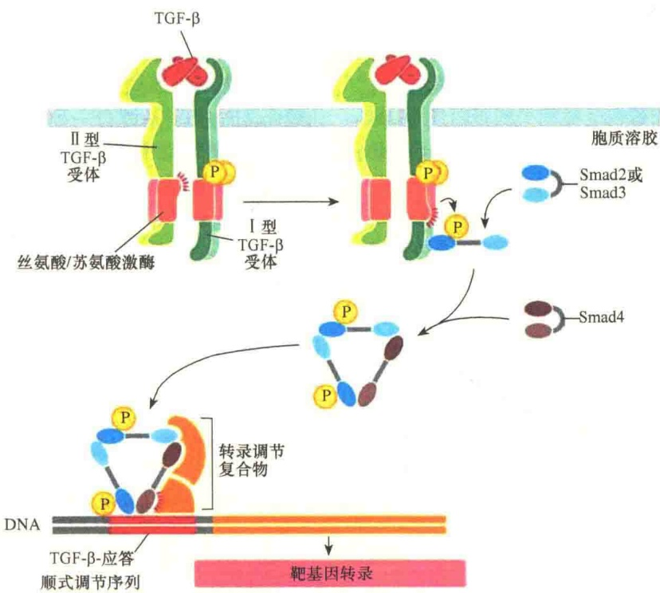
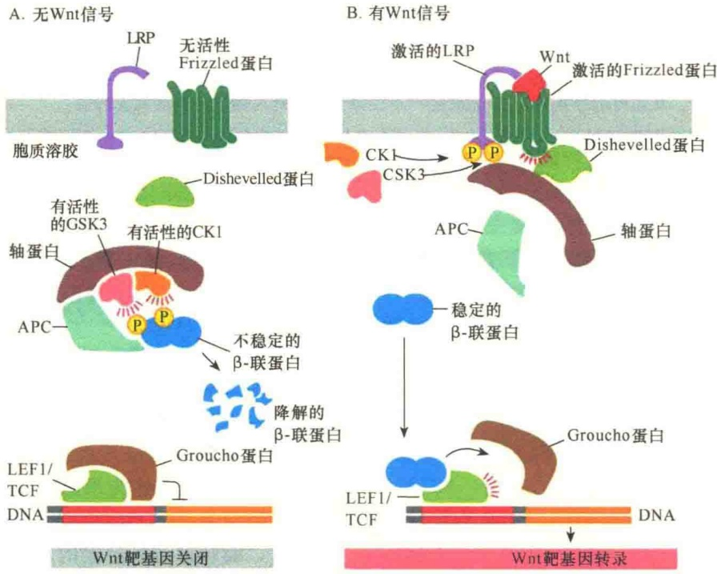
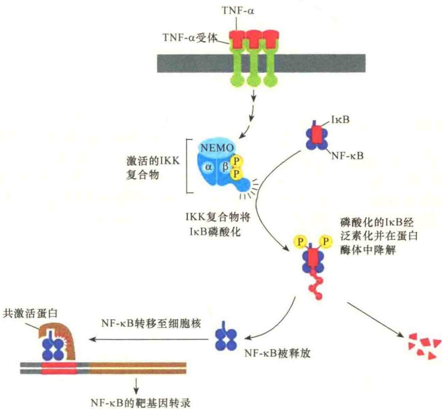
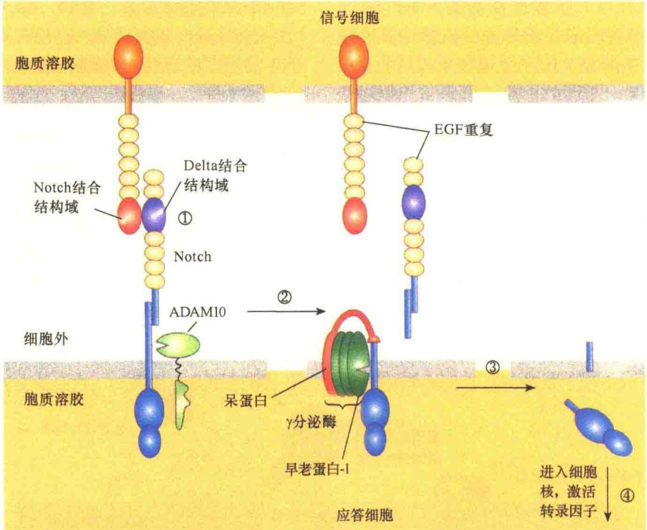

图 5-58 由 TGF- $\beta$ 激活的 Smad 依赖性信号转导（引自 Alberts et al., 2015）。在 TGF- $\beta$ 的作用下，I 型和 II 型两个受体二聚体装配成一个四聚体。II 型的二聚体受体将 I 型的二聚体受体的一个特异性位点磷酸化，从而为 Smad2 或 Smad3 的结合提供了位点。当结合的 Smad 被磷酸化后，暴露出可二聚化的面，从而有利于同 Smad4 装配成一个三体复合物进入细胞核调控基因转录。

行特定基因的转录调控。穿梭持续时间的长短取决于信号的强度。

虽然丝氨酸/苏氨酸受体激酶主要是通过Smad途径进行信号转导，但也可以刺激其他的激酶，如MAP激酶、PI-3激酶信号途径。反过来，其他信号途径中信号蛋白也能够磷酸化Smad蛋白，影响Smad信号途径。

## 5.4 其他形式的信号途径

总体来说，细胞信号转导引起的细胞效应可分为短期效应与长期效应。短期效应主要是生化反应；长期效应是通过基因表达的调控，产生对发育、分化等方面的影响。我们按通常的习惯讨论了G蛋白偶联受体、酶联受体（主要是RTK）、离子通道偶联受体的一些典型信号途径。由于细胞信号转导的复杂性，本部分讨论一些比较特殊的信号转导途径。

## 5.4.1 通过泛素化控制的信号途径

我们讨论过的信号途径都是可逆的，或者细胞外的信号一旦解除信号反应随之终止。但还有一些信号途径是不可逆的，即使可逆，速度也非常慢，因为必须通过泛素化的作用将信号蛋白降解或切割后才能结束，所以速度非常慢。Wnt、Hedgehog 和 NF- $\kappa$ B 等都是通过泛素化控制的信号途径。

## 5.4.1.1 Wnt/β-联蛋白信号途径

Wnt 蛋白是细胞分泌的信号分子。研究表明 Wnt 作为局部介质和形态发生素，在很多动物细胞中影响细胞的一些发育行为。人们分别在果蝇和小鼠中发现了 Wnt 蛋白:在果蝇中由 Wingless（Wg）基因编码，作为形态发生素，影响翅的发育；小鼠中由 Int1 基因编码，当有病毒基因与其整合时，能够促进乳腺癌的发生。Wnt 蛋白并非都是分泌蛋白，因其 N 端有一个共价结合的脂肪酸链，增加了 Wnt 蛋白与细胞质膜结合的机会，但限制了 Wnt 蛋白的作用范围。在人体内已发现 19 种 Wnt 蛋白，虽然它们具有不同的功能，但常常交叉重叠。

Wnt 蛋白至少有两条细胞内的信号通路。第一条是 Wnt/β-联蛋白（β-catenin）途径，该途径主要与隐蔽性转录调控因子 β-联蛋白相关；第二条是平面极性途径（planar polarity pathway）。这两条途径都涉及 Wnt 蛋白与 Frizzled 受体结合。

Wnt 蛋白通过两种细胞表面受体蛋白起作用:一种是 Frizzled（Fz）蛋白，这是一种含有 7 个穿膜 α 螺旋的受体蛋白，可直接与 Wnt 蛋白结合；另一种是与低密度脂蛋白受体相关的蛋白质（LDL-receptor-related protein，LRP），该蛋白质协助 Frizzled 蛋白起受体作用，是一种辅助受体（co-receptor）。

Wnt/β-联蛋白途径是通过调节多功能的β-联蛋白的酶解起作用的。β-联蛋白是细胞黏附结构的组成部分，维持细胞的黏附。如果没有Wnt信号，细胞质中的β-联蛋白则要被快速降解。β-联蛋白的降解要依靠一个大的降解复合物，复合物中除了结合的β-联蛋白外，至少还有另外4个蛋白质。第一个是酪蛋白激酶1（casein kinase 1，CK1），它能够将β-联蛋白的丝氨酸磷酸化；第二个是糖原合成酶蛋白激酶3（GSK3），它能将β-联蛋白进一步磷酸化。β-联蛋白经过CK1和GSK3磷酸化后被泛素化，并在蛋白酶体中被快速降解。复合物中另两个蛋白质都是支架蛋白，支持复合物的组成。其中一个叫轴蛋白（axin），是主要的支架蛋白；另一个是 APC 蛋白。此处的 APC 与细胞周期后期的 APC 的含义是不同的，此处的 APC（adenomatous polyposis coli）是源自一种良性瘤（腺瘤）结肠突变基因的产物，而细胞周期 APC 则是促后期复合物（anaphase-promoting complex）。

当有 Wnt 信号时，Wnt 信号可通过与受体 Frizzled 及辅助受体 LRP 结合从而抑制降解 β-联蛋白复合物的组装:经 Wnt 信号激活的受体复合物能够招募 Dishevelled 蛋白与受体结合，并将受体激活，与此同时，招募 CK1、GSK3 两种蛋白激酶将 LRP 磷酸化并将其激活。接着，将支架蛋白——轴蛋白招募到激活的受体复合物上并与 Dishevelled 蛋白结合，使轴蛋白失去支架作用。由于轴蛋白失去支架作用，另一个支架蛋白 APC 也同时失去支架作用，这样，导致将 β-联蛋白磷酸化并降解的复合物也就无法组装。安全稳定的 β-联蛋白就可以进入细胞核调节相关基因的转录（图 5-59）。

图 5-59 Wnt/β-联蛋白信号途径（引自 Alberts et al., 2015）。A. 无 Wnt 信号时，未与细胞结合的 β-联蛋白与轴蛋白、APC、有活性的 CK1、GSK3 形成一个复合物，导致 β-联蛋白被泛素化并在蛋白酶体中被降解，而 β-联蛋白应答基因仍被抑制物所抑制。B. 当 Wnt 信号与受体蛋白 Frizzled 及 LRP 结合后，将辅阻遏物结合在一起，抑制了 β-联蛋白的降解，β-联蛋白则可参与相关基因转录的调控。

## 5.4.1.2 依赖于NF- $\kappa \mathrm{B}$ 的信号途径

NF- $\kappa$ B 蛋白是大多数动物细胞中的隐蔽性转录调节蛋白，参与很多应激、炎症及先天免疫反应。NF- $\kappa$ B 蛋白在动物细胞发育中也有重要作用。

例如，果蝇中的 NF- $\kappa$ B 蛋白成员 Dorsal 蛋白在果蝇胚胎发育过程中对于背腹轴的发育具有特别重要的作用。

在动物细胞中有很多细胞表面受体参与NF-κB的信号反应途径。果蝇中的Toll受体、脊椎动物中的Toll样（Toll-like）受体都能够识别病原菌并激活NF-κB信号途径进行免疫应答。脊椎动物中的细胞因子，如肿瘤坏死因子α（tumor necrosis factor α，TNFα）及白细胞介素-1（interleukin-1，IL-1）受体也都能激活NF-κB信号途径，这些细胞因子在诱导炎症应答中具有重要作用。Toll、Toll样、IL-1受体属于相同的蛋白家族，TNF则属于不同的家族，但是，它们对于NF-κB的反应方式基本相同。当它们被激活时，引起多个蛋白质的泛素化，并通过磷酸化级联反应，从抑制蛋白质复合物中将NF-κB蛋白释放出来。被释放的 NF- $\kappa$ B 蛋白转移到细胞核，在那里启动几百个参与炎症与免疫反应相关的基因转录。

哺乳动物细胞中有5种NF-κB蛋白（RelA、RelB、c-Rel、NF-κB1、NF-κB2），它们能够形成多种不同的同质或异质二聚体，每一种二聚体能够激发一套特异的基因转录。在没有被激活的细胞中，NF-κB蛋白二聚体与抑制型的κB，即IκB，紧紧地结合在一起，保持非活性状态。哺乳动物中有三种类型的IκB（IκBα、IκBβ、IκBε）。NF-κB信号途径则是激发IκB的磷酸化、泛素化，最终被降解后释放出NF-κB二聚体（图5-60）。

图 5-60 TNF-$\alpha$ 对 NF-$\kappa$ B 途径的激活（引自 Alberts et al., 2015）。TNF-$\alpha$ 及其受体都是三聚体。TNF-$\alpha$ 的结合引起受体细胞质结构域的尾部发生重排，此时会招募一些信号蛋白，激活一些蛋白激酶及 I$\kappa$ B 激酶（IKK）。IKK 是由两个激酶亚基（IKK$\alpha$、IKK$\beta$）和一个调节亚基（NEMO）组成的异源三聚体。然后，IKK$\beta$ 将 I$\kappa$ B 的两个丝氨酸位点磷酸化，作为泛素化的标记，最后在蛋白酶体中被降解。释放的 NF-$\kappa$ B 进入细胞核，参与靶基因的转录调控。

## 5.4.1.3 Notch/Delta信号途径

Notch/Delta 信号途径是通过细胞-细胞相互接触进行的通讯。Notch 蛋白是应答细胞的穿膜蛋白，Delta 蛋白是信号细胞的穿膜蛋白。应答细胞与信号细胞是不同的细胞。Delta 作为信号蛋白与相邻的应答细胞的 Notch 受体蛋白结合，将 Notch 蛋白激活。Notch 蛋白被激活后经过两次切割事件，释放出细胞质结构域，该结构域作为转录因子在细胞核中调节基因的转录。

Notch 蛋白是经内质网合成的单体膜蛋白，在高尔基体中经历了一次蛋白酶切割，产生一个细胞外亚基和一个穿膜的细胞质亚基，这两个亚基通过非共价方式结合在一起。当相邻细胞表面 Delta 信号蛋白与 Notch 蛋白结合时，使其发生了两次酶解切割。第一次切割是由 ADAM10 催化的，ADAM10是一种基质金属蛋白酶，ADAM 是 “a disintergrin metalloprotease” 的缩写，意思是解联蛋白酶（解联蛋白能够与整联蛋白结合，破坏细胞与细胞外基质的相互作用）。第二次切割发生在 Notch 蛋白疏水的穿膜区，这次切割是由一种四蛋白穿膜复合物——γ分泌酶（γ-secretase）催化的。这次切割释放了Notch蛋白的细胞质片段，释放后随即被转移到细胞核，调节相关基因的转录（图5-61）。

图 5-61 Notch/Delta 信号途径（引自 Lodish et al., 2013）。①当没有 Delta 信号蛋白时，应答细胞 Notch 蛋白细胞外片段与 Delta 细胞外结构域非共价结合在一起；②当信号细胞的 Delta 与 Notch 蛋白结合时，Notch 蛋白被基质金属蛋白酶 ADAM10 进行第一次切割，释放了部分细胞外 Notch 片段；③γ 分泌酶的四蛋白复合物中的呆蛋白与 Notch 穿膜结构域的外端结合，γ 分泌酶在 Notch 穿膜结构域进行第二次切割，释放 Notch 细胞质结构域；④释放的 Notch 细胞质结构域转入细胞核，进行基因转录调节。

γ 分泌酶复合物含有一个主要的蛋白质，称为早老蛋白-1（presenilin，PS-1），之所以如此称呼，是因为编码该蛋白质的基因突变后，会引起早发家族性阿尔茨海默病。复合物中还有另外三个蛋白质——aph-1、pen-2 及呆蛋白（nicastrin）。

Notch 和 Delta 都是糖蛋白，它们间的相互作用都是受 Delta 糖基化调节的。实际上，Delta 蛋白的糖基化是由 Fringe 家族的糖基转移酶催化的，进行 O-连接糖基化。Delta 糖基化后，改变了与配体结合的特异性。这也是首例通过不同受体的糖基化调节配体与受体的信号转导。

## 5.4.2 植物的细胞通讯

如同动物一样，植物也要进行通讯。我们对植物细胞通讯的了解更多的是植物对外界环境的通讯，如对光、黑暗、温度等的反应，以及植物生长的协同反应，如根、茎、叶、开花、结果等的反应。由于组织与基因组的巨大差别，植物与动物相比，在通讯方式上有很大的不同，但也有相似的地方。例如，植物也使用NO、cGMP、 $Ca^{2+}$ 及Rho家族GTPase作为信号分子；但是，根据拟南芥的测序资料看，没有Ras、JAK、STAT、TGF- $\beta$ 、Wnt等核受体的同源家族。此外，植物似乎也不用cAMP作为细胞内的信号分子。总体上看，植物与动物对于信号通讯所采取的策略还是相似的，如都有细胞表面偶联受体。

植物中大多数细胞表面受体是酶联受体。我们知道，动物细胞中最大的一类细胞表面受体是受体酪氨酸激酶（RTK），但是RTK在植物细胞中却很少见，取而代之的是丝氨酸/苏氨酸激酶受体。此类受体的细胞质部分有丝氨酸/苏氨酸激酶结构域，细胞外有配体结合结构域。植物中最大的一类丝氨酸/苏氨酸激酶受体是富含亮氨