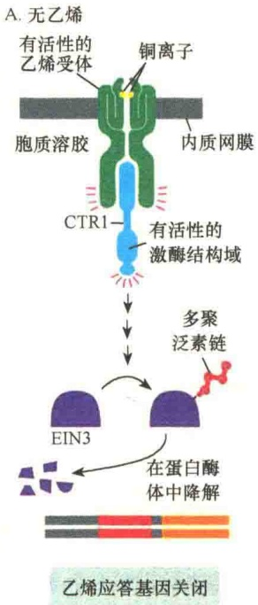
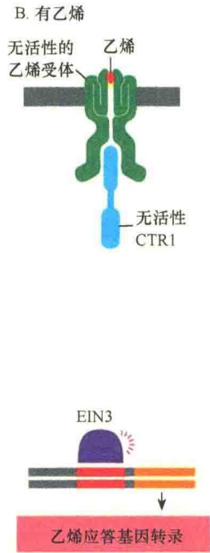
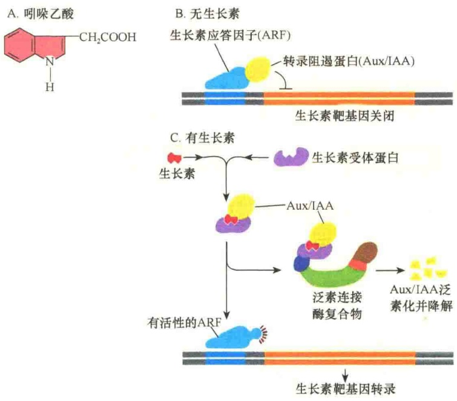
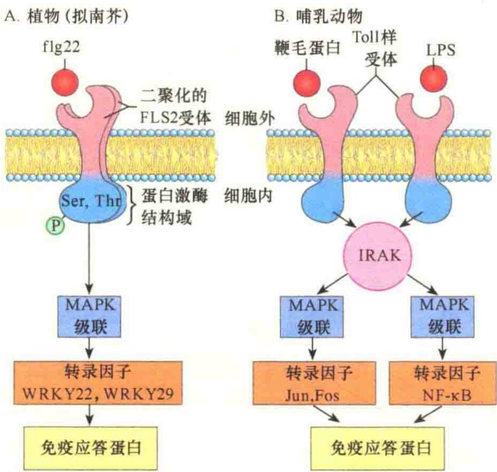
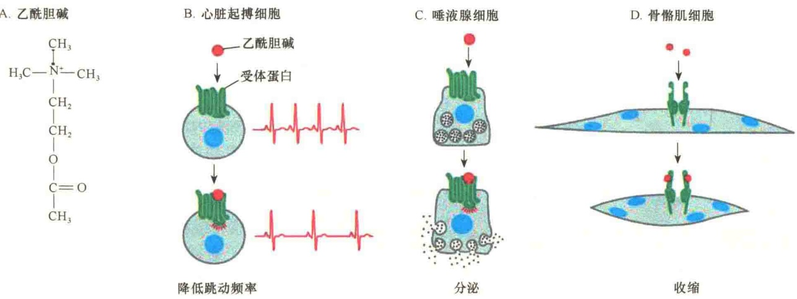
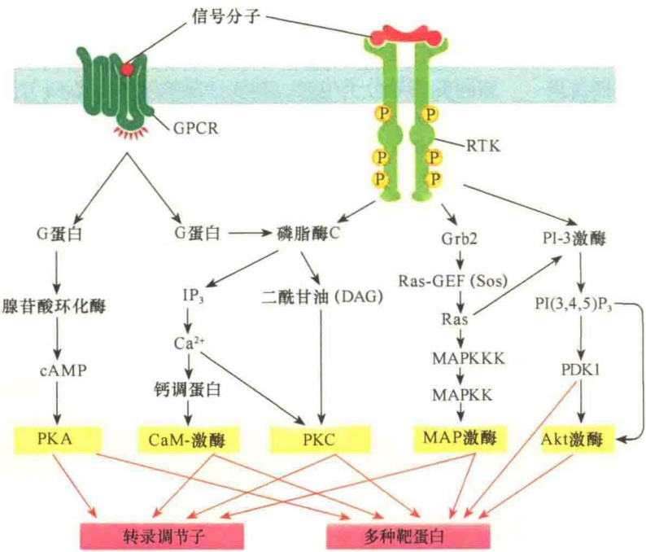

酸重复（leucine-rich repeat，LRR）的受体激酶。拟南芥基因组编码300多种丝氨酸/苏氨酸激酶受体，是植物中最大的受体家族，参与对病原菌的防御反应。

## 5.4.2.1 乙烯信号途径

很多植物生长调节子（plant growth regulator），又称植物激素（plant hormone），协调植物发育。这些激素包括乙烯（ethylene）、生长素（auxin）、细胞激动素（cytokinin）、赤霉素（gibberellin）、脱落酸（abscisic acid），以及菜籽类固醇（brassinosteroid）等。它们都是植物自己制造的小分子，能够穿过细胞壁进行扩散，可在局部起调节作用，也可转运到较远的部位起作用。每种激素都具有多种效应，效果则因环境条件、植物的生长状态、靶细胞的反应，以及其他生长调节子的作用而不同。

乙烯是重要的植物激素，它是小的气体分子，能够以多种方式影响植物的繁育:促进果实的成熟、叶片脱落，以及植物衰老。乙烯也能参与植物的应激反应，如损伤、感染及水涝等。

植物有多种乙烯受体，这些受体位于内质网膜，并且都有结构相关性。乙烯受体是二聚体的多次穿膜蛋白，它具有一个含铜的乙烯结合结构域，以及一个与CTR1蛋白作用的结构域。CTR1蛋白与动物细胞中Raf蛋白激酶（MAPKKK）作用相似，具有相似的激酶级联反应（图5-62）。

令人不解的是，乙烯受体原本就有活性，而不是与信号分子结合后才被激活。

## 5.4.2.2 生长素信号途径

生长素（auxin），如吲哚-3-乙酸（indole-3-acetic acid），是一种植物激素，在细胞核中与受体结合，帮助植物向光生长。如同乙烯，生长素通过激发阻遏生长素应答基因表达的转录调节子的泛素化及降解，启动相关基因的表达（图5-63）。在没有生长素时，转录阻遏蛋白（Aux/IAA）与生长素应答因子（auxin response factor，ARF）结合，并抑制了基因转录。进入细胞核中的生长素与受体蛋白结合并将受体激活，激活的受体与转录抑制蛋白结合，然后招募泛素蛋白将阻遏蛋白泛素化并将其降解，摆脱了抑制的生长素应答因子启动相关基因的转录。

图 5-62 乙烯信号途径（引自 Alberts et al., 2015）。A. 无乙烯时，受体与 CTR1 都具有活性，可引起 EIN3 泛素化并被降解。EIN3 是细胞核中的一种转录调节蛋白，负责乙烯反应基因的应答转录。B. 乙烯与受体结合后导致受体失活，并破坏 CTR1 的活性。EIN3 的基因没有被失活，可激活乙烯应答基因的转录。

图 5-63 生长素信号途径（引自 Alberts et al., 2015）。A. 吲哚乙酸的结构；B. 与 Aux/IAA 结合的 ARF 不能启动基因转录；C. 在生长素信号诱导下，阻遏物经泛素化后被降解，激活的 ARF 启动相关基因转录。

## 5.4.2.3 受体样蛋白激酶信号转导

在植物信号转导中还有一个位于细胞质膜的受体样蛋白激酶（receptor like kinase，RLK）。RLK受体有一个α螺旋穿膜结构域，细胞外有受体结合结构域，细胞质部分有丝氨酸/苏氨酸激酶结构域。该受体参与植物对病原菌感染的防御，作用于该受体的信号是一种肽（flg22），它是鞭毛蛋白（flagellin）断裂释放的肽，鞭毛蛋白是细菌的主要蛋白。flg22与拟南芥的FLS2受体结合，诱导受体二聚化，并在受体丝氨酸和苏氨酸残基自我磷酸化，接着启动类似于动物细胞中胰岛素诱导的MAPK激酶的级联反应。级联反应的最后一个激酶激活一个特异的转录因子，从而激发了抵抗细菌感染的蛋白质合成。

植物防御细菌感染的 MAPK 级联反应与哺乳动物天然免疫的 MAPK 级联反应十分相似（图 5-64）。在动物天然免疫反应中，由细菌的脂多糖（lipopolysaccharide，LPS）作为信号作用于

图 5-64 植物与动物中免疫应答信号通路比较（引自 Nelson and Cox，2013）。A. 植物中，来自病原菌细菌的鞭毛蛋白 flg22 与植物细胞质膜中的 FLS2 受体结合，引起受体二聚化，激活细胞质的结构域，进而将丝氨酸（Ser）和苏氨酸（Thr）残基磷酸化。磷酸化激活的受体进一步激活一个 MAPK 级联反应系统，最后将转录抑制蛋白 WRKY22、WRKY29 经泛素化而降解，启动了相关免疫应答基因的表达。B. 在哺乳动物中，有害细菌释放的 LPS 与被感染的细胞质膜受体结合，然后激活一种细胞质蛋白激酶（IRAK），另外，病原菌释放的鞭毛蛋白与一个类似的受体结合，同样能够激活 IRAK，激活的 IRAK 启动两个不同的 MAPK 级联系统将信号传递到细胞核，激活与免疫应答相关的基因转录。

Toll 样受体（Toll-like receptor，TLR），启动相应的信号转导。

## 5.5 信号转导的复杂性与信号的终止

高等动植物细胞具有各种信号转导机制将细胞外的信号传递到细胞内，通过不同的转导途径作出不同的应答。实际上，细胞从环境中得到的不是单一的信号，细胞最后作出的应答也是综合性的。所以，信号转导是极其复杂的。

另外，细胞对信号的应答也应“速战速决”，特别是生化反应的信号必须快速解除，否则不仅会造成资源浪费，也会影响周期的轮转，所以细胞必须有一套科学精密的解除信号的机制。

## 5.5.1 受体与配体相互作用的复杂性

细胞通过化学信息进行通讯的能力取决于信号分子的合成与分泌，以及受体与配体的相互识别及结合，配体与受体的结合又同配体与受体的结构和化学性质相关联。

## 5.5.1.1 受体与配体相互作用的一般特性

多细胞生物体中的细胞，其周围环境中常常有多达几百种化学信号分子，细胞如何去识别？是否一种信号分子只能作用于一种类型的细胞？受体与配体如何结合？这些都是由受体自身的特性决定的。

（1）特异性（specificity）。受体与配体的结合是高度特异性的反应，就如同酶与底物的特异性识别。所以，受体与配体的结合是选择性的，不受其他信号分子的干扰。不过，这种特异性不是绝对的，如胰岛素受体除结合胰岛素外，还可与胰岛素样生长因子结合；糖皮质（激）素受体除与糖皮质（激）素结合以外，还可与其他甾类激素结合，这种受体与配体交叉结合的现象称为受体交叉（receptor crossover）。

（2）高亲和力（high affinity）。受体与配体结合的能力称为亲和力，通过配体与受体结合反应的动力学分析可获得亲和力的信息。受体与其配体的亲和力越强，受体越容易被占据。

（3）饱和性（saturation）。由于细胞含有有限数量的受体分子，提高配体分子的浓度，可使细胞的受体全部被配体所占据，此时的受体处于饱和状态，即使增加配体的浓度也不会增加配体与受体的结合。由于一个细胞或一定组织内受体的数目是有限的，因此受体与配体的结合具有饱和性。

（4）可逆性（reversibility）。由于配体与受体的结合是通过非共价键，所以是快速可逆的，当引发出生物效应后，受体-配体复合物解离，受体可以恢复到原来的状态并再次使用。受体与配体结合的可逆性有利于信号的快速解除，避免受体一直处于激活状态。

（5）生理效应（physiological response）。信号分子与受体的结合会引起适当的生理反应，反应的强弱与结合配体的受体数量呈正相关。例如，在胰岛素与受体结合时，会激发葡萄糖向靶细胞的运输，并且，葡萄糖运输的数量随受体结合胰岛素的数量增加而增加。

## 5.5.1.2 信号分子与受体相互作用的复杂性

在多细胞的生物体中，一个细胞的周围通常有上百种不同的信号分子，这些信号分子中有些游离存在于细胞外液中，有些则是附着在细胞外基质，还有一些是结合在相邻细胞的表面；细胞必须对这些信号分子进行选择，并根据自身的需要作出相应的反应。

细胞与信号分子的反应首先取决于细胞是否具有某种信号分子的受体，如果没有受体，细胞对信号就会视而不见，因此不会有什么反应。尽管细胞通过产生有限的受体来限制自己对众多的细胞信号分子作出反应，但是信号分子仍能以相当复杂的方式来控制细胞的行为。

这种复杂性表现在以下三个方面。

第一，虽然一种信号分子只能与一种受体作用，但是却能作用于不同的靶细胞产生多种效应，如形态变化、运动性改变、代谢改变及基因表达的变化。相同的信号分子能以不同的方式引起不同细胞的反应，如当心肌细胞暴露于神经递质乙酰胆碱中时，它降低了收缩的频率；但是当唾液腺暴露于相同的信号分子中时，却能分泌唾液（图 5-65）。

图 5-65 相同的信号分子（乙酰胆碱）在不同的靶细胞中引起不同的应答（引自 Alberts et al., 2015）。A. 乙酰胆碱的分子结构。在 B 和 C 中，乙酰胆碱与相同的受体蛋白（G-蛋白偶联受体）结合，但由于细胞的功能不同，引起不同的反应；在 D 中，乙酰胆碱作用于不同的受体，同样引起不同的反应。

第二，一个细胞表面有几十甚至上千种不同的受体同时与细胞外基质中的不同信号分子起作用，这些信号分子共同作用的影响比任何单个信号所起的作用都强得多。所以，细胞必须对多种信号进行协调综合。由于不同信号分子间的不同组合，会使细胞产生不同的综合性反应:有些信号组合起来可促使细胞分裂，有些则促使细胞死亡。

第三，细胞信号的传递并非都是“长驱直入”式的，也并非是单一目标式。信号被细胞接收后需要加工与转换，才能作用于最终的效应物，因此，受体与配体的相互作用具有多种形式，包括信号重叠（overlapping）、趋同（convergent）、趋异( divergent ) 及串流 ( cross-talk )。

## 5.5.2 信号转导的重叠、趋同、趋异与串流

细胞的信号转导大多是由细胞表面受体介导的，但受体介导的细胞内各种信号途径并非都是单一地通向某一方向，而是相互转化的。信号在细胞内的转导过程是复杂的，因为不同的信号通路往往有交汇点，这势必给信号传递带来影响，有可能汇聚起来共同作用于某一效应物。例如，Ras蛋白既能被来自胰岛素与胰岛素受体结合后传递的信号所激活，又能被EGF受体结合EGF后的信息所激活。有些细胞外的信号分子与受体结合后，不仅仅引起一种应答，而且有可能激活许多不同的效应物，引起细胞的不同反应。例如，胰岛素与受体结合后，可激活3种不同的胰岛素受体底物及不同的信号转导途径。另外，不同途径的信号有可能汇聚后相互协作，共同作用于同一效应物。

## 5.5.2.1 RTK与GPCR信号的重叠

GPCR 与 RTK 是两大类不同的膜受体，介导不同的信号转导。一般而言，GPCR 介导的信号转导与细胞代谢相关，而 RTK 介导的信号转导常常涉及细胞的基因表达。但是，它们在细胞内的信号途径常常会发生重叠（图 5-66），其中既包含信号的趋同，又有信号的趋异。

图 5-66 GPCR 与 RTK 两种受体偶联系统信号转导的信号重叠（引自 Alberts et al., 2015）。图中显示在 GPCR 与 RTK 两种受体偶联系统信号转导中，通过 5 种激酶达成两个终极目标:转录调节及蛋白质活性调节，这是典型的信号趋同。磷脂酶 C 既能被 GPCR 受体的信号激活，又能被 RTK 受体的信号激活，显示的是两种受体信号间的串流。GPCR 受体信号可启动 2 条通路，RTK 则启动 3 条通路，显示信号的趋异。

## 5.5.2.2 胰岛素/RTK信号途径的趋异

信号趋异（divergence）最典型的是受体酪氨酸激酶的信号转导，如胰岛素生长因子受体被胰岛素激活后可启动多条不同途径的信号转导，包括促进细胞生长、糖原合成、抑制细胞程序性死亡等。

被胰岛素激活的受体细胞质结构域自我磷酸化后，为 IRS-1 提供了锚定位点，IRS-1 与受体结合后若干个酪氨酸残基被磷酸化。磷酸化的 IRS-1 与衔接蛋白 Grb2 结合并经 Sos，与质膜中的 Ras 蛋白结合形成信号复合物，将 Ras 激活，激活的 Ras 蛋白通过 MAP 激酶级联反应调控相关基因的表达（见图 5-55）。

另一个与胰岛素信号相关的重要途径是 PI-3 激酶途径。在该通路中，PI-3 激酶通过 SH2 结构域与磷酸化的 IRS-1 结合并被激活。激活的 PI-3 激酶能够将质膜中  $PIP_{2}$  进一步磷酸化，生成  $PIP_{3}$ ，然后激活蛋白激酶 B（protein kinase B，PKB），激活的 PKB 启动了与糖原合成相关的信号转导通路（见图 5-56）。

## 5.5.2.3 信号转导途径的趋同

相比较而言，细胞外信号分子的种类与数量远比细胞的表面受体多。另外从细胞对信号应答方面来说，要么是快反应，要么是慢反应，所以受体介导的不同信号途径往往会殊途同归，汇集到一起，产生综合性应答。例如，胰岛素和表皮生长因子分别作用于不同的受体系统，但是受体的细胞内结构域磷酸化后的位点都可作为SH2的锚定位点，换句话说，凡具有SH2结构域的蛋白质既能与胰岛素受体的磷酸化部位结合，也能与PDGF受体的磷酸化部位结合，实际上，通过SH2将这两种不同受体所接收的信号整合到一起。

我们所讨论过的与信号转导有关的细胞表面受体有4种类型，即离子通道偶联受体、G蛋白偶联受体、酶联受体和整联蛋白受体。在这些受体中，有3种类型的受体的信号转导涉及Grb2-Sos复合物（图5-67）。虽然这三种类型受体结合的细胞外配体不同，但是它们都能够形成磷酸酪氨

酸位点，锚定具有 SH2 结构域的衔接蛋白 Grb2，然后通过 Sos 激活 Ras，激活的 Ras 通过激活 MAP 激酶的级联系统进行信号转导。其结果是将不同受体结合的信号汇聚起来，引起靶细胞中一套相同的、促进细胞分裂的基因表达。

## 5.5.2.4 信号串流

常说“牙齿也会和舌头打架”，在所讨论过的