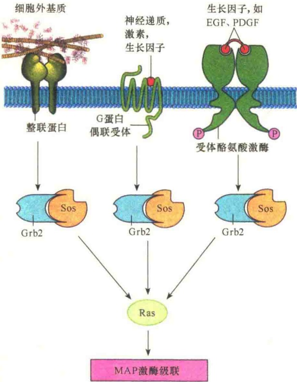
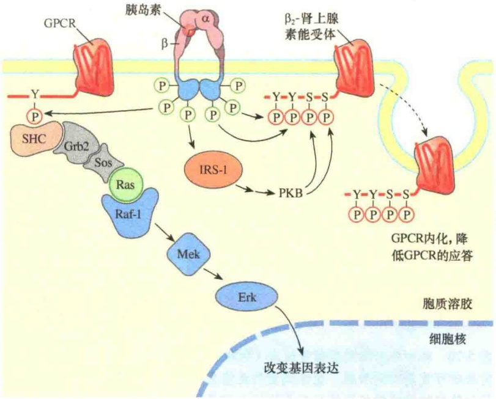
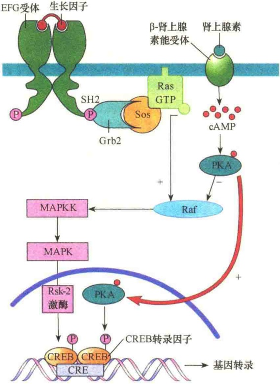
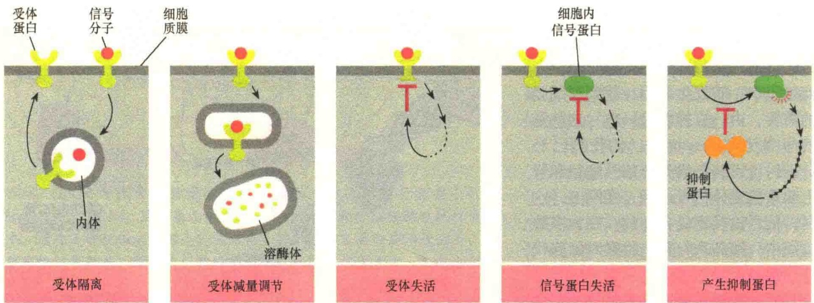
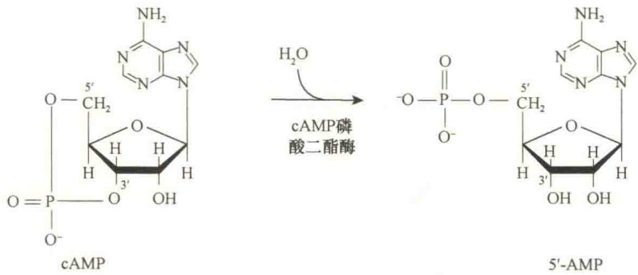
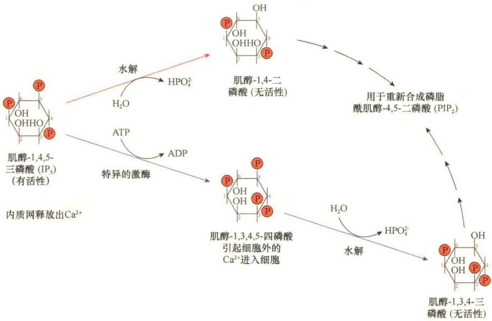
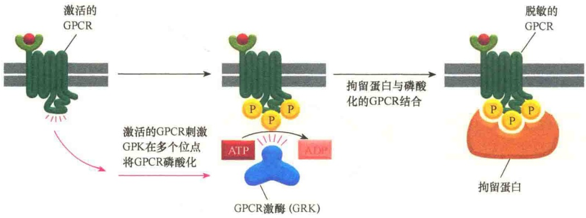

图 5-67 信号的趋同（引自 Karp，2010）。图中所示是将来自 G 蛋白偶联受体、整联蛋白、受体酪氨酸激酶的信号通过 Grb2-Sos 汇聚到 Ras，然后沿着 MAP 激酶级联系统进行传递。

酸残基被 INSR 磷酸化后可为具有 SH2 结构域的衔接蛋白提供锚定位点，启动 MAP 激酶的级联反应（图 5-68）。

在某些情况下，GPCR 产生的细胞内信号也能对酶联受体产生的信号进行控制。如经肾上腺素产生的细胞内第二信使 cAMP 激活的 PKA，不仅能够启动细胞核 CRE 基因的转录，而且能对 Ras 通路中的 Raf 激酶进行抑制（图 5-69）。

## 5.5.3 信号的适应、解除与终止

对于细胞来说，对环境变化的有效应答不仅仅是激活一个信号途径，也包括一旦应答到位，立即终止信号作用或是下调应答。如果信号转导途径维持较长时间的“开放”状态，或是应答水平维持“较高”状态，细胞就会变得“过度亢奋”。癌细胞就是不正常的信号应答所致。在癌细胞中，突变的蛋白质不断刺激细胞增殖，或者阻止细胞进行程序性死亡，甚至有正常信号作用时也“置若罔闻”。因此，细胞及时终止或下调信号应答是细胞信号转导的另一重要方面。

信号转导中，虽然每种体系都有自己相对独立的系统，似乎互不影响，实际上细胞内的各种信息往往要交织在一起形成一个信息网共同起作用。在此过程中，若发生矛盾，就要视细胞的需要，由一方控制另一方，这就是信号串流（cross-talk）。如我们已经分别讨论了胰岛素受体信号途径和肾上腺素能受体信号途径，实际上，这两种信号途径不是独立的，在大多数组织中，胰岛素与肾上腺素对细胞代谢作用是相对立的，胰岛素的信号途径是通过削弱β-肾上腺素信号途径而发挥作用。例如，INSR激酶直接将β₂-肾上腺素能受体细胞质尾部结构域的两个Tyr残基磷酸化，同时，被INSR激活的蛋白激酶B将相同结构域中两个Ser残基磷酸化，这四个氨基酸残基磷酸化后，触发了网格蛋白将磷酸化的β₂-肾上腺素能受体内化，从而降低了细胞对肾上腺素的敏感性。另外，肾上腺素能受体的酪氨

图 5-68 胰岛素受体与  $\beta_{2}$ -肾上腺素能受体（或其他 GPCR）间的串流（引自 Nelson and Cox，2013）。当胰岛素受体被结合的胰岛素激活时，它的酪氨酸激酶直接将  $\beta_{2}$ -肾上腺素能受体（右侧）羧基端的两个酪氨酸（Tyr $^{350}$  和 Tyr $^{364}$ ）磷酸化，并通过 PKB 间接将相邻的两个丝氨酸磷酸化；磷酸化的结果是引起肾上腺素能受体内化从而降低了对肾上腺素能的应答。同时，通过对 GPCR 受体羧基端酪氨酸的磷酸化，激活了 MAP 激酶的级联反应。

图 5-69 两个主要信号转导途径间的串流（引自 Karp，2010）。在某些细胞中，G 蛋白偶联系统的受体在肾上腺素等细胞外信使的作用下，产生第二信使 cAMP，cAMP 激活 PKA，然后通过 PKA 抑制 Raf，从而阻断了从 Ras 到 Raf 的信号转导。

## 5.5.3.1 靶细胞对细胞外信号分子的适应

面对多种类型的细胞外刺激型的信号，细胞能够通过对刺激强度及应答的程度调整对信号的敏感性。靶细胞是通过称之为适应（adaptation）或脱敏（desensitization）的可逆过程进行调整的。

细胞有多种适应信号刺激的方式，但基本上都是使受体本身失活（图 5-70）。例如，信号分子与受体的结合可以诱导受体发生内吞，或是将受体暂时性隔离到内体中，需要时再回到细胞质膜。有时，也可将信号诱导的受体内吞与溶酶体融合，将受体水解掉，从而减少受体的数量。若是将受体水解，则称之为受体下调（receptor down-regulation）。有时受体可直接在细胞表面被失活，如将受体细胞质结构域磷酸化，使其不能激活偶联的 G 蛋白，或是改变其细胞内信号转导蛋白的结构，或是通过抑制蛋白对受体的抑制等。

## 5.5.3.2 cAMP信号的终止

细胞内 cAMP 浓度的升高对细胞的代谢乃至基因表达都有重要影响，因此对 cAMP 的浓度必须进行严格地控制，以免细胞一直处于过敏状态。细胞有多种方式终止或下调 cAMP 的信号转导途径。

图 5-70 靶细胞对细胞外信号适应（脱敏）的几种方式（引自 Alberts et al., 2015）。受体隔离是将受体暂时性转入内体，需要时可重新回到质膜。受体减量则是将受体通过内吞并由溶酶体降解，从而减少膜受体的量。受体失活则是通过对受体细胞内结构域进行修饰而失去活性。信号蛋白失活是通过对受体下游的信号蛋白进行修饰，从而阻断信号转导。也可以通过激活一种抑制蛋白对信号途径进行阻断。

第一，通过降低配体与受体结合的亲和力。当结合有配体的受体与 Gs 蛋白作用时，由于 GTP 替换 GDP，可降低配体与受体结合的亲和力。

第二， $G_{as}$  自身的 GTPase 活性将结合的 GTP水解成 GDP 时，会逐渐失去  $G_{\alpha s}$  对腺苷酸环化酶的激活作用，也降低了 cAMP 的合成。

第三，cAMP 磷酸二酯酶（phosphodiesterase, PDE）将 cAMP 的环破坏，形成 5'-AMP（图 5-71），降低了细胞内 cAMP 的浓度，终止了其信号作用。

图 5-71 cAMP 磷酸二酯酶对 cAMP 的水解。

第四，对于Gs偶联系统来说，通过抑制型的信号作用于 $R_{i}$ ，然后通过 $G_{i}$ 起作用。抑制型的G蛋白偶联受体所起的作用与刺激型的G蛋白偶联受体正好相反，它降低细胞中cAMP的浓度，这是由抑制性的信号（第一信使）作用于抑制型的受体和抑制型的G蛋白引起的，如肾上腺素（epinephrine）与肾上腺素能受体（adrenergic receptor）结合就是最好的例子。机制是 $G_{i}$ 蛋白被激活后，GTP与 $G_{i}$ 蛋白的 $\alpha$ 亚基结合， $G_{i}$ 的 $\alpha$ 亚基与 $G_{i}\beta\gamma$ 复合物分离，并在细胞膜的胞质面进行扩散；当 $G_{i}$ 的 $\alpha$ 亚基与腺苷酸环化酶结合后则抑制其活性；而 $G_{i}\beta\gamma$ 复合物则可与激活型的 $G_{s}$的  $\alpha$  亚基作用，阻止它去激活腺苷酸环化酶。

## 5.5.3.3 IP $_{3}$ /DAG/Ca $^{2+}$ 信号的终止

如同 cAMP 引起的信号转导，磷脂肌醇和  $Ca^{2+}$  的第二信使作用也必须迅速解除，使细胞重新回到初始状态。

1）DAG 信号的解除 DAG 只是由 PIP₂ 水解得到的暂时性产物，寿命只有几秒钟，靠两种方式

进行降解:①被 DAG 磷酸激酶磷酸化，生成磷脂酸（PA）；② DAG 被 DAG 酯酶水解生成单脂酰甘油，再进一步水解成游离的不饱和脂肪酸和花生四烯酸甘油。

2）$\mathrm{IP}_{3}$ 信号的解除 有两种途径终止 $\mathrm{IP}_{3}$ 的信号作用（图5-72）:① $\mathrm{IP}_{3}$ 被水解，即 $\mathrm{IP}_{3}$ 在 $5^{\prime}$-磷酸酶的作用下，水解为肌醇-1,4-二磷酸[I(1,4)$\mathrm{P}_{2}$]，并且进一步水解成肌醇；②在胞质中肌醇磷酸脂3-激酶的作用下，$\mathrm{IP}_{3}$ 被ATP磷酸化生成肌醇-1,3,4,5-四磷酸（inositol-1,3,4,5-tetraphosphate，$\mathrm{IP}_{4}$），然后被水解成无活性的肌醇-1,3,4-三磷酸（inositol-1,3,4-trisphosphate），从而解除 $\mathrm{IP}_{3}$ 的作用。

3）$\mathrm{Ca^{2+}}$ 信号的解除 $\mathrm{Ca^{2+}}$ 信号的解除主要是

图 5-72 胞质溶胶中  $IP_{3}$  的命运（引自 Lodish et al., 1995）。

通过降低胞质溶胶中的  $Ca^{2+}$  浓度。有几种机制可快速终止  $Ca^{2+}$  信号并保持静息状态下细胞质中  $Ca^{2+}$  的低浓度。最重要的是通过细胞质膜及内质网膜中的钙泵将  $Ca^{2+}$  泵回内质网及细胞外基质。肌细胞与神经细胞是对  $Ca^{2+}$  信号使用得尤为频繁的两类细胞，在它们的细胞质膜中除了钙泵外，还有与钙的输入-输出偶联的  $Ca^{2+}$  运输蛋白（ $Na^{+}$ -驱动的  $Ca^{2+}$  交换蛋白）。

实际上，$\mathrm{IP}_{3}$ 与内质网膜中 $\mathrm{IP}_{3}$-门控 $\mathrm{Ca}^{2+}$ 通道的结合亲和力不强，并且其结合亲和力随着内质网中的 $\mathrm{Ca}^{2+}$ 释放到胞质溶胶导致胞质溶胶中 $\mathrm{Ca}^{2+}$ 浓度升高而降低。实验证明，细胞质中 $\mathrm{Ca}^{2+}$ 浓度的升高具有正反馈调节作用，促使细胞质中的 $\mathrm{Ca}^{2+}$ 浓度瞬间急剧升高，其中也有从细胞外输入的 $\mathrm{Ca}^{2+}$。若浓度达到一个阈值，可激活内质网膜及细胞质膜中的 $\mathrm{Ca}^{2+}$ 泵，瞬间又可使胞质溶胶保持一个低 $\mathrm{Ca}^{2+}$ 浓度。加之 $\mathrm{IP}_{3}$ 的寿命极短，在几秒钟之内，其C5上的磷酸基团就会被磷酸酶水解，使其丧失功能，$\mathrm{IP}_{3}$-门控 $\mathrm{Ca}^{2+}$ 通道恢复关闭状态。实验同样证明，$\mathrm{Ca}^{2+}$ 信号的解除具有负反馈调节，正所谓“墙倒众人推”，不过，此处的负反馈调节有利于细胞恢复静息状态。

## 5.5.3.4 磷酸酶在细胞信号解除中的作用

前面我们已经讨论过蛋白质活性调节的两种开关是磷酸化与去磷酸化，磷酸酶的作用是将靶蛋白去磷酸化，所以在信号解除中具有重要作用。

在许多信号转导途径中，蛋白激酶通过磷酸化作用将一些靶蛋白（酶）激活。蛋白质的磷酸化是一种可逆的化学修饰，所以通过蛋白激酶添加到蛋白质上的磷酸基团可通过蛋白磷酸酶的作用被除去。实验表明，激酶与磷酸酶对底物的影响是相反的，当磷酸化激活底物时，可通过脱磷酸将底物失活，反之亦然。所以，磷酸酶在细胞内的作用与磷酸化酶一样重要。

据估计，人基因组编码1000种以上的磷酸酶（激酶大约2000种），这说明磷酸酶在细胞中是非常重要的酶。如同蛋白激酶一样，某些磷酸酶是多功能的，并且能够脱去几种蛋白质中的磷酸基团。但有些磷酸酶的活性相当专一，只能将一种或两种底物中的磷酸基团脱去。像丝氨酸/苏氨酸和酪氨酸磷酸激酶一样，多数磷酸酶分为丝氨酸/苏氨酸磷酸酶和酪氨酸磷酸酶，它们只能从磷酸化的丝氨酸/苏氨酸残基或磷酸化的酪氨酸残基脱磷酸，但不能同时从这两种类型的残基上脱磷酸。不过，有些磷酸酶既能从磷酸化的丝氨酸/苏氨酸残基上脱去磷酸，又能从磷酸化的酪氨酸残基上脱去磷酸。

## 5.5.3.5 GPCR脱敏

受体脱敏（receptor desensitization）是指受体对信号分子失去敏感性，即使与信号分子结合也不能向下游进行信号传递。依赖于受体磷酸化的 GPCR 脱敏是指 GPCR 激酶（GPCR kinase, GRK）将 GPCR 磷酸化后失去与信号分子作用的能力。GRK 是一种丝氨酸 / 苏氨酸激酶，能够将 GPCR 中多个丝氨酸或苏氨酸残基磷酸化。这种磷酸化作用需要有信号分子与受体结合并被激活后才能进行，因为 GRK 是由激活的 GPCR 所激活。激活的 GRK 反过来将受体的细胞内结构域磷酸化，磷酸化的受体以极高的亲和力与抑制蛋白家族中的拘留蛋白（arrestin）结合，从而抑制了受体与 G 蛋白相互作用，不能进行信号转导（图 5-73）。

图 5-73 依赖于受体磷酸化的 GPCR 脱敏（引自 Alberts et al., 2015）。

受体内化（internalization）是借助于网格蛋白的作用，将受体转入到内吞泡中，有需要时再返回到细胞质膜，或是经内体转运到溶酶体，将受体降解。

在肾上腺素能受体偶联的信号转导途径中有一种蛋白激酶，能够将受体细胞质部分与  $G_{s\alpha}$  作用结构域磷酸化使受体脱敏，进而发生内化（图 5-74）。

当  $G_{\alpha s}$  蛋白偶联的  $\beta$ -肾上腺素能受体被肾上