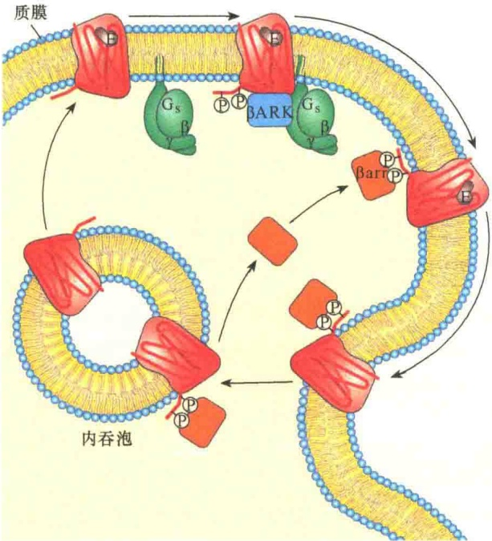

图 5-74 β-肾上腺素能受体在肾上腺素持续存在时的内化作用（引自 Nelson and Cox，2013）。肾上腺素能受体内化是由 β-肾上腺素能受体激酶（βARK）与 β-拘留蛋白联合介导的。

腺素持续刺激几小时后，受体细胞质结构域有几个丝氨酸被该途径激活的β-肾上腺素能受体激酶（β-adrenergic receptor kinase，βARK）磷酸化，βARK是GPCR激酶的一种。被磷酸化的受体为β-拘留蛋白（β-arrestin，βarr，又称拘留蛋白2）提供了结合位点。β-拘留蛋白与受体结合，有效地阻止了受体与G蛋白的进一步相互作用。不仅如此，β-拘留蛋白与受体结合，也促进了受体与信号分子的隔离，即通过内化作用，将受体转移到内吞泡的膜上（图5-74）。当β-拘留蛋白与受体结合时招募了两种蛋白质——AP-2与网格蛋白的结合形成内吞体（内体）。在此过程中，受体与肾上腺素信号分子“天各一方”，导致受体失活。在内体中的受体有可能去磷酸化，若如此，受体可重新回到质膜中行使功能。

β-肾上腺素能受体激酶是 GRK 家族的一员，它们的作用是将 GPCR 细胞质结构域 C 端磷酸化，将受体脱敏。在人的基因组中至少有 5 种不同的 GRK 和 4 种不同的拘留蛋白，它们分别作用于不同的 GPCR 系统。

## 5.5.3.6 酶联受体途径的信号终止

RTK 信号的终止主要是通过受体的内化，导致受体内化的原因目前尚不清楚。有一种机制与受体结合蛋白 Cb1 相关。当 RTK 被配体激活时，受体自我磷酸化的酪氨酸残基也能作为 Cb1 的结合位点，因为在 Cb1 中也有 SH2 结构域。与受体结合的 Cb1 同时能够与泛素蛋白结合，最终导致受体被降解。

TGF- $\beta$ 激活的 Smad 依赖性信号转导也可以进行基因转录的负调控，该途径是通过 I-Smad 进行的。I-Smad 包括 Smad6 及 Smad7。I-Smad 与 TGF- $\beta$ 激活的受体细胞质结构域结合，以三种不同的方式阻断信号通路:① 同 R-Smad 竞争与受体结合，从而降低 R-Smad 被磷酸化的机会，削弱了 R-Smad 的信号转导作用；② I-Smad 招募一种称为 Smurf 的泛素连接酶，它可以将受体泛素化，并导致受体内化，最后导致受体被降解；③ I-Smad 也可招募磷酸酶，将受体去磷酸化而失去活性。此外，I-Smad 还可以与 co-Smad（Smad4）结合，阻止 R-Smad 与 Smad4 组成复合物进入细胞核调节基因转录。

## 本章小结

多细胞生物体中的细胞生命活动都是受细胞外信息控制的，包括刺激细胞生存、生长或分化，也包括对细胞生长的抑制、诱导，或启动细胞的程序性死亡。

构成细胞通讯网络的分子包括蛋白质、蛋白聚糖、肽、氨基酸、脂、核苷，以及带电的离子（$\mathrm{Ca}^{2+}$、$\mathrm{Na}^{+}$、$\mathrm{Cl}^{-}$）等。

在细胞通讯中, 由通讯细胞送出的信号分子必须被靶细胞接收才能触发靶细胞的应答, 接收信息的分子称为受体, 信号分子被称为配体。在细胞通讯中受体通常是指位于细胞膜表面或细胞内 (核内) 与信号分子结合的蛋白质。

常见的与信号分子结合的受体可分为6种类型，包括G蛋白偶联受体、受体蛋白激酶、配体门控离子通道受体、穿膜支架、受体鸟苷酸环化酶、核受体。

有些细胞外的信号与细胞表面受体识别及结合后，进入细胞内的信号转导途径时要通过小分子的信号分子在细胞内传递，这种在细胞内传递信号的小分子化学物就称为第二信使。细胞内最常见的4种第二信使，即cAMP、cGMP、二酰甘油（DAG）、肌醇三磷酸（$\mathrm{IP}_{3}$）。

支架蛋白能够将信号蛋白聚集起来组成信号复合物，并能以较高的局部浓度使信号转导快速有序进行，防止了信号之间的串流。

G 蛋白偶联受体（GPCR）是细胞表面受体的最大家族，它们介导大多数来自细胞外及其他细胞的信号转导，包括激素信号、神经递质与局部介质。

PKA 系统是以 cAMP 作为第二信使激活蛋白激酶 A（PKA）进行信号放大，包括激活型和抑制型两种类型。在激活型中，G 蛋白偶联受体与信号分子结合后，G 蛋白被激活，活性 α 亚基与其他两个亚基分离并激活腺苷酸环化酶（AC），产生第二信使 cAMP，cAMP 激活 PKA，PKA 再作用于靶蛋白，产生细胞应答。在抑制型中，激活的 G 蛋白则抑制 AC 的活性。PKC 系统是以肌醇三磷酸（IP₃）、二酰甘油（DAG）为第二信使，并通过蛋白激酶 C（PKC）引起级联反应。在 PKC 系统中，磷脂酶 C-β 相当于 PKA 系统的 AC，经 G 蛋白激活后的磷脂酶 C-β 水解质膜上的磷脂酰肌醇 4,5-二磷酸（PIP₂），产生 IP₃ 和 DAG。IP₃ 的作用是释放出内质网中的 Ca²⁺，由 DAG 和 Ca²⁺ 共同作用激活 PKC，PKC 参与多种生化反应的催化。

霍乱和百日咳是两种威胁人类生命安全的疾病，分别由两种细菌毒素作用于激活型和抑制型的G蛋白所引起。

某些 G 蛋白可直接控制离子通道的通透性，如通过神经递质乙酰胆碱调节心肌收缩。GPCR 还参与脊椎动物眼睛的光信号转导，以及嗅觉、味觉信号转导。

酶联受体信号转导涉及 SH 结构域。Ras/MAP 激酶信号转导是研究得较为清楚的一条信号转导途径，其转导包括三个基本过程，即受体激活、Ras 蛋白激活、MAP 级联反应。Ras 蛋白活性受到 GAP 和 GEF 的调控，其激活亦涉及 Grb2 蛋白和 Sos 蛋白。

磷脂酰肌醇 3 激酶主要是磷酸化肌醇磷脂，而不是磷酸化蛋白质的激酶。它所介导的信号转导属于磷脂信号转导，促进细胞的生存与生长。

胰岛素信号途径涉及胰岛素受体及级联反应。胰岛素可通过 MAP 激酶级联途径调节基因表达，也可通过 PI3K 调节糖原合成。

细胞因子受体激活的 JAK-STAT 信号途径是由细胞因子与受体结合引起的信号转导，包括激活巨噬细胞、刺激红细胞生成、刺激粒细胞及巨噬细胞生长等。

转化生长因子- $\beta$ （TGF- $\beta$ ）超家族是一类结构相关、分泌在细胞质中的二聚体蛋白，可通过丝氨酸/苏氨酸酶联受体起作用。

通过泛素化控制的信号途径包括 Wnt/ $\beta$ -联蛋白信号途径、依赖于 NF- $\kappa$ B 的信号途径、Notch/Delta 信号途径等。

与动物的信号转导相比，植物在通讯方式上有很大的不同，但也有相似的地方。植物中了解最为清楚的是乙烯信号途径。

受体与配体相互作用及引起的信号转导是十分复杂的，包括信号重叠、趋同、趋异和串流。

解除信号转导的方式有信号分子（包括第二信使）的水解、受体脱敏（包括受体内化）、信号蛋白失活等。

## 思考题

（1）酶联受体在进行信号传递时，首先要进行受体二聚化，对此有何感想？

(2) 细胞在进行信号传递时, 相关蛋白的活性转换是十分快捷的, 其巧妙之处是设计了最为简洁而快速的开关装置,请说明。

（3）比较信号传导（signaling）与信号转导（signal transduction）有何不同？

（4）比较 cAMP 信号系统与 IP₃-DAG 信号系统在跨膜信号传递作用的异同。

(5) 不同的细胞如何能以不同的方式对完全相同的信号分子作出反应, 即使它们有相同的受体?

(6) GPCR 通过降低 GDP 结合强度来激活 G 蛋白, 使 GDP 分离, 而浓度高得多的 GTP 从而结合上去。如果有一种突变导致 GPCR 对 GDP 的亲和力降低, 但不会显著改变对 GTP 的结合亲和力, 你认为 G 蛋白的活性会受到这种突变的影响吗?

(7) 导致 G 蛋白激活的反应和导致 Ras 激活的反应有哪些相似之处和不同之处?

(8) 霍乱毒素是由霍乱弧菌产生的一种毒素, 能够引起受感染的人水样腹泻。霍乱毒素产生这种作用的分子基础是什么?

（9）请说明胰岛素信号转导与糖原代谢的关系。