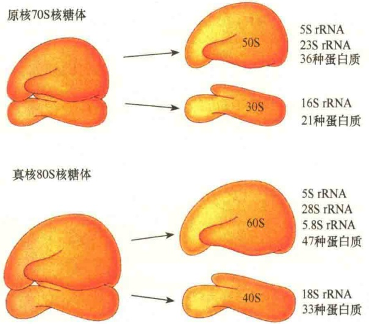
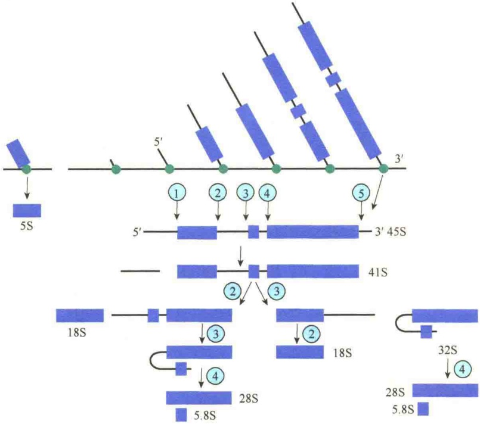

# 核糖体与蛋白质

6.1 核糖体的形态结构与 rRNA 基因

6.1.1 核糖体的形态结构与类型

6.1.2 核糖体 rRNA 基因扩增与染色体定位

6.1.3 核糖体 rRNA 基因的转录与加工

6.2 核糖体的装配

6.2.1 核糖体亚基的自我装配

6.2.2 原核生物核糖体重组实验

6.2.3 真核生物核糖体的装配

6.3 核糖体的功能——蛋白质合成

6.3.1 蛋白质合成的基本过程

6.3.2 核糖体的功能位点

6.3.3 tRNA及氨酰tRNA的合成

6.3.4 多聚核糖体

6.3.5 蛋白质合成抑制剂

6.4 蛋白质的折叠、修饰与降解

6.4.1 蛋白质折叠与分子伴侣

6.4.2 蛋白质的修饰与加工

6.4.3 蛋白酶体对蛋白质的降解

6.5 核酶

6.5.1 核糖体是一种核酶

6.5.2 具有切割功能的核酶

6.5.3 核酶与内含子的剪接

6.6 RNA编辑

6.6.1 RNA编辑对表达的调控

6.6.2 gRNA 介导的 mRNA 插入编辑

6.6.3 改变 mRNA 中单个核苷酸的 RNA 编辑

核糖体（ribosome）可谓是细胞中的“当家”细胞器，由于它参与细胞中蛋白质的合成，所以称为蛋白质合成机器。它的全称是核糖核蛋白复合体（ribonucleoprotein complex），即由核糖核酸与蛋白质组成的复合体。

核糖体的蛋白质合成功能是通过放射性标记实验发现的。将细胞与放射性标记的氨基酸短暂接触后进行匀浆，然后分级分离，发现在微粒体部分有大量新合成的放射性标记的蛋白质。后将微粒体部分进一步分离，得到核糖体和膜微粒，这一实验结果表明核糖体与蛋白质合成有关。

蛋白质是细胞各种结构，包括细胞核、细胞质膜、内质网、高尔基体、线粒体、叶绿体，细胞骨架，乃至鞭毛与纤毛的基本组成单位，蛋白质也是细胞一切功能的执行者，包括基因表达、信号转导、生长、分化等。

## 6.1 核糖体的形态结构与 rRNA 基因

核糖体最早是 Claude 于 20 世纪 30 年代后期用暗场显微镜观察细胞的匀浆物时发现的，当时称为微体（microsome），直到 20 世纪 50 年代中期，Palade 在电子显微镜下观察到这种颗粒的存在。当时 Palade 和他的同事研究了多种生物的细胞，发现细胞质中有类似的颗粒存在，尤其在进行蛋白质合成的细胞中特别多。后来 Siekevitz 用亚细胞组分分离技术分离了这种颗粒，并发现这些颗粒总是伴随内质网微粒体一起沉积。化学分析揭示，这种微粒富含核苷酸，随之命名为 ribosome，主要成分是:核糖体 RNA（rRNA），约占 60%；核糖体蛋白质（ribosomal protein），约占 40%。

## 6.1.1 核糖体的形态结构与类型

参与蛋白质合成的核糖体，基本组成为蛋白质与核糖体 RNA（rRNA），它们存在于细胞质中，可分为原核生物核糖体和真核生物核糖体。此外，在真核生物的细胞质、线粒体与叶绿体中都有核糖体，因此又分为细胞质核糖体和细胞器核糖体。细胞质核糖体参与核基因编码的蛋白质合成，而细胞器核糖体仅负责细胞器基因编码的蛋白质的合成。

## 6.1.1.1 核糖体是由大、小两个亚基组成的复合物

原核细胞的核糖体体积较小，沉降系数为70S，分子质量为 $2.5 \times 10^{3}kDa$ ，由50S和30S两个亚基组成；真核细胞的核糖体体积较大，沉降系数为80S，分子质量为 $3.9 \times 10^{3} \sim 4.5 \times 10^{3}kDa$ ，由60S和40S两个亚基组成（图6-1）。

图 6-1 核糖体的结构（引自 Cooper and Hausman，2013）。

虽然核糖体都是由大、小两个不同的亚基组成，但是这两个亚基并非都是结合在一起的，在不进行蛋白质合成时，它们是分开的，并且各自游离存在于细胞质中，只是在进行蛋白质合成时才结合在一起。

$Mg^{2+}$ 的浓度对于大、小亚基的聚合和解离有很大的影响。体外实验表明，70S核糖体在 $Mg^{2+}$ 的浓度小于1mmol/L的溶液中易解离；当 $Mg^{2+}$ 浓度大于10mmol/L时，两个核糖体通常形成100S的二聚体（图6-2）。

## 6.1.1.2 核糖体的类型

真核细胞中不仅有细胞质核糖体，而且还有叶

图 6-2 通过区带离心鉴定核糖体的亚基（引自 Kleinsmith and Kish，1995）。在  $Mg^{2+}$  浓度低时，完整的核糖体将分成大、小两个亚基。

绿体核糖体和线粒体核糖体。

在组成上，叶绿体中的核糖体与原核生物核糖体相同，但线粒体中核糖体的大小变化较大（表6-1）。

表 6-1 不同类型核糖体的大小比较

<table><tr><td>来源</td><td>完整核糖体</td><td>核糖体亚基</td><td>核糖体 RNA</td></tr><tr><td rowspan="2">细胞质(真核生物)</td><td>80S</td><td>60S(大亚基)</td><td>28S、5.8S、5S</td></tr><tr><td></td><td>40S(小亚基)</td><td>18S</td></tr><tr><td rowspan="2">细胞质(原核生物)</td><td>70S</td><td>50S(大亚基)</td><td>23S、5S</td></tr><tr><td></td><td>30S(小亚基)</td><td>16S</td></tr><tr><td rowspan="2">线粒体(哺乳动物)</td><td>55S~60S</td><td>45S(大亚基)</td><td>16S</td></tr><tr><td></td><td>35S(小亚基)</td><td>12S</td></tr><tr><td rowspan="2">线粒体(酵母)</td><td>75S</td><td>53S(大亚基)</td><td>21S</td></tr><tr><td></td><td>35S(小亚基)</td><td>14S</td></tr><tr><td rowspan="2">线粒体(高等植物)</td><td>78S</td><td>60S(大亚基)</td><td>26S、5S</td></tr><tr><td></td><td>45S(小亚基)</td><td>18S</td></tr><tr><td rowspan="2">叶绿体</td><td>70S</td><td>50S(大亚基)</td><td>23S、5S</td></tr><tr><td></td><td>30S(小亚基)</td><td>16S</td></tr></table>

在真核细胞中，核糖体进行蛋白质合成时，若是游离存在于细胞质中，称为游离核糖体；若是附着在内质网的表面，则称为附着核糖体。真核细胞含有较多的核糖体，每个细胞平均有 $10^{6}\sim10^{7}$ 个；而原核细胞中核糖体较少，每个细胞平均只有 $15\times10^{2}\sim18\times10^{3}$ 个。

核糖体的大、小两个亚基都是由核糖体 RNA（rRNA）和核糖体蛋白质组成的，但原核生物和真核生物细胞质核糖体的大、小亚基在蛋白质和 RNA 的组成上有较大的差别。

典型的原核生物大肠杆菌核糖体是由50S大亚基和30S小亚基组成的。在完整的核糖体中，rRNA约占2/3，蛋白质约占1/3。50S大亚基含有36种不同的蛋白质和两种RNA，大rRNA沉降系数为23S，小rRNA沉降系数为5S。30S小亚基含有21种蛋白质和一个16S的rRNA。

真核细胞核糖体的沉降系数为 80S，大亚基为 60S，小亚基为 40S。在大亚基中，有大约 47 种蛋白质，另外有 3 种 rRNA，即 28S rRNA、5S rRNA 和 5.8S rRNA。小亚基含有大约 33 种蛋白质，一种 18S rRNA。

## 6.1.2 核糖体 rRNA 基因扩增与染色体定位

核糖体的组成成分是 rRNA 和蛋白质，所以编码核糖体的基因分为两类，一类是 rRNA 基因，另一类是核糖体蛋白质编码基因。在生活细胞中，特别是在活跃进行蛋白质合成的细胞中，需要大量的核糖体，这就意味着需要合成大量的 rRNA 和核糖体蛋白质。

## 6.1.2.1 编码 rRNA 基因的过量扩增

细胞为了满足大量需求的 rRNA，在进化过程中形成了一种机制:增加编码 rRNA 基因的拷贝数。在细胞中扩大 rRNA 基因的拷贝数有两种方式:第一种是在染色体上增加 rRNA 基因的拷贝数，如在 E. coli 的基因组中有 7 套 rRNA 基因，而典型的真核生物细胞含有几百到几千个 28S、18S 和 5.8S rRNA 基因的拷贝，5S rRNA 基因的拷贝数多达 50 000 个。

在需要大量合成核糖体的细胞中，增加RNA基因拷贝数的第二种方式是通过基因扩增（gene amplification）。研究者用两栖类的卵细胞（卵母细胞）研究发育过程中rRNA基因的扩增，发现两栖类卵母细胞在发育的早期，rRNA基因的数量扩增到1000多倍。基因扩增是通过形成几千个核进行的，每个核里含有几百个拷贝的编码28S、18S和5.8S的rRNA，最后卵母细胞中的这些rRNA的拷贝数几乎达到50万个，而在相同生物的其他类型细胞中，这些rDNA的拷贝数只有几百个。卵母细胞中有如此众多的rDNA拷贝，为卵细胞在受精后的发育过程中合成大量核糖体创造了条件（图6-3）。

图 6-3 非洲爪蟾卵母细胞中 rRNA 的合成（引自 Karp, 2010）。卵母细胞中含有几百个核仁，每个核仁都含有扩增的 rDNA。

一般将编码 rRNA 基因的 DNA 称为 rDNA。

至于卵母细胞中 rRNA 基因扩增的机制，有人认为可能是通过从染色体上分离出来的环状 DNA 分子，这种环状 DNA 中含有 rRNA 基因，但是第一个含有 rRNA 基因的环状 DNA 是如何形成的尚不清楚。由于环状 DNA 的复制是通过滚环复制（rolling circle replication）的方式进行的，因而能够产生大量的 rRNA 基因。

## 6.1.2.2 真核生物 rRNA 基因的染色体定位

在真核生物染色体中，18S rRNA、5.8S rRNA 和 28S rRNA 基因是串联在一起的，每个基因被间隔区隔开，5S rRNA 基因位于不同染色体上。在人基因组中，18S rRNA、5.8S rRNA 和 28S rRNA 基因串联在一起，并分布在人的 13、14、15、21 和 22 号染色体上。在间期核中，所有这 5 条染色体 rRNA 基因区域转录时聚集在一起，形成一个核仁。

真核细胞核糖体的 5S rRNA 基因则是独立存在于一个或几个染色体上，拷贝数达几千个。在人的细胞中，该基因的拷贝有 24 000 个之多，它们串联排列在 1 号染色体接近末端处。

## 6.1.3 核糖体 rRNA 基因的转录与加工

## 6.1.3.1 18S rRNA、5.8S rRNA、28S rRNA 基因转录与加工

18S rRNA、5.8S rRNA 和 28S rRNA 基因首先转录成一个 45S 的前 rRNA（pre-rRNA），大约是这 3 个 rRNA 总长的 2 倍。能够转录这 3 个前 rRNA 的 DNA 区域称为一个转录单位（transcription unit），意指它们有一个共同的转录起点和转录终点。在转录单位中除了这 3 个 rRNA 基因外，还包括一些间隔区。真核生物中参与 rRNA 基因转录的酶是 RNA 聚合酶 I。前 rRNA 在核仁中被酶剪切成 3 个 rRNA 产物，转录间隔区则被降解掉。

虽然所有真核生物的 18S rRNA、5.8S rRNA 和 28S rRNA 基因是相同的，并且在染色体上组成同一个转录单位，但是不同生物中的 18S rRNA、5.8S rRNA 和 28S rRNA 基因的转录起点和间隔区的长短并不完全相同（图 6-5）。

由于不同生物的 rDNA 转录起点不同、间隔区长短不同，所以前 rRNA 的大小不都是 45S，范围在 34S～45S 之间（表 6-2）。

表 6-2 不同种生物的前 rRNA

| 生物 | 前 rRNA 的沉降系数 |
| --- | --- |
| 果蝇 | 34S |
| 裂殖酵母 | 37S |
| 烟草 | 38S |
| 蛙 | 40S |
| 鸡 | 45S |
| 小鼠 | 45S |
| 人 | 45S |

前体的加工过程也十分复杂，通过 $^{3}$ H 标记的尿嘧啶和放线菌素 D 研究人的培养细胞前 rRNA 合成时发现:当人的细胞与 $^{3}$ H 标记的尿嘧啶共培养 25min 后，被标记 rRNA 的沉降系数是 45S，加入放线菌素 D 阻断 RNA 的合成后，标记的 45S rRNA 首先转变成 32S 的 rRNA，随着培养时间的延长，逐渐出现被标记的 28S rRNA、18S rRNA，根据这一研究结果推测出前 rRNA 的加工过程（图 6-4）。

图 6-4 45S 前 rRNA 的加工过程（引自 Karp, 2010）。在 rRNA 聚合酶 I 的作用下，将 18S rRNA、5.8S rRNA 和 28S rRNA 转录成 45S 的前体，然后通过一系列的切割加工形成成熟的 18S rRNA、5.8S rRNA 和 28S rRNA。其中，5.8S rRNA 通过互补碱基的氢键与 28S rRNA 结合在一起。

## 6.1.3.2 真核生物前 rRNA 的修饰

研究发现，真核生物的45S前rRNA在被剪切成18S rRNA、5.8S rRNA、5.8S rRNA之前要进行修饰，包括约有100多个位点被甲基化、100多个位点的尿苷转变成了假尿苷（pseudouridine）（图6-6）。

甲基化的主要部位在核糖第二位的羟基上，而假尿苷则是由尿苷异构化而成。前 rRNA 的修饰作用尚不十分了解，但有助于 rRNA 的折叠。实验证明前 rRNA 中被甲基化的部位在加工过程中并未被切除，而是一直保持在成熟的 rRNA 中。另外还发现，如果人为地阻断前 rRNA 的甲基化，前 rRNA 的成熟加工也被阻断，因此，推测前 rRNA 的甲基化对 rRNA 的加工具有指导作用。此外，前 rRNA 的修饰可能有利于 rRNA 的正确折叠，以及与别的分子正确地相互作用。

前 rRNA 的修饰位点是特异的，是由指导 RNA（guide RNA）通过碱基配对引导的，然后