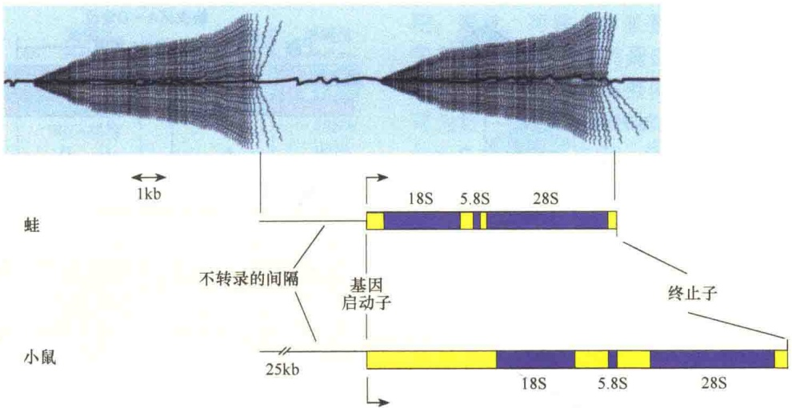
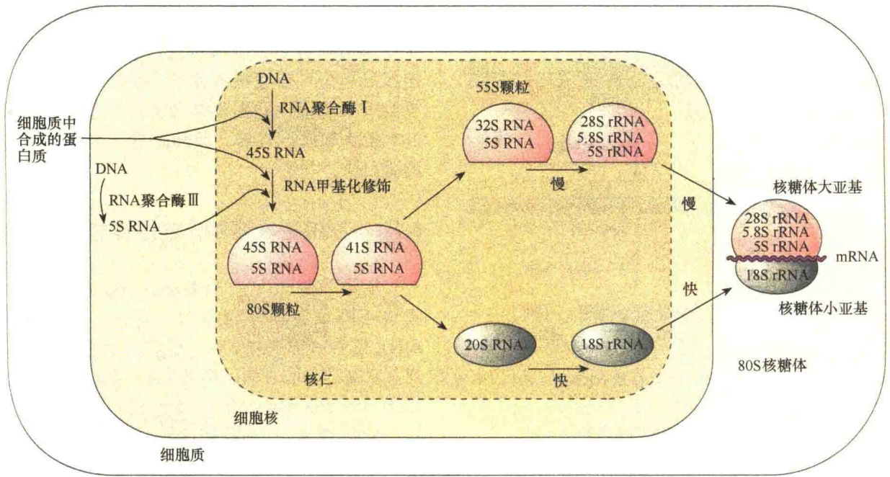

图 6-5 rRNA 转录单位（引自 Karp，2010）。图的上半部是正在转录的 rDNA 形成的刷状 rRNA；下半部是一个转录单位的转录物，并将蛙的 rRNA 转录单位与小鼠的转录单位进行比较。从图中可见:①基因间被可转录的间隔物隔开；②转录单位之间有非转录区；③不同生物的 rDNA 转录起点可能不同；④不同生物的 rDNA 各基因间的间隔序列长短不同。

图 6-6 真核生物 45S 前 rRNA 在核仁中进行的化学修饰与切割（引自 Alberts et al., 2015）。圆点表示甲基化，三角形表示假尿苷。

由 RNA-修饰酶完成修饰；而前 rRNA 的特异性切割位点则由另一些指导 RNA 来引导。所有参与修饰与切割的指导 RNA 都位于一种 snoRNA（small nucleolar RNA）（图 6-7）之中。之所以称为 snoRNA，是因为它们属于在核仁中起作用的小分子 RNA。很多 snoRNA 都是由内含子编码的，特别是那些编码核糖体蛋白质基因的内含子。

## 6.1.3.3 5S rRNA基因的转录与加工

5S rRNA 是核糖体大亚基的一个组分，长度约为 120 个核苷。原核生物和真核生物的核糖体都有

5S rRNA，而且结构相似。真核生物的 5S rRNA 基因与其他 3 种 rRNA 基因不在同一条染色体上，它是由核仁以外的染色体基因转录的，然后转运到核仁内参与核糖体的装配。5S rRNA 基因的数量比 45S rRNA 转录单位多，人的 5S rRNA 基因有 500 个拷贝，并且在染色体上串联排列。非洲爪蟾的 5S rRNA 基因的排列研究得较为清楚:一个重复单位含有一个 5S rRNA 基因、一个不转录的假基因（pseudogene）（101bp 的 5S rRNA 基因的片段），每个重复单位间被不转录的间隔序列隔开，间隔序列的长度变化不定，最长达 400bp；基因转录的速度很快，产生过量的 5S rRNA，有些最后要被降解掉。

图 6-7 指导 RNA 介导对前 rRNA 的修饰（引自 Alberts et al., 2015）。A. rRNA 被修饰后形成两种新的化合物；B. snoRNP（核仁小核糖核蛋白，small nucleolar ribonucleoprotein）中指导 RNA 引导特异的位点进行修饰。

5S rRNA 基因是由 RNA 聚合酶Ⅲ转录的，原初转录物的 5' 端与成熟的 5S rRNA 的 5' 端完全相同。在某些生物中，3' 端通常含有多余的核苷酸，在加工时要被切除。所以，5S rRNA 只需要进行简单的加工，或者根本不需要进行加工。

在 3 种 RNA 聚合酶中，RNA 聚合酶Ⅲ通常与位于转录部分的启动子结合，而不是与转录起始位点上游的启动子结合；也就是说 RNA 聚合酶Ⅲ使用的是内部启动子，其他的两种酶使用的是上游启动子，实验也证明这种内部启动子的存在。有人将 5S rRNA 基因的 5' 端的上游序列完全除去，并不影响 5S rRNA 基因的转录。但是，如果将 5S rRNA 基因内部缺失一部分序列（从 50 位到 80 位缺失），RNA 聚合酶Ⅲ不仅不能转录这段 DNA，甚至不能结合上去（图 6-8）。如果将 5S rRNA 基因的内部启动子序列插入到基因组的其他部位，会使插入的部位形成一个新的转录起点。

有 3 个转录因子参与 RNA 聚合酶Ⅲ对 5S rRNA 基因的转录，其中转录因子 TFⅢA 是 5S rRNA 基因转录特异的，其他两种转录因子是 RNA 聚合酶Ⅲ转录其他基因时都需要的。

## 6.1.3.4 原核生物 rRNA 基因及转录与加工

虽然原核生物没有细胞核和核仁，但细菌核糖图 6-8 RNA 聚合酶Ⅲ转录 5S rRNA 基因启动子的鉴定（引自 Kleinsmith and Kish，1995）。将图中 5S rRNA 基因的 A 片段或 D 片段缺失，都不会影响 RNA 聚合酶Ⅲ的转录，但是将 B 片段或 C 片段缺失，都会影响 RNA 聚合酶Ⅲ的转录，表明 5S rRNA 基因的启动子位于 5S 基因内部的控制区。

推论:序列 $47\sim 83$ 位为转录所必需

体的组织和结构与真核生物有许多相似之处。原核生物 rRNA 基因也是多拷贝的，并且也要被转录成一个前体，然后再经加工，成为成熟的 rRNA。但是，原核生物和真核生物的 rRNA 基因在组织结构上有一些重要的差异。首先表现在基因的重复次数上，真核生物的 rRNA 基因重复次数相当高，而原核生物的 rRNA 基因重复次数却很低，如 E. coli 只重复了 7 次。另一个差别是，在真核生物中编码 5S rRNA 的基因位于不同的染色体上，而细菌的 5S rRNA 基因与另外两种 rRNA 基因组成一个转录单位，它们在染色体上的排列顺序是:16S-23S-5S。

通过核酸酶Ⅲ（RNase Ⅲ）突变体的研究证明原核生物的3种rRNA位于同一个原初转录物中。在这种突变体中，3种rRNA位于同一条rRNA分子中，但是在正常的细胞中这3种rRNA是以3种独立的小分子存在的，这一研究结果也说明RNase Ⅲ是将16S-23S-5S前rRNA切割成单体的主要核酸酶。

在细菌中 RNase Ⅲ不是参与前 rRNA 加工唯一的酶，还需要其他一些核酸酶参与。实验证明，如果缺少其他一些酶，就不能得到正确大小的 rRNA。细菌中的 rRNA 转录单位除了转录 3 种 rRNA 外，同时也会产生几种 tRNA 分子。在 16S rRNA 和 23S rRNA 间可产生 2 个 tRNA，在 5S rRNA 基因的下游也会产生 1 个 tRNA。

与真核生物一样，细菌的 rRNA 也有甲基化，但比真核生物 rRNA 甲基化程度低。细菌的 rRNA 加工过程见图 6-9。

图 6-9 E. coli 前 rRNA 的转录与加工（引自 Kleinsmith and Kish, 1995）。

## 6.2 核糖体的装配

核糖体是自装配的细胞器，当蛋白质和 rRNA 合成加工成熟之后，就要开始装配核糖体的大、小两个亚基。真核生物核糖体亚基的装配地点在细胞核的核仁部位，原核生物核糖体亚基的装配则在细胞质中。

## 6.2.1 核糖体亚基的自我装配

关于原核生物核糖体装配的了解主要是通过体外实验获得的。

为了研究核糖体中蛋白质和 rRNA 的关系及装配机制，1968 年，Nomura 把拆开的大肠杆菌核糖体的 30S 小亚基的 21 种蛋白质与 16S rRNA 在体外混合后重新装配成 30S 小亚基，然后把重建的小亚基与 50S 大亚基及其他辅助因子混合后，进行蛋白质合成实验，发现重建的核糖体具有生物活性，能催化氨基酸掺入蛋白质多肽链中。这一实验表明，核糖体是一种自组装（self-assembly）的结构，即没有模板或亲体结构。但是在组装过程中，蛋白质的结合有先后之分:某些蛋白质必须先结合到 rRNA 上，其他蛋白质才能组装上去，即组装过程有先后顺序。

在核糖体重装配过程中，可以通过减去某一种蛋白质来验证该蛋白质在亚基装配及亚基中的作用。据此，可将30S亚基上的蛋白质分为3类:①开始装配所必需的蛋白质，它们先与rRNA特定区段结合，形成核糖体亚基的核心；②结合后可为后一批蛋白质提供结合位点的蛋白质；③非30S亚基形成所必需，但却是显示其活性所必需的蛋白质。

## 6.2.2 原核生物核糖体重组实验

所谓核糖体重组（ribosome recombination）是指将不同来源的核糖体大小亚基、不同亚基的rRNA或蛋白质重新组合，形成杂合的核糖体后研究其功能的实验方法。结果表明:①30S亚基的蛋白质只与16S rRNA结合；50S亚基的蛋白质只与23S rRNA结合，如果把30S亚基rRNA和50S亚基的蛋白质相混合，则不能装配成有功能的亚基。②从不同种细菌提取30S亚基的rRNA和蛋白质，可装配成有功能的30S亚基，这表明不存在种间差异。③原核生物核糖体与真核生物核糖体的亚基不同，由二者的rRNA和蛋白质重组后的核糖体没有功能。④大肠杆菌的核糖体与玉米叶绿体核糖体亚基重组后具有功能。⑤由于不同生物的线粒体核糖体大小不同，由55S到80S不等，而原核生物的核糖体基本稳定，所以线粒体的核糖体亚基与原核生物核糖体亚基相互重组形成的杂合核糖体没有功能。

## 6.2.3 真核生物核糖体的装配

真核生物核糖体的合成与装配比原核生物核糖体的合成与装配要复杂得多。编码核糖体亚基的蛋白质基因转录后在细胞核中加工成熟，随即运送到细胞质中合成蛋白质，再将合成的蛋白质送回细胞核的核仁中参与核糖体亚基的装配。组成核糖体亚基的18S rRNA、5.8S rRNA和28S rRNA基因在核仁中边转录边参与核糖体亚基的装配，5S rRNA却是在细胞核中转录后运送到核仁中参与核糖体亚基的装配。图6-10是关于人细胞中核糖体装配的示意图。按照这个模型，首先要合成与核糖体装配有关的蛋白质，这些蛋白质包括核糖体结构蛋白和与前rRNA加工有关的酶。它们都是在细胞质的游离核糖体上合成，然后迅速集中到细胞核，并在核仁区参与核糖体亚基的装配。

装配过程中，45S RNA、5S RNA 与蛋白质形成 80S RNA 颗粒，然后 80S 颗粒被降解成大、小两个颗粒，大颗粒为 55S，含有 32S 和 5S 两种 RNA，小颗粒含有 20S 的前 rRNA。然后，小颗粒中的 20S 前 rRNA 被快速降解成 18S 的 rRNA，并运送到细胞质中，即是成熟的核糖体小亚基。55S 大颗粒中的 32S RNA 被加工形成 28S 和 5.8S 两种 rRNA 并与 5S rRNA 装配成成熟的大亚基后，被运送到细胞质中，这个过程比较慢。如果这时有 mRNA 与小亚基结合，大亚基即可结合上去形成完整的核糖体，并进行蛋白质的合成。

图 6-10 人细胞中核糖体装配的主要过程（引自 Kleinsmith and Kish, 1995）。根据该装配模型，从核 DNA 转录的 45S 前 rRNA 与蛋白质结合、甲基化、与 5S rRNA 结合形成 80S 核糖核蛋白颗粒。通过 RNA 的加工，将 80S 的颗粒转变成大小核糖体亚基，然后被运送到细胞质参与蛋白质的合成。

最早发现核仁与核糖体形成有关的是20世纪60年代初期Perry的研究工作。他用紫外微光束破坏活细胞的核仁，发现破坏了核仁的细胞丧失合成rRNA的能力，这一发现提示核仁与核糖体的形成有关。后来Perry又发现低浓度的放线菌素D能够抑制 $^{3}$ H-尿嘧啶掺入rRNA中，而不影响其他种类的RNA合成。显微放射自显影也显示放线菌素D能够选择性阻止核仁RNA的合成，表明核仁与rRNA的合成有关。

## 6.3 核糖体的功能——蛋白质合成

核糖体的功能是进行蛋白质的合成。蛋白质的合成，或称 mRNA 翻译是细胞中最复杂的合成活动。蛋白质的合成需要携带氨基酸的各种 tRNA、核糖体、mRNA、不同功能的蛋白因子、阳离子、GTP 等的参与。蛋白质的合成过程之所以复杂，是因为构成蛋白质的 20 种氨基酸要按照密码精确地掺入多肽中，不能有丝毫的差错。

## 6.3.1 蛋白质合成的基本过程

在核糖体上合成的只是蛋白质的一级结构，即多肽链。合成是从多肽链的 N 端开始，到 C 端结束。对于 mRNA 来说，合成的方向则是  $5'\rightarrow3'$  端。蛋白质的合成是一个极其复杂的过程，大约分为 5 个阶段（图 6-11）。

第一阶段:氨基酸激活（activation of amino acid）。对于蛋白质多肽的合成来说，一定会遇到两个基本的化学问题:一是氨基酸的羧基必须被激活，才能促进肽键的形成；二是新的氨基酸必须与 mRNA 中携带的密码信息建立一种有效的关联。在合成的第一阶段遇到的这两个问题是通过氨基酸与 tRNA 的结合解决的。至关重要的是，需要将正确的氨基酸结合到正确的 tRNA 上，这一反应是在胞质中完成的，而不在核糖体上。20 种氨基酸在 ATP 供能、 $Mg^{2+}$  介导下，通过氨酰合成酶的催化作用与各自特异的 tRNA 共价结合。

第二阶段:起始（initiation）。携带有多肽合成密码的 mRNA 与核糖体的小亚基结合，然后与起始氨酰 tRNA 结合，形成起始复合物。起始氨酰 tRNA 通过碱基配对，与 mRNA 的起始密码子 AUG 结合。该过程需要 GTP 及一些促进起始的蛋