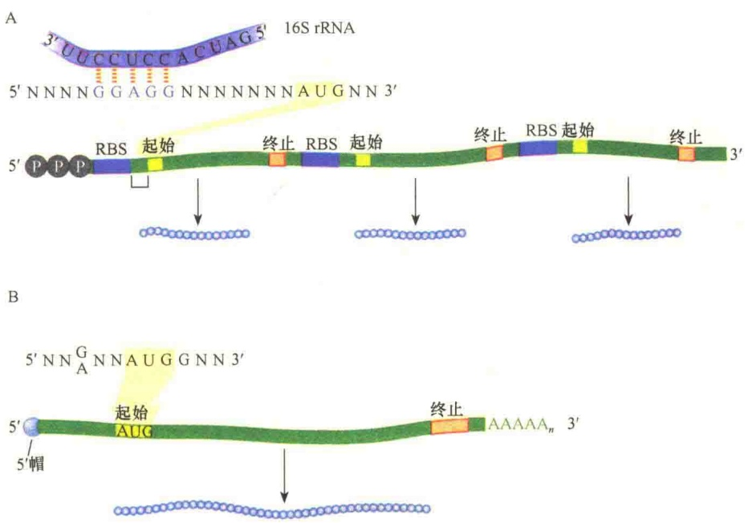
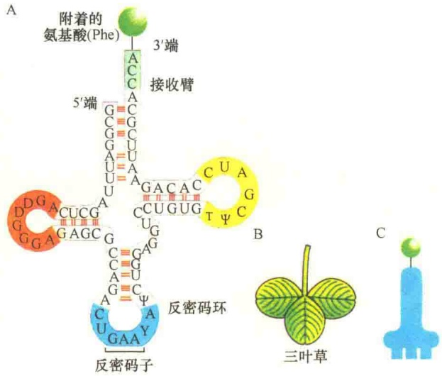
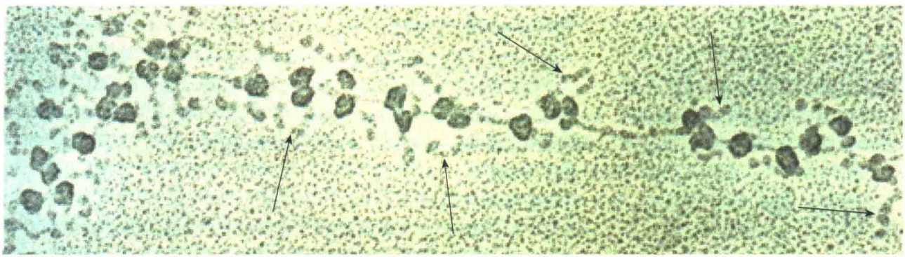
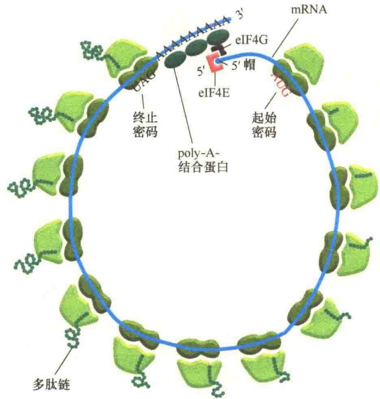

图 6-11 蛋白质合成概览（引自 Nelson and Junge, 2015）。蛋白质合成分为 5 个阶段:① 氨基酸激活:tRNA 的氨酰化；② 起始:氨酰 tRNA、mRNA 与核糖体小亚基结合，再结合上核糖体大亚基，形成起始复合物；③ 延伸:第二个氨酰 tRNA 结合上来，核糖体沿着 mRNA 移动，携带不同氨基酸的 tRNA 与匹配的密码子结合，催化肽键的形成；④ 终止与核糖体循环:转译到终止密码处终止，释放出核糖体，进入下一轮蛋白质合成；⑤ 折叠及翻译后加工。

白因子的协助。

第三阶段:延伸（elongation）。一旦起始复合物形成，蛋白质的合成随即开始，此过程称为蛋白质合成的延伸。延伸涉及4个重复的步骤:①氨酰tRNA进入核糖体的A位点；②肽键形成；③转位；④脱氨酰tRNA释放。上述4步的循环，使肽链不断延长。在整个过程中，需要GTP和一些延伸因子的参与。

第四阶段:终止与核糖体循环（termination and ribosome recycling）。蛋白质合成的终止是指核糖体沿着 mRNA 移动，如果进入 A 位点的是终止密码子，由于没有与之匹配的反密码子而终止蛋白质的合成。一共有 3 种终止密码子:UAA、UAG、UGA，其中任何一种进入 A 位点都会终止蛋白质的合成，并导致多肽链从核糖体释放出来。

蛋白质合成的终止需要释放因子（release-factor，RF）的存在。细菌有3种终止释放因子:RF1、RF2、RF3。RF1能够识别UAA和UAG终止密码子；RF2识别终止密码子UAA和UGA；RF3虽不识别特异的终止密码子，但是能够增加其他因子的活性。真核细胞有两种释放因子:eRF1和eRF3，这两种因子共同作用，能够识别所有的终止密码子。研究表明，释放因子与tRNA非常相似，所以释放因子能够进入A位点直接与终止密码子相互作用。

第五阶段:折叠及翻译后加工（folding and posttranslation processing）。从核糖体上释放的仅仅是多肽，是不具有生物学功能的。所以，释放出的多肽必须经过折叠及适当的加工，才能行使生物学功能。一般的加工包括乙酰化、磷酸化、甲基化等。此外，还有可能切除一些氨基酸，或是添加一些氨基酸。正确的空间构型对于蛋白质的功能是十分重要的。虽然这些反应不是在核糖体上进行的，但仍属于蛋白质合成的一部分。

由上述蛋白质合成的 5 个阶段可知，蛋白质的合成除了核糖体、rRNA、tRNA、mRNA，还需要能源分子、离子，以及各种辅助蛋白的参与（表 6-3）。

表 6-3 大肠杆菌中蛋白质合成各阶段所需的组分

| 阶段 | 基本组分 |
| --- | --- |
| 1.氨基酸的激活 | 20种氨基酸,20种氨酰tRNA合成酶32种(或以上)tRNA,ATP,$Mg^{2+}$ |
| 2.起始 | mRNA,N-甲酰化$tRNA^{fMet}$mRNA中起始密码(AUG),30S核糖体亚基50S核糖体亚基,起始因子(IF-1、IF-2、IF-3)GTP,$Mg^{2+}$ |
| 3.延伸 | 有功能的70S核糖体(起始复合物)各种与密码子匹配的特异氨酰tRNA延伸因子(EF-Tu、EF-Ts、EF-G)GTP,$Mg^{2+}$ |
| 4.终止 | mRNA中的终止密码释放因子(RF-1、RF-2、RF-3、RRF)EF-G,IF-3 |
| 5.折叠与翻译后加工 | 分子伴侣与折叠酶(PPI,PDI)特异性的酶,辅助因子,以及其他与加工相关的酶和蛋白质 |

## 6.3.2 核糖体的功能位点

从蛋白质合成的过程看，蛋白质合成是由核糖体提供平台（“战场”），mRNA、tRNA、rRNA通力合作“会战”（图6-12），合力将mRNA中的密码翻译成相应的氨基酸，并以多肽链的形式提供给细胞，催生成千上万个“英雄好汉”。

图 6-12 蛋白质合成中三种 RNA 的作用（引自 Lodish et al., 2013）。rRNA 是核糖体的组成部分，参与平台的构建。原核生物（如细菌）的核糖体有 3 种不同 rRNA，真核生物的核糖体有 4 种 rRNA；mRNA 是信使 RNA，其序列中有可翻译成蛋白质氨基酸的密码；tRNA 是搬运工，它可以与相应的氨基酸结合，并通过 tRNA 上的反密码子与 mRNA 中密码子配对，完成密码子的翻译。

蛋白质合成是极其复杂又高度有序的过程。mRNA与核糖体的结合、氨酰tRNA的进入及卸载tRNA的退出都有各自的通道，也就是说，核糖体上有特异的功能位点，使得整个翻译过程有条不紊。

原核生物核糖体中有 4 种与 RNA 分子结合的位点，其中一个是与 mRNA 结合的位点，另外 3 个是与 tRNA 结合的位点（图 6-13）。

（1）A 位点（A site），即氨酰基位点，是与新掺入的氨酰 tRNA（aminoacyl-tRNA）结合的位点，又叫受位（entry site），主要位于大亚基。

（2）P位点（P site），即肽酰tRNA位点（peptidyl-tRNA site），又叫供位（donor site）或肽酰基位点，主要位于大亚基，是肽酰tRNA移交肽链后所占据的位置，即与延伸中的肽酰tRNA结合的位点。

（3）E位点（exit site）是脱氨酰tRNA（dea-minoacyl-tRNA）离开P位点到完全从核糖体释放出来的一个中间停靠点，只是作暂时的停留。当E位点被占据之后，A位点与氨酰tRNA的亲和力降低，防止了氨酰tRNA的结合，直到核糖体准备就绪，E位点腾空，才会接受下一个氨酰tRNA。

（4）mRNA 结合位点。蛋白质的起始合成，首先需要 mRNA 与小亚基的结合，推测在核糖体上必然有与 mRNA 结合的位点。原核生物与真核生物 mRNA 的 5' 端结构不同，真核生物 mRNA 的 5' 端有帽子结构，原核生物则没有，推测它们与核糖体的结合机制是不同的。

图 6-13 原核生物核糖体中与 RNA 结合的位点（引自 Nelson and Cox, 2013）。

在原核生物中，核糖体中与 mRNA 结合的位点位于 16S rRNA 的 3' 端。mRNA 中与核糖体 16S rRNA 结合的序列称为 SD 序列，它是 1974 年由 Shine 和 Dalgarno 发现的，故此命名。SD 序列是 mRNA 中 5' 端富含嘌呤的短核苷酸序列，一般位于 mRNA 起始密码子 AUG 上游 5～10 个碱基处，并且与 16S rRNA 3' 端序列互补。真核生物没有 SD 序列，mRNA 与核糖体小亚基的结合主要是依赖于 mRNA 5' 端甲基化帽子结构的识别。

另外，原核生物 mRNA 的 5' 端与真核生物 mRNA 的 5' 端结构不同，因此与核糖体的识别和结合机制也不同（图 6-14）。

## 6.3.3 tRNA及氨酰tRNA的合成

在蛋白质合成过程中，tRNA 具有重要作用，而这一重要作用与它的结构有关（图 6-15）。

tRNA 分子长 70～80 个核苷，在溶液中折叠成柄-环结构，类似三叶草，故称为三叶草结构。它有三个环，即 D-环、反密码环、T-环，还有 4 个由碱基配对而成的柄，在 3' 端有氨基酸接受臂。在 tRNA 的序列中有一些特殊的核苷，如次黄嘌呤核苷（inosine）、二羟尿苷、假尿苷等，这些特殊的核苷都是在 tRNA 合成后被修饰而成的。

有20种不同的tRNA用于转运20种不同的氨基酸进行蛋白质合成。tRNA 的氨酰化是由氨酰 tRNA 合成酶催化完成的。细胞中有 20 种不同的氨酰 tRNA 合成酶，每一种氨酰 tRNA 合成酶识别一种特异的氨基酸。氨酰 tRNA 合成酶将氨基酸偶联到 tRNA 3' 端腺嘌呤的 2' 或 3' 羟基上，此过程需要 ATP 供能。在偶联反应中，氨基酸通过高能键与 tRNA 连接，该反应称为氨基酸的激活（图 6-16）。此时形成的键能可用于后来的肽键的

图 6-14 原核生物与真核生物 mRNA 的结构比较（引自 Watson et al., 2014）。A. 典型的细菌核糖体与 mRNA 的结合位点 mRNA 中的 SD 序列与核糖体 16S rRNA 3' 端互补。在 SD 序列的下游 5～10 个碱基处是起始密码子 AUG 或 GUG。B. 真核生物 mRNA, 5' 端有帽结构，不需要 SD 序列。RBS（ribosome binding site）为核糖体结合位点。

图 6-15 苯丙氨酸 tRNA 的结构（引自 Alberts et al., 2015）。
A. tRNA 三叶草形结构的碱基对；B. 三叶草；C. 作用时的模式。

形成。

氨酰 tRNA 合成酶与相关联 tRNA 的识别主要是通过反密码环和受体臂的相互作用，有时 tRNA 的其他部分对识别也有帮助。氨酰 tRNA 合成酶与正确的 tRNA 结合是非常重要的，不仅如此，氨酰 tRNA 合成酶与正确的氨基酸结合也同样重要。为保证不出差错，氨酰 tRNA 合成酶本身具有校读机制。

## 6.3.4 多聚核糖体

在蛋白质合成过程中，同一条 mRNA 分子能够与多个核糖体结合，同时合成若干条蛋白质多肽链，结合在同一条 mRNA 上的核糖体就称为多聚核糖体（polysome 或 polyribosome）（图 6-17）。

20 世纪 60 年代有几个实验室先后发现了多聚核糖体。例如，Rich 的实验室采用未成熟的红细胞研究蛋白质合成时发现了多聚核糖体。他们将未成熟的红细胞与放射性物质进行短暂培养，以标记新合成的蛋白质，然后温和地破碎细胞，离心除去细胞核和线粒体，收集上清液，在上清液中含有核糖体。然后通过移动区带离心，发现除了 80S 的核糖体之外，还有 170S 的核糖体，而放射性的标记物主要存在于 170S 的核糖体上，因此推断在蛋白质合成时，核糖体可能是成串存在的。电子显微镜观察证实:80S 的核糖体是单个存在的，而 170S 的核糖体是由 4～6 个核糖体组成的多聚核糖体。

图 6-16 将核酸序列解码成氨基酸序列（引自 Lodish et al., 2013）。在蛋白质合成中，将 mRNA 中的核酸序列翻译成氨基酸序列，涉及两个步骤:①氨酰 tRNA 合成酶先与特异的氨基酸偶联，经由一个高能酯键与相应 tRNA 末端的腺嘌呤 2' 或 3' 羟基相连；②氨酰 tRNA 反密码环中的 3 个碱基序列通过配对规律与 mRNA 中对应的密码序列配对，从而对 mRNA 中的密码子进行解码。

图 6-17 电子显微镜观察的多聚核糖体（引自 Voet et al., 1995）。图中所示是蚕的丝心蛋白 mRNA 3' 端多聚核糖体，箭头所示是丝心蛋白多肽。

1）多聚核糖体的形成 在 mRNA 的起始密码子部位，核糖体亚基装配成完整的起始复合物，然后向 mRNA 的 3' 端移动，直至到达终止密码子处。当第一个核糖体离开起始密码子后，空出的起始密码子的位置足够与另一个核糖体结合时，第二个核糖体的小亚基就会结合上来，并装配成完整的起始复合物，开始蛋白质的合成。同样，第三个核糖体、第四个核糖体……依次结合到 mRNA 上（图 6-18）。根据电子显微照片推算，多聚核糖体中，每个核糖体间相隔约 80 个核苷酸。同一条 mRNA 被多个核糖体同时翻译成蛋白质，大大提高了蛋白质合成的速率，也减轻了细胞核进行基因转录和加工的压力。

2）多聚核糖体的意义 由于 mRNA 的寿命有限，合成后必须快速用于蛋白质的合成。在细菌中，mRNA 的转录与蛋白质的翻译是偶联的，其本身的速度就很快，而在真核生物中，转录的是 pre-mRNA，需要加工。为了提高 mRNA 的利用率，一个核糖体启动之后，第二个核糖体紧接着结合上

图 6-18 真核生物多聚核糖体及成环（引自 Alberts et al., 2015）。一条 mRNA 上有多个核糖体在进行多肽的合成。eIF4E 与 mRNA 5' 帽结合，eIF4G 同时与 eIF4E、poly-A-结合蛋白结合，从而使转译中 mRNA 成环。