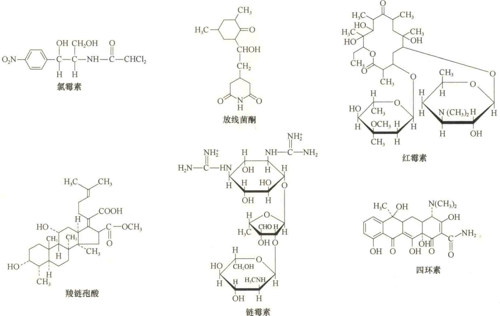
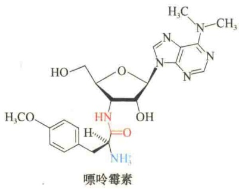
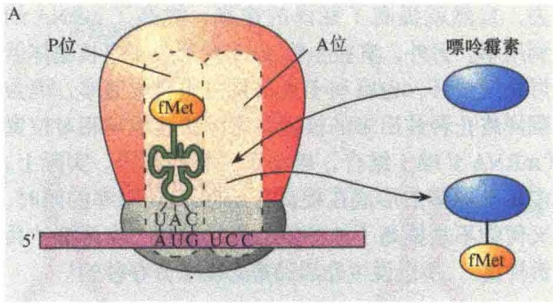
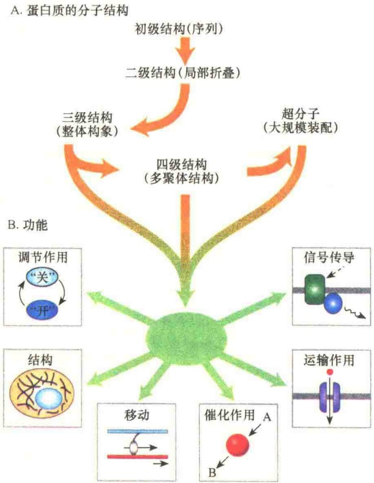
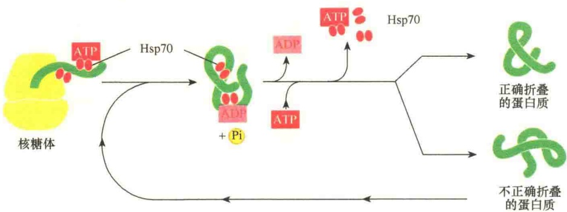

去，自然就提高了翻译的速率，提高了mRNA的利用率。另外，真核生物mRNA形成多聚核糖体后可快速成环，也有利于提高蛋白质合成速率，因为翻译终止释放出来的核糖体可以快速地与相对位置（mRNA 5'端）结合，启动下一轮的翻译。实际上，多聚核糖体的形成在提高了mRNA利用率的同时，又何尝不是提高了核糖体的使用率呢，真可谓“兵贵神速”，所以说生命活动是必须争分夺秒的！

## 6.3.5 蛋白质合成抑制剂

不同的蛋白质合成抑制剂具有不同的作用机制，它们是研究蛋白质合成机制的有用工具。

## 6.3.5.1 抗生素

抗生素（antibiotic）是主要的蛋白质合成抑制剂，如氯霉素、链霉素等。

不同的抗生素作用机制不同，如链霉素主要是抑制起始tRNA和非起始tRNA与核糖体的结合，导致肽链合成的提前终止。此外，链霉素也可引起遗传密码子的错读。例如，将链霉素加入正在用人工合成的polyU进行翻译的核糖体中，异亮氨酸、亮氨酸、丝氨酸、酪氨酸和苯丙氨酸都能掺入到新合成的多肽中。正常情况下，polyU只编码苯丙氨酸。有研究表明，在生活细胞中S12蛋白具有抗链霉素密码子错读的作用。另外，有些抗生素（如氯霉素）抑制50S大亚基肽酰转移酶的活性。

表 6-4 是一些常见的蛋白质及 RNA 合成抑制剂，图 6-19 是一些常见的蛋白质合成抑制剂的结构。

表 6-4 蛋白质及 RNA 合成抑制剂

<table><tr><td>抑制剂</td><td>影响效果</td></tr><tr><td colspan="2">仅作用于细菌</td></tr><tr><td>四环素(tetracycline)</td><td>与30S核糖体结合,阻断氨酰tRNA与核糖体的A位点结合</td></tr><tr><td>链霉素(streptomycin)</td><td>阻止起始、链延伸,诱发错配</td></tr><tr><td>氯霉素(chloramphenicol)</td><td>抑制50S核糖体亚基的肽酰转移酶的活性(阻止肽键的形成)</td></tr><tr><td>红霉素(erythromycin)</td><td>与50S亚基结合,抑制转位</td></tr><tr><td>利福霉素(rifamycin)</td><td>与RNA聚合酶结合,阻止RNA链的起始合成</td></tr><tr><td colspan="2">作用于细菌与真核</td></tr><tr><td>嘌呤霉素(puromycin)</td><td>通过与链生长端结合,引起新肽链的提前释放</td></tr><tr><td>放线菌素D(actinomycin D)</td><td>与DNA结合,阻断RNA聚合酶的移动(影响RNA合成)</td></tr><tr><td colspan="2">仅作用于真核</td></tr><tr><td>放线菌酮(cycloheximide)</td><td>阻止起始tRNA转位(tRNA从P位点释放)</td></tr><tr><td>茴香霉素(anisomycin)</td><td>阻止核糖体中肽酰转移酶的反应</td></tr><tr><td>α-鹅膏蕈碱(α-amanitin)</td><td>通过与RNA聚合酶II结合阻断mRNA的合成</td></tr></table>

图 6-19 几种常见的抑制蛋白质合成的抗生素（引自 Voet and Voet，1995）。

## 6.3.5.2 嘌呤霉素

嘌呤霉素（puromycin）是一种蛋白质合成抑制剂，它具有与tRNA分子末端类似的结构（图6-20），能够与氨基酸结合，代替氨酰化的tRNA与核糖体的A位点结合，并掺入到生长的肽链中。虽然嘌呤霉素能够与A位点结合，但是不能参与随后的任何反应，因而导致蛋白质合成的终止并释放出C端含有嘌呤霉素不成熟的多肽。

图 6-20 嘌呤霉素与苯丙氨酰 tRNA 3' 端结构的比较。

在蛋白质合成过程中，核糖体的 A 位点和 P 位点是两个极为重要的功能位点，它们的存在主要是通过嘌呤霉素的抑制实验研究证实的。

通过嘌呤霉素对蛋白质合成的抑制实验发现核糖体的 A 位点和 P 位点是两个独立的位点。实验分两组进行，在第一组实验中，将 P 位点结合有起始 tRNA 的核糖体与嘌呤霉素一起温育。在这种条件下，嘌呤霉素与核糖体结合，并且能够与起始 tRNA 相互作用（图 6-21A）。在第二组实验中，将 P 位点结合有起始 tRNA 的核糖体先与氨酰 tRNA 一起温育，使之形成肽键，然后再加入嘌呤霉素，此时加入的嘌呤霉素既不能与核糖体结合，也不能与二肽酰 tRNA 相互作用（图 6-21B），但是在反应体系中加入 GTP 和延伸因子 G 后，嘌呤霉素则能与核糖体结合。根据这两组实验结果可以判断核糖体中的 A、P 是各自独立的两个位点（图 6-21）。

图 6-21 用嘌呤霉素证明核糖体的 A、P 是两个独立存在的位点（引自 Kleinsmith and Kish，1995）。A. 在第一组实验中，只有起始 tRNA 占据 P 位点，如果 A 位点是一个独立位点的话，此时的 A 位点就是空闲的，嘌呤霉素当然能够结合上去；如果 A 位点与 P 位点是同一位点，那么嘌呤霉素就不能与核糖体结合，实验结果是嘌呤霉素能够结合。B. 在第二组实验中，由于 A 位点已经被占据，嘌呤霉素无法与 A 位点结合，只有加入延伸因子和 GTP 后，使 A 位点腾空，嘌呤霉素才能结合到核糖体上。因此，根据这两组实验结果可以断定 A、P 是两个独立的功能位点。

## 6.4 蛋白质的折叠、修饰与降解

蛋白质是细胞功能的执行者，所以蛋白质的合成是细胞中最重要的合成事件。但是在核糖体上合成的仅是蛋白质的一级结构——多肽，要想行使功能，必须要折叠成高级结构。另外，蛋白质不仅是细胞各结构的组成部分，也是各细胞器功能的实现者，所以它要被准确地运送到“岗”。再者，蛋白质的寿命是有限的，再加上细胞周期的关系，一些蛋白质的“出场”时间是受限的，如何对“延时”蛋白质及时清理，也是考验细胞的智慧。

## 6.4.1 蛋白质折叠与分子伴侣

蛋白质是氨基酸的聚合体，有不同的大小与形态。它们的三维结构的不同是由多肽链的长度及氨基酸不同造成的。由于蛋白质的不同形态与不同化学性质，因而具有不同功能。虽然蛋白质各自具有不同的功能，但还是可以分成不同的功能大类。例如，结构蛋白（structure protein）与细胞的空间结构、形态有关；支架蛋白（scaffold protein）指导蛋白质组装成特异功能的平台；酶蛋白行驶催化功能；膜运输蛋白行驶细胞的运输功能等。总之，蛋白质的形态结构与功能是统一的，形态是多样的，功能也是多样的（图6-22）。

图 6-22 蛋白质的装配与功能概览（引自 Lodish et al., 2013）。A. 蛋白质具有四个层级结构。一级结构是线性多肽；二级结构是多肽链折叠成螺旋或片层。在二级结构基础上，包装成三维形态，即三级或超分子的结构；再进一步组装成多聚体的结构，即四级结构。B. 蛋白质行驶多种功能，包括将基因组包装成三维形态、细胞器的组建、膜构建，还参与信号传递、催化反应等。

## 6.4.1.1 蛋白质折叠

由上可知，蛋白质的形态决定功能（form follows function），因此，多肽合成之后必须快速折叠成高级结构（图6-23），才可快速发挥作用。蛋白质折叠成的高级结构，通常是 $\alpha$ 螺旋或 $\beta$ 片层构型。其实，蛋白质折叠（protein folding）也有利于防止蛋白质由于相互粘连聚集成为水不溶的“蛋白质团”而丧失功能。折叠的另一个好处是可防止水解酶的攻击。要知道，细胞中的“明枪暗箭”是很多的，做好安全防范，才能更好地生存。

图 6-23 蛋白质折叠成一个致密的构型（引自 Alberts et al., 2015）。极性氨基酸侧链倾向位于蛋白质的外侧，便于与水作用。非极性氨基酸被包在内侧，形成疏水的核。

## 6.4.1.2 分子伴侣在蛋白质折叠中的作用

蛋白质的折叠并非自主行为，虽然决定如何折叠的是蛋白质的氨基酸序列，但需要帮手，或者需要指导者，细胞中具有这一功能的分子称为分子伴侣（chaperone或molecular chaperone），其本质也是蛋白质。分子伴侣在细胞中广泛存在（无论是细菌，还是人），而且结构上也高度同源，作用机制也基本相同。分子伴侣作用时需要ATP，利用ATP水解释放的能量帮助新生蛋白质折叠。分子伴侣最早是Ron Laskey及其同事提出的，用于描述一种细胞核蛋白（核质蛋白）。这种蛋白质是组蛋白与DNA装配成核小体所必需的。因此，分子伴侣的主要特点是帮助装配自身又不成为装配体的一部分，后来这一概念扩大到在所有装配中起作用的蛋白质，包括参与蛋白质折叠的蛋白质。

分子伴侣又称伴侣分子，它与蛋白质底物的短片段结合，以稳定未折叠的蛋白质或是让其部分折叠，以防止底物蛋白聚集或被降解。例如，Hsp70、Hsp90就是此类分子伴侣。图6-24是Hsp70帮助新生蛋白质折叠的示意图。

Hsp70 作用时需要 ATP，并能将 ATP 水解，所以，Hsp70 具有 ATP 酶的活性，也是一种 ATPase。Hsp70 帮助折叠的蛋白质不仅仅是新生的蛋白质，也包括细胞内因不良环境造成的折叠不正常的蛋白质，进行“救死扶伤”。

图 6-24 分子伴侣 Hsp70 家族介导的蛋白质折叠（引自 Alberts et al., 2015）。这类分子伴侣工作较早，核糖体上合成的新生肽露出一小段就被 Hsp70 分子伴侣所识别并与之结合，在一组小分子 Hsp40（未显示）的协同下，ATP 与 Hsp70 结合，然后将 ATP 水解成 ADP，帮助靶蛋白折叠后离开。若是折叠不正确，重新进行折叠。

有一种分子伴侣称为伴侣蛋白（chaperonin），这种分子伴侣会形成一个折叠“工作室”，让被折叠的蛋白质进入室内的适宜环境，经过一段时间过程进行合适的折叠，Hsp60家族就属于此类伴侣蛋白。

对于分子质量大的蛋白质的折叠，Hsp70 家族是“无能为力”的，需要另一个家族，即 Hsp60 家族。因此，Hsp60 家族是介导较大蛋白质正确折叠的分子伴侣。Hsp60 家族是巨型圆桶状的结构，由两个低聚体的环构成。有两类不同的伴侣蛋白，它们在结构、定位及作用机制等方面稍有不同。Ⅰ类伴侣蛋白是在原核生物、叶绿体、线粒体中发现的，由两个环构成，每个环上有7个亚基构成的盖。细菌中的Ⅰ类伴侣蛋白称为GroEL/GroES，它参与10%的蛋白质的折叠。Ⅱ类伴侣蛋白是在真核生物及古细菌中发现的，每个环上有8～9个同质或异质的亚基构成的盖。图6-25是伴侣蛋白GroEL/GroES帮助蛋白质折叠的示意图。

图 6-25 原核生物伴侣蛋白 GroEL 介导的蛋白质折叠（引自 Lodish et al., 2013）。①部分折叠或错误折叠的蛋白质进入伴侣蛋白的折叠室，第二个折叠室被 GroES 盖封闭了，每个环中 7 个 GroEL 亚基结合 7 个 ATP，水解 ATP 释放 ADP，使底部的 GroES 盖与桶脱离转而与伴侣蛋白顶部结合，同时补充 ATP。②被折叠的蛋白质在伴侣蛋白桶内随着 ATP 的水解，缓慢循环折叠。③诱导 ATP 结合，同时诱导 GroES 盖与另一个环结合；结合后引起 GroES 盖与 ADP 和含肽的环结合，然后打开上盖，释放 ADP、蛋白质。④如果释放的蛋白质折叠正确，就会进入细胞发挥作用，若折叠不正确，则需重新进入伴侣蛋白进行重折叠。

## 6.4.1.3 蛋白质酶促折叠——二硫键的形成

蛋白质多肽中半胱氨酸间二硫键的形成对于稳定蛋白质的折叠具有重要作用，蛋白质二硫化异构酶（protein disulfide isomerase，PDI）催化二硫键的形成（图 6-26）。对于含有多个半胱氨酸的蛋白