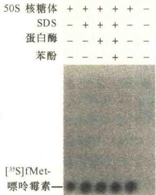

（3）将与E2结合的泛素C端第76位甘氨酸羧基与靶蛋白的赖氨酸侧链的氨基形成共价键，该反应是由泛素-蛋白连接酶（ubiquitin-protein ligase）E3催化的。这种类型的键称为异肽键（isopeptide bond）。在连接酶的连续作用下，不断将新的泛素通过其C端甘氨酸羧基经由异肽键结合到前一个泛素第48位赖氨酸上，形成与靶蛋白共价连接的多聚泛素链（图6-31）。

当多聚泛素链达到 4 个或更多个泛素连接后，26S 蛋白酶体的 19S 帽能够识别泛素化标记的靶蛋白（有时需要一些相关蛋白的帮助），并将其解折叠、转入蛋白酶体进行降解（图 6-31C）。

蛋白酶体对蛋白质的降解需要通过泛素的介导，所以又将之称为泛素降解途径。蛋白酶体对蛋白质的降解作用分为两个过程:一是对被降解的蛋白质进行标记，由泛素完成；二是蛋白酶解作用，由蛋白酶体催化。

## 6.5 核酶

核酶（ribozyme）一词用于描述具有催化活性的 RNA，即化学本质是核糖核酸（RNA），却具有酶的催化功能。核酶的作用底物可以是不同的分子，有些作用底物就是同一 RNA 分子中的某些部分。核酶的功能很多，有的能够切割 RNA，有的能够切割 DNA，有些还具有 RNA 连接酶、磷酸酶等活性。与蛋白质酶相比，核酶的催化效率较低，是一种较为原始的催化酶。

## 6.5.1 核糖体是一种核酶

核糖体是合成蛋白质的机器，它的构成成分的2/3是rRNA，只有1/3是蛋白质。一系列的研究发现，rRNA是核糖体的核，而核糖体蛋白质起稳定rRNA核的作用。不仅如此，rRNA本身具有酶的活性。

在蛋白质合成过程中，肽键的形成是由肽酰转移酶（peptidyl transferase）催化的。它催化核糖体A位点tRNA上末端氨基酸的氨基与P位肽酰-tRNA上氨基酸的羧基间形成肽键。其结果使A位点的氨酰-tRNA上的多肽延长了一个氨基酸，而P位点的氨酰-tRNA形成脱氨酰-tRNA（图6-32）。

多年来一直把催化氨基酸间肽键形成的反应看成是由核糖体蛋白质酶催化完成的，但不能确定是何种蛋白质。Harry Noller 和他的同事分别在 1972 年、1992 年发表了两项研究结果，证明核糖体 rRNA 在蛋白质合成中具有催化作用:1972 年的论文是通过改变 rRNA 中的碱基，使核糖体失去活性；1992 年的论文是除去核糖体中的蛋白质，发现除去蛋白质的核糖体仍具有肽酰转移酶的活性。

1992年发表的研究论文的策略是用去垢剂、蛋白酶、苯酚除去核糖体中的蛋白质，而不使rRNA 降解或变性。为了检查除去蛋白质的核糖体是否能够合成蛋白质，Noller 和他的同事们使用了一个简化的肽酰转移酶反应体系，在反应系统中仅加有处理的 50S 核糖体，而不加起始与延伸因子，另外加 [$^{35}$S] 甲硫氨酸（便于检测），以及嘌呤霉素。用这种简化的反应体系，研究者发现水生栖热菌（Thermus aquaticus，一种嗜热菌，认为 RNA 比较稳定）的 50S 核糖体能够保留肽酰转移酶的活性，甚至用蛋白酶 K、SDS 及苯酚等处理嗜热菌 50S 亚基，即将所有的蛋白质都破坏后，仍然具有肽酰转移酶的活性（图 6-33）。

图 6-32 核糖体 A 位点和 P 位点氨基酸间肽键的形成（引自 Nelson and Cox, 2013）。

后来的实验证明，即使用蛋白酶 K 或 SDS 等处理常温的 E. coli 的 50S 核糖体，同样具有肽酰转移酶的活性。与此不同的是，用核酸酶处理核糖体 50S 亚基，将 rRNA 降解后，肽酰转移酶的活性也随之消失。这些结果提示是 rRNA 而不是蛋白质催化肽键形成。

图 6-33 50S 核糖体中 rRNA 肽酰转移酶活性证明（引自 Cox et al., 2012）。用 SDS、蛋白酶 K 或苯酚处理栖热水生菌的核糖体，然后用片段反应检测肽酰转移酶的活性，再通过电泳及放射自显影检测反应产物  $\left[^{35}\mathrm{S}\right]$  fMet-嘌呤霉素。结果显示，即使 SDS、蛋白酶 K、苯酚同时处理，都不会影响  $\left[^{35}\mathrm{S}\right]$  fMet-嘌呤霉素的形成。

## 6.5.2 具有切割功能的核酶

上面讨论的核糖体核酶是催化蛋白质合成中肽键形成的核酶，有些核酶还具有水解酶的活性，参与前体 RNA 加工。

## 6.5.2.1 RNase P 是具有切割功能的核酶

tRNA 的原初转录物只是一种前体形式，其 5' 端、3' 端及中间一个小环都要经过加工剪接，此外还要对某些序列进行修饰，才能成为成熟的 tRNA。早期认为 5' 端和 3' 端部分序列的切除分别是由核糖核酸酶 P（ribonuclease P，RNase P）和核糖核酸酶 D（ribonuclease D，RNase D）催化的，它们都是蛋白质酶。后来发现 RNase P 是 RNA 和蛋白质的复合体，含有一个单链 RNA 分子，长度为 377 个核苷酸，结合一个分子质量为 20kDa 的多肽（119 个氨基酸残基）。1983 年，Sidney Altman 及其同事分离了复合体中的 RNA，并证明分离的 RNA 具有催化切割 tRNA 的能力（图 6-34），推测蛋白质则起间接的作用，可能是维持 RNA 结构的稳定。他们的研究证明了 RNase P 是一种具有切割功能的核酶。

## 6.5.2.2 四膜虫 28S rRNA 前体的自我剪接

在大多数真核生物的 rRNA 加工中，从前 rRNA 中切除的序列都是间隔区（spacer）而不是内含子。所谓间隔区，就是位于编码基因间的序列而不是位于基因内的序列。但是在某些原生动物，如四膜虫的编码核糖体大亚基26S rRNA（相当于高等生物的28S rRNA）的基因中，有一个414个碱基的内含子（intron）。所谓内含子，是基因内的间隔序列，它不出现在成熟的RNA分子中，也就是说在转录后要通过加工被切除。与内含子相对应的是外显子（exon），即最后出现在成熟RNA中的序列。1981年，Thomas R. Cech和他的同事在研究四膜虫的26S前rRNA加工去除基因内含子时获得一个惊奇发现:内含子的切除反应发生在仅含有核苷酸和纯化的26S前rRNA而不含有任何蛋白质催化剂的溶液中，可能的解释是:内含子切除是由26S前rRNA自身催化的，而不是蛋白质。为了证明这一发现，他们将编码26S前rRNA的DNA克隆到细菌中并在无细胞系统中转录成28S前rRNA分子。结果发现这种人工制备的26S前rRNA分子在没有任何蛋白质催化剂存在的情况下，切除了前体分子中的内含子，这种现象称为自剪接（self-splicing）。

图 6-34 细菌与真核生物 tRNA 的加工（引自 Nelson and Cox，2013）。图中显示的是酵母 tRNA $^{Tyr}$ 被加工的主要过程:5' 端由核酶 RNase P 切割，3' 端由蛋白质酶切割，并在 3' 端加上 CCA，同时还要对某些碱基进行修饰。

这一发现之后不久，在酵母和真菌的线粒体前mRNA和前tRNA加工、叶绿体的tRNA和前rRNA加工、某些细菌病毒的前mRNA加工中都发现了自剪接现象。Thomas R.Cech与Sidney Altman因发现RNA催化剪接共同获得1989年诺贝尔化学奖。

## 6.5.3 核酶与内含子的剪接

由于真核生物的大多数基因中有内含子的存在，所以，转录产物是以前 rRNA、前 tRNA 和前 mRNA 的形式存在的，这些内含子都要通过加工被切除后才能得到成熟的 rRNA、tRNA 或 mRNA。虽然这些 RNA 中内含子切除的机制各不相同，但都涉及核酶的作用。

## 6.5.3.1 hnRNA中内含子的剪接

真核生物的结构基因中一般都含有内含子，转录后，从前 mRNA 中将内含子切除，然后将外显子重新连接成一个成熟的 mRNA 的过程称为 RNA 剪接（RNA splicing）。

核剪接（nuclear splicing）是指发生在细胞核中的剪接，主要是对 hnRNA 中内含子的剪接。这种剪接有三个主要特点:一是在前 mRNA 中内含子与外显子间有特征性序列，即 GU-AG 规则；二是剪接过程中需要 snRNA 参与，并要形成剪接体；三是要形成套索结构。

1）GU-AG 规则（GU-AG rule） 前 RNA 中参与内含子剪接的两个特殊位点，即在内含子和外显子交界处有两个相当短的保守序列:5'端为GU，3'端为AG，称为GU-AG规则。GU-AG规则主要适用于（或是全部）真核生物基因的剪接位点，说明内含子的切除有一共同的机制。应指出的是，这种保守性不适用于线粒体、叶绿体和酵母tRNA基因转录后的加工。

2）剪接体（spliceosome）在剪接过程中形成的剪接复合物称为剪接体，剪接体的主要组成是蛋白质和核小RNA（small nuclear RNA，snRNA）。复合物的沉降系数为50S～60S，它是在剪接过程的各个阶段随着snRNA的加入而形成的。也就是说在完整的前mRNA上形成的一个剪接中间体。

剪接体的装配与核糖体的装配相似，依靠RNA-RNA、RNA-蛋白质、蛋白质-蛋白质三个方面的相互作用，可能比核糖体更复杂，要涉及snRNA的碱基配对、相互识别等。

剪接体中有 5 种类型的核小 RNA，分别是 U1、U2、U4、U5、U6（由于这些小 RNA 富含尿嘧啶，故称为 U），这些 RNA 的大小为 50～200 个核苷酸，每个小分子 RNA 与 6～10 个蛋白质分子组成复合物，称为核内小核糖核蛋白颗粒（small nuclear ribonucleoprotein particle snRNP），snRNP 在剪接反应中起核心作用。U1、U2 和 U5 snRNP 均是独立存在，U4 与 U6 snRNA 组成复合体。

剪接体装配的第一步是 U1 与 pre-mRNA 剪接点的结合。5' 位点的识别涉及 U1 5' 端序列与 5' 剪接位点序列的配对。随着 U1 的结合，U2 snRNP 通过类似配对的原则与分支点 A 结合，随之是 U4/U6 和 U5 snRNP 的结合，形成剪接体，其中 U5 是与剪接点的 5' 端结合。

snRNA 不仅仅通过与剪接点、支点的结合形成剪接体，它们也直接催化 pre-mRNA 的剪接，最后将切成的两个外显子连接起来（图 6-35），因此剪接体中的 snRNA 具有自剪接（self splicing）的能力。

3）套索的形成和释放 内含子的剪接分为两个主要的阶段。第一阶段是从内含子的5'端开始切割，将左边的外显子与右边的内含子-外显子分开，左边的外显子是一个线性分子，右边的内含子-外显子形成一个套索（lariat）结构；在套索结构中，内含子的5'端与内含子右侧一个碱基相连形成一个环。第二阶段是在剪接位点的3'端切割，释放套索中的内含子，同时右边的外显子与左边的外显子连接起来，切割和连接反应不是独立的，而是协同进行的。

## 6.5.3.2 I型、Ⅱ型内含子的剪接

根据内含子自剪接作用机制不同，分为I型内含子和Ⅱ型内含子。Ⅰ型内含子存在于某些生物的细胞核、线粒体和叶绿体中编码rRNA、mRNA和tRNA的基因中；Ⅱ型内含子一般存在于真菌、藻类，以及植物的线粒体和叶绿体mRNA的初级转录物中，所以Ⅰ型内含子比Ⅱ型内含子更普遍。

图 6-35 剪接体的装配与内含子的剪接（引自 Cooper and Hausman, 2016）。剪接体装配的第一步是 U1 snRNP 与 5' 端剪接位点（splice site, SS）结合，接着是 U2 snRNP 与支点结合，然后是预装配的复合物 U4/U6 及 U5 snRNP 进入剪接体。U1、U4 与剪接体分离，U6 催化套索样中间体（lariat-like intermediate）的形成，然后将含有内含子的套索释放，并将外显子连接起来。

I 型内含子（group I intron）是一类具有酶催化功能的内含子，转录成 RNA 后，可以自剪接。此类内含子转录后可以形成 9 个由碱基配对形成的特定二级结构，分别命名为 P1～P9，其中 P1 和 P7 是保守的。I 型内含子的自我剪接需要鸟苷（guanosine）作为辅助因子，不过鸟苷不是作为能源，而是作为附着基团暂时性与 RNA 结合。鸟苷与剪接位点的 5' 端结合，并与内含子的 5' 端形成一个磷酸二酯键，同时在上游外显子形成 3'-OH 基，接着，新形成的 3'-OH 基与 3' 剪接点结合，将两个外显子连接起来，释放出内含子。

从结构上看，Ⅱ型内含子（group II intron）的6个结构域可形成发夹环，结构域5与6之间只间隔3个碱基，结构域6参与转酯作用。Ⅱ型内含子同样具有自剪接的功能，它的剪接位点类似于核编码结构基因的内含子，并同样遵从GU-AG规则。Ⅱ型内含子的剪接又不完全与核内含子的剪接相同，它不需要剪接体，但要形成一个套索的中间体。Ⅱ型内含子自剪接的第一步通过内含子中的一个腺苷与

5'剪接点反应从而将5'剪接点切开，并形成一个套索中间体。第二步是将内含子的3'剪接点切开，两个外显子相连，释放套索结构。

I型与Ⅱ型内含子都是自剪接，图6-36是I

图 6-36 I 型内含子、Ⅱ型内含子自我剪接（引目 Cooper et al., 2013）。在 I 型内含子剪接中，剪接反应的第一步，在鸟苷（G）的引导下，在内含子的 5' 端剪接点进行切割，生成一种线性的、内含子 5' 端结合有 G 的中间体。在Ⅱ型内含子的剪接中，剪接反应的第一步是通过内含子内的腺苷反应进行 5' 剪接点切割，形成套索中间体。I 型内含子和Ⅱ型内含子剪接的第二步都是在 3' 端剪接点进行切割，然后进行外显子的连接。