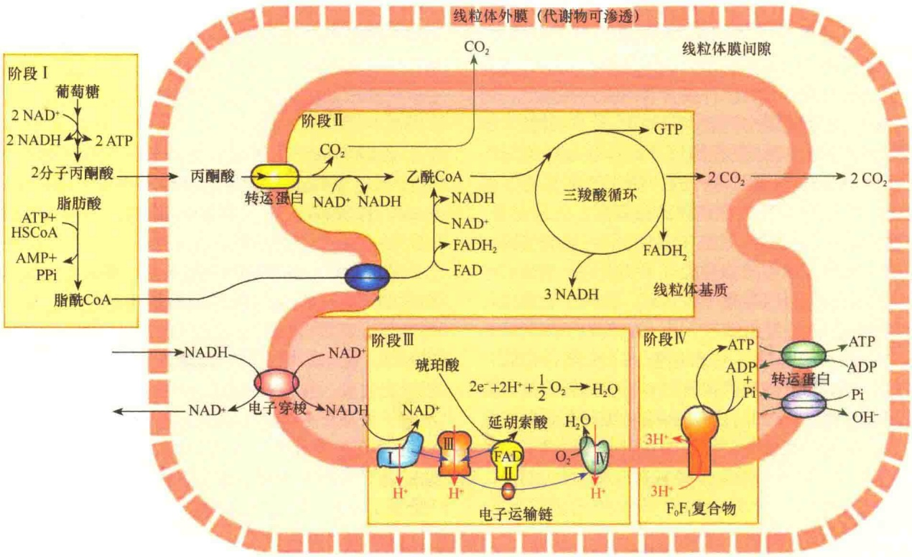
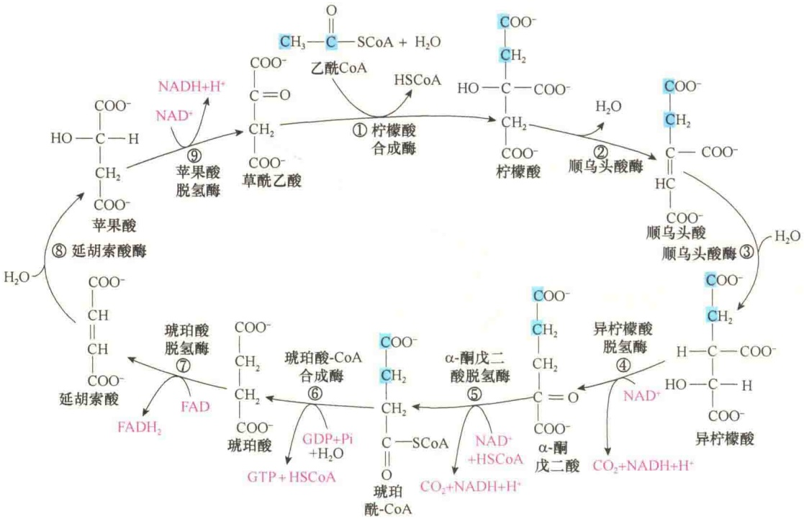
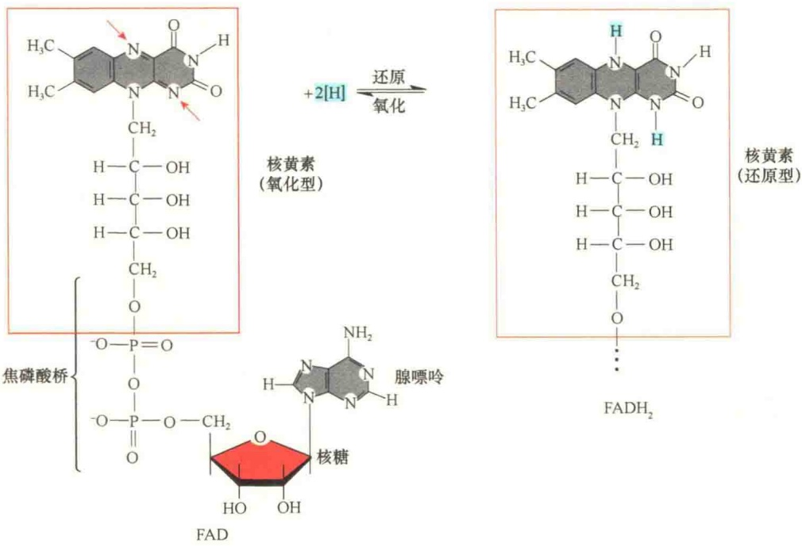

## 7.2.2.6 线粒体内膜蛋白的转运

有三条不同路径引导线粒体内膜蛋白的转运。细胞色素氧化酶亚基 CoxVa 的寻靶就是第一条路径的典型例子。CoxVa 前体蛋白的 N 端含有被外膜受体 TOM20/TOM22 识别的线粒体基质靶向序列，该序列能够通过外膜的通用运输孔及内膜的 TIM23/TIM17 通道进入线粒体基质；CoxVa 前体蛋白含有一个疏水的停止转移锚定序列（stop transfer anchor sequence），该序列介导 CoxVa 蛋白锚定在内膜上。当基质靶向序列穿过内膜后，被停止转移锚定序列锚定在内膜上，此时，基质靶向序列被基质中蛋白水解酶切除。随后，停止转移锚定序列介导前体蛋白侧向扩散进入线粒体内膜，成为线粒体内膜的组成成分（图 7-7A）。

第二条路径是在前体蛋白中含有线粒体基质靶向序列和被内膜蛋白Oxa1识别的靶向序列。在该路径的运输中，线粒体前体蛋白通过基质靶向序列进入线粒体基质，在线粒体基质中，基质靶向序列被切除，其后的Oxal-靶向序列被内膜中的Oxal识别并介导到内膜中（图7-7B）。此过程中或许有其他膜蛋白相助。

第三条路径涉及内膜多次穿膜蛋白的转运，如ATP/ADP逆向协同转运蛋白就是此种运输。当输入蛋白的内部序列被外膜中由TOM70/TOM22构成的第二个运输受体识别时，输入蛋白通过通用运输孔穿过外膜（图7-7C）。然后，输入蛋白被转移到位于内膜的第二个转运复合物，该复合物由TIM22、TIM18、TIM54三种蛋白质组成。输入蛋白转移到TIM22/TIM18/TIM54复合物需要线粒体膜间隙中的两种小蛋白——TIM9与TIM10的协助，这两种小蛋白属于膜间隙的分子伴侣，它们通过与输入蛋白的疏水区结合，以防止它们在膜间隙的水性环境中聚集形成不溶的聚集物。最后，由TIM22/TIM18/TIM54复合物将内膜蛋白的多个疏水片段整合到内膜中形成多次穿膜的内膜蛋白。

图 7-7 线粒体内膜蛋白转运的三条路径（引自 Lodish et al., 2016）。具有不同靶向序列的线粒体内膜蛋白通过不同的路径转运到内膜。A. 含有一个靶向序列:①在基质靶向序列的引导下，输入蛋白通过外膜运输通道，穿过内膜时，停止转移锚定序列将蛋白质锚定在内膜；②基质靶向序列被切除后，停止转移锚定序列通过侧向扩散进入线粒体内膜。B. 该路径中的前体蛋白含有线粒体基质靶向序列和被内膜蛋白 Oxa1 识别的靶向序列:①线粒体前体蛋白通过基质靶向序列进入线粒体基质，在线粒体基质中，基质靶向序列被切除；②Oxa1-靶向序列被内膜中的 Oxa1 识别并介导到内膜中。C. 仅含有内部锚定序列的内膜蛋白:①通过外膜通用运输孔进入线粒体内膜；②在线粒体膜间隙分子伴侣的协助下，输入蛋白被内膜的 TIM22/TIM18/TIM54 复合物整合到内膜中，成为多次穿膜的内膜蛋白。

## 7.2.2.7 线粒体外膜蛋白的转运

线粒体外膜使用与革兰氏阴性菌相同的外膜蛋白定位的方式。线粒体外膜含有丰富的孔蛋白，而孔蛋白是细菌质膜中的β桶结构蛋白，本身具有物质运输作用。TOM复合物仅介导具有α螺旋结构的蛋白质定位到线粒体外膜，而不能将具有β桶结构的孔蛋白介导整合到膜的脂双层。代之的是，孔蛋白以未折叠的形式被TOM转运到线粒体膜间隙，在那里，它们与特异的分子伴侣进行短暂的结合，以防止孔蛋白聚集（图7-8）。然后，孔蛋白与外膜的SAM复合物结合，由SAM复合物介导孔蛋白插入外膜并进行正确折叠。SAM复合物的一种核心亚基与帮助细菌孔蛋白β折叠的外膜复合物的蛋白同源。线粒体孔蛋白折叠与细菌孔蛋白折叠的保守途径，也为线粒体的内共生起源提供了一种思考。

图 7-8 线粒体外膜和内膜蛋白的定位（引自 Alberts et al., 2015）。

## 7.3 线粒体的功能——氧化磷酸化作用

线粒体是真核生物氧化代谢的部位，是糖、脂肪和氨基酸最终氧化放能的场所，最终氧化的共同途径是三羧酸循环和呼吸链的氧化磷酸化。

## 7.3.1 真核细胞中的氧化作用

葡萄糖和脂肪酸是真核细胞能量的主要来源，细胞通过对葡萄糖的代谢获取能量。葡萄糖（或糖原）在正常有氧的条件下，氧化后，产生 $CO_{2}$ 和水，这个总过程称为糖的有氧氧化（aerobic oxidation），又称细胞氧化或生物氧化。

葡萄糖进入细胞后先在细胞质中通过酵解作用生成丙酮酸，如果没有氧，丙酮酸经过发酵生成乳酸；如果有氧存在，丙酮酸进入线粒体基质，经过三羧酸循环、电子传递和氧化磷酸化，最后生成ATP和水。整个反应分为4个阶段（图7-9）。

## 7.3.1.1 三羧酸循环

乙酰 CoA 一旦形成，立即进入线粒体基质的循环氧化途径，即三羧酸循环（tricarboxylic acid cycle, TCA cycle），又称 Krebs 循环、柠檬酸循环（图 7-10）。

参与 TCA 循环的酶有很多种，除琥珀酸脱氢酶是结合在内膜上以外，其他的酶都存在于线粒体基质。循环开始，由乙酰 CoA 和草酰乙酸缩合成有 3 个羧基的柠檬酸，柠檬酸经一系列反应，一再氧化脱羧，经酮戊二酸、琥珀酸，再降解成草酰乙酸。每循环一次，仅用去 1 分子乙酰基中的二碳单位，最后生成 2 分子 CO₂、1 分子 GTP、4 分子 NADH（连同丙酮酸脱羧形成乙酰 CoA 时产生的 1 分子 NADH 在内）和 1 分子 FADH₂，总反应为:

$$
\begin{array}{r l} & {\mathrm{乙酰} \mathrm{CoA} + 2 \mathrm{H} _ {2} \mathrm{O} + \mathrm{FAD} + 3 \mathrm{NAD} + \mathrm{GDP} + \mathrm{Pi} \longrightarrow} \\ & {2 \mathrm{CO} _ {2} + \mathrm{FADH} _ {2} + 3 \mathrm{NADH} + 3 \mathrm{H} ^ {+} + \mathrm{GTP} + \mathrm{HS-CoA}} \end{array}
$$

## 7.3.1.2 辅酶在能量传递中的作用

富含能量的糖类和脂肪酸能够通过氧化反应释放出能量。根据定义，在反应中释放电子是氧化，获得电子是还原，氧化和还原反应总是同时发生的:氧化的底物释放出的电子被另一个分子接收，而接收电子的底物则被还原。因此，氧化还原反应涉及电子从一种底物向另一种底物传递。在生物氧化中，电子传递常常与氢原子的传递同时进行。假定反应: $XH_{2}+Y\longrightarrow X+YH_{2}$ ，在这一反应中，要从底物 $XH_{2}$ 中脱去2个氢原子，并转移到底物Y，每个氢原子含有1个电子，所以转移2个氢原子就要将2个电子从底物 $XH_{2}$ 转移到底物Y。底物 $XH_{2}$ 失去2个电子是氧化的结果，与此相反，底物Y得到2个电子则是还原。由此看来，被氧化的底物是电子供体，被还原的底物则是电子受体。

在葡萄糖氧化过程中使用了两种辅酶:NAD（nicotinamide adenine dinucleotide，烟酰胺腺嘌呤二核苷酸）和FAD（flavin adenine dinucleotide，黄素腺嘌呤二核苷酸），它们的还原型分别是NADH和 $FADH_{2}$ （图7-11和图7-12）。

## 7.3.1.3 苹果酸-天冬氨酸穿梭

TCA 循环产生的净平衡产物是  $FADH_{2}$  和 NADH，它们都含有在 TCA 循环中底物氧化释放的电子，总共 5 对电子（连同丙酮酸转变成乙酰 CoA 时释放的

图 7-9 线粒体利用葡萄糖与脂肪酸产生 ATP 的 4 个阶段（引自 Lodish et al., 2016）。阶段Ⅰ:在胞质溶胶中，糖酵解产生丙酮酸和 NADH；如果是脂肪酸，则先被转变成脂酰 CoA。阶段Ⅱ:丙酮酸或脂酰 CoA 在膜运输蛋白的帮助下进入线粒体基质，在基质中产生 NADH 和乙酰 CoA。在糖酵解过程中产生的 NADH，将它的高能电子提供给线粒体内膜的化合物。乙酰 CoA 通过 TCA 循环，产生 NADH 和 FADH₂。阶段Ⅲ:生成的 NADH 和 FADH₂ 进行氧化，分子中释放出的电子通过内膜中的电子传递链，最终传递给分子氧（O₂）。阶段Ⅳ:氧化中释放的能量被用于 ATP 的合成，主要是通过 ATP 合酶完成的。

图 7-10 TCA 循环（引自 Lodish et al., 2016）。

图7-11 辅酶 $\mathrm{NAD^{+}}$ 的结构及其氧化与还原。

图7-12 辅酶FAD的结构及其氧化与还原。

1 对电子），这些电子可用于 ATP 的合成。另外，葡萄糖在胞质溶胶中进行糖酵解时也有 NADH 的形成，但是线粒体膜不能将胞质溶胶中的 NADH 运入线粒体参与电子传递。虽然胞质溶胶中形成的 NADH 自身不能进入线粒体，但可通过另外的方式将其电子转移到线粒体并参与电子传递:将电子还原成小分子的代谢物，这些小分子的代谢物能够通过苹果酸-天冬氨酸穿梭（malate-aspartate shuttle）进入线粒体，然后在线粒体中将 NAD$^{+}$还原成 NADH（图 7-13）。所以，线粒体用于 ATP 合成的电子不仅有来自线粒体内部的，也有来自胞质溶胶糖酵解过程形成的

NADH。这一机制也确保了细胞质中 NADH 及时转变为  $NAD^{+}$ ，有利于胞质中的有机物质氧化释放的能量的储存与利用。

## 7.3.2 呼吸链与电子传递

呼吸链（respiratory chain）又称电子传递链，是线粒体内膜上一组酶复合体，其功能是进行电子传递、 $H^{+}$ 的传递及氧的利用，产生 $H_{2}O$ 和ATP。

在三羧酸循环中，乙酰 CoA 中的 2 个碳被完全氧化生成 2 分子  $CO_{2}$  释放出来。此过程释放的