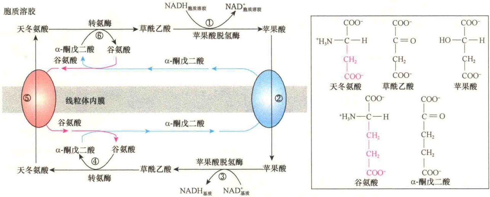

图 7-13 苹果酸-天冬氨酸穿梭（引自 Lodish et al., 2013）。①在胞质溶胶中，苹果酸脱氢酶将胞质溶胶中 NADH 的电子转移给草酰乙酸，生成苹果酸。②线粒体内膜中一种反向转运蛋白将苹果酸输入线粒体基质，同时将线粒体基质中的  $\alpha$ -酮戊二酸运到胞质溶胶，与苹果酸进行交换。③线粒体苹果酸脱氢酶将苹果酸转变成草酰乙酸，将线粒体基质中的 NAD⁺ 还原成 NADH。④线粒体基质中的转氨酶将谷氨酸中的一个氨基添加到草酰乙酸上，将不能直接穿过内膜的草酰乙酸转变成天冬氨酸，在此过程中谷氨酸转变成了  $\alpha$ -酮戊二酸。⑤通过第二个反向转运蛋白将天冬氨酸转运到胞质溶胶，与谷氨酸进行交换。⑥胞质溶胶中转氨酶将天冬氨酸转变成草酰乙酸、将  $\alpha$ -酮戊二酸转变成谷氨酸，完成循环。通过苹果酸-天冬氨酸穿梭，巧妙地将胞质溶胶中的 NADH 转移到线粒体基质中。

大部分能量都储存在辅酶（NADH 和  $FADH_{2}$ ）分子中，直接产生的能量（ATP）很少。只有将这些还原型的辅酶氧化成氧化型的辅酶，才能将能量释放出来。该过程涉及电子从 NADH 或  $FADH_{2}$  传递到氧，最后生成水，氧化型的  $NAD^{+}$ 和  $FAD^{+}$ 又可参与三羧酸循环:

$$
\begin{array}{r l} & {\mathrm{NADH+1/2O_2} \longrightarrow \mathrm{NAD^+ + H_2O+能量}} \\ & {\mathrm{FADH_2+1/2O_2} \longrightarrow \mathrm{FAD^+ + H_2O+能量}} \end{array}
$$

如果上述反应将能量一次性释放的话，由于能量太高不仅不能全部收集和储存，还会使细胞受到损伤，因此如何确保 NADH 及  $FADH_{2}$  在氧化过程中释放的能量能够有效收集，并成功用于 ATP 的合成，考验着细胞的“智慧”。

NADH 及  $FADH_{2}$  在氧化过程中不仅会释放出自由能，而且会释放出电子、 $H^{+}$ ，也就是说，在 NADH 及  $FADH_{2}$  的氧化过程中，不仅要收集能量，而且也要妥善安置释放出来的电子和  $H^{+}$ 。有趣的是，在细胞生命的进化过程中，细胞巧妙地在线粒体内膜中构建了一条呼吸链，利用 NADH 及  $FADH_{2}$  在氧化过程中释放的能量，“雇用”一系列递氢体和电子载体在传递电子的同时将释放出的  $H^{+}$  传递到线粒体膜间隙，构建  $H^{+}$ 质子库；最后通过  $H^{+}$ 质子经线粒体内膜中“ATP 合酶”向线粒体基质回流，进行 ADP 的磷酸化，高效地将 NADH 及  $FADH_{2}$  在氧化过程中释放的能量用于 ATP 的合成，实际上，能量储存在 ATP 的高能磷酸键中。电子通过呼吸链的流动称为电子运输或电子传递，而将 ADP 转变成 ATP 称为磷酸化，伴随氧化进行的磷酸化就称为氧化磷酸化。

## 7.3.2.1 电子载体

在电子传递过程中，与释放的电子结合并将电子传递下去的物质称为电子载体（electron carrier）。参与传递的电子载体有4种，即黄素蛋白、细胞色素、铁硫蛋白和辅酶Q（coenzyme Q, CoQ）。在这4种电子载体中，除了辅酶Q外，接受和提供电子的氧化还原中心都是与蛋白质相连的辅基（图7-14）。

1）黄素蛋白（flavoprotein） 黄素蛋白是由一条多肽结合一个辅基组成的酶类，结合的辅基可以是 FAD 或 FMN，它们是维生素  $B_{2}$  的衍生物，每个辅基能够接受和提供 2 个质子及 2 个电子（图 7-14A）。

2）细胞色素（cytochrome） 细胞色素是含有血红素辅基（图7-14B）的一类蛋白质。血红素基团是由卟啉环结合一个铁原子（铁原子位于环的中央）构成的。与 $NAD^{+}$ 和 $FAD^{+}$ 不同，在氧化还原过程中，血红素基团的铁原子可以传递单个的电子而不必成对传递。血红素中的铁通过 $Fe^{3+}$ 和 $Fe^{2+}$ 两种状态的变化传递电子。在还原反应时，铁原子由 $Fe^{3+}$ 状态转变成 $Fe^{2+}$ 状态；在氧化反应中，铁由  $Fe^{2+}$  转变成  $Fe^{3+}$  。电子传递链中至少有 5 种类型的细胞色素:a、 $a_{3}$ 、b、c 和  $c_{1}$ ，它们间的差异在于血红素基团中取代基和蛋白质氨基酸序列的不同。

图 7-14 三种电子载体的氧化与还原结构（引自 Karp，2010）。A. NADH 脱氢酶的 FMN（黄素单核苷酸）；B. 细胞色素 c 的血红素基团；C. 泛醌（辅酶 Q）。

3）辅酶Q（CoQ）或泛醌（ubiquinone，UQ）（图7-14C） 泛醌是一种脂溶性的分子，含有长长的疏水链，由五碳类戊二醇构成。CoQ的氧化还原分两步进行:先接收1个电子，得到部分还原，称为半醌（UQH）；再得到1个电子，成为完全还原的醌，称为全醌（$\mathrm{UQH_2}$）；全醌失去1个电子是部分氧化，称为半醌；2个电子全部失去，即完全氧化则称为氧化型的醌。

## 4）铁硫蛋白（iron-sulfur protein，Fe/S protein）

铁硫蛋白是含铁的蛋白质，也是细胞色素类蛋白质。在铁硫蛋白分子中央结合的不是血红素而是铁和硫，称为铁-硫中心（iron-sulfur center）。最常见的是在蛋白质的中央含有4个原子，其中2个是铁，另外2个是硫，称为[2Fe-2S]；或在蛋白质的中央含有8个原子，其中4个是铁，另外4个是硫，称为[4Fe-4S]，并且通过硫与蛋白质的半胱氨酸残基相连（图7-15）。在铁硫蛋白中尽管有多个铁原子的存在，但整个复合物一次只能接收1个电子、传递1个电子，并且也是靠 $\mathrm{Fe}^{3+}$ 、$\mathrm{Fe}^{2+}$ 状态的循环变化传递电子。

图 7-15 铁硫中心（引自 Karp，2010）。A. [2Fe-2S]-铁硫中心结构；B. [4Fe-4S]-铁硫中心结构。

## 7.3.2.2 氧化还原电位与载体排列顺序

在线粒体内膜的呼吸链中，不同电子载体的排列顺序怎样？又是如何确定的？由于不同的还原剂具有不同的电子传递电位，而氧化与还原又是偶联的，如  $NAD^{+}$  和 NADH。它们的差别主要是电子数量不同，所以二者间就有一个电位差，即氧化还原电位（oxidation-reduction potential, redox potential）。构成氧化还原的成对离子或分子，称为氧化还原对或氧还对（redox pair）。氧还电位可在标准条件下测定，即标准氧化还原电位（standard oxidation-reduction potential,  $E_{0}^{\prime}$ ）。标准氧化还原电位的值越小，提供电子的能力越强。所谓标准条件是指 1mol/L 反应浓度、25℃、pH7.0 和 1 个大气压条件下测得的氧还电位，用伏特（V）表示。因此，只要分别测定电子载体的氧化还原电位，再进行比较，可初步推断它们在呼吸链中的排列顺序。

根据测得的标准氧化还原电位，按氧还电位的大小可排出电子载体在呼吸链中的位置（图 7-16）。

图 7-16 中每一个载体都是从呼吸链中上一个载体获得电子被还原，而上一个载体由于失去电子被氧化，因此电子是从一个载体传向另一个载体，直至最终的受体被还原为止。在该呼吸链中的最终的受体是  $O_{2}$ ，接受电子后生成水。

## 7.3.2.3 呼吸链的组成和排列

呼吸链中的4种电子载体在线粒体内膜中不是单一存在，而是与其他的蛋白质组成复合物。当破坏了线粒体内膜后，能够从4种不同的复合物中分离出各种载体。这4种复合物是不同的、不对称的穿膜蛋白复合物，分别被命名为复合物Ⅰ、Ⅱ、Ⅲ和Ⅳ。在这4种复合物中都没有细胞色素c和CoQ，这两种呼吸链的成分独立存在于线粒体膜中。CoQ溶于膜的脂双层，而细胞色素c是膜外周蛋白，因此，CoQ和细胞色素c是在膜内或沿着膜在大的、非移动的复合物间传递电子。一旦电子进入一个大的多蛋白复合物中，电子就按既定的途径传递。

图 7-16 电子传递链中几种电子载体的氧还电位（引自 Lodish et al., 2013）。图中给出各电子载体近似的氧还电位，并标出了电子对沿呼吸链向分子氧传递形成的自由能，垂直箭头线表示产生的能量足够驱使质子穿过线粒体内膜，其后可为 ATP 合成提供能量。

组成呼吸链的4种复合物又都是由几种不同的蛋白质组成的多蛋白复合物（表7-4，图7-17），功能是参与氧化还原作用。由于这些复合物在线粒体内膜中不停地移动，所以它们没有稳定的结构。

1）复合物Ⅰ（complex I） 复合物Ⅰ又称NADH脱氢酶（NADH dehydrogenase）或NADH-CoQ还原酶复合物，功能是催化1对电子从NADH传递给CoQ，它是线粒体内膜中最大的蛋白复合物，是穿膜蛋白，也是呼吸链中了解最少的复合物。哺乳动物的复合物Ⅰ含有43种不同的亚基，总分子质量约 850kDa。其中有 7 个亚基都是疏水的穿膜蛋白，由线粒体基因编码。复合物 I 含有黄素蛋白（FMN）和至少有 6 个铁硫中心。一对电子从复合物 I 传递时伴随着 4 个质子被传递到膜间隙。

表 7-4 线粒体呼吸链中 4 种复合物的性质

<table><tr><td rowspan="2">序号</td><td rowspan="2">名称</td><td rowspan="2">多肽亚基数</td><td rowspan="2">辅基</td><td colspan="2">电子传递</td><td rowspan="2">转运质子数(每对电子)</td></tr><tr><td>接收自</td><td>传递给</td></tr><tr><td rowspan="2">I</td><td>NADH CoQ氧化还原酶</td><td>43</td><td>1个FMN</td><td>NADH</td><td>CoQ</td><td>4</td></tr><tr><td>NADH脱氢酶</td><td></td><td>6~9个Fe/S中心</td><td></td><td></td><td></td></tr><tr><td rowspan="2">II</td><td rowspan="2">琥珀酸-CoQ氧化还原酶(琥珀酸脱氢酶)</td><td rowspan="2">4</td><td>1个FAD</td><td rowspan="2">琥珀酸(经由酶结合的FAD)</td><td rowspan="2">CoQ</td><td rowspan="2">0</td></tr><tr><td>3个Fe/S中心</td></tr><tr><td rowspan="3">III</td><td rowspan="3">CoQ-细胞色素c氧化还原酶(细胞色素 $b/c_1$ 复合物)</td><td rowspan="3">11</td><td>2个细胞色素b</td><td rowspan="3">CoQ</td><td rowspan="3">细胞色素c</td><td rowspan="3">4</td></tr><tr><td>1个细胞色素 $c_1$ </td></tr><tr><td>1个Fe/S中心</td></tr><tr><td rowspan="3">IV</td><td rowspan="3">细胞色素c氧化酶</td><td rowspan="3">13</td><td>1个细胞色素a</td><td rowspan="3">细胞色素c</td><td rowspan="3">氧( $O_2$ )</td><td rowspan="3">2</td></tr><tr><td>1个细胞色素 $a_3$ </td></tr><tr><td>2个Cu中心(具有细胞色素 $a_3$ 的Fe/Cu中心)</td></tr></table>

图 7-17 线粒体内膜电子传递复合物的排列及质子与电子传递示意图（引自 Nelson and Cox，2013）。呼吸链由 4 个含有电子载体的复合物及另外 2 个独立存在的电子载体组成，进入呼吸链的电子可以来自 NADH 或 FADH$_{2}$。电子可以从复合物 I 或复合物 II 传递给 UQ，然后进一步传递给复合物 III，经由细胞色素 c 传递给复合物 IV，最后传递给 1/2 O$_{2}$，生成水。

2）复合物Ⅱ（complex Ⅱ） 复合物Ⅱ又称为琥珀酸脱氢酶（succinate dehydrogenase）或琥珀酸-CoQ酶复合物，功能是催化电子从琥珀酸传递给CoQ，由4个亚基组成，其中有2个多肽组成琥珀酸脱氢酶，并且是膜结合蛋白，总分子质量为140kDa。复合物Ⅱ参与的是低能电子传递途径，将琥珀酸的电子经FAD传给CoQ。复合物Ⅱ传递电子时不伴随氢的传递。

3）复合物Ⅲ（complex Ⅲ） 复合物Ⅲ又称$\mathrm{CoQH_{2}}$ -细胞色素 $c$ 还原酶复合物，由11个亚基组成，总分子质量为 $250\mathrm{kDa}$ 。含1个细胞色素 $c_{1}$ 、1个细胞色素 b（有两个血红素基团）、1 个铁硫蛋白。其中，细胞色素 b 由线粒体基因编码。复合物Ⅲ催化电子从 CoQ 向细胞色素 c 传递，并且每传递一对电子，同时传递 4 个  $H^{+}$ 到膜间隙。

4）复合物Ⅳ（complex Ⅳ） 复合物Ⅳ又称细胞色素c氧化酶（cytochrome c oxidase），由13个亚基组成，总分子质量为160kDa。复合物Ⅳ是以二聚体的形式存在，它的亚基Ⅱ含有2个Cu离子（称为 $Cu_{A}$ ），亚基Ⅰ含有2个血红素基团（1个a、1个 $a_{3}$ ）和1个Cu离子（称为 $Cu_{B}$ ）。主要功能是将电子从细胞色素c传递给 $O_{2}$ 分子，生成 $H_{2}O$ : $4Cyt c^{2+} + O_{2} + 4H^{+} \longrightarrow 4Cyt c^{3+} + 2H_{2}O$ 。每传递1对电子，要从线粒体基质中摄取4个质子，其中2个质子用于水的形成，另外2个质子被穿膜转运到膜间隙。

由于线粒体中需要经呼吸链氧化和电子传递