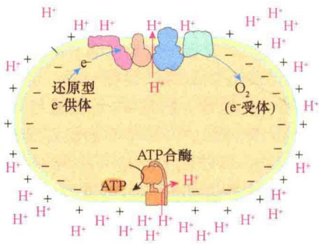
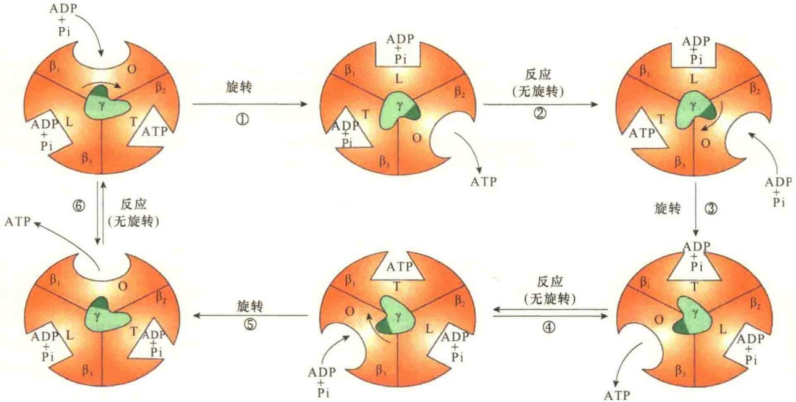

的主要是 NADH，而  $FADH_{2}$  较少，可将呼吸链分为主、次呼吸链（图 7-18）:①主呼吸链由复合物 I、Ⅲ和Ⅳ构成，从 NADH 来的电子依次经过这 3 个复合物，进行传递；②次呼吸链由复合物Ⅱ、Ⅲ、Ⅳ构成，来自 FADH₂ 的电子不经过复合物 I。

图 7-18 线粒体内主、次呼吸链（引自 Becker et al., 2003）。呼吸链复合物 I～IV 是线粒体内膜的整合蛋白复合物。NADH 氧化释放的电子经复合物 I、III、IV 传递，同时它们又将基质中的 H⁺ 传递到膜间隙；而 FADH₂ 氧化释放的电子经复合物 II、III、IV 传递，但是复合物 II 不参与 H⁺ 传递。由于在 TCA 循环中产生的 NADH 的数量远多于 FADH₂，NADH 氧化释放的电子与 H⁺ 的量大，所以，将复合物 I、III、IV 称为主呼吸链，II、III、IV 称为次呼吸链。

## 7.3.2.4 递氢体与电化学梯度的建立

组成呼吸链的成员中除了电子载体外，有些还具有将质子穿膜传递到膜间隙的作用，将能够传递氢质子的复合物称为递氢体。质子从线粒体基质穿膜传递到线粒体膜间隙是一种耗能的过程，递氢体利用电子在呼吸链中传递时释放的自由能完成递氢过程。实际上，正是呼吸链中的递氢体通过对质子的穿膜传递，将 NADH 和  $FADH_{2}$  在氧化过程中释放出来的自由能转变成势能，这种势能可进一步用于 ATP 的合成。

质子穿过内膜向膜间隙的转运也是一种电生成（electrogenesis），即电压生成的过程。因为质子穿膜转运使得膜间隙积累了大量的质子，建立了质子梯度，由于膜间隙质子梯度的建立，使内膜两侧发生两个显著的变化:一是线粒体膜间隙产生大量的正电荷，而线粒体基质产生大量的负电荷，使内膜两侧形成电位差；二是因两侧氢离子浓度的不同而产生pH梯度（ $\Delta pH$ ），这两种梯度合称为电化学梯度（electrochemical gradient）。线粒体内膜两侧电化学梯度的建立，能够形成质子动势（proton motive force， $\Delta p$ ），只要有合适的条件即可转变成化学能储存起来。

膜间隙对质子梯度的维持，主要是靠内膜的高度不通透性，否则，由于质子的扩散使得质子回流到线粒体基质，从而流失自由能。而内膜恰恰是高度不通透性的，递氢体转运到膜间隙的质子得以维持，也就维持了质子移动的力，可用于ATP的合成。

## 7.3.3 氧化磷酸化:ATP形成机制

氧化磷酸化（oxidative phosphorylation）是指在活细胞中伴随着呼吸链的氧化作用所发生的能量

转换和ATP的形成过程。

## 7.3.3.1 氧化磷酸化偶联位点

早在20世纪30年代，Belitzer首先提出电子传递与ATP合成偶联的假设。他在体外测定肌组织制备物合成ATP与氧消耗比值时发现，呼吸链每传递1对电子，至少可合成2个ATP。

后来有人发现 P/O 比值（形成的 ATP 数与每个还原氧的比值）接近 3，也就是说可合成 3 分子 ATP。根据对呼吸链中不同复合物间氧化还原电位的研究，发现复合物 I、Ⅲ、Ⅳ 每传递 1 对电子，释放的自由能都足够合成 1 分子 ATP，因此将复合物 I、Ⅲ、Ⅳ 看成是呼吸链中电子传递与氧化磷酸化偶联的 3 个位点。

上述 ATP 合成的数量和偶联位点得到实验的支持。如将分离的线粒体内膜小泡与抗霉素（antimycin）一起温育，由于抗霉素阻止电子通过细胞色素  $b-c_{1}$ （复合物Ⅲ），NADH 释放的电子只能传递到 CoQ，其结果是，每传递 1 对电子只合成 1 分子 ATP。因此可以推论复合物 I 是 ATP 合成的偶联位点。用同样的方法证明复合物Ⅲ和复合物Ⅳ也都是 ATP 合成与电子传递偶联位点。

如果以  $FADH_{2}$  作为电子供体，则只有两个 ATP 合成偶联位点，因为  $FADH_{2}$  提供的电子是经复合物Ⅱ、Ⅲ和Ⅳ传递的，而复合物Ⅱ不能作为 ATP 合成的偶联位点，所以只有两个偶联位点，这就意味着由  $FADH_{2}$  作为电子供体时，只能合成 2 分子的 ATP。

## 7.3.3.2 ATP合酶的结构和功能

线粒体 ATP 合酶（ATP synthase）是由多种蛋白质组成的复合物，可分为两个主要的亚复合物（subcomplex），即  $F_{1}$  和  $F_{0}$ ，它们各自含有多种蛋白质组分（图 7-19）。ATP 合酶的别名很多，如  $F_{0}F_{1}$  复合物（ $F_{0}F_{1}$  complex）、 $F_{0}F_{1}$ -ATP 合酶（ $F_{0}F_{1}$ -ATP synthase）、 $F_{0}F_{1}$ -ATP 酶（ $F_{0}F_{1}$ -ATPase）、 $F_{0}F_{1}$ -ATPase 复合物（ $F_{0}F_{1}$ -ATPase complex）等。ATP 合酶也可以看成是内膜中的第 5 种复合物。

$F_{0}$  含有三种不同类型内膜整合蛋白，分别命名为 a 亚基、b 亚基、c 亚基。在细菌与酵母的线粒体中，组成  $F_{0}$  的亚基数量是  $a_{1}b_{2}c_{10}$ ，但是在其他真核细胞中，c 亚基的数量有所变化，通常在 8～15 之间。但无论是在何种情况下，c 亚基都会在膜的平面形成圈饼形的环，称 c 环（c ring）。1 个 a 亚基与 2 个 b 亚基紧紧地连在一起，但都不与 c 环相连。

图 7-19 细菌质膜中 ATP 合酶结构（引自 Lodish et al., 2016）。

$\mathrm{F}_{1}$ 亚复合物由5种不同的多肽构成，其中 $\alpha$ 、 $\beta$ 各3分子，合起来共由9个多肽组成，即 $\alpha_{3}\beta_{3}\gamma \delta \varepsilon$ 。正常情况下，$\mathrm{F}_{1}$ 与 $\mathrm{F}_{0}$ 在线粒体内膜上是紧密结合在一起的。 $\mathrm{F}_{1}$ 复合物的 $\gamma$ 亚基的底部以螺旋的形式插入到 $\mathrm{F}_{0}$ 复合物c亚基的中央部分，并紧紧结合在一起。因此，当 $\mathrm{F}_{0}$ 的c亚基的环旋转时，杆状的 $\mathrm{F}_{1}\gamma$ 亚基也会一起旋转。$\mathrm{F}_{1}$ 的 $\varepsilon$ 亚基紧紧地附着在 $\gamma$ 亚基上，同时也会与 $\mathrm{F}_{0}$ 复合物的c亚基结合。$\mathrm{F}_{1}$ 复合物的 $\alpha$ 、 $\beta$ 亚基构成了 $\mathrm{F}_{1}$ 的球形头部，并以交替的形式构成六聚体，即 $\alpha \beta \alpha \beta \alpha \beta$ 或者写成（$\alpha \beta$)₃，并被一个长长的 $\gamma$ 亚基顶在头上。$\mathrm{F}_{1}$ 的 $\delta$ 亚基与 $\mathrm{F}_{1}\alpha$ 永久性结合在一起，也可以与 $\mathrm{F}_{0}$ 的b亚基结合。这样，$\mathrm{F}_{0}$ 的a、b亚基与 $\mathrm{F}_{1}$ 的 $\delta$ 亚基、$(\alpha \beta)_{3}$ 六聚体形成一种牢牢锚定在线粒体内膜中的坚固结构。杆状的b亚基可作为一个“定子”（stator），防止在静息状态下，$\mathrm{F}_{1}\delta$ 亚基顶上的 $(\alpha \beta)_{3}$ 六聚体自由移动，因为 $(\alpha \beta)_{3}$ 六聚体只能与 $\mathrm{F}_{0}$ 的c环一起移动，并在ATP合成中发挥重要作用。

当 ATP 合酶被嵌在膜中时，伸向细胞质侧（线粒体基质面）的  $F_{1}$  可作为一个“把手”（knob），当  $F_{1}$  与膜分开时，在没有  $F_{0}$  的情况下， $F_{1}$  能够催化 ATP 水解，此时的  $F_{1}$  被称为  $F_{1}$ -ATPase。也就是说，该酶在细胞中参与 ATP 的合成，一旦将之与  $F_{0}$  分离，离开膜后就变成 ATP 水解酶了。因此将它称为 ATP 合酶。表 7-5 是大肠杆菌  $F_{0}F_{1}$  合酶亚基的组成及功能。

表 7-5 大肠杆菌 ${\mathrm{F}}_{0}{\mathrm{\;F}}_{1}$ 合酶亚基的组成及功能

<table><tr><td>亚复合物</td><td>亚基</td><td>相对分子质量</td><td>数量</td><td>功能</td></tr><tr><td rowspan="3"> $F_0$ </td><td>a</td><td>30 000</td><td>1</td><td>质子通道</td></tr><tr><td>b</td><td>17 000</td><td>2</td><td>与 $F_0$ 、 $F_1$ 连接在一起的定子的杆</td></tr><tr><td>c</td><td>8 000</td><td>10</td><td>可以带动 $F_1\gamma$ 亚基转动环</td></tr><tr><td rowspan="5"> $F_1$ </td><td>α</td><td>52 000</td><td>3</td><td>促进β亚基的作用</td></tr><tr><td>β</td><td>55 000</td><td>3</td><td>ATP合酶的催化部位</td></tr><tr><td>δ</td><td>19 000</td><td>1</td><td>将 $α_3β_3$ 环锚定到 $F_0$ 的定子杆</td></tr><tr><td>γ</td><td>31 000</td><td>1</td><td>将能量从 $F_0$ 旋转传送到 $F_1$ </td></tr><tr><td>ε</td><td>15 000</td><td>1</td><td>将γ亚基锚定到 $F_0$ 的 $c_{10}$ 环</td></tr></table>

## 7.3.3.3 化学渗透偶联假说

关于氧化磷酸化的偶联机制，先后提出过几种假说，如化学偶联假说（chemical coupling hypothesis）和构象偶联假说（conformational coupling hypothesis），这些假说由于证据不足没有得到公认。

英国生物化学家 Mitchell 于 1961 年提出了化学渗透偶联假说（chemiosmotic coupling hypothesis）解释氧化磷酸化的偶联机制。该学说认为:在电子传递过程中，伴随着质子从线粒体基质向膜间隙转移，形成穿膜的氢离子梯度，产生了势能，这种势能驱动了氧化磷酸化反应（提供了动力），合成了 ATP。这一学说有大量的实验证明，得到了公认，Mitchell 也因此获得了 1978 年诺贝尔化学奖。化学渗透偶联假说可以很好地说明线粒体内膜中电子传递、质子动势的建立、ADP 磷酸化的关系（图 7-20）。

图 7-20 ATP 合成的化学渗透机制（引自 Nelson and Cox, 2013）。在线粒体中，电子自动通过膜结合的载体（呼吸链）移动，最后传递给  $O_{2}$ 。在此过程中，呼吸链中的递氢体将  $H^{+}$ 转运到线粒体膜间隙，导致膜间隙中的  $H^{+}$ 浓度升高，造成与线粒体基质中的浓度梯度差；同时由于  $H^{+}$ 浓度升高，膜间隙与线粒体基质的电位差提高，也就形成了电化学梯度。为了消除这种差别，只有将膜间隙中的  $H^{+}$ 通过 ATP 合酶渗透回线粒体基质，此时的 ATP 合酶就会合成大量的 ATP。

## 7.3.3.4 ATP合酶合成ATP的机制

ATP 合酶合成 ATP 的分子机制的研究一直是研究的热点。被多数人接受的 ATP 合酶合成 ATP 的模型是结合变构机制（binding-change mechanism）。按照这一机制，当质子“居高临下”通过  $F_{0}$  流动时，释放的能量直接驱动了 c 环及与其相连的  $\gamma$  和  $\varepsilon$  亚基的转动。 $\gamma$  亚基作为凸轮（cam），或者一个非对称的旋转杆，由于它的底部镶嵌在 c 环的中央，顶部又顶着六聚体的  $(\alpha\beta)_{3}$ ，所以， $\gamma$  亚基的转动也就带动了  $(\alpha\beta)_{3}$  的转动。但旋转时会引起  $\alpha\beta$  复合物构型的改变，有 3 种不同的构型，对 ATP 和 ADP 具有不同的结合能力:① O 型（open），即开放的状态，几乎不能结合 ATP，与 ADP、Pi 结合的能力也很弱；② L 型（loose），即松散型，与 ADP 和 Pi 结合的能力较强，但是不能与 ATP 结合；③ T 型（tight），即紧密型，与 ADP 和 Pi 的结合很紧并能自动反应形成 ATP。 $\gamma$  亚基每旋转  $120^{\circ}$ ，导致  $\beta$  亚基的构型发生一次变化，旋转  $360^{\circ}$ ，完成一次从 O 到 T 的循环，而构型的不同导致与 ATP/ADP/Pi 结合的改变（图 7-21）。

现已了解，当质子通过  $F_{0}$  流入线粒体基质时， $F_{1}$  中便合成了 ATP，而这个合成过程是完全可逆的。当质子经  $F_{0}$  流出时， $F_{1}$  便会水解 ATP。质子流经  $F_{0}$  部分与在  $F_{1}$  部分中 ATP 的合成 / 水解这两个过程可能是通过  $F_{0}$  与  $F_{1}$  间共轴旋转相偶联。由于在  $F_{1}$  内部的旋转运动可合成 / 水解 ATP，因此  $F_{1}$ -ATP 酶被认为是一种分子螺旋发动机。

体外实验为结合变构机制提供了支持。1997年，两位日本科学家获得γ亚基带动αβ亚基旋转的直接证据。他们设计了一个十分精巧的实验系统来观察单个酶分子催化细胞中一个正常反应的逆反应。首先，他们制备了一个“工程版”的ATP合酶的 $F_{1}$ 部分，由3个α亚基、3个β亚基、1个γ亚基组成（ $\alpha_{3}\beta_{3}\gamma$ ）（图7-22）。然后将这种多肽复合物头部固定到盖玻片上，并将一段短的、经荧光标记的肌动蛋白纤维附着在γ亚基的顶部。将这种制备复合物与ATP一起温育时，由于ATP的水解驱动了复合物旋转，用荧光显微镜可观察到转动。在此实验的基础上，后来设计的多种实验都检测到细胞中 $F_{1}$ 通过旋转合成ATP，从而证明结合变构机制的正确性。

图7-21 利用ADP和Pi合成ATP的结合变构机制（引目Lodish et al., 2016）。3个β亚基随着γ亚基的转动，构型发生变化，与ATP/ADP/Pi的结合力也发生变化。γ亚基每转动120°，3个β亚基都要发生构型改变并引起相应的反应。①γ亚基向右转动120°引起的构型改变:β₁亚基的构型由O型转变为L型，与ADP和Pi的结合加强；β₂亚基的构型由T型变成O型，与ATP结合力微弱，致使ATP脱离；β₃亚基的构型由L型变成T型，与ADP和Pi的结合更加紧密。②γ亚基第一次转动引起的反应:L型的β₁亚基与ADP和Pi的结合力加强；O型的β₂亚基开始与ADP和Pi结合；紧密结合在β₃亚基上的ADP和Pi形成ATP。③γ亚基第二次向右转动120°引起的构型改变:β₁亚基的构型由L型变成T型，与ADP和Pi的结合更为紧密；β₂亚基的构型由O型变成L型，与ADP和Pi的结合力加强；β₃亚基的构型由T型变成O型，与ATP的结合力丧失。④γ亚基第二次向右转动引起的反应:紧密结合在T型β₁亚基中的ADP和Pi形成了ATP，L型β₂亚基与ADP和Pi的结合更为紧密，O型β₃亚基开始与ADP和Pi结合。⑤γ亚基第三次向右转动120°引起的构型改变:β₁亚基的构型由T型变成O型，丧失与ATP的结合能力；β₂亚基的构型由L型变成T型，与ADP和Pi的结合更加紧密；β₃亚基的构型由O型变成L型，与ADP和Pi的结合力加强。⑥γ亚基第三次旋转120°引起的反应:O型的β₁亚基开始与ADP和Pi结合；与β₂亚基紧密结合的ADP和Pi形成了ATP，L型的β₃亚基与ADP和Pi的结合更加紧密。γ亚基经过3次旋转，完成了一次循环，共生成3个ATP。

图 7-22  $F_{1}$  和  $\gamma$  旋转的体外实验示意图（引自 Lodish et al., 2016）。实验中对  $F_{1}$  进行人工改造，使之带上组氨酸（每个亚基一个），由于组氨酸能够与覆盖有金属还原剂（Ni 复合物）的玻片结合，因此可使  $F_{1}$  固定到这种玻片上。通过人工的方法将  $\gamma$  结合上一条荧光标记的肌动蛋白纤维，然后在供给 ATP 的情况下用荧光显微镜观察  $\gamma$  亚基的转动。

## 7.4 线粒体的遗传、融合与分裂

## 7.4.1 线粒体的遗传

线粒体是半自主性的细胞器，它除了有自己的遗传物质线粒体DNA外，还有蛋白质合成系统（核糖体、mRNA、rRNA、tRNA），但是，它的遗传信息量不足，仍然要受控于核的遗传信息，也就是说，线粒体中的蛋白质只有少数几种是线粒体基因编码的，大多数线粒体蛋白质还是由核基因编码，所以线粒体的生物合成涉及两个彼此分开的遗传系统。