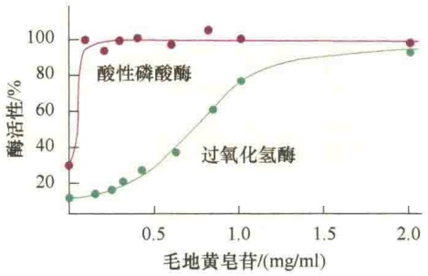
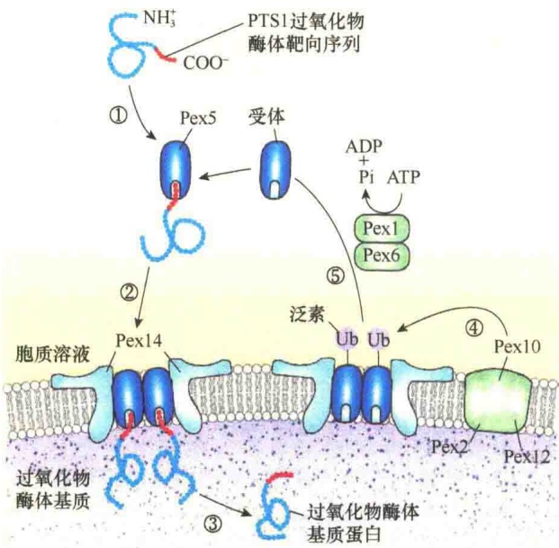
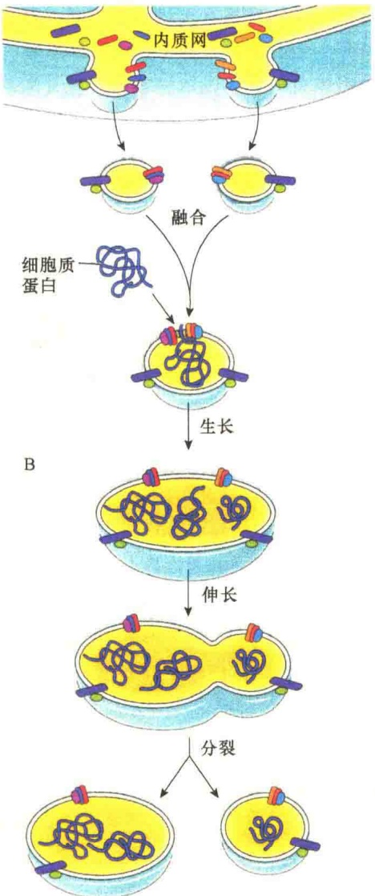

溶酶体和过氧化物酶体是两种不同的细胞器，这两种细胞器的膜对去垢剂的耐受性是不同的。

图 7-29 酸性磷酸酶和过氧化氢酶释放实验（引自 Kleinsmith and Kish, 1995）。

## 7.5.1.2 过氧化物酶体的酶类

过氧化物酶体在肝及肾细胞中极为丰富，植物的种子及叶中也很多。所有的过氧化物酶体都含有过氧化氢酶，约占过氧化物酶体总蛋白的15%。过氧化物酶体含有丰富的酶类，目前已知的有40余种，主要是氧化酶、过氧化氢酶和过氧化物酶（表7-7）。

表 7-7 过氧化物酶体中发现的主要酶类

| 酶 | 鼠肝 | 植物种子 | 植物叶 |
| --- | --- | --- | --- |
| 过氧化氢酶 | + | + | + |
| 尿酸氧化酶 | + | + | + |
| D-氨基酸氧化酶 | + | + | - |
| L-氨基酸氧化酶 | ± | + | - |
| L-α-羟酸氧化酶 | + | + | + |
| 乙醇酸氧化酶 | + | + | + |
| 脂肪酸β-氧化酶 | + | + | - |
| 柠檬酸合成酶 | - | + | - |
| 顺乌头酸酶 |  | + | - |
| 异柠檬酸裂解酶 | - | + | - |
| 马来酸合成酶 | - | + | - |
| 马来酸脱氢酶 | - | + | + |
| 乙醛酸还原酶 | + | - | + |
| 乙醛酸转氨酶 | - | - | + |

注:+表示存在，-表示不存在；空白表示未测。±表示有些有，有些无。

1）氧化酶（oxidase） 过氧化物酶体含有的氧化酶包括尿酸氧化酶、D-氨基酸氧化酶、L-氨基酸氧化酶和L-α-羟基酸氧化酶等。氧化酶约占过氧化物酶体酶总量的一半。各种氧化酶作用于不同的底物，其共同特点是氧化底物的同时，将氧还原成过氧化氢: $RH_{2}+O_{2}\longrightarrow R+H_{2}O_{2}$ 。

2）过氧化氢酶（catalase） 过氧化氢酶是过氧化物酶体的标志酶，这是因为所有过氧化物酶体都含有过氧化氢酶，约占过氧化物酶体酶总量的40%。过氧化氢酶的作用是将过氧化氢还原成水: $2H_{2}O_{2}\longrightarrow O_{2}+2H_{2}O$ 。

## 7.5.2 过氧化物酶体的功能

因为氢的过氧化物是有毒的，似乎认为过氧化物酶体的功能就是防止产生过氧化氢，对细胞起保护作用。事实上，过氧化物酶体不仅仅是将过氧化氢水解，还有其他一些重要功能。

1）使毒性物质失活 这种作用是过氧化氢酶利用过氧化氢氧化各种底物，如酚、甲酸、甲醛和乙醇等，氧化的结果使这些有毒性的物质变成无毒性的物质，同时也使 $H_{2}O_{2}$ 进一步转变成无毒的 $H_{2}O$ 。这种解毒作用对于肝、肾特别重要。例如，人们饮入的酒精几乎有一半是以这种方式被氧化成乙醛的，从而解除了酒精（乙醇）对细胞的毒性作用。

2）对氧浓度的调节作用 过氧化物酶体中的氧化酶都是利用分子氧作为氧化剂，催化如下的化学反应: $RH_{2}+O_{2}\longrightarrow R+H_{2}O_{2}$ 。

这一反应对细胞内氧的水平有很大的影响。例如，在肝细胞中，有20%的氧是由过氧化物酶体消耗的，其余的在线粒体中消耗。在过氧化物酶体中氧化产生的能量以产热的方式消耗掉，而在线粒体中氧化产生的能量贮存在ATP中。线粒体与过氧化物酶体对氧的敏感性是不一样的，线粒体氧化所需的最佳氧浓度为2%左右，增加氧浓度并不提高线粒体的氧化能力。过氧化物酶体与线粒体不同，它的氧化率是随氧张力增强而成正比地提高（图7-30）。因此，在低浓度氧的条件下，线粒体利用氧的能力比过氧化物酶体的强，但在高浓度氧的情况下，过氧化物酶体的氧化反应占主导地位，这种特性使过氧化物酶体具有使细胞免受高浓度氧的毒性作用。

图 7-30 过氧化物酶体和线粒体中氧浓度与呼吸速率的关系（引自 Kleinsmith and Kish，1995）。

3）脂肪酸的氧化 动物细胞的过氧化物酶体中有氧化脂肪酸的酶类。动物组织中有25%～50%的脂肪酸是在过氧化物酶体中氧化的，其他则是在线粒体中氧化的。另外，由于过氧化物酶体中有与磷脂合成相关的酶，所以过氧化物酶体也参与脂的合成。

4）含氮物质的代谢 在大多数动物细胞中，尿酸氧化酶对于尿酸的氧化是必需的。尿酸是核苷酸和某些蛋白质降解代谢的产物，尿酸氧化酶可将这种代谢废物进一步氧化去除。另外，过氧化物酶体还参与其他的氮代谢，如转氨酶（aminotransferase）催化氨基的转移。

5）过氧化物酶体在植物中的作用 第一是在种子发芽时，将脂肪酸转变成糖碳水化合物为种子的生长提供能量；第二是参与光呼吸（参见本书第8章相关内容）。

## 7.5.3 过氧化物酶体的生物发生

通常将细胞器的增殖称为生物发生（biogenesis）。过氧化物酶体是一种小的、由单层膜包裹的细胞器。过氧化物酶体不同于线粒体，它没有DNA，也不含核糖体，构成过氧化物酶体的所有蛋白质都是核基因编码，并运输到过氧化物酶体的膜或过氧化物酶体的腔中。但是，过氧化物酶体却能随着细胞的生长与分裂同步进行生长与分裂，这一切是如何发生的呢？

## 7.5.3.1 过氧化物酶体生物发生途径

过氧化物酶体的生物发生曾经被认为是与内体、溶酶体类似的方式。后来，大多数研究者认为，过氧化物酶体的生物发生只是通过已有的过氧化物酶体分裂进行的。最新的证据表明，过氧化物酶体的生物发生既有与溶酶体生物发生类似的途径，也有通过预先存在的过氧化物酶体分裂而产生的途径，或者是两种途径的结合。图7-31是关于过氧化物酶体是如何增殖及新的过氧化物酶体是如何产生的示意图。参与过氧化物酶体生物发生的蛋白质统称为过氧化物酶体生成蛋白（peroxin），如Pex1、Pex2、Pex5、Pex19等。

## 7.5.3.2 过氧化物酶体基质蛋白的靶向信号

大多数过氧化物酶体基质蛋白的羧基端都有一个三氨基酸序列（Ser-Lys-Leu）作为过氧化物酶体靶向信号，将这种信号称为 PTS1（peroxisome targeting signal 1）。少数过氧化物酶体的蛋白质是由氨基端的 9 个氨基酸序列引导定位，这种定位信号称为 PTS2（peroxisome targeting signal 2）。PST1 和 PST2 由不同的受体识别，与线粒体、叶绿体、

图 7-31 过氧化物酶体生物发生的示意图（引自 Alberts et al., 2015）。从内质网产生过氧化物酶体前体膜泡，推测膜泡膜中的两个过氧化物酶体的膜蛋白分别是 Pex3、Pex16。在 Pex19 及其他一些尚不清楚的蛋白质的帮助下，内质网选择性地将只有过氧化物酶体的蛋白质包入前体膜泡中，形成的过氧化物酶体前体膜泡可以相互或与预先存在的过氧化物酶体进行融合。过氧化物酶体的膜含有输入蛋白受体及蛋白质转运器，能够从胞质溶胶中摄取过氧化物酶体所需的蛋白质，也包括输入蛋白受体及蛋白质转运器的新拷贝。据推测，过氧化物酶体生长所需的脂类也是通过脂运输蛋白转运来的，也包括预先存在的过氧化物酶体提供的脂类。

ER 蛋白定位转运不同，过氧化物酶体蛋白质在转运时不必解折叠，靶向信号也不会在蛋白质转运后被切除。图 7-32 是 PST1 介导的过氧化物酶体基质蛋白的转运示意图。

图 7-32 PTS1 介导的过氧化物酶体基质蛋白的转运（引自 Lodish et al., 2016）。①大多数过氧化物酶体的基质蛋白的 C 端都有一个 PTS1 的靶向序列，该序列能够与细胞质受体 Pex5 结合。②Pex5-过氧化物酶体基质蛋白复合物进一步与定位在过氧化物酶体膜上的两个受体蛋白 Pex14 结合形成多亚基的复合物。③过氧化物酶体基质蛋白-Pex5 与 Pex14 装配成复合物之后，过氧化物酶体基质蛋白与 Pex5 解离，被释放到过氧化物酶体基质中。④释放了基质蛋白的 Pex5 被位于过氧化物酶体膜中的 Pex2、Pex10 和 Pex12 泛素化。⑤泛素化的 Pex5 在 ATPase 酶蛋白 Pex1、Pex6 的作用下从过氧化物酶体的膜上脱离下来，该过程需要 ATP 水解供能。重新进入胞质溶胶的 Pex5 开始新的循环。

过氧化物酶体中含量最高的过氧化氢酶蛋白的 C 端具有 PST1 靶向序列，就是通过上述机制进入过氧化物酶体基质的。少数过氧化物酶体基质蛋白，如硫解酶（thiolase）的前体蛋白的靶向序列位于 N 端，它们与细胞质中不同的受体蛋白结合，但是，输入过氧化物酶体的机制与 PST1 介导的转运是相同的。

## 7.5.3.3 过氧化物酶体膜蛋白的转运

细胞质中游离核糖体不仅为过氧化物酶体合成基质蛋白，也为过氧化物酶体合成膜蛋白，不过，过氧化物酶体膜蛋白与过氧化物酶体基质蛋白的转运机制是不同的。过氧化物酶体的膜蛋白具有膜靶向信号（mPTS），能够被细胞质中水溶性的受体Pex19识别并结合。Pex19-过氧化物酶体膜蛋白复合物被过氧化物酶体膜中的Pex3/Pex16识别，然后在Pex19的介导下，过氧化物酶体的膜蛋白插入过氧化物酶体的膜中，Pex19进入胞质溶胶执行新的膜蛋白识别与转运任务（图7-33）。

图 7-33 来自细胞质的过氧化物酶体膜蛋白的转运（引自 Cooper and Hausman，2016）。在细胞质游离核糖体上合成的过氧化物酶体的膜蛋白具有可被细胞质中受体蛋白 Pex19 识别的信号（mPTS）。然后，Pex19-靶蛋白复合体与过氧化物酶体膜中的 Pex3/Pex16 结合，Pex19 介导靶蛋白插入膜并在膜脂双层中装配成蛋白复合物。

## 7.5.3.4 过氧化物酶体的生长与分裂

从上面的讨论中可以看到，过氧化物酶体的生物发生可以“从无到有”（图 7-34A），即由内质网通过出芽产生含有过氧化物酶体的膜泡，至于新生的膜泡上有多少种过氧化物酶体的膜蛋白及基质蛋白，仍不清楚。一般认为，从内质网上产生的膜泡仅是一个空壳（ghost），但可以肯定在膜泡的膜上至少有两种作为膜受体的过氧化物酶体的膜蛋白Pex3和Pex16，是它们招募Pex19，导致过氧化物酶体膜泡的形成。

膜泡形成之后，可以相互融合，通过可溶性的受体（Pex5、Pex19）不断将细胞质游离核糖体合成的过氧化物酶体的基质蛋白、膜蛋白转运到过氧化物酶体。不仅如此，胞质溶胶中的脂运输蛋白将内质网合成的磷脂不断运送到过氧化物酶体的膜中，满足不断生长的过氧化物酶体的需要。此外还要从细胞中摄取血红素，保证氧化酶的活性。

除了上面所说的过氧化物酶体从无到有的生成之外，过氧化物酶体也可以通过分裂进行繁衍（图 7-34B）。当过氧化物酶体生长到成熟时即可通过分裂产生新的小过氧化物酶体。新生的过氧化物酶体又通过前述的机制不断从细胞质中摄取蛋白质等，逐渐长大。

据研究，过氧化物酶体中有一类检测蛋白，能够检测过氧化物酶体是否成熟，目前已知 Pex11 与过氧化物酶体的成熟分裂相关。

过氧化物酶体与人类某些疾病密切相关。主要是编码定位于过氧化物酶体的酶的基因发生突变导致酶活性丧失；或是运输酶蛋白的受体发生突变，导致这些酶定位于胞质而不能进入过氧化物酶体。最典型的导致人类疾病的例子是 Zellweger 综合征（脑肝肾综合征），患这种病的儿童的寿命不过 10 岁。研究表明，至少有 10 种基因的突变会导致该病的发生，这些基因突变的结果都是影响了过氧化物酶体蛋白的转运，其中一个突变影响了受体对 PST1 的识别。

A

图 7-34 新的过氧化物酶体形成的两种途径（引自 Cooper and Hausman，2016）。A. 由内质网产生的膜泡开始从无到有的形成新的过氧化物酶体。B. 通过成熟过氧化物酶体的分裂产生新的过氧化物酶体。

## 本章小结

线粒体是细胞内氧化磷酸化和合成 ATP 的主要场所，是细胞的 “动力工厂”。

线粒体有内、外两层膜，外膜含有孔蛋白，通透性高。内膜通透性较低，通常向基质折褶形成嵴，嵴上有许多规则排列的基粒。内膜上有许多参与运输、合成、电子传递和ATP合成的酶类。内、外膜之间有膜间隙，其化学组成接近胞质溶胶。线粒体基质中含有与三羧酸循环、线粒体DNA合成等相关的酶类。

线粒体的绝大多数蛋白质由核基因编码，在细胞质游离核糖体上合成后通过转运肽转运到线粒体中，转运过程需要受体、消耗能量及分子伴侣的帮助等。

线粒体是真核生物氧化代谢的部位。糖酵解生成的丙酮酸进入线粒体基质，经过三羧酸循环生成 $FADH_{2}$ 和NADH，再进入呼吸链进行氧化磷酸化，最后生成ATP和水。呼吸链上的电子载体有黄素蛋白、细胞色素、铁硫蛋白和辅酶Q。主呼吸链由复合物Ⅰ、Ⅲ、Ⅳ构成，传递氧化NADH释放的电子；次呼吸链由复合物Ⅱ、Ⅲ、Ⅳ构成，传递氧化 $FADH_{2}$ 释放的电子。呼吸链通过3个氧化磷酸化偶联位点，即复合物Ⅰ、Ⅲ、Ⅳ建立质子动势，驱动ATP合酶合成ATP。英国生化学家Mitchell于1961年提出化学渗