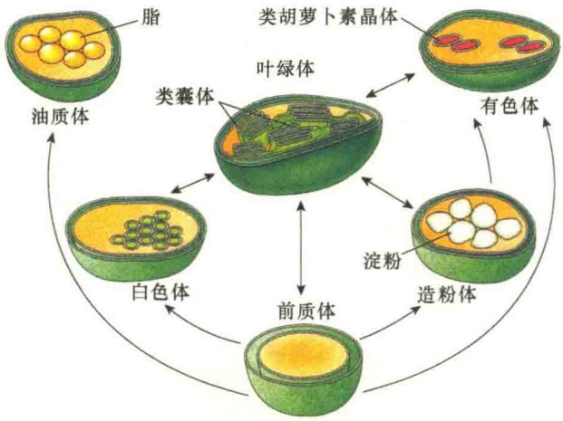
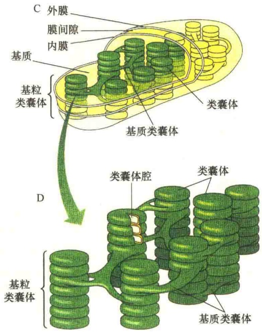
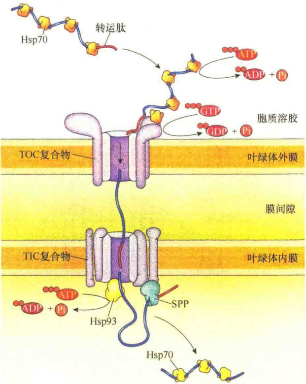

# 叶绿体与光合作用

- 8.1 质体与叶绿体
- 8.1.1 前质体与质体
- 8.1.2 叶绿体的形态、大小与数量
- 8.2 叶绿体的结构
- 8.2.1 叶绿体被膜的结构及特性
- 8.2.2 类囊体
- 8.2.3 叶绿体基质
- 8.3 叶绿体蛋白的转运
- 8.3.1 叶绿体基质蛋白的转运
- 8.3.2 类囊体蛋白的转运
- 8.4 光合作用
- 8.4.1 光合作用的四个阶段与特点
- 8.4.2 光吸收
- 8.4.3 电子传递
- 8.4.4 线性及循环式电子传递途径
- 8.4.5 光合磷酸化
- 8.4.6 暗反应
- 8.4.7 过氧化物酶体在光合作用中的作用
- 8.5 叶绿体的遗传和起源
- 8.5.1 叶绿体的遗传
- 8.5.2 叶绿体的起源
- 8.6 叶绿体与线粒体的结构与功能的比较

光合作用是自养生物利用光能将碳进行还原的过程。在真核自养生物中，捕获光能的反应只能发生在特殊的细胞器——叶绿体中；而在原核自养生物中，相应的反应发生在质膜上。植物通过光合作用将光能转变成化学能的过程主要是在植物细胞的叶绿体中进行的。叶绿体（chloroplast）是植物细胞所特有的能量转换细胞器，其功能是进行光合作用，即利用光能同化二氧化碳和水，合成糖，同时产生分子氧。

由于叶绿体的体积大且具有绿色，所以它是光学显微镜下发现的第一个细胞内的结构。17世纪，光学显微镜发明不久，列文虎克就在藻类中观察到了叶绿体；到了1800年，在各种植物的叶中都鉴定到叶绿体。将叶绿体置于低渗溶液中会膨胀破裂，表明叶绿体也是由半透性的膜包裹的细胞器。

## 8.1 质体与叶绿体

## 8.1.1 前质体与质体

虽然叶绿体是植物细胞特有的细胞器，但并非所有的植物细胞都具有叶绿体，如高等植物中的分生组织细胞就缺少叶绿体，但是它们具有一些小的细胞器，称为前质体（proplastid）。前质体的直径约为1μm，或更小一些，它是由双层膜包被着未分化的基质（stroma）所组成。植物中的前质体在发育过程中随着所处的位置及接受光的多少，分化成功能各异的质体（plastid）。所以，质体是植物细胞中一类膜性细胞器的总称，这类细胞器都是由共同的前体——前质体分化发育而来（图8-1）。

根据质体是否含有叶绿素及功能的不同，可将其分为叶绿体、白色体、有色体、蛋白质体、油质体、造粉体等。

图 8-1 前质体的分化途径（引自 Cooper and Hausman, 2016）。

## 8.1.2 叶绿体的形态、大小与数量

高等植物中的叶绿体为球形、椭圆形或卵圆形，为双凹面。有些叶绿体呈棒状，中央区较细小而两端膨大（图8-2），充满叶绿素和淀粉粒。在同一物种的不同细胞内叶绿体的形态变化较大，但在同一种组织的细胞内比较稳定。叶绿体的大小变化很大，高等植物叶绿体通常宽2～5μm、长

图 8-2 植物细胞中叶绿体的电子显微镜照片（引自 Jeff et al., 2012）。A. 植物叶细胞中的叶绿体；B. 海藻细胞中的叶绿体。

5～10μm。对于特定的细胞类型来说，叶绿体的大小相对稳定，但受遗传和环境的影响，如多倍体细胞内的叶绿体就比单倍体细胞的要大些。同一种植物生长在不同的环境中，其大小也不相同。

不同植物中叶绿体的数目相对稳定，大多数高等植物的叶肉细胞含有几十到几百个叶绿体，可占细胞质体积的40%。叶绿体的数目因物种、细胞类型和生理状况而异，藻类植物通常只有一个巨大的叶绿体，其形态有螺旋状、星状，依据细胞的形态而定。例如，丝状绿藻含有一个螺旋带形的巨大叶绿体，而紫球藻细胞中含有一个巨大的球形叶绿体，其内膜小泡平行排列而不堆积形成基粒。

## 8.2 叶绿体的结构

叶绿体由叶绿体被膜（chloroplast envelope）、类囊体（thylakoid）和叶绿体基质（chloroplast stroma）组成。叶绿体的结构比较特殊，它含有3种不同的膜（外膜、内膜和类囊体膜），以及3种彼此分隔的区室（膜间隙、叶绿体基质和类囊体腔）。

## 8.2.1 叶绿体被膜的结构及特性

叶绿体的外膜和内膜合称为被膜。叶绿体的外膜和内膜都是连续的单位膜，每层膜的厚度为6～8nm，内、外两膜间有2～10nm宽的间隙，称为膜间隙。与线粒体不同的是，叶绿体的内膜并不向内折成嵴（图8-3），但在某些植物中，内膜可皱褶形成相互连接的泡状或管状结构，称为周质网（peripheral reticulum），这种结构的形成可增加内膜的表面积。

内膜含有较多的膜整合蛋白，因此内膜的蛋白

图 8-3 叶绿体的膜与区室（引自 Wolfe，1993）。

质与脂的比值比外膜的高。

内膜上的蛋白质大多是与糖脂、磷脂合成有关的酶类。研究结果表明，叶绿体的被膜不仅是叶绿体脂合成的场所，也是整个植物细胞脂合成的主要场所。这一点与动物细胞有很大的不同:在动物细胞中，脂类的合成主要是在滑面内质网上进行的。内膜中发现的另一类蛋白质是转运蛋白，这也与线粒体一样，由于外膜通透性大，物质的选择性运输任务就自然落在了内膜上。

膜间隙将叶绿体的内外膜分开，间隔2\~10nm。由于外膜的通透性大，所以膜间隙的成分几乎与胞质溶胶的一样。尚不了解在膜间隙中有哪些蛋白质的存在。

## 8.2.2 类囊体

与线粒体不同，叶绿体基质中有第三种膜结构系统，称为类囊体，它是由内膜发展而来的、膜封闭的扁平小囊。类囊体是叶绿体内部组织的基本结构单位，上面分布着许多光合作用色素，是光合作用的光反应场所。

## 8.2.2.1 类囊体的结构

叶绿体中的类囊体有两种类型:基粒类囊体（granum thylakoid）和基质类囊体（stroma thylakoid）（图8-3和图8-4）。

图 8-4 基粒类囊体和基质类囊体的立体结构（引自 Jeff et al., 2012）。A. 猫尾草（Phleum pratense）叶绿体的透射电镜照片。B. 叶绿体的三维结构。C. 叶绿体模式图。D. 两种类型的类囊体模式图。

叶绿体中圆盘状的类囊体常常相互堆积在一起形成柱形颗粒，叫基粒（granum），看起来似一叠硬币。每一个叶绿体中含有40～80个基粒。将构成基粒的类囊体称为基粒类囊体，或称为堆积类囊体（stacked thylakoid）。基粒类囊体的直径为0.25～0.8μm，厚0.01μm，一个基粒由5～30个基粒类囊体所组成，最多的可达上百个。

通常基粒中的类囊体会延伸出网状或片层结构并与相邻的基粒类囊体相通，连接两个相邻基粒类囊体的片层结构称为基质类囊体，也有称为非堆积类囊体（unstacked thylakoid）。基质类囊体是非常大的扁平囊泡结构，能够将多个甚至所有的单个基粒类囊体连接起来。

基本上，所有参与光合作用的色素、光合作用所需的酶类、参与电子传递的载体，以及将电子传递与质子泵和 ATP 合成偶联的蛋白质都定位在类囊体膜上。

由类囊体膜封闭的区室称为类囊体腔（thylakoid lumen），类囊体腔与叶绿体基质是分隔的，它在电化学梯度的建立和 ATP 的合成中起重要作用。

## 8.2.2.2 类囊体膜的化学组成

类囊体的膜在两个方面表现出独特的性质:一是类囊体膜上有伸向基质的柄状结构，称为  $CF_{1}$  颗粒；二是相互堆积形成基粒。类囊体膜的化学组成也比较特别，如细胞质膜中的主要脂类成分——磷脂在类囊体膜上只占5%\~20%，而在线粒体的膜上占90%，内质网膜上的磷脂也有80%。类囊体膜上的脂主要是含半乳糖的一些糖脂和具有光吸收功能的脂类色素。脂类中的脂肪酸主要是不饱和的亚麻酸，约占87%，因此，类囊体膜的脂双层流动性特别大。此外，类囊体膜上的蛋白质与脂的比值很高，这是因为类囊体膜有很多电子载体、酶和一些参与光合作用的色素结合蛋白。

类囊体膜的蛋白质分为整合蛋白和外周蛋白两类。外周蛋白在类囊体膜的叶绿体基质面较多；整合蛋白镶嵌在脂双层中，如质体蓝素、细胞色素等。

## 8.2.3 叶绿体基质

叶绿体内膜与类囊体之间的区室，称为叶绿体基质。在电子显微镜下观察可见到基质中有一些细微颗粒，其中最多的是淀粉颗粒。这种颗粒是用于储存光合作用所产生的糖。另外还有一些含脂的沉积物称为质体球（plastoglobule），这种小球的产生与类囊体的破裂有关，当新类囊体形成时，老的类囊体破裂，可减少类囊体的数量和体积，由此推测质体球可作为类囊体脂的储备库。基质中含有大量的可溶性蛋白质，其中RuBP羧化酶占可溶性蛋白质总量的60%。此外，基质中还含有 $CO_{2}$ 固定反应的所有酶类。叶绿体基质中还有核糖体、DNA和RNA等。叶绿体DNA编码约100余种多肽，涉及叶绿体DNA的复制、转录和翻译。基质是光合作用固定 $CO_{2}$ 的场所。

## 8.3 叶绿体蛋白的转运

虽然叶绿体基因组为自身编码的蛋白质较线粒体的多，但约有3000种或95%的叶绿体蛋白质是由核基因编码的，这些蛋白质是在细胞质游离核糖体上合成，然后被转运到叶绿体，并定位到叶绿体的不同部位起作用。由于叶绿体是三膜三空间结构，所以，叶绿体蛋白质的分选转运要比线粒体蛋白分选转运复杂。

## 8.3.1 叶绿体基质蛋白的转运

大多数进入叶绿体的蛋白质都是通过 N 端一段由 30～100 个氨基酸残基构成的、称之为转运肽（transit peptide）的信号序列引导的，转运肽能够引导叶绿体蛋白质穿过叶绿体的外膜与内膜。进入到叶绿体基质后，转运肽将被水解切除（图 8-5）。

图 8-5 叶绿体基质蛋白的转运（引自 Cooper and Hausman, 2016）。具有 N 端转运肽的蛋白质被引导复合物（guidance complex）所识别，并将之引导到叶绿体外膜的 TOC 复合物。通过外膜时，需要位于膜间隙的 Hsp70 相助，并需要消耗 ATP；而 TOC 复合物在转运叶绿体蛋白质时，也需要水解 GTP。一旦穿过外膜，转运肽就会引导蛋白质穿过内膜的 TIC 复合物，但在穿过内膜 TIC 复合物时需要 Hsp93 的帮助，并消耗 1 分子 ATP。在叶绿体基质中，转运肽要被叶绿体基质加工蛋白酶（stromal processing peptidase, SPP）切除。

叶绿体基质蛋白的转运与线粒体基质蛋白的转运相比，共同点是:都需要解折叠，都需要分子伴侣的帮助，都需要外膜与内膜通道复合物，都需要消耗能源分子；但也有不同，如在能量的消耗上，线粒体基质蛋白转运时需要ATP与膜间隙中$\mathrm{H^{+}}$ 的电化学梯度，而叶绿体中，$\mathrm{H^{+}}$ 的电化学梯度在类囊体，故叶绿体基质蛋白质在穿膜时需要水解GTP供能。

另外，植物细胞中既有线粒体，又有叶绿体，而它们的核基因编码的蛋白质都是在细胞质中游离核糖体合成的，所以在这两种细胞器的外膜和内膜中的蛋白质转运器具有不同的识别功能。