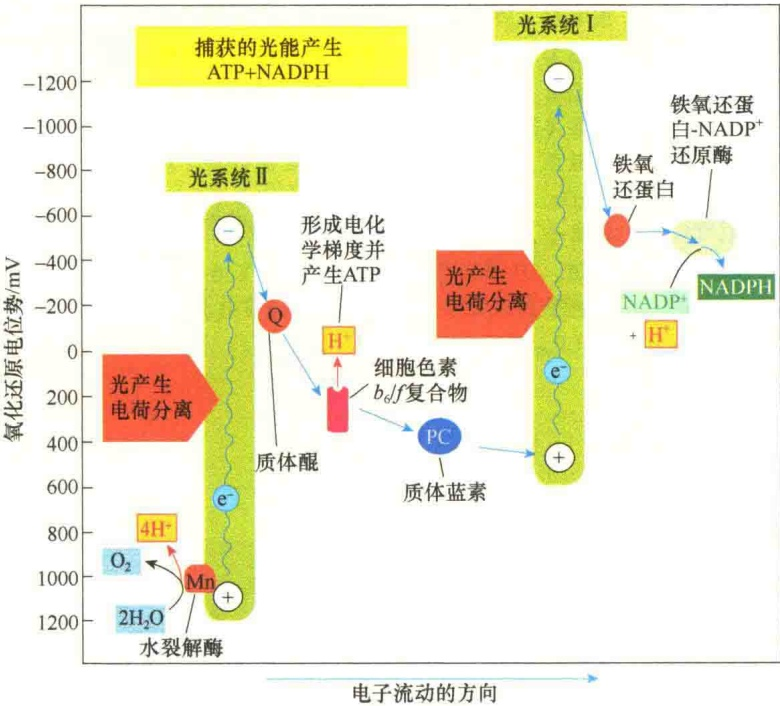
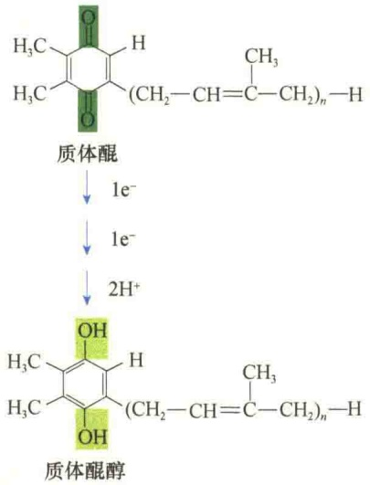
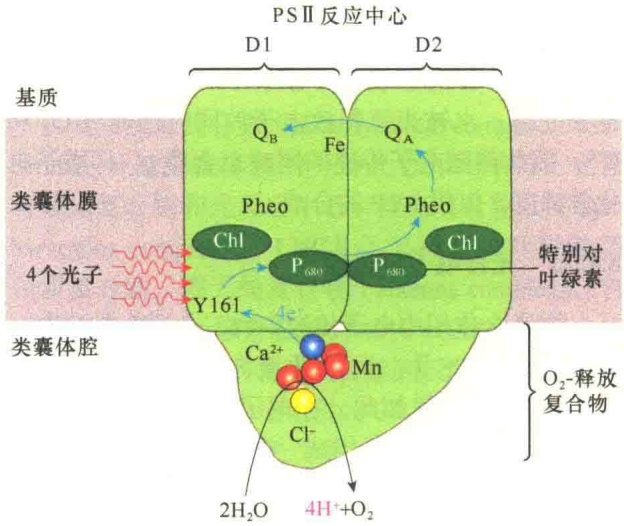
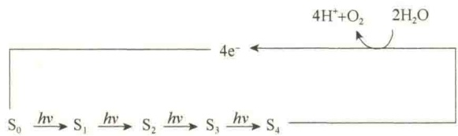
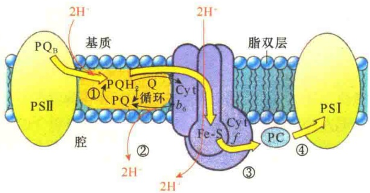
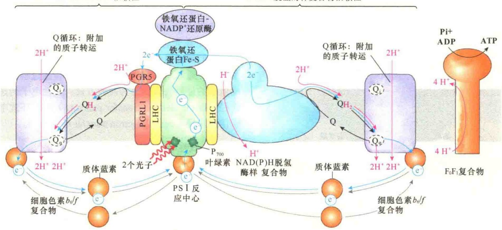

息状态。这一过程涉及水的光解和电子传递，还涉及两对偶联氧化还原: $O_{2}-H_{2}O$ 、 $NADP^{+}-NADPH$ 。其中， $H_{2}O$ 作为原初电子供体， $NADP^{+}$ 作为最终电子受体；水被光解释放电子的同时还释放 $O_{2}$ 和 $H^{+}$ ，因此伴随电子传递的同时也会建立 $H^{+}$ 质子电化学梯度，以供ATP的合成。

## 8.4.3.1 光合电子传递链

在光合作用中电子传递中有三个源头与流向:从 $\mathrm{H}_2\mathrm{O}$ 流向PSⅡ，从PSⅡ流向PSI，从PSI流向 $\mathrm{NADP^{+}}$ 。不仅如此，在电子传递中还需要其他几种电子载体，才能组成一条顺畅的电子传递链（图8-13）。

图8-13 光合作用中的Z形电子传递链及氧还电势的变化（引自Alberts et al., 2015）。该传递链中除了水、PSⅡ、PSⅠ外，还有质体醌、质体蓝素、细胞色素 $b_{0}/f$ 、Fd等。由于各电子载体在电子传递链中的氧还电势的不同，呈现Z字形。PSⅡ将来自水的电子传递给PSⅠ，而PSⅠ则通过铁氧还蛋白-NADP⁺还原酶（ferredoxin-NADP⁺reductase）传递给NADP⁺。净电子流是两个光系统协同将来自水的电子流向NADP⁺，同时产生了NADPH及电化学质子梯度。形成的质子梯度可用于ATP的合成。

光合电子传递链（photosynthetic electron transfer chain）是由一系列的电子载体构成的，与线粒体呼吸链中电子载体的作用基本相似。但二者不同的是，线粒体呼吸链中的载体位于内膜，将来自NADH和 $FADH_{2}$ 的电子传递给氧，释放出的能量用于ATP的合成；而光合作用的电子载体位于类囊体膜上，将来自 $H_{2}O$ 的电子传递给 $NADP^{+}$，并且这是一个吸热的过程而不是放热的过程。

与线粒体的呼吸链一样，光合作用的电子传递链中的电子载体也是细胞色素、铁氧还蛋白、黄素蛋白和醌等。

1）细胞色素 植物细胞有几个特殊的细胞色素参与光合作用的电子传递。其中主要的两种是细胞色素 $b_{6}$ 和细胞色素f，它们的吸收波长都已非常清楚，一个为563nm，另一个为553nm。细胞色素f属于细胞色素c的一种，中等电位型，细胞色素 $b_{6}$ 是低等电位型。

2）质体蓝素（plastocyanin，PC）一种含铜的蛋白质，氧化型呈蓝色，吸收光谱为600nm。在还原状态时蓝色消失，传递电子时靠 $Cu^{2+}\rightarrow Cu^{+}$ 的状

态循环。

3）质体醌（plastoquinone，PQ或Q）质子和电子载体，与线粒体的电子传递链的泛醌一样，也是通过醌和醌醇循环来传递电子和氢质子，但质体醌与泛醌的结构是不同的（图8-14）。

与线粒体的电子传递链的电子载体需组成复合物一样，光合作用中的电子载体也要组成复合物。在光合作用的电子传递链上一般有3种复合物，其中两种是光系统（光系统Ⅱ和光系统Ⅰ）的组成部分，另一种是细胞色素 $b_{6}/f$ 复合物（cytochrome $b_{6}/f$ complex，Cyt $b_{6}/f$）。

20 世纪 50 年代后期从植物叶中分离了一种铁硫蛋白，发现将这种铁硫蛋白加入到分离的叶绿体中能够增强 NADP $^{+}$ 的还原能力。后来将这种蛋白质称为铁氧还蛋白（ferredoxin），含有一个氧化还原的位点，该位点有两个与硫结合的铁原子。如同其他的铁硫蛋白，铁氧还蛋白也是通过 Fe $^{3+}$ → Fe $^{2+}$ 的循环传递电子；在氧化状态，对波长在 420nm 和 463nm 处的光有较强的吸收作用。

Cyt  $b_{6}/f$  复合物是类囊体膜上可分离出来的复合物，它由 4 个多肽组成，即

细胞色素f、细胞色素 $b_{6}$ 、铁硫蛋白和一个分子质量为17kDa的多肽，前3个都是电子载体。细胞色素f属c型细胞色素，与线粒体的细胞色素 $c_{1}$ 关系密切，该复合物位于基质面，功能是参与电子传递。

## 8.4.3.2 水的裂解:PSⅡ中氧的产生与电子流

PSⅡ中经光化学氧化的反应中心叶绿素 $P_{680}^{+}$ ，是极强的生物氧化剂，它的氧还电位为+1.1V，足以将水裂解（水的氧还电位是+0.82V），产生 $O_{2}$ 和 $H^{+}$ 。

图 8-14 质体醌的氧化和还原状态（引自 Karp，2010）。

水的氧化为 PSⅡ中  $P_{680^{+}}$  的还原提供了电子。水的氧化是由 3 个复合物协同催化完成的，这 3 种复合物分别位于类囊体的膜及类囊体的腔面。放氧复合物（oxygen-evolving complex）含有 4 个锰离子，这 4 个锰离子通过氧原子桥连接在一起，并结合有一个  $Ca^{2+}$ 、一个  $Cl^{-}$ （图 8-15）。用浓盐溶液处理可将这 4 个锰离子连同另外 3 个外周蛋白质除去，并使之丧失氧释放的能力，但不影响光吸收及电子传递的起始。

在水光解反应（water splitting reaction）中，每裂解2分子的 $H_{2}O$ ，释放4个电子、1分子 $O_{2}$ 和4个 $H^{+}$ : $2H_{2}O\longrightarrow O_{2}+4H^{+}+4e^{-}$ ，这一反应又称为水的光解作用（photolysis）。

值得注意的是, 2 分子水的光解释放 1 分子氧, 同时释放出了 4 个电子, 而 $\mathrm{P}_{680^{+}}$ 一次只能接受一个电子, 如何解释这种现象?

水的光解是由含锰的蛋白质复合物介导的。该复合物中4个锰（Mn）与PSⅡ的D1蛋白紧密地靠在一起。已知锰可以多种氧化状态（+2～+5价）存在。光谱研究表明，绑定在氧释放复合物中的Mn以5种不同的氧化状态进行循环: $S_{0}\sim S_{4}$ 。在一次S循环中，有2个 $H_{2}O$ 分子被裂解，产生4个质子，释放1个 $O_{2}$ （图8-16）。

从水裂解中释放的4个电子经由Mn离子传递，每次传递一个，连续4次传递给相邻的酪氨酸侧链，进而传递给反应中心的 $P_{680^{+}}$ ，从而补充了因光吸收而失去的电子，使反应中心的叶绿素还原到  $P_{680}$ 。从  $H_{2}O$  中释放的  $H^{+}$ 则留在类囊体的腔中。

图 8-15 PSⅡ中的电子流与氧的产生（引自 Lodish et al., 2013）。PSⅡ反应中心含有两个整合蛋白质，分别称为 D1 和 D2，以及一对特别的叶绿素（ $P_{680}$ ）。在该反应中心的类囊体腔面膜上结合着一些电子载体，形成放氧复合物。在放氧复合物中另有 3 个外在蛋白质（相对分子质量为 33kDa、23kDa 和 17kDa）、4 个锰离子、1 个钙离子、1 个氯离子，这些离子参与  $H_{2}O$  的裂解、维持环境中  $O_{2}$  的高比值。D1 多肽中的酪氨酸 161（Y161）可促进 Mn 产生的电子去氧化反应中心的叶绿素（ $P_{680^{+}}$ ），使之还原到基态（ $P_{680^{*}}$ ）。

图 8-16 Mn 的电子传递与水的光解（引自 Karp，2010）。S 表示 Mn 基团的正电荷数。

## 8.4.3.3 电子从PSⅡ向PSI传递

上面讨论了电子从水分子传递到 PSⅡ中的  $PQ_{B}$ ，那么电子是如何从 PSⅡ传递到 PSⅠ的呢？

$\mathrm{PQ_B}$ 类囊体基质中获得2个 $\mathrm{H^{+}}$ ，被还原成$\mathrm{PQH_2}$ ， $\mathrm{PQH_2}$ 是一种脂溶性的分子，并且是可动的分子，在脂双层中通过扩散进行移动。它的结构和功能与线粒体呼吸链中的辅酶Q相似。在光合作用中， $\mathrm{PQH_2}$ 中的2个电子能够传递给Cyt $b_{6} / f$ 复合物，同时将2个氢质子释放到类囊体的腔，由于 $\mathrm{PQH_2}$ 在Q循环中，传递2个电子，同时要转运 $4\mathrm{H^{+}}$ ，除了释放自身携带的 $2\mathrm{H^{+}}$ 外，还将类囊体基质中的  $2H^{+}$ 转移到类囊体的腔，所以这一过程实际上是将  $H^{+}$ 进行了跨膜转运，有利于质子梯度的建立。Cyt  $b_{6}/f$  复合物接受电子后，经  $b_{6} \rightarrow FeS \rightarrow f$ ，再传递给另一个可动的水溶性电子载体——质体蓝素（PC），这是一种含铜的蛋白质，位于类囊体膜的腔面，然后再传递给 PS I 反应中心色素  $P_{700^{+}}$ （图 8-17）。

图 8-17 电子在 PSⅡ与 PSⅠ之间的传递（引自 Karp, 2010）。

## 8.4.4 线性及循环式电子传递途径

光反应的最终目的是要为暗反应中碳固定提供足够的 NADPH 和 ATP。叶绿素通过光吸收捕获了大量的光能，并逐步转变成化学能，如何将这些化学能转变成 NADPH 和 ATP？

由于在光合作用的电子传递链中有两个光系统，它们都能吸收光能进行光反应，所以会形成两个高峰，通常用 Z 字形图来表示电子传递过程。根据电子的最后去向，分为两种方式:线性电子传递途径（linear electron transfer pathway）和循环式电子传递途径（cyclic electron transfer pathway）。

## 8.4.4.1 线性电子传递途径

线性电子传递又称为非循环式电子传递（non-cyclic electron transfer pathway）。在这种方式中，需要两个光反应系统共同参与，电子从水开始，经PSⅡ、质体醌（PQ）、细胞色素 $b_{6}/f$ 、质体蓝素（PC）、PSⅠ、铁氧还蛋白（Fd），最后传递给NADP $^{+}$ （图8-18）。

可以将线性电子流分为4个阶段:①电子从PSⅡ的 $P_{680}$ 传递给PQ，生成 $PQH_{2}$ ；②水光解释放的电子经Mn传递给PSⅡ的 $P_{680^{+}}$ ；③电子从 $PQH_{2}$ 经细胞色素 $b_{6}/f$ 传递给PC，即电子从PSⅡ传递给PSI；④电子经 $P_{700^{+}}$ 传递给Fd，最后在铁氧还蛋

图 8-18 光合作用中线性电子传递途径（引自 Lodish et al., 2013）。在非循环式电子传递途径中，电子的最终受体是 NADP $^{+}$ ，电子供体来自光解的水。

白-NADP $^{+}$ 还原酶的作用下，电子被 NADP $^{+}$ 接收。

该途径的主要特点是需要 PSⅡ、PSⅠ 共同作用，产物除了 NADH 外，还有  $O_{2}$ ，同时在类囊体腔中建立  $H^{+}$ 质子动势，可用于 ATP 的合成。

## 8.4.4.2 循环式电子传递途径

在线性电子传递途径中，被传递的电子经过两个光系统接力合作，最终被NADP $^{+}$ 接收，并将

NADP $^{+}$ 还原成 NADPH。在循环式电子传递途径中，PS I 反应中心吸收光子后产生的高能电子传递给 Fd 之后，不是进一步传递给 NADP $^{+}$ ，而是传递给细胞色素 b $_{6}$ /f 复合物，再经 PC 又回到 PS I，形成了闭路循环（图 8-19）。

在高等植物中，有两种形式的循环式电子传递途径控制着 ATP : NADPH 的比值。主要途径是 PGR5-PGRL1 依赖性途径（PGR5-PGRL1- dependent pathway），该途径保证了光合作用效率，并防范胁迫。次要途径是NADH脱氢酶样复合物依赖性途径（NADH-dehydrogenase-like complex-dependent pathway），可能的作用是胁迫应答，并作为 $\mathrm{H}_2\mathrm{O}_2$ 介导的调节靶标。NADH脱氢酶样复合物是非常大的多蛋白复合物，在形态与组成上都与线粒体复合物I非常相似。线粒体复合物I的作用是在Q还原成 $\mathrm{QH_2}$ 时对NADPH或NADH进行氧化，然而，NADH脱氢酶样复合物似乎缺少NADPH氧化所必需的亚基。

图 8-19 光合作用中循环式电子传递途径（引自 Lodish et al., 2016）。在循环式电子传递中，光能被 PS I 用于循环式转运电子从而产生质子动力与 ATP，而不是用于氧化水及产生 NADPH。高能电子经由 PS I 的铁氧还蛋白或是传递给 PGR5-PGRL1 异源二聚体，或是传递给 NADH-脱氢酶样复合物，这两种方式最终都是将质体 Q 还原成  $QH_{2}$ 。 $QH_{2}$  又将电子传递给细胞色素  $b_{6}/f$ ，再传递给质体蓝素，最后又回到 PS I。

在循环式电子传递期间，通过光吸收在PSI中产生的高能电子及光电运输（photoelectric transport）经由PSI的铁氧还蛋白亚基或是被传递给PGR5-PGRL1异源二聚体，或是被传递给NADH-脱氢酶样复合物。有证据显示，这两种电子受体是各自独立的，分别通过LHC亚基的介导与PSI结合形成超复合物。这两种电子受体都将Q还原成 $QH_{2}$ ，然后经由Q循环将质子与电子传递给细胞色素 $b_{6}/f$ 复合物。在细胞色素 $b_{6}/f$ 复合物（也可能在NADH-脱氢酶样复合物）的作用下，质子穿过类囊体的膜进入类囊体的腔。最后，质体蓝素将电子从细胞色素 $b_{6}/f$ 复合物传回到PSI完成循环。在循环式电子流中产生的质子动力在 $F_{0}F_{1}$ 复合物（ATP合酶）的作用下，驱动ATP的合成，因此提高了ATP:NADPH的值。

循环式光合磷酸化的产物仅为 ATP，无 NADPH和分子氧。循环式光合磷酸化占光合磷酸化的10%～20%，特别是NADP⁺不足时，所占的比例增大，因此它对光反应中产生的ATP和NADPH的比例具有调节作用。由于NADP⁺接收电子被还原时，需要同时从叶绿体基质中摄取一个H⁺，如果基质中NADP⁺浓度不高，或NADPH的浓度过高，说明NADPH与ATP的比例失调，需要加以调整。调整的机制是将电子回传给细胞色素 $b_{6}/f$ 复合物。细胞色素 $b_{6}/f$ 复合物是一种质子泵，得到电子从而有足够的自由能将基质中的H⁺跨膜传递到类囊体腔，使类囊体腔中质子梯度升高；高浓度的H⁺质子通过 $CF_{0}-CF_{1}$ ATP合酶的H⁺通道返回叶绿体基质，从而促进了ATP的合成，其结果是，调整了光反应中ATP和NADPH的比值，有利于 $CO_{2}$ 的固定。因此循环式电子流对光合作用具有重要的调节作用，主要是调节光反应中合成的ATP与还原的NADPH的比值，因为在暗反应中，固定 $CO_{2}$ 时既需要ATP也需要NADPH，二者间应有一个合适的比例，保持平衡。

实际上，植物通过循环式电子流对不良环境进行胁迫调控，如在干旱、高光、低  $CO_{2}$  及 NADPH 浓度过高（或  $NADP^{+}$ 浓度不足）等环境下，植物需要产生更多的 ATP，而不是 NADPH，为此，主要通过 PS I 去建立  $H^{+}$ 质子动势合成 ATP。

由此看来，PSⅡ、PSⅠ有明确的分工:PSⅡ主要是为光合作用的暗反应提供足够的NADPH与ATP；而PSⅠ有两方面的作用，一是协助PSⅡ为