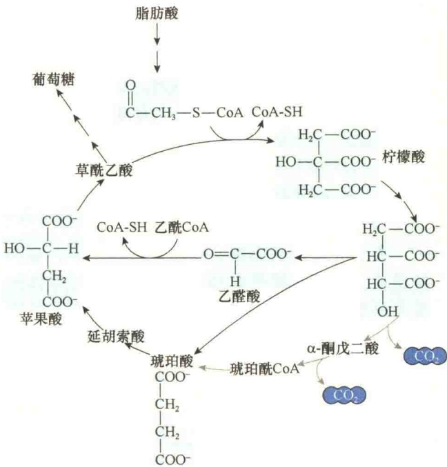
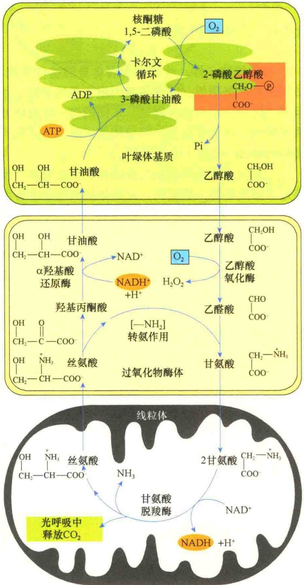
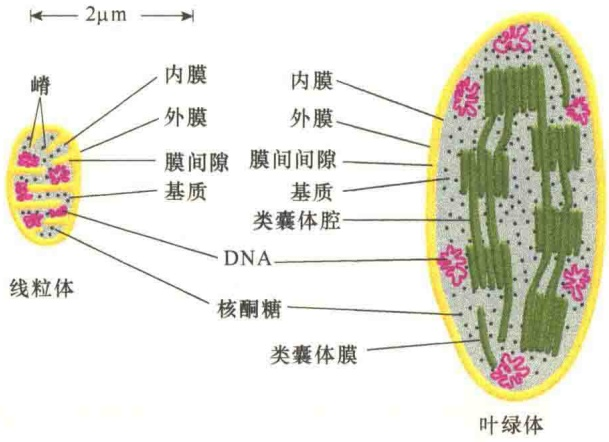

第一，种子中过氧化物酶体负责将贮存的脂肪酸转变成碳水化合物，这不仅为种子的生长提供能量，而且为植物种子发芽生长提供初始物质。这种作用是通过一系列称之为乙醛酸循环（glyoxylate cycle）的反应过程进行的（图8-25）。乙醛酸循环是一种改良的三羧酸循环。在乙醛酸循环中，过氧化物酶体又被称为乙醛酸循环体（glyoxysome）。

图 8-25 乙醛酸循环（引自 Cooper and Hausman，2016）。植物可将脂肪酸经由乙醛酸循环合成糖，是一种改良的三羧酸循环。在乙醛酸循环中，由脂肪酸产生的乙酰 CoA 与草酰乙酸（oxaloacetic acid）结合，形成柠檬酸（citric acid），柠檬酸进一步转变成异柠檬酸（isocitrate），此时的异柠檬酸不需像三羧酸循环那样经过两次脱羧形成琥珀酸（succinate），而是直接转变成琥珀酸与乙醛酸。乙醛酸与另 1 分子乙酰 CoA 形成苹果酸，再经草酰乙酸合成糖。

第二，植物叶片中的过氧化物酶体参与光呼吸，为光合作用提供副产品。我们知道，植物在光合作用的卡尔文循环中，利用光能将  $CO_{2}$  固定并转化成碳水化合物。卡尔文循环的第一步是将  $CO_{2}$  加到一个五碳糖上，生成 2 分子三碳的 3-磷酸甘油酸。然而，参与该反应的酶（Rubisco）有时将  $O_{2}$  而不是  $CO_{2}$  添加上去，催化核酮糖 1,5-二磷酸裂解成 3-磷酸甘油酸和 2-磷酸乙醇酸。这是一种副反应，产生的磷酸乙醇酸不是有用的代谢物。因此，磷酸乙醇酸进一步被转变成乙醇酸，然后被转运到过氧化物酶体，在过氧化物酶体中被氧化，生成甘氨酸。甘氨酸被转移到线粒体，在线粒体中 2 分子的甘氨酸缩合成 1 分子的丝氨酸，同时失去 1 分子  $CO_{2}$  和 1 分子的  $NH_{3}$ 。生成的丝氨酸又回到过氧化物酶体，被转变成甘油酸（glycerate）。最后甘油酸被转运到叶绿体，重新进入卡尔文循环（图 8-26）。上述过程表明，过氧化物酶体对于降低光呼吸带来的危害、提高碳的利用具有重要的作用。

图 8-26 过氧化物酶体在光呼吸中的作用（引自 Nelson and Cox，2013）。在光合作用期间， $CO_{2}$  经卡尔文循环被转变成糖，反应的第一步是将  $CO_{2}$  添加到五碳糖——核酮糖 1,5-二磷酸上。但是，起催化反应的酶有时会错误地将  $O_{2}$  分子而不是  $CO_{2}$  添加到核酮糖 1,5-二磷酸上，这样产生的产物是二碳的磷酸乙醇酸（phosphoglycolate），磷酸乙醇酸可转变成乙醇酸（glycolate），并被转移到过氧化物酶体，在过氧化物酶体中被氧化转变成甘氨酸。随后，甘氨酸被转移到线粒体，并在线粒体中转变成丝氨酸。丝氨酸又重新回到过氧化物酶体，并转变成甘油酸（glycerate）。

## 8.5 叶绿体的遗传和起源

叶绿体与线粒体一样，也是半自主性细胞器(semiautonomous orga-nelle)。叶绿体也有自己的DNA，它的生长和增殖受核基因组及自身的基因组两套遗传系统的控制。

## 8.5.1 叶绿体的遗传

与线粒体一样，叶绿体含有自身的遗传系统，如同线粒体基因组，叶绿体基因组也是环状的，并且每个叶绿体中有多个拷贝，不同的是，叶绿体基因组较大，而且更复杂。叶绿体基因组大小范围为120～160kb，约含150个基因。

已经完成了几种植物叶绿体基因组的测序，也鉴定了细胞器的一些基因。叶绿体基因组中含有编码涉及叶绿体基因表达的 RNA 和蛋白质的基因，并编码一些在光合作用中起作用的功能蛋白。

虽然叶绿体具有自身的遗传物质和进行蛋白质合成的全套机构，但是组成叶绿体的各种蛋白质成分是由核 DNA 和叶绿体 DNA 分别编码的。也就是说，叶绿体的生长和增殖是由核 DNA 及叶绿体 DNA 共同控制的。

叶绿体的自主性表现在:叶绿体不仅有自己的DNA，还有自己的核糖体，同原核生物的一样都是70S，实验证明，缺少叶绿体核糖体的突变体不能合成叶绿体基因组编码的蛋白质。

虽然叶绿体有自己的DNA，但是信息量有限，只能起部分控制作用。而大部分叶绿体的蛋白质是核基因编码的，有些是叶绿体基因和核基因共同编码的。例如，RuBP羧化酶的8个大亚基是由叶绿体基因编码的，而8个小亚基是由核基因编码，在细胞质中合成后转运到叶绿体。

## 8.5.2 叶绿体的起源

关于叶绿体的起源，也与线粒体一样，有两种学说，但普遍接受内共生学说，认为叶绿体的祖先是蓝藻或光合细菌，在生物进化过程中被原始真核细胞吞噬，共生在一起进化成为今天的叶绿体（图 8-27）。

图 8-27 叶绿体的起源（引自 Alberts et al., 2015）。叶绿体的起源被认为是光合作用细菌与已经含有线粒体的早期真核生物共生而来。

## 8.6 叶绿体与线粒体的结构与功能的比较

与线粒体相比，叶绿体是由外膜、内膜和类囊体膜3种不同类型的膜将其内部分隔成3个不同的区室:膜间间隙、叶绿体基质和类囊体腔。因此，叶绿体是一种特别的膜性细胞器（图8-28）。

在功能上，线粒体是有机物氧化的场所，同时将释放出的自由能转变成可利用的化学能贮存在ATP的高能磷酸键上，这一过程是通过氧化磷酸化完成的。而叶绿体是光能的捕获者和高能有机物的制造者，光能的捕获和转化是通过光合作用完成的。二者功能虽然不同，但都是通过电子传递和建立 $H^{+}$ 质子梯度，实现能量转换的。

在质子梯度建立方面，二者有许多相似之处，也有一些差别。在叶绿体中， $H^{+}$ 是从叶绿体基质图 8-28 叶绿体与线粒体的比较（Alberts et al., 2015）。线粒体和叶绿体的膜及区室在结构组成和功能上都有所不同，如线粒体内膜除了作为线粒体界膜之外，主要功能是电子传递和合成 ATP。从结构上看，线粒体内膜向内折叠成嵴，ATP 合酶位于嵴上。而叶绿体的内膜只是稍向内折形成小管或小泡结构，且表面光滑。叶绿体内膜是脂合成的场所，是叶绿体的界膜。

泵向类囊体腔，叶绿体基质中的 pH 是 8.0，建立  $H^{+}$ 质子梯度后，类囊体腔中的 pH 下降到 5.5。在线粒体中， $H^{+}$ 是从线粒体基质泵向膜间隙。线粒体基质的 pH 是 7.9，建立  $H^{+}$ 质子梯度后，膜间隙中 pH 为 7.4（图 8-29）。氧化磷酸化和光合磷酸化除了在  $H^{+}$ 质子梯度建立方面的一些差别之外，还有其他一些不同（表 8-1）。

图 8-29 线粒体和叶绿体中 ATP 合酶的定向及  $H^{+}$ 的流向（引自 Alberts et al., 2015）。

表 8-1 氧化磷酸化与光合磷酸化的比较

<table><tr><td>项目</td><td>氧化磷酸化</td><td>光合磷酸化</td></tr><tr><td rowspan="2">细胞器部位</td><td>线粒体</td><td>叶绿体</td></tr><tr><td>线粒体内膜</td><td>类囊体膜</td></tr><tr><td>电子传递系统</td><td>呼吸链</td><td>PSI、PSII</td></tr><tr><td>电子供体</td><td>NADH或 $FADH_2$ </td><td> $H_2O$ 的光解</td></tr><tr><td>电子终受体</td><td>1/2  $O_2$ </td><td> $NADP^+$ </td></tr><tr><td>传递电子对</td><td>1对</td><td>1对</td></tr><tr><td>造成的 $H^+$ 质子浓度差</td><td>膜间间隙(高)/基质(低)</td><td>类囊体腔(高)/基质(低)</td></tr><tr><td>电子跨膜次数</td><td>3次</td><td>2次</td></tr><tr><td>偶联因子</td><td> $F_0-F_1 ATP$ 合酶</td><td> $CF_0-CF_1 ATP$ 合酶</td></tr><tr><td>机制</td><td>化学渗透</td><td>化学渗透</td></tr><tr><td>偶联因子定位取向</td><td>向内朝向基质</td><td>向外朝向基质</td></tr><tr><td> $H^+$ 质子流向</td><td>向外流向膜间隙</td><td>向内流向类囊体腔</td></tr><tr><td>产生ATP所需的 $H^+$ </td><td>2个 $H^+$ </td><td>3个 $H^+$ </td></tr></table>

## 本章小结

叶绿体由叶绿体被膜、类囊体和基质组成。类囊体分为基粒类囊体和基质类囊体，是光合作用光反应的场所。

叶绿体的主要功能是进行光合作用，分两个阶段进行。

光合作用的第一阶段是光反应，包括光能的吸收、电子的传递、光合磷酸化3个主要过程。

进行光吸收的功能单位是光系统，它由捕光复合物和光反应中心复合物组成，被吸收的光能在色素分子之间传递。

光反应的第二步是电子传递。在此过程中，$\mathrm{H}_{2} \mathrm{O}$ 是原初电子供体，$\mathrm{NADP}^{+}$ 是最终电子受体。电子载体位于类囊体膜上，包括细胞色素、铁氧还蛋白、$\mathrm{NADP}^{+}$ 还原酶、质体蓝素、$\mathrm{NADP}^{+}$、细胞色素 $b_{6} / f$ 复合物等。

电子传递复合物包括光系统Ⅰ、光系统Ⅱ和细胞色素 $b_{6}/f$ 复合物。其中，光系统Ⅱ又由捕光复合物Ⅱ、PSⅡ反应中心复合物和水裂解放氧复合物组成，光系统Ⅰ由捕光复合物Ⅰ和PSⅠ反应中心复合物组成。电子传递有循环式和非循环式两种途径。

叶绿体光合磷酸化的机制与线粒体的氧化磷酸化的相似。在电子传递过程中，类囊体膜两侧建立质子动力势，通过  $CF_{0}-CF_{1}ATP$  合酶合成 ATP。

光合作用的第二阶段是 $\mathrm{CO}_{2}$ 的固定, 即暗反应, 在叶绿体基质中进行。光呼吸是一种依靠光来消耗 $\mathrm{O}_{2}$ 、释放 $\mathrm{CO}_{2}$ 的作用。光呼吸的结果是降低了光合作用的效率。

叶绿体是半自主性细胞器，其基因组为环状，编码部分叶绿体所需的蛋白质和RNA，叶绿体的大多数蛋白质由核基因编码并通过信号序列转运而来。

叶绿体由前质体分化来，并通过分裂而增殖。

## 思考题

（1）何谓前质体？其会分化成哪些功能各异的质体？

(2) 什么是类囊体？它的蛋白质是如何定位的？

(3) 如何理解 “叶绿体从捕获光能到糖类的合成，都是集体智慧的结晶” 这一说法？

（4）什么是线性与循环式电子传递链？各有什么特点？

（5）什么是光呼吸？过氧化物酶体在光呼吸中有什么作用？

（6）比较叶绿体与线粒体在 ATP 的合成中的异同。