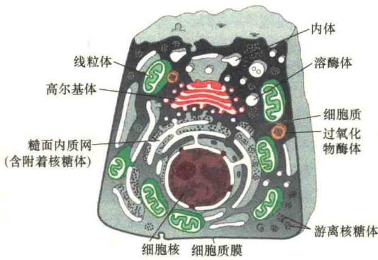
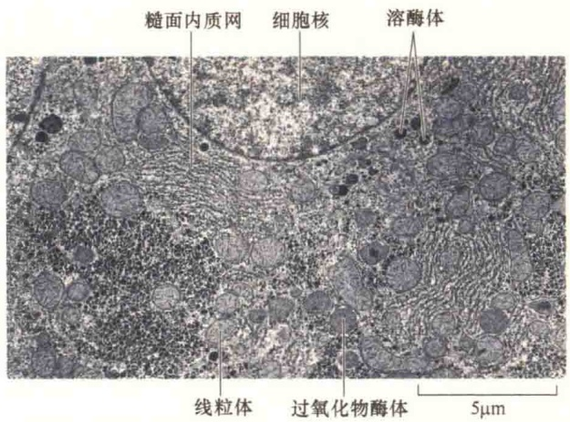
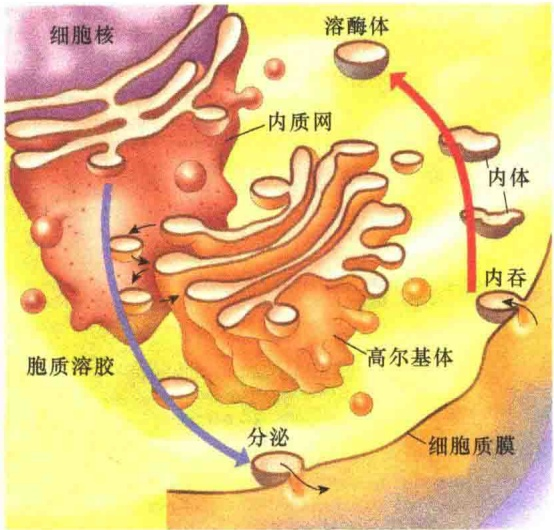
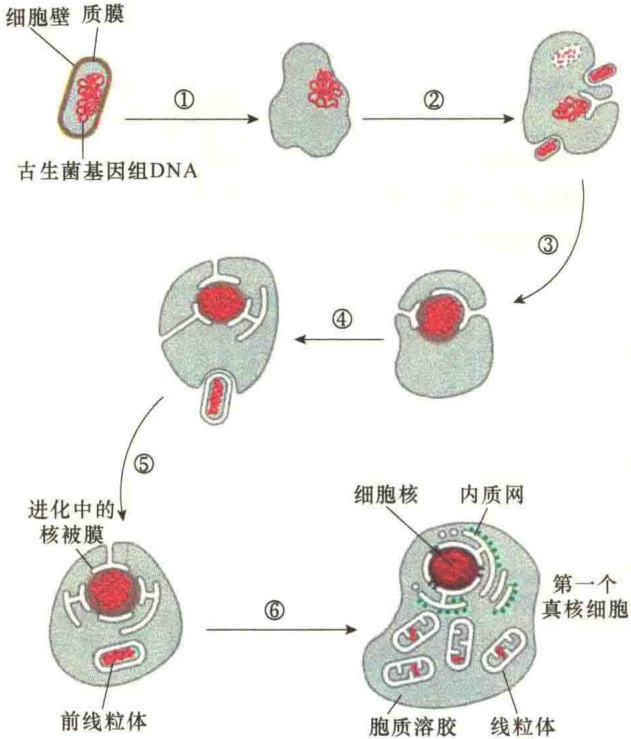

# 内膜系统与蛋白质分选

## 9.1 概述

9.1.1 膜性细胞器与内膜系统

9.1.2 蛋白质分选与膜运输

9.1.3 内膜系统的研究方法

9.2 内质网

9.2.1 内质网的形态结构和化学组成

9.2.2 滑面内质网的功能

9.2.3 糙面内质网的功能——蛋白质转运

9.2.4 蛋白质插入内质网的膜及定向

9.2.5 蛋白质在内质网中的折叠与修饰

## 9.3 高尔基体

9.3.1 高尔基体的一般特性

9.3.2 高尔基体的功能

9.4 溶酶体与液泡

9.4.1 溶酶体的酶与溶酶体的发现

9.4.2 溶酶体的功能

9.4.3 植物细胞的液泡

细菌是由质膜包裹的单一区室的细胞，基因组小，如大肠杆菌才4000个基因，编码的蛋白质数量也不算大，所以其细胞内部的结构较为简单。而真核细胞的遗传信息量大。例如，人的基因组有30亿个碱基对，基因数量为2万～2.5万个，维持真核细胞生命活动所需蛋白质的数量巨大，动物细胞内可能有10 000种左右，数量达到 $10^{10}$ 个；单细胞的真核细胞——酵母也有5000种不同的蛋白质，如此大量的蛋白质必须要将它们组织起来才能高效地发挥作用。

为此，真核细胞逐步进化形成了发达的内膜系统（endomembrane system），将细胞内环境分割成许多功能不同的区室（compartment）。另外，细胞内不同区室的结构与功能是不同的，这些差异是由蛋白质决定的，而蛋白质绝大多数都是在胞质溶胶中合成的，如何将这些蛋白质准确无误地运送到各自的细胞岗位中去履职？为此，真核细胞进化出极致的蛋白质分选（protein sorting）与细胞内膜运输（membrane trafficking）机制。

## 9.1 概述

真核细胞进化的一个精妙绝伦之作是细胞内形成了由膜包裹起来的细胞器体系，它不仅将细胞内蛋白质进行了集团化，而且为新生蛋白质准确“上岗”建立了最为快捷而又科学的机制，细胞内这些膜包裹的细胞器既相对独立，又相互合作，组成一个完美的内膜系统。

## 9.1.1 膜性细胞器与内膜系统

关于真核细胞中具有膜结构细胞器的描述通常有3个概念:膜性细胞器（membrane-bound organelle）、细胞质膜系统（cytoplasmic membrane system）、内膜系统。虽然这3个概念都是指真核细胞中具有膜结构的细胞器，但是在含义上仍有一些差别。膜性细胞器统指细胞质中所有具有膜结构的细胞器，包括细胞核、内质网、高尔基体、溶酶体、分泌泡、内体、线粒体、叶绿体和过氧化物酶体等。细胞质膜系统是指细胞内那些在生物发生上与质膜相关的细胞器，显然不包括线粒体、叶绿体，因为这两种细胞器的膜是独立的。内膜系统有广义与狭义之分，广义的内膜系统就是细胞内所有的膜性细胞器，而狭义的内膜系统是指内质网、高尔基体、细胞核、溶酶体和膜泡（包括内体和分泌泡）5类膜性细胞器，因为它们的膜是相互流动的，处于动态平衡，在功能上也是相互协同的。从本质上说，这些膜性细胞器都是由膜包裹着的、具有不同功能的区室，它们是既相互独立，又相互合作。图9-1显示了动物细胞内区室的形态及其在细胞内的分布。

图9-1 动物细胞内主要的区室（引自Alberts et al., 2015）。细胞内的空间为胞质溶胶，里面被一些膜性细胞器分隔成许多区室，每个区室至少有一层单位膜包裹，如细胞核、高尔基体、内质网、溶酶体、线粒体等。

## 9.1.1.1 膜性细胞器的作用与分布

一般而言，真核细胞内有许多膜性细胞器构成的区室，几乎占据细胞总体积的一半（表9-1）。

正是由于这些膜性细胞器的形成，使真核细胞内不同功能的蛋白质有了相对集中、独立的“工作间”（表9-2），这不仅有利于节省资源，也极大地提高了效率。

在细胞内膜性细胞器中，线粒体、叶绿体、过氧化物酶体和细胞核等的独立性很强，并且有独特的功能。其他几种膜性细胞器，如内质网、高尔基体、溶酶体，虽然有不同的结构和功能，但是它们都参与蛋白质的加工、分选和膜泡运输，形成了一个特别的细胞内系统。

表 9-1 肝细胞中主要区室及占细胞的体积比

| 区室 | 占细胞体积/% | 区室 | 占细胞体积/% |
| --- | --- | --- | --- |
| 胞质溶胶 | 54 | 线粒体 | 22 |
| 糙面内质网 | 9 | 滑面内质网+高尔基体 | 6 |
| 细胞核 | 6 | 过氧化物酶体 | 1 |
| 溶酶体 | 1 | 内体 | 1 |

表 9-2 真核细胞区室的主要功能

| 细胞器(区室) | 主要功能 |
| --- | --- |
| 胞质溶胶 | 代谢的主要场所,是蛋白质合成部位 |
| 细胞核 | 基因组存在场所,DNA 和 RNA 合成场所 |
| 内质网 | 大多数脂的合成场所,蛋白质合成和集散地 |
| 高尔基体 | 蛋白质和脂的修饰、分选及包装 |
| 溶酶体 | 细胞内的降解作用 |
| 内体 | 内吞物质的分选 |
| 线粒体 | 通过氧化磷酸化合成 ATP |
| 叶绿体 | 进行光合作用 |
| 过氧化物酶体 | 毒性分子的氧化 |

膜性细胞器在细胞内的分布是有层次的（图9-2），细胞核位于细胞的中央，它是细胞中最重要的细胞器，有两层膜结构。细胞核的外膜与内质网的膜是联系在一起的，是糙面内质网的一部分。由于内质网与核外膜相连，所以内质网位于细胞核的外侧，高尔基体靠近细胞核，但在内质网的外侧，接收来自内质网的蛋白质和脂肪，然后对它们进行修饰和分选。溶酶体是含有水解酶的囊泡，它是由高尔基体分泌而来的。内体是由内吞作用产生的具有分选作用的细胞器，它能向溶酶体传递从细胞外摄取的物质，这种细胞器一般位于细胞质的外侧。另外还有线粒体、过氧化物酶体等分布在细胞的不同部位。如果是植物细胞，还有叶绿体和中央液泡。

图 9-2 内膜系统的电镜照片（引自 Alberts et al., 2015）。可见膜性细胞器的分布层次。

虽然各类膜性细胞器合计仅占细胞的一半体积，但是，它们的膜面积的总量却非常之大，如肝细胞的糙面内质网与滑面内质网的总面积是细胞质膜的20～30倍（表9-3）。我们知道，很多蛋白质需要在膜上行使功能，内膜的形成弥补了细胞膜面积的不足。

表 9-3 肝细胞中膜性细胞器的膜的含量

| 膜的类型 | 占细胞膜的面积/% | 膜的类型 | 占细胞膜的面积/% |
| --- | --- | --- | --- |
| 细胞质膜 | 2 | 糙面内质网膜 | 35 |
| 滑面内质网膜 | 16 | 线粒体外膜 | 7 |
| 线粒体内膜 | 32 | 细胞核内膜 | 0.2 |
| 溶酶体膜 | 0.4 | 过氧化物酶体膜 | 0.4 |
| 内体膜 | 0.4 | 分泌泡膜 | 未测定 |

## 9.1.1.2 内膜系统的动态性

虽然细胞内膜性细胞器是一个个独立的区室，并各有一套独特的酶系，有着各自的功能，在分布上有各自的空间，但实际上，细胞内膜性细胞器的结构是不断变化的，细胞内区室的最大特点是动态性，各种膜结构处于流动状态。正是这种流动状态，将细胞的合成活动、分泌活动和内吞活动连成了网络，在各内膜结构之间常常看到一些小泡来回穿梭，这些小泡分别是从内质网、高尔基体和细胞质膜上产生的，这就使内膜系统的结构处于一种动态平衡（图9-3）。

内膜系统中的动态网络主要是由细胞中3种不同的生化活动及3种不同的代谢途径造成的。①生化合成途径（biosynthetic pathway）:在动物细胞中主要涉及分泌性蛋白质的合成与脂的合成。脂的合成在滑面内质网，而分泌性蛋白质的合成起始于糙面内质网，完成于高尔基体。②分泌途径（secretory pathway）:在内质网上合成的蛋白质和脂经出芽形成小泡逐步向外运输传递。细胞的分泌活动分为两种类型:组成型和调节型。前者恒定释放分泌物，后者需要信号激发。③内吞途径（endocytosis pathway）:是分泌的相反过程，是将细胞外的物质吞进内体和溶酶体。

内膜系统参与的动态运输活动酷似人类社会的生产活动，而内膜系统是蛋白质合成、分泌及外来物质降解的处理中心，任何时候都是“车水马龙，一派繁忙”的景象。

图 9-3 真核细胞中生化合成、分泌和内吞作用的动态网络（引自 Plopper，2016）。内膜系统将细胞中的生化合成、分泌和内吞作用连接成动态的、相互作用的网络。在内质网合成的蛋白质和脂通过分泌活动进入分泌小泡运送到工作部位（包括细胞外）；细胞通过内吞途径将细胞外的物质送到溶酶体降解。

## 9.1.1.3 内膜系统的进化及其意义

真核生物的内膜系统是如何进化的？一般认为现代的真核生物是由古代的原核生物进化而来的。古代的原核生物体积小，内部结构简单，仅有细胞质膜而没有其他的膜结构。细胞质膜担负着所有与膜有关的功能，包括质子泵、ATP的合成、蛋白质的分泌及脂肪的合成等。由于古代细菌的体积小，表面积与体积的比值很大。现存的真核生物，其体积大约是典型的细菌E.coli的1000～10000倍，体积的增大势必要求表面积的增大才能维持合适的体积与表面积的比值。

真核细胞内膜系统的进化有两种途径:一种是线粒体和叶绿体的进化模式，即内共生途径；另一种是通过细胞质膜的内陷分化途径形成的，这两种途径的结合形成了最早的真核细胞。

有证据表明，真核细胞的基因组是由古老的古生菌（archaeon）进化而来的。例如，真核细胞中发现的肌动蛋白、微管蛋白、组蛋白，以及核DNA复制系统与古生菌中发现的有明显的同源性，但是与细菌的没有同源性。因此，现在的看法是第一个真核细胞来自1.6万亿年前古生菌和细菌。如图 9-4 所示，古生菌通过细胞质膜的内陷（invagination），进而通过与质膜的切割形成核膜，将 DNA 保护起来，并通过形成的核孔使得细胞核与胞质溶胶保持平衡。内质网的腔与细胞核的内外核膜的间隙相通。线粒体是后来由细菌与古生菌内共生进化而成的。

图 9-4 真核细胞与细胞内膜系统的进化（引自 Alberts et al., 2015）。①古生菌丧失细胞壁，促进了水平基因转移。②通过吞噬作用及对被吞噬古生菌与细菌的消化，促进水平基因量的增加，促进了进化进程。③质膜内陷，包裹 DNA，有利于保护基因组。④质膜进一步内陷形成外核膜与内质网。⑤吞噬具有氧化磷酸化作用的细菌。⑥逐渐进化形成第一个真核细胞。

细胞质中膜性细胞器的形成，特别是内膜系统的形成对于细胞的生命活动具有十分重要的意义。首先，内膜系统中各细胞器膜结构的合成和装配是统一进行的，这不仅提高了合成的效率，更重要的是保证了膜结构的一致性，特别是保证了膜蛋白在这些膜结构中方向的一致性。其次，内膜系统在细胞内形成了一些特定的功能区域和微环境，如酶系统的隔离与衔接、细胞内不同区域pH的差异、离子浓度的维持、扩散屏障和膜电位的建立等，以便在蛋白质、脂类、糖类的合成代谢、加工修饰、浓缩过程中完成其特定的功能。第三，内膜系统通过小泡分泌的方式完成膜的流动和特定功能蛋白质的定向运输，这不仅保证了内膜系统中各细胞器的膜结构的更新，更重要的是保证了一些具有杀伤性的酶类在运输过程中的安全，并能准确、迅速地到达作用部位。第四，细胞内的许多酶反应是在膜上进行的，内膜系统的形成使这些酶反应互不干扰。第五，扩大了膜的表面积，提高了表面积与体积的比值。第六，区室的形成，相对提高了重要分子的浓度，从而提高了反应效率。

## 9.1.1.4 膜性细胞器的再生

细胞通过分裂进行增殖时，除了复制染色体外，也必须复制细胞内的膜性细胞器。一般而言，内膜系统中的膜性细胞器也会随着细胞的增大而增大，然后随着细胞的分裂被分配到两个子细胞中。因此，可以说子细胞不仅从母细胞遗传了全套染色体，也遗传了一套完整的细胞膜结构。这种遗传是非常必要的，因为细胞不能从无到有合成膜。试想，如果将细胞内的内质网完全去除，它将如何生成？细胞内的内质网、高尔基体、核膜，包括细胞质膜，都是逐步更新再生的。线粒体则是通过二裂法随细胞的分裂而分裂。内膜系统的这一特点，保证了细胞质膜系统“青春常驻”！

## 9.1.2 蛋白质分选与膜运输

蛋白质不仅是细胞各种结构和细胞器的结构分子，也是细胞生命活动的功能分子。蛋白质是由核糖体合成的，合成之后必须准确无误地运送到细胞的各个部位。由于各个部位所需蛋白质在结构和功能方面各不相同，为了能准确地运送蛋白质，在进化过程中每种蛋白质形成了一个明确的地址签（address target），细胞通过对蛋白质地址签的识别进行运送，这就是蛋白质分选。在第7章线粒体与过氧化物酶体中简要介绍了蛋白质分选的两种方式:共翻译转运和翻译后转运，内膜系统参与共翻译转运，是分泌蛋白质分选运输的主要系统。

分泌蛋白的分选是由内膜系统特定膜部位的受体蛋白促进的，这些受体蛋白结合具有特定地址签的蛋白质，并将它们装入正确的运输小泡。而那些没有地址签的蛋白质被装入非特异性运输小泡。

在细胞生命周期的各个阶段都需要不断补充和更新蛋白质（或酶）。细胞中的线粒体、叶绿体和过氧化物酶体等细胞器都是通过已存在细胞器分裂增殖的，新形成的细胞器的生长需要大量的蛋白质。细胞本身也是通过分裂增殖的，新形成的细胞为了增大体积，需要不断地补充蛋白质。即使是不进行分裂的细胞，由于细胞内蛋白质的