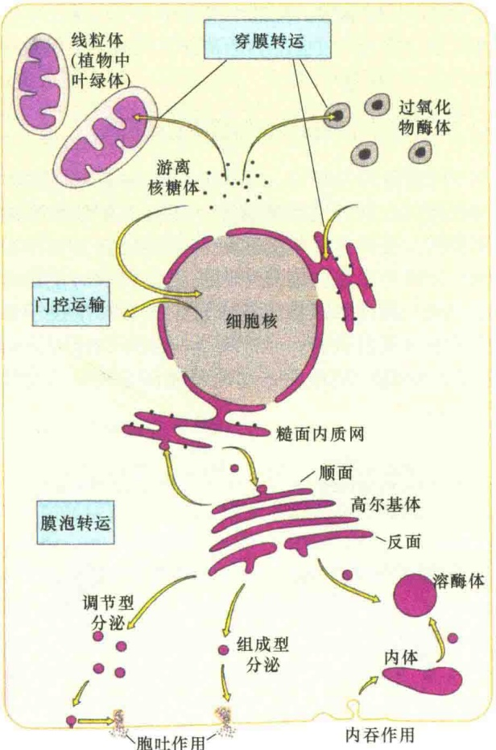
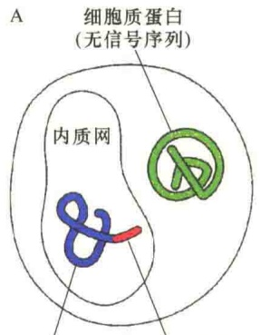
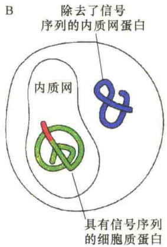
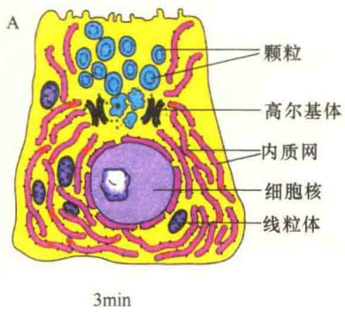
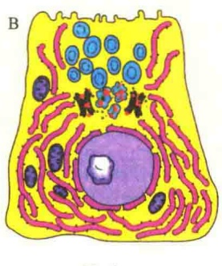
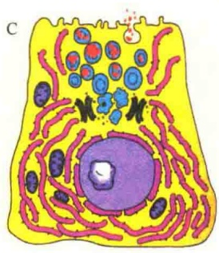
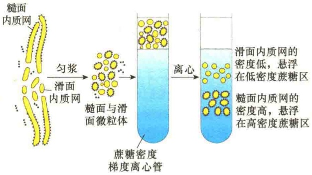
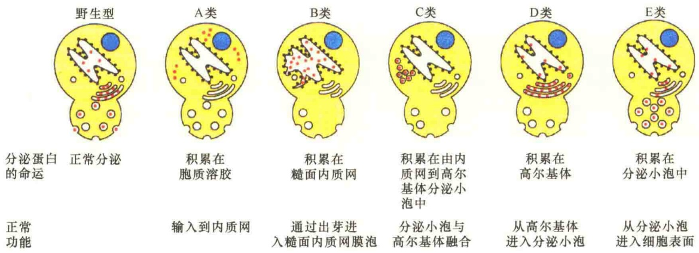

寿命限制和降解，也需要不断地补充新的蛋白质，以取代细胞器中丧失功能的蛋白质，所以蛋白质的合成和分选运输是细胞中最重要的生命活动之一。

## 9.1.2.1 蛋白质分选运输的时空概念

蛋白质分选运输的时空概念包括两种含义:①合成的蛋白质何时转运？②合成的蛋白质在运输中所要逾越的空间障碍是什么？

细胞中的蛋白质除了极少数是由线粒体或叶绿体基因编码之外，大多是由核基因编码，并在细胞质核糖体中合成。从时间上考虑，蛋白质的合成分选有两种情况:一是先合成，再分选；二是一边合成一边分选。为了适应蛋白质分选时间上的需要，核糖体在合成蛋白质时就会有两种存在状态:游离的或与内质网附着的。

从蛋白质定位运输的空间看，包括四大部分:第一部分是细胞内的膜性细胞器（包括细胞器的膜与基质），如细胞核、内质网、高尔基体、溶酶体、内体、线粒体、叶绿体（植物）等；第二部分是细胞质膜所需的蛋白质；第三部分是细胞外蛋白；第四部分是在胞质溶胶中起作用的蛋白质。不过，这一部分蛋白质不需要特别转运，合成之后可直接发挥作用。此外，线粒体与叶绿体基因组自身合成的蛋白质也有定位运输问题，不过相对于细胞质核糖体合成的蛋白质定位运输要简单得多。

## 9.1.2.2 蛋白质分选运输的空间障碍及克服机制

若是从蛋白质分选运输是否有空间障碍来看，有三种情况。①没有膜障碍的，如胞质溶胶，包括胞质溶胶中的细胞骨架蛋白和各种酶及蛋白质分子。②有完全封闭的膜障碍，如线粒体、叶绿体、过氧化物酶体、内质网、高尔基体、溶酶体、内体等。由于运送到细胞质膜和细胞外的蛋白质要逾越内质网和高尔基体的膜障碍，所以也归于此类。③有膜障碍，但是膜上有孔，如细胞核。

由于蛋白质分选运输需要克服的障碍不同，运输的机制也就不同，可分为穿膜转运、门控（核孔）运输，以及膜泡转运。图 9-5 是细胞内蛋白质分选运输的三种转运方式。

1）穿膜转运（transmembrane translocation）胞质溶胶中合成的蛋白质进入到内质网、线粒体、叶绿体和过氧化物酶体等是通过穿膜机制进行运输，需要蛋白质转运器（protein translocator）的帮助。除过氧化物酶体外，被运输的蛋白质通常是未折叠的状态，细菌的质膜上也有类似的蛋白质转运器。

图 9-5 细胞内新合成蛋白质的三种分选运输方式图（引自 Bolsover et al., 2011）。第一种方式是穿膜转运，定位运输的细胞器包括线粒体、质体、过氧化物酶体、内质网等。第二种方式是核孔运输，即细胞核孔的门控运输，主要是将蛋白质运输到细胞核。第三种方式是膜泡转运，定位运输的细胞器包括高尔基体、内体、分泌泡、溶酶体和质膜。需要说明的是，游离核糖体合成的、在胞质溶胶中起作用的蛋白质不需要转运。

2）核孔运输（transport through nuclear pore），又称门控运输（gated transport） 胞质溶胶中合成的蛋白质穿过细胞核内外膜形成的核孔进入细胞核。核孔如同一扇可开启的大门，而且是具有选择性的门，能够主动运输特殊的生物大分子。

3）膜泡转运（vesicular trafficking）蛋白质从内质网转运到高尔基体，以及从高尔基体转运到溶酶体、分泌泡、细胞质膜、细胞外等是由小泡介导的，这种小泡称为运输小泡（transport vesicle）。内膜系统的蛋白质定位，除了内质网本身之外，其他膜性细胞器的蛋白质定位都是通过形成运输小泡，将蛋白质从一个区室转运到另一个区室。小泡的形成是通过出芽的方式，到达目的地时则是通过膜融合的方式使小泡成为另一个区室的一个部分，实现蛋白质的运输。在这个过程中不仅运输了小泡内的蛋白质，同时也将膜脂和膜蛋白从一个区室运到了另一个区室。

## 9.1.2.3 信号序列指导蛋白质的正确运输

虽然蛋白质可通过不同的方式和机制克服空间障碍定位到膜性细胞器中，但就其定位的准确性来说，无论何种运输机制都是通过信号引导实现的，换句话说，信号序列决定蛋白质的正确运输方向。通过基因重组的方法，将原本定位于内质网中的蛋白质的信号序列重组到非内质网蛋白质肽的N端，其结果是这两种蛋白质互换了位置（图9-6）。

内质网蛋白 内质网信号序列

图 9-6 信号序列在蛋白质分选中的作用（引自 Alberts et al., 1994）。A. 具有内质网定位信号序列的蛋白质被运输到内质网中，而没有信号序列的蛋白质存在于胞质溶胶中；B. 通过重组 DNA 技术将信号序列与胞质溶胶的蛋白质基因重组，表达的胞质溶胶蛋白被定位到内质网，相反，被剥夺了内质网定位信号的蛋白质则只能存在于胞质溶胶中。该实验说明信号序列对所引导的蛋白质没有特异性。

信号序列通常为 15～60 个氨基酸长度，不同的膜性细胞器具有不同的蛋白质定位的信号序列（表 9-4）。

表 9-4 细胞内某些细胞器的定位信号序列

| 功能 | 信号序列组成 |
| --- | --- |
| 输入细胞核 | -Pro-Pro-Lys-Lys-Lys-Arg-Lys-Val- |
| 输出细胞核 | -Met-Glu-Glu-Leu-Ser-Gln-Ala-Leu-Ala-Ser-Ser-Phe- |
| 输入线粒体 | $^{+}H_{3}N$-Met-Leu-Ser-Leu-Arg-Gln-Ser-Ile-Arg-Phe-Phe-Lys-Pro-Ala-Thr-Arg-Thr-Leu-Cys-Ser-Ser-Arg-Tyr-Leu-Leu- |
| 输入质体 | $^{+}H_{3}N$-Met-Val-Ala-Met-Ala-Met-Ala-Ser-Leu-Gln-Ser-Ser-Leu-Ser-Leu-Ser-Ser-Asn-Ser-Phe-Leu-Gly-Gln-Pro-Leu-Ser-Pro-Ile-Thr-Leu-Ser-Pro-Phe-Leu-Gln-Gly- |

| 功能 | 信号序列组成 |
| --- | --- |
| 输入过氧化物酶体 | -Ser-Lys-Leu-COO$^{-}$ |
| 输入内质网 | $^{+}H_{3}N$-Met-Met-Ser-Phe-Val-Ser-Leu-Leu-Leu-Val-Gly-Ile-Leu-Phe-Trp-Ala-Thr-Glu-Ala-Glu-Gln-Leu-Thr-Lys-Cys-Glu-Val-Phe-Gln |
| 滞留内质网 | -Lys-Asp-Glu-Leu-COO$^{-}$ |

注: $^{+}H_{3}N$  代表氨基端； $COO^{-}$  代表羧基端。红色表示带正电荷氨基酸，蓝色表示带负电荷氨基酸。

根据信号序列运输方向的不同，习惯上将信号序列分为三种类型:核定位信号、前导肽和信号肽。核定位信号包括输入与输出细胞核的信号，指导蛋白质输入或输出细胞核。前导肽指导线粒体、叶绿体和过氧化物酶体蛋白的定位。信号肽指导内膜系统的蛋白质定位，包括内质网返回信号。前导肽指导的蛋白质运输已在线粒体和叶绿体中进行了介绍，入核信号将在第12章细胞核与染色体中讨论，本章将重点讨论信号肽指导的蛋白质运输定位。

蛋白质转运的信号序列在多肽中的位置也不相同，如输入线粒体、内质网和质体的信号序列位于N端，输入过氧化物酶体的信号大多数位于C端，也有少数位于N端，内质网返回信号位于C端，而核定位信号在新生肽中位置是可变的。另外，多数信号序列引导蛋白质定位后，常被切除掉，有些则终生保留。表9-5综合了一些信号序列的特点、位置及可能的命运。

表 9-5 细胞内某些信号序列的特性

<table><tr><td>细胞器</td><td>信号序列的位置</td><td>定位后是否被切除</td><td>基本特点</td></tr><tr><td>内质网(腔)</td><td>N端</td><td>被切除</td><td>6~12个核心的疏水氨基酸序列</td></tr><tr><td>线粒体基质</td><td>N端</td><td>被切除</td><td>长20~50个氨基酸残基的两性螺旋</td></tr><tr><td>叶绿体间质</td><td>N端</td><td>被切除</td><td>没有特征性模体,富含Ser和Thr,少有Glu和Asp</td></tr><tr><td rowspan="2">过氧化物酶体(基质)</td><td>C端(大多数)</td><td>不切除</td><td>PTS1(Ser-Lys-Leu)信号在C端</td></tr><tr><td>N端(少数)</td><td>不切除</td><td>PTS2信号在N端</td></tr><tr><td>细胞核(核质)</td><td>位置可变</td><td>不切除</td><td>种类较多,有一个富含Lys和Arg的共同模体</td></tr></table>

## 9.1.3 内膜系统的研究方法

虽然电子显微镜能够获得高度清晰的细胞内膜系统的结构，但是不能研究单个膜性细胞器的结构和功能。最有效的是离心分离技术、同位素示踪技术和突变技术。特别是3位科学家使用分离技术揭示了内膜系统的结构和功能，即动态特性，从而分享了1974年诺贝尔奖:Claude发明了用于细胞器分离的差速离心技术；Palade用这一技术研究了内质网和高尔基体；de Duve用离心分离技术发现了溶酶体和过氧化物酶体。

日本科学家下村修、美国科学家 M. Chalfie 和美籍华裔科学家钱永健因在发现和研究绿色荧光蛋白（GFP）方面做出的杰出贡献获得 2008 年诺贝尔化学奖。下村修 1962 年在北美西海岸的水母中首次发现了一种在紫外线下发出绿色荧光的蛋白质，即绿色荧光蛋白。随后，Chalfie 在利用绿色荧光蛋白作为生物示踪分子方面的研究做出了杰出贡献；钱永健的研究让科学界更全面地理解绿色荧光蛋白的发光机制，他还拓展了绿色以外的其他颜色荧光蛋白，为同时追踪多种生物细胞变化的研究奠定了基础。GFP 技术的建立与发展，极大地方便了对细胞内蛋白质合成与转运途径的可视化。不过，该方法需要通过基因重组，将 GFP 的编码基因先连接到目标蛋白的编码基因上。

本节重点介绍传统的三类研究方法在内膜系统研究中的应用。

## 9.1.3.1 放射自显影术

胰腺系统中的胰泡细胞具有最发达的内膜系统，主要功能是合成消化酶类。这些酶类合成之后要从胰腺系统经由导管分泌到小肠中行使功能。这些酶是如何分泌出去的？Jamieson 和 Palade 使用放射自显影技术得到了答案（图 9-7）。

他们将一小块胰腺组织放在加有放射性同位素标记氨基酸的培养液中进行短暂培养，在此期间，活细胞就会摄取具有放射性的氨基酸并掺入到核糖体合成的消化酶中，然后立即将组织进行固定，通过切片和放射自显影检测，发现放射性出现在内质网，说明蛋白质的合成始于内质网。为了检查蛋白质合成后的运输路线，他们还进行了一系列脉冲追踪实验（pulse-chase experiment），即将组织置于加有放射性同位素标记氨基酸的培养液中进行短暂培养，然后将组织洗净再置于无同位素的培养基中培养不同时间，再进行组织固定和放射自显影术检测。检测的结果表明:追踪培养的时间越长，同位素标记的蛋白质离开合成部位越远，分泌性蛋白质在内质网合成后经高尔基体转移到分泌小泡和细胞外。

## 9.1.3.2 差速离心分离

虽然放射自显影技术证明了分泌性蛋白质合成的起始部位，但不能证明是哪种细胞器合成分泌性蛋白质。20世纪50～60年代Claude和de Duve发展了细胞组分分离技术，分离到了具有蛋白质合成和分泌功能的结构。当细胞被匀浆破碎时，细胞质膜（包括细胞质膜系统的膜）破裂成膜碎片，破裂的膜碎片能够自己融合形成球形的小囊泡。这些小囊泡的直径为100nm左右，分别来自不同的膜性细胞器（细胞核、线粒体、质膜、内质网等）。这些小囊泡具有不同的性质，可以通过细胞离心分离技术将它们分开（图9-8）。来自内膜系统的小囊泡（主要是内质网和高尔基体）是一种异质性的集合体，其大小相似，称之为微粒体（microsome）。有些微粒体表面具有一些小颗粒附着，有些表面没有小颗粒的附着，用更精确的技术能够将这些不同的颗粒分开。

通过差速离心分离的微粒体不仅具有膜的结构特征，同时还具有在活细胞中的生物活性和功能。

图 9-7 蛋白质分泌的同位素示踪实验（引自 Wolfe，1993）。A. 细胞与同位素接触 3min 之后，标记物出现在内质网中。B. 细胞接触同位素 3min 后，置于非同位素的培养基中追踪 20min，放射性标记出现在高尔基体和部分分泌泡中。C. 细胞接触同位素 3min 后，置于无同位素的培养基中追踪 120min，标记物主要出现在分泌泡中。

例如，来自高尔基体的囊泡具有将蛋白质和脂进行糖基化修饰的作用。用从这些囊泡中分离的特殊蛋白质作为抗原制备抗体，然后将制备的抗体与特定的颗粒，如金颗粒结合，再通过免疫电镜技术就能够对用作抗原的酶进行

图 9-8 微粒体的分离（引自 Alberts et al., 2015）。用机械匀浆将细胞破碎，各种膜性细胞器破裂，并且重新自我融合形成各种球形膜泡。通过较高速度离心除去细胞核、线粒体、过氧化物酶体等细胞器。收集悬浮液再用较低速度离心，然后用电子显微镜检查离心后分开的两部分结构，发现上层的囊泡表面是光滑的，沉淀下的囊泡表面有核糖体颗粒。

定位，通过这些研究详细揭示了高尔基体在复杂的糖装配中的具体作用。

## 9.1.3.3 突变体研究

科学家利用酵母突变体研究分泌过程及与分泌相关的基因，揭示了小泡运输的过程（图9-9）。为了研究编码与分泌途径相关蛋白质的基因，科学家们筛选了一些突变体，在这些突变体中，内膜结构不正常。如涉及内质网出芽小泡形成的基因发生突变，这种酵母的内质网就特别大；如涉及与高尔基体融合的基因突变，这种突变酵母中积累大量的分泌泡。目前已经分离和克隆了几十个与分泌途径相关的基因。通过序列分析，表明这些基因与哺乳动物分泌基因具有同源性，推测哺乳动物的细胞分泌过程与酵母细胞的分泌过程相似。

图 9-9 与分泌相关的不同酵母突变体（引自 Lodish et al., 2000）。野生型是分泌正常的酵母，A、B、C、D、E 是 5 类不同的分泌基因（secretory gene）突变，代表了蛋白质分泌的 5 个过程。A 类:分泌蛋白质不能进入内质网；B 类:内质网出芽缺陷；C 类:分泌小泡不能与高尔基体融合；D 类:高尔基体不能形成分泌小泡；E 类:分泌小泡不能与质膜融合。

## 9.2 内质网

内质网（endoplasmic reticulum，ER）是 Porter 和 Claude 等在 1945 年发现的。他们在体外培养成纤维细胞时得到了薄层生长细胞，这种培养的细胞不需要切片就可以在电子显微镜下进行观察，从而得到第一张培养细胞的电镜照片。观察发现薄层生长细胞的细胞质不是均质的，其中可见一些形状和大小略有不同的网状结构，并集中在细胞内质中，所以建议称为内质网。原核生物没有内质网，由细胞质膜代行其功能。

## 9.2.1 内质网的形态结构和化学组成

## 9.2.1.1 内质网的形态结构

内质网是由一层单位膜形成的囊状、泡状和管状结构，并形成一个连续的网膜系统（图9-10）。膜厚50～60Å，内腔是连通的。内质网通常占细胞膜系统的一半左右，占细胞体积的10%以上。内质网在细胞质中一般呈连续的网状，但这种连续性和形状不是固定不变的。在细胞周期中，一个时期可能是一些连续的小管或小囊泡，而在另一个时期有可能是不连续的。同时，内质网对细胞的生理变