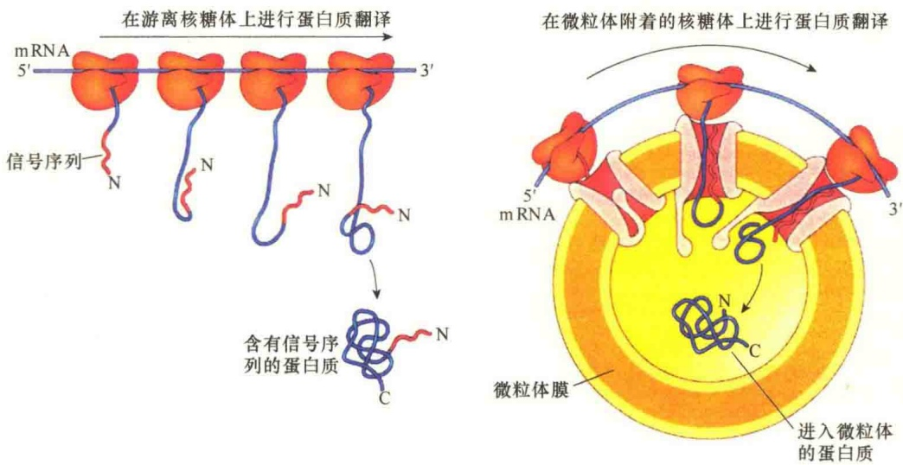
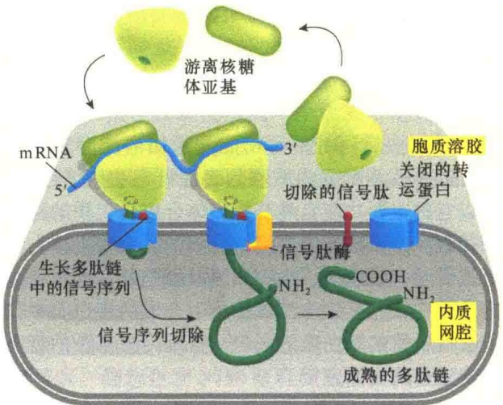
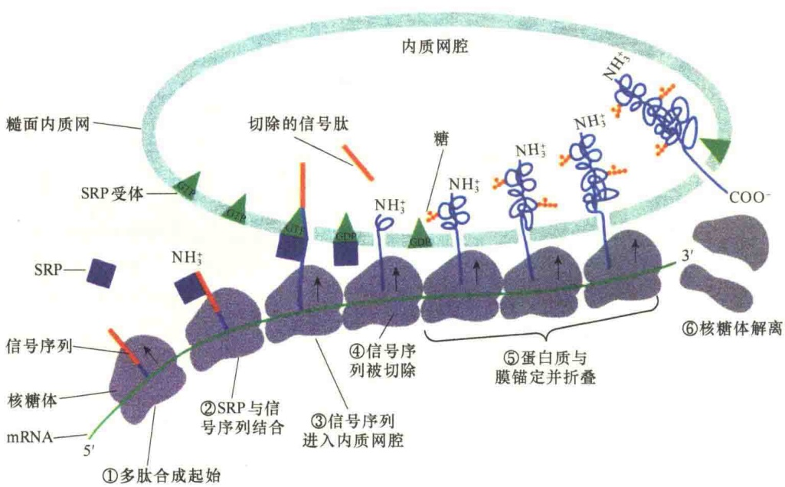
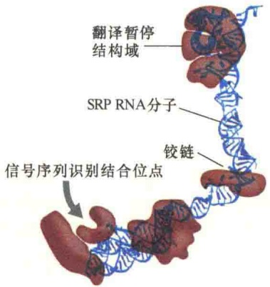
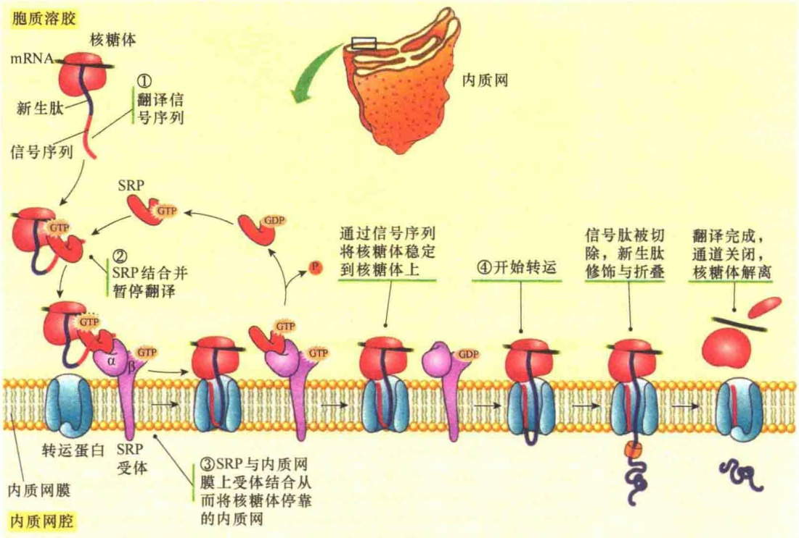
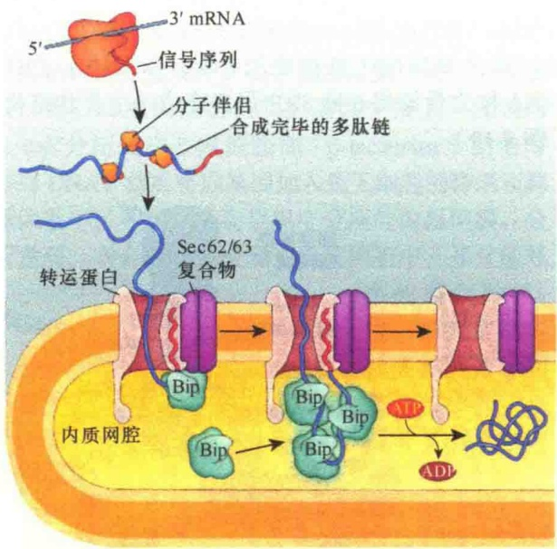

30 个左右的  $Ca^{2+}$ 。

## 9.2.3 糙面内质网的功能——蛋白质转运

糙面内质网的基本功能与滑面内质网完全不同，这是因为糙面内质网的表面可与核糖体结合，所以它的主要功能自然与核糖体合成蛋白质的作用相关联。由于糙面内质网上合成的蛋白质最终去向是提供给内膜系统、细胞质膜及细胞外，所以糙面内质网在从与其结合的核糖体上合成的蛋白质中获得自己所需的蛋白质的同时，帮助内膜系统的蛋白质转运也就责无旁贷。

## 9.2.3.1 信号序列的发现和证实

在 Palade 用离心技术分离到有核糖体附着的微粒体，即发现附着核糖体之后，推测附着核糖体合成的蛋白质首先要进入内质网，然后通过选择性分泌输出到细胞外，而游离核糖体上合成的蛋白质则留在细胞内使用。

20世纪60年代，Redman和Sabatini用分离的糙面内质网小泡研究附着核糖体合成的蛋白质是否会进入糙面内质网的腔。他们将糙面内质网微粒体置于加有放射性标记氨基酸底物的蛋白质合成体系中进行短暂温育，然后加入嘌呤霉素，使蛋白质合成提前终止并从核糖体中释放出不完全的多肽。此时离心收集糙面内质网小泡，用去垢剂将糙面内质网小泡破坏，使小泡内的物质释放出来，并对其进行分析，结果表明，从破裂的糙面内质网小泡中说，附着核糖体是处于工作状态的核糖体。静息状态的核糖体或是刚刚起始合成蛋白质的核糖体都是游离状态，那么，又是什么因素决定核糖体在合成蛋白质时是游离存在还是附着到内质网上？

针对上面的问题，1971年美国洛克菲勒大学的Blobel、Sabatini和Dobberstein等推测，蛋白质合成的地点是由多肽N端一段氨基酸序列决定的，这一段氨基酸序列在蛋白质合成时最先出现在核糖体上。根据推测，他们提出了如下建议:①分泌蛋白的N端含有一段特别的信号序列，可将多肽和核糖体引导到内质网膜上；②多肽通过内质网膜上的转运通道蛋白进入内质网的腔中，推测多肽是在合成的同时转移的。

1975 年，Blobel 与 Dobberstein 报道了用无细胞系统研究免疫球蛋白 IgG 轻链合成时获得了信号序列存在的直接证据。他们用分离纯化的核糖体在无细胞体系中用编码免疫球蛋白轻链的 mRNA 指导合成多肽，发现合成的多肽比分泌到细胞外成熟的免疫球蛋白在 N 端有一段多出的肽链，它有 20 个氨基酸，推测这段肽具有信号作用，使 IgG 得以通过糙面内质网并继而分泌到细胞外。

Blobel、Dobberstein、Walter 和他们的同事在上述发现的基础上用分离的微粒体和无细胞体系进行了大量的实验，进一步证实了信号序列的存在及其作用（图 9-16）。

多聚核糖体是研究内质网帮助蛋白质运输的好材料。不难想象，当一条 mRNA 上结合有若干个核糖体进行蛋白质翻译时，最先附着的核糖体，其

释放出来的物质中有放射性标记的新合成多肽。

这一实验结果说明附着核糖体合成的蛋白质能够穿过内质网的膜进入内质网腔。但是，什么原因指导新生肽穿过内质网的膜呢？另外还有一个问题:我们所观察到的结合在糙面内质网上的核糖体是正在进行蛋白质合成的核糖体，也就是

图 9-16 分泌蛋白进入微粒体的实验（引自 Cooper and Hausman，2016）。在无细胞系统中，若不加入微粒体，合成的分泌蛋白 N 端多一段信号序列。当加入微粒体后，新合成的分泌蛋白进入到微粒体，分离微粒体、溶解微粒体膜后，分析进入微粒体中的蛋白质，比没有添加微粒体系统合成的分泌蛋白 N 端多出一段，证明起信号作用。

合成的多肽最长，最尾端的核糖体只是刚刚开始进行翻译。如果翻译的是分泌蛋白，最先结合上的核糖体合成的多肽，其N端可能没有了信号序列，因为在内质网中被切除了。从骨髓瘤分离多聚核糖体，用去垢剂处理，使之与内质网膜分离后，继续在无细胞体系（不含糙面内质网小泡）中进行翻译。研究发现，短时间温育，即可得到成熟的分泌蛋白（无信号序列）；而长时间的温育，得到的产物N端有信号序列。这一结果说明由于mRNA中多聚核糖体合成蛋白质的不同步，位于mRNA 3'端的核糖体合成的蛋白质在分离前不仅进入了内质网，而且在内质网的腔中被切除了信号序列。越靠近mRNA 5'端的核糖体，合成的蛋白质越短，所以在体外经较长时间的翻译得到的是含有信号序列的前体蛋白质，因为没有了内质网，信号序列则不能被切除（图9-17）。

## 9.2.3.2 信号假说

1975 年，Günter Blobel 根据对信号作用的研究成果，正式提出信号假说（signal hypothesis），其要点是:①分泌蛋白的合成始于细胞质中的游离核糖体。②新生蛋白的 N 端信号序列露出核糖体后，靠自由碰撞与内质网膜的转运蛋白（transporter）结合，接着 N 端信号序列插入转运蛋白的水性通道。③蛋白质继续合成，并以袢环形式穿过内质网膜的转运蛋白。④信号肽酶（signal peptidase）将信号肽切除，完全合成的新生肽进入内质网的腔；转运蛋白关闭，直到有新的核糖体结合才打开（图 9-18）。

图 9-18 信号假说（引自 Alberts et al., 2015）。当 mRNA 与核糖体结合起始蛋白质合成后，若 N 端有信号肽序列，则正在合成蛋白质的核糖体被引导至内质网，并与内质网膜中的受体结合，新生的肽链通过内质网膜中的转运蛋白通道进入内质网的腔。信号肽被内质网信号肽酶切除，合成的蛋白质释放到内质网的腔中。

信号假说提出后得到许多实验的支持，包括Blobel的研究小组和其他研究小组获得的证据。其中最有力的一项实验结果是Lingappa及其同事用杂合蛋白研究的结果。黑猩猩的 $\alpha$-珠蛋白是一种在游离核糖体上合成并存在于胞质溶胶中的可溶性蛋白，他们在编码该蛋白质的基因中接上一段编码E.coli分泌蛋白β-内酰胺酶（β-lactamase）的信号序列DNA，然后将该基因加入到无细胞的转录和翻译体系中，并加入从狗组织中分离的内质网膜。分析发现，杂合蛋白质出现在内质网腔中，并且信号

图 9-17 多聚核糖体实验证明信号序列的引导作用（引自 Voet and Voet, 1995）。SRP:信号识别颗粒。

序列被切除了。这一研究结果不仅证实了信号假说的正确性，也揭示了信号序列的一个重要特性:信号序列没有特异性，并且原核生物的信号序列在真核生物中也是有效的。

Blobel 提出的信号假说揭示了细胞中不同蛋白质在合成后是如何找到自己的“工作岗位”的秘

密，发现了蛋白质与生俱来的“地址签”。这一发现开辟了一个全新的医学、细胞生物学和分子生物学的研究领域，为此 Blobel 获得了 1999 年诺贝尔生理学或医学奖。

## 9.2.3.3 信号识别颗粒及其作用

1975 年提出的信号假说虽然说明了分泌蛋白是通过信号序列的引导进入内质网的，但没有回答新生的信号肽是如何被引导到内质网膜的转运蛋白上。

1981 年，Walter、Blobel 和其合作者们通过实验发现在核糖体与内质网的结合过程中需要几种蛋白质复合物的参与，这些发现对信号假说做了一些补充，增加了信号序列如何被识别的一些细节。

内质网信号序列被引导到内质网的膜，至少有两种蛋白复合物发挥重要作用:一种是信号识别颗粒（signal recognition particle，SRP），它的作用是在胞质溶胶与内质网膜间循环，识别内质网新合成蛋白质的内质网信号序列；另一种是内质网膜中的SRP受体（SRP receptor），它的作用是与SRP结合（图9-17）。

SRP 是一种核糖核蛋白复合体，沉降系数为 11S，含有分子质量为 72kDa、68kDa、54kDa、19kDa、14kDa、9kDa 的 6 条多肽和一个 7S（长约 300 个核苷酸）的细胞质 RNA（scRNA），SRP RNA 作为骨架将 6 种 SRP 蛋白连成一个杆状结构（图 9-19）。

图9-19 信号识别颗粒（SRP）的结

构组成（引自Alberts et al., 2015）。

SRP 上有三个功能部位:信号序列识别结合位点、翻译暂停结构域、SRP 受体蛋白结合位点。SRP 上的信号序列识别结合位点负责识别刚从游离核糖体上合成出来的信号序列，并与之结合，然后由翻译暂停结构域暂时中止新生肽的合成；此时 SRP 会暴露出 SRP 上与内质网受体结合的位点，将正在合成蛋白质的核糖体结合到内质网膜的 SRP 受体上，从而将核糖体与内质网膜转运蛋白结合，并进行新生肽的转移。

SRP 受体，又称停靠蛋白（docking protein, DP），它是内质网膜上与 SRP 结合的内质网膜蛋白。动物细胞中的 SRP 受体是由两个不同的多肽构成的二聚体，由  $\alpha$  和  $\beta$  两个亚基构成， $\alpha$  亚基是 SRP 识别与结合位点， $\beta$  亚基是穿膜蛋白，在细胞质结构域有 GTP 结合位点。SRP 受体有两个方面的作用:一是与结合有内质网信号的 SRP 结合，将正在合成蛋白质的核糖体引导到内质网的膜；二是介导核糖体与非偶联的内质网膜中转运蛋白结合，然后通过将 SRP 与  $\alpha$  亚基上的 GTP 水解释放 SRP 与 SRP 受体，核糖体上的 mRNA 继续完成多肽的翻译，并通过转运蛋白进入内质网的腔。

## 9.2.3.4 分泌蛋白质共翻译转运机制

补充修改后的信号假说合理解释了分泌蛋白质共翻译转运机制。核糖体与内质网的结合受制于mRNA中特定的密码序列（可以翻译成信号肽），具有这种密码序列的新生肽才能连同核糖体一起附着到内质网膜的特定部位。因此，核糖体与内质网的结合是功能性结合，同时具有暂时性，并受时间和空间的限制。正是由于这种结合保证了新合成蛋白质的矢量释放。内质网信号序列有两个基本作用:一是通过与SRP的识别和结合，引导核糖体与内质网结合；二是通过信号序列的疏水性，引导新生肽穿膜转运。

图 9-20 是根据修改后的信号假说绘制的分泌蛋白进入内质网腔的过程。①分泌性蛋白质在游离核糖体上起始合成。核糖体是蛋白质合成的基本装置，它并不决定合成蛋白质的去向，合成的蛋白质何去何从是由 mRNA 决定的，也就是说，是由密码子决定的。②信号序列与 SRP 结合。SRP 的信号序列识别结合位点识别新生肽的信号序列并与之结合；同时，SRP 上的翻译暂停结构域与核糖体的 A 位点作用，暂时停止核糖体的蛋白质合成。③核糖体附着到内质网上。结合有信号序列的 SRP 通过它的第三个结合位点与内质网膜中受体的 α 亚基结合，将核糖体附着到内质网的蛋白质转运蛋白。④ SRP 释放与蛋白质转运通道的打开。当 SRP-信号序列-核糖体-mRNA 复合物锚定到内质网膜后，SRP 受体将其结合的 GTP 水解，同时将 SRP 释放出来，此时蛋白质转运通道打开，核糖体与通道结合，新生的肽插进通道。释放的 SRP 又回到胞质溶胶中循环使用。⑤在信号肽酶的作用下，信号肽被切除，分泌蛋白被释放到内质网的腔中。

图 9-20 蛋白质进入内质网腔的机制（引自 Plopper，2016）。1981 年修改的信号假说中，SRP 起导航作用:由 SRP 识别信号序列，并介导与内质网结合。GTP 水解后，SRP 被释放到胞质溶胶，开始新一轮的循环。

在蛋白质输入内质网腔的过程中，除了蛋白复合物SRP及受体外，GTP也具有重要作用。SRP是G蛋白，只有在结合有GTP的状态下才能识别新生的内质网信号序列，同样，SRP受体也是G蛋白，在β亚基结合有GTP的状态下，其α亚基才能与SRP结合。当结合的GTP水解时，SRP则介导合成蛋白质的核糖体与内质网膜的转运蛋白结合，促进新合成的肽进入内质网。

## 9.2.3.5 蛋白质翻译后进入内质网

研究发现，酵母中有很多蛋白质，以及哺乳动物中少数蛋白质的内质网寻靶不是通过共翻译转运的，而是在游离核糖体翻译后转运到内质网。这种转运方式不需要SRP及SRP受体的介导，而是通过Sec62/63蛋白复合物介导。Sec62/63蛋白复合物是与转运蛋白结合在一起的内质网穿膜蛋白。此类蛋白质在细胞质中合成后，由分子伴侣Hsp70与Hsp40将其维持在非折叠状态，以便穿过内质网的转运蛋白通道，同时需要内质网中的分子伴侣BiP蛋白将新生蛋白质“拉”入内质网。而在共翻译转运中，蛋白质进入内质网是由蛋白质合成时的推力使得新生蛋白质进入内质网。图9-21是翻译后蛋白质输入内质网的过程。

图 9-21 翻译后蛋白质输入内质网（引自 Cooper and Hausman，2013）。一些在细胞质核糖体合成的多肽也能穿过内质网的膜进入内质网，它们不需要 SRP 介导，而是通过 Sec62/63 蛋白复合物的介导。Bip 为一类分子伴侣，参与蛋白质折叠。

## 9.2.4 蛋白质插入内质网的膜及定向

在糙面内质网上合成的蛋白质有两类:分泌蛋白和膜蛋白。分泌蛋白在内质网上合成之后通过对