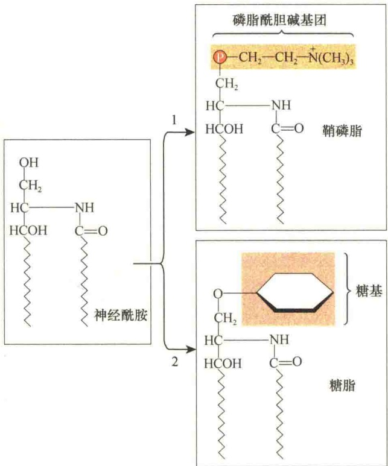
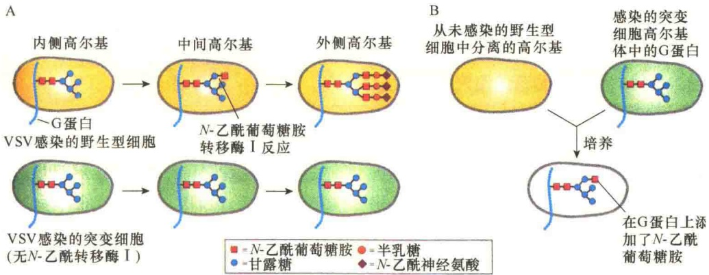
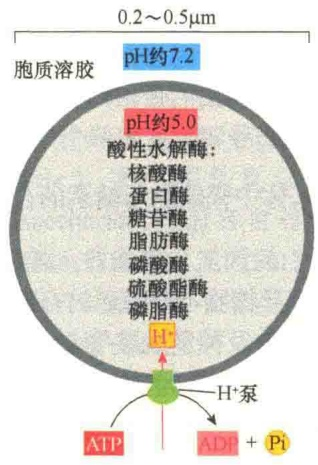
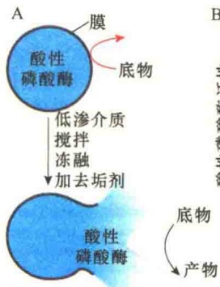
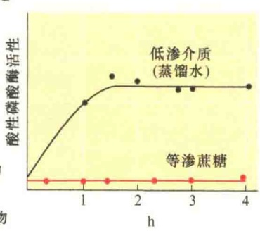
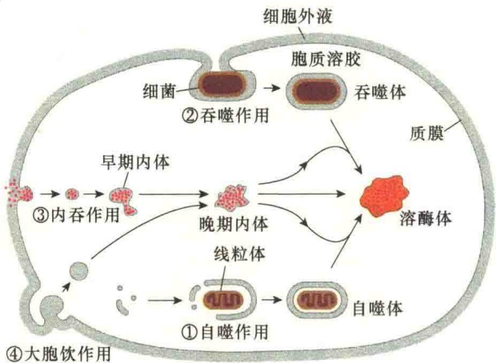
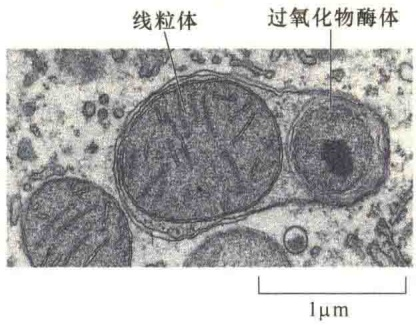
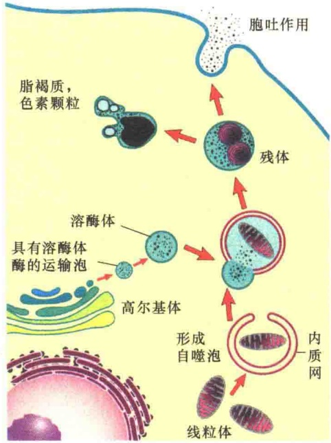

表面的黏度，有利于防止细菌、病毒及有害酶的侵蚀。第四，细胞表面的糖蛋白也参与细胞的识别与黏着。第五，细胞表面的蛋白糖基化也参与信号调节，如 Notch 的信号调节就是一个典型的例子。

## 9.3.2.4 高尔基体中鞘磷脂与糖脂的合成

除了糖蛋白的加工与修饰外，高尔基体也参与脂的代谢，特别是糖脂与鞘磷脂的合成。我们知道，甘油磷脂、胆固醇及神经酰胺等是在内质网中合成的，而鞘磷脂则是在高尔基体中利用神经酰胺合成的（图9-35）。

在植物细胞中，高尔基体是细胞壁多糖的合成场所。植物细胞壁有三种类型的多糖:纤维素、半纤维素与果胶。纤维素是在细胞质膜表面合成的，而半纤维素与果胶则是在高尔基体中合成的，然后通过膜泡运送到细胞表面。细胞壁多糖的合成是高尔基体的主要功能，植物细胞中高尔基体80%的代谢活性都贡献给了多糖的合成。

## 9.3.2.5 高尔基体的运输作用

定位于内质网、高尔基体、溶酶体、胞内体、细胞质膜及分泌到细胞外的蛋白质都是在糙面内质网上合成的。那么，这些蛋白质必然有一个合成后的转运问题。而高尔基体位于质膜和内质网之间，因此它就成了蛋白质加工、分选与转运的中间站，膜脂则随蛋白质转运一起被运输。

通过离体培养细胞进行的研究，证明了分泌蛋白从顺面高尔基网向反面高尔基网的转运。

离体实验体系采用培养的成纤维细胞系及其突变体，突变体缺少N-乙酰葡萄糖胺转移酶I。在野生型细胞中，N-乙酰葡萄糖胺转移酶定位于高尔基体的中间潴泡，它能够将N-乙酰葡萄糖胺转移到 N-连接的寡糖。在用水疱性口炎病毒（vesicular stomatitis virus，VSV）感染的野生型细胞中，病毒 G 蛋白的寡糖被 N-乙酰葡萄糖胺修饰。但是，用 VSV 感染突变体细胞，病毒的 G 蛋白到达细胞表面，并且病毒 G 蛋白的甘露糖未被 N-乙酰葡萄糖胺进一步修饰（图 9-36A）。从感染的突变体细胞分离高尔基体潴泡，并将它与从未感染的野生型细胞中分离的高尔基体潴泡一起培养，可见到病毒 G 蛋白寡糖末端添加了 N-乙酰葡萄糖胺（图 9-36B）。

图 9-35 鞘磷脂与糖脂的合成（引自 Cooper and Hausman, 2016）。内质网中合成的神经酰胺在高尔基体中可以作为鞘磷脂或糖脂的前体。在第一个反应中，从磷脂酰胆碱中将磷脂酰胆碱基团转移到神经酰胺，合成的是鞘磷脂。在第二个反应中，可以用一个或多个不同的糖基合成不同的糖脂。

图 9-36 无细胞体系证明蛋白质从高尔基体潴泡间的转运（引自 Lodish et al., 2013）。A. 用 VSV 分别感染体外培养的野生型成纤维细胞及突变的成纤维细胞，表明突变成纤维细胞的中间高尔基体不能将病毒 G 蛋白进行 N-乙酰葡萄糖胺修饰。B. 从感染的突变体细胞分离高尔基体潴泡，并将它与从未感染的野生型细胞中分离的高尔基体潴泡一起培养，可见到病毒 G 蛋白寡糖末端进行了 N-乙酰葡萄糖胺修饰，从而证明修饰发生在高尔基体的中间膜囊。

## 9.4 溶酶体与液泡

溶酶体（lysosome）是动物细胞中一种膜性细胞器，小球状，外面由一层单位膜包被。溶酶体含有多种水解酶类，在细胞内起消化和保护作用，可与吞噬泡或胞饮泡结合，消化和利用其中的物质。也可以消化自身细胞破损的细胞器或残片，有利于细胞器的重新组装、成分的更新及废物的消除。当细胞被损伤时，溶酶体可释放出水解酶类，使细胞自溶。溶酶体来自高尔基体，溶酶体的酶有一个基本的特征，即它们的寡糖链有磷酸化甘露糖残基，被TGN的M6P受体识别和结合，从而被分拣出来。

## 9.4.1 溶酶体的酶与溶酶体的发现

溶酶体是一种异质性（heterogeneous）的细胞器，不同来源的溶酶体形态、大小，甚至所含有酶的种类都有很大的不同。溶酶体是一种动态的结构，它不仅在不同类型的细胞中形态大小不同，而且在同一类细胞的不同发育阶段往往也不同。溶酶体呈小球状，大小变化很大，直径一般0.25～0.8mm，最大的可超过1mm，最小的直径只有25～50nm。

## 9.4.1.1 溶酶体的酶

溶酶体内含有 50 多种酶类，其中包括脂肪酶、蛋白水解酶、核酸酶、磷酸酯酶、糖苷酶和硫酸酯酶等。这些酶的最适 pH 是 5 左右，故均为酸性水解酶（acid hydrolase），在酸性 pH 条件下具有最高的活性。少量溶酶体的酶泄漏到胞质溶胶中并不会引起细胞损伤，其主要原因是胞质溶胶中的 pH 为 7.0 左右，在这种环境下，溶酶体的酶基本没有活性。图 9-37 是典型的溶酶体的形态、大小及 pH 环境，表 9-7 列出了溶酶体所含的主要酶类。

溶酶体的外被是一层单位膜，内部没有任何特殊的结构。由于溶酶体中含有各种不同的水解酶类，所以溶酶体在生活细胞中必须是高度稳定的。溶酶体的稳定性与其膜的结构组成有关:①溶酶体膜含有各种不同酸性的、高度糖基化的膜整合蛋白，这些膜整合蛋白的功能可能是保护溶酶体的膜免遭溶酶体内酶的攻击，有利于防止自身膜蛋白的降解。②溶酶体的膜中含有较多能促进膜稳定的胆固醇。③溶酶体膜中嵌有质子运输泵

图 9-37 溶酶体的形态、大小及 pH 环境（引自 Alberts et al., 2015）。

表 9-7 溶酶体的主要酶类

| 酶 | 底物 |
| --- | --- |
| 磷酸酶 |  |
| 酸性磷酸酶 | 磷酸单酯 |
| 酸性磷酸二酯酶 | 磷酸二酯 |
| 核酸酶 |  |
| 酸性核糖核酸酶 | RNA |
| 酸性脱氧核糖核酸酶 | DNA |
| 蛋白酶 |  |
| 组织蛋白酶 | 蛋白质 |
| 胶原酶 | 胶原 |
| GAG-水解酶 |  |
| 艾杜硫酸酯酶 | 硫酸皮肤素 |
| β-半乳糖脑苷 | 硫酸角质素 |
| 硫酸乙酰肝素N-硫酸酯酶 | 硫酸肝素 |
| α-N-乙酰葡萄糖苷酶 | 硫酸肝素 |
| 多糖酶与寡糖酶 |  |
| α-葡萄糖苷酶 | 糖原 |
| 岩藻糖苷酶 | 岩藻糖基寡糖 |
| α-甘露糖苷酶 | 甘露糖基寡糖 |
| 唾液酸酶 | 唾液酸化寡糖 |
| 鞘脂水解酶 |  |
| 神经酰胺酶 | 神经酰胺 |
| 葡萄糖脑苷脂酶 | 葡萄糖神经酰胺 |
| β-氨基己糖苷酶 | GM2-神经节苷脂 |
| 芳基硫酸酯酶A | 半乳糖硫酸苷 |
| 脂肪水解酶 |  |
| 酸性脂酶 | 三酰甘油 |
| 磷脂酶 | 磷脂 |

$\left(\mathrm{H}^{+}-\mathrm{ATPase}\right)$ ，借助水解 ATP 释放出的能量将  $H^{+}$ 泵入溶酶体内，使溶酶体中的  $H^{+}$ 浓度比细胞质中的  $H^{+}$ 浓度高得多；同时，在溶酶体膜上有  $Cl^{-}$ 通道蛋白，可向溶酶体中运输  $Cl^{-}$ ，两种运输蛋白作用的结果就等于向溶酶体中运输了 HCl，以此维持溶酶体内部的酸性环境。

## 9.4.1.2 溶酶体的发现

20 世纪 50 年代初期，de Duve 和他的同事在研究亚细胞组分时发现了溶酶体，不过，溶酶体的发现带有很大的偶然性。de Duve 对胰岛素在糖代谢中的作用很感兴趣，他打算通过对葡萄糖-6-磷酸酶在细胞内的定位来研究胰岛素对糖代谢的影响，该酶在细胞内的作用是向血液中释放葡萄糖。在实验中，他们选用酸性磷酸酶作为对照，因为酸性磷酸酶并不参与糖的代谢。他们先用 0.25mol/L 的蔗糖对肝组织进行匀浆，然后用差速离心分离细胞组分。实验中发现葡萄糖-6-磷酸酶总是与微粒体在一起被分离。这一发现非常重要，因为当时人们普遍认为微粒体就是破碎的线粒体囊泡，由于葡萄糖-6-磷酸酶只与微粒体相关，并不与线粒体一起被分离，这就有理由推测，微粒体是不同于线粒体的细胞结构。

另一方面，他们发现虽然在离心分离的线粒体组分中酸性磷酸酶的浓度最高，但也只占肝细胞中酸性磷酸酶总量的10%，还有90%的酸性磷酸酶在离心分离过程中是如何分布的并不了解。当时他并没有重新分析实验结果，因为时间太晚了，于是他们将样品放在低温下冷冻起来。可是，几天后当他们重新分析分离样品的酸性磷酸酶时，发现活性比原来高出了10倍。于是de Duve推测:某些酸性磷酸酶在分离的线粒体组分中可能被“隐藏”了，在冷冻过程中酸性磷酸酶被某种因素激活。于是他对冷冻的线粒体分离样品重新离心，将线粒体沉淀后分析上清液中酸性磷酸酶的活性，发现上清液中的酸性磷酸酶的活性提高了，这就是说，冷冻后酸性磷酸酶活性的提高主要是由于可溶性的酸性磷酸酶量的增加。

虽然这一发现与 de Duve 原来的研究目的无关，但是他决定继续研究下去，因为他意识到这种发现有某种重要性。他很快发现除了冷冻之外还有其他的一些处理也可以提高酸性磷酸酶的活性。他们发现在样品匀浆过程中，通过冷冻、加热、添加去垢剂等都能够提高肝组织匀浆液中酸性磷酸酶的活性。由于所采取的措施都是促进膜的破裂，于是推测酸性磷酸酶位于膜性细胞器中，因为他们用于分析酸性磷酸酶活性的底物都是不能通过扩散穿过膜的脂双层，只有膜破裂之后待酸性磷酸酶释放到溶液中才能测到酶的活性（图 9-38）。

图 9-38 酸性磷酸酶存在于膜性小泡中的实验证明（引自 Kleinsmith and Kish, 1995）。A. 造成膜泡破裂及酸性磷酸酶释放的条件；B. 将鼠肝的线粒体分离组分置于低渗条件下检测的酸性磷酸酶活性曲线。

细胞内有很多种膜性细胞器，酸性磷酸酶到底存在于何种膜性细胞器中？de Duve 原先将酸性磷酸酶定位在线粒体中，后来在一次偶然的实验中否定了这一假设:他的一位学生在离心分离线粒体时，并没有用超速离心而是用了较低的速度，这种较低速度的离心同样分离到大量的线粒体组分，但是在收集的线粒体组分中没有可检测的酸性磷酸酶的活性。这种偶然的发现导致 de Duve 相信酸性磷酸酶位于其他的膜性细胞器中。

为了验证这一想法，他重新设计了分离线粒体的离心分离方法，按照原先的方法分离线粒体组分后，再调整离心速度重新进行离心分离，得到大、小两部分（fraction）。与线粒体功能有关的酶，如细胞色素氧化酶，存在于大的部分中；而酸性磷酸酶和另一些水解酶类（核糖核酸酶、脱氧核糖核酸酶、β-葡萄糖醛酸酶、组织蛋白酶）一起存在于小的部分中。由于这5种酶都是小分子的水解酶，于是de Duve认为大的部分是真正纯化的线粒体，而小的部分在细胞内行使降解作用，1955年他将这一部分命名为溶酶体。需要说明的是，de Duve发现的只是生化证据，并没有看到真正的溶酶体，在电子显微镜下观察到溶酶体是后来的事。

## 9.4.2 溶酶体的功能

溶酶体的主要功能是降解作用，根据其降解底物来源的不同，分为四种类型（图9-39）。①自噬作用（autophagy）或称自体吞噬，吞噬的是细胞内原有的物质，如老化的线粒体；②吞噬作用（phagocytosis），吞噬的是有害物质，如细菌；③内吞作用（endocytosis），通常是指受体介导的内吞，吞入的既有营养物质（如低密度脂蛋白），也有有害物质（如HIV病毒）。由于吞噬作用和内吞作用提供的被降解的物质都是来自细胞外，又将这两种来源的物质降解作用统称为异体吞噬（heterophagy）。④还有一种大胞饮作用（macropinocytosis），吞入的可能是液体，而且这种内吞不经过网格蛋白小泡介导。

图 9-39 溶酶体中降解作用的四种类型（引自 Alberts et al., 2015）。①自噬作用；②吞噬作用；③内吞作用；④大胞饮作用。

溶酶体还具有自溶作用，即某些即将老死的细胞是靠溶酶体破裂释放溶酶体内的酶将自身降解。另外，溶酶体的酶也可释放到细胞外，对细胞外基质进行降解。

## 9.4.2.1 自噬作用

自噬作用是普遍存在于大部分真核细胞中的一种现象，是溶酶体对自身细胞结构的吞噬降解，它是细胞内的再循环系统（recycling system）。

自噬作用主要是清除细胞内受损伤的细胞结构、衰老的细胞器，以及不再需要的生物大分子等（图 9-40）。自噬作用在降解的同时，也为细胞内细胞器的构建提供原料，即细胞结构的再循环。因此，溶酶体相当于细胞内“清道夫”。

处于不同的细胞周期、不同分化阶段和不同生理状态下的细胞，进行着不同的生理生化反应，需要不同的酶系统，细胞生理状态的变化要依靠酶系统的变化来实现。对于细胞质中某些暂时不需要的酶系统或代谢产物，需要通过自噬作用进行酶系统的更新。

细胞中的生物大分子和细胞器都有一定的寿命，为了保证细胞正常的代谢活动，必须不断地清除衰老的细胞器和生物大分子。很多生物大分子的半衰期只有几小时或几天，肝细胞中线粒体的寿命平均约10天。

图 9-40 自噬作用（引自 Alberts et al., 2015）。电镜照片显示衰老的线粒体和过氧化物酶体被包裹在一个双层膜结构中。该膜来自内质网，被内质网膜包裹而成的自噬体将会与溶酶体融合，进而被溶酶体酶降解。

由于溶酶体的膜十分稳定，并且溶酶体的酶不能轻易释放到胞质溶胶中进行降解作用，所以老的、不用的细胞器和生物大分子先要被内质网的膜包裹起来形成自噬泡（autophagic vacuole）（图 9-41），然后与溶酶体膜泡融合形成晚期内体，即自噬性的溶酶体，融合后的底物被溶酶体酶降解。

自噬作用在不同类型细胞中发生的频率不同。

图 9-41 自噬泡形成的机制（引自 Karp，2008）。内质网形成一个双层膜的杯形结构，衰老的细胞器（线粒体）从杯口进入，然后封口；小泡与成熟的溶酶体融合，溶酶体的酶降解融合泡中的底物。