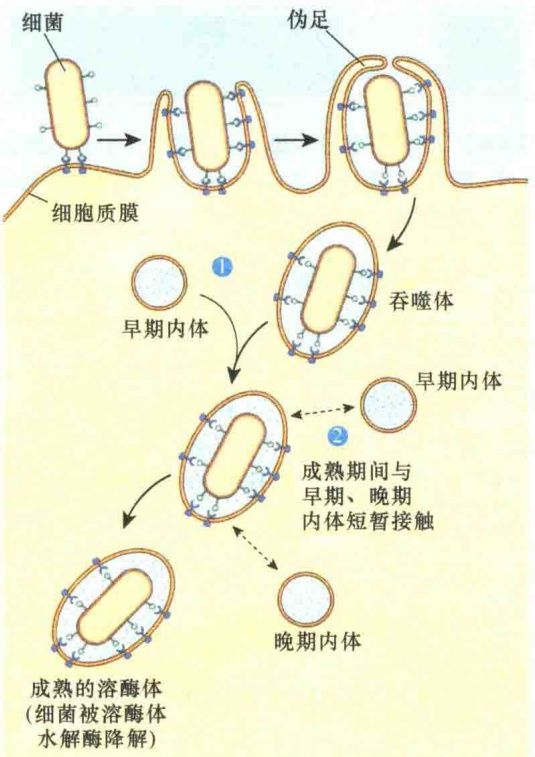
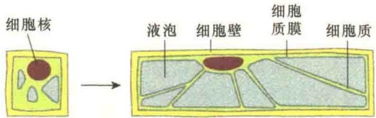

在某些发育阶段的细胞中，自噬作用特别强，因为这些细胞要不断地进行细胞器的更新或消除。例如，红细胞发育成熟后，所有的细胞器都要通过自噬作用被清除。另外，在细胞饥饿条件下，自噬作用也特别强，此时的自噬作用主要是为细胞提供能量，维持细胞的生命活动。

## 9.4.2.2 吞噬作用

细胞吞噬感染的病毒、细菌或其他一些颗粒等称为异体吞噬。通过溶酶体的吞噬作用保护细胞免受细菌与病毒等的侵染，是细胞的防御功能所必需的。外来的有害物质被吞入细胞后，即形成由膜包裹的吞噬体（phagosome），溶酶体膜泡很快与吞噬体融合形成晚期内体，此时溶酶体中的底物是从细胞外摄取的，故为异噬性的溶酶体，在异噬性的溶酶体中吞噬物被酶水解（图9-42）；水解后，那些可溶性小分子可通过溶酶体膜进入胞质溶胶，为细胞再利用。多细胞的动物具有专门的吞噬细胞，即巨噬细胞（macrophage）和中性粒细胞（neutrophil），担任机体的保护防御任务。在细胞的吞噬过程中，如果吞进来的是液体，则称为大胞饮作用，这种作用形成的吞饮体（pinosome）也是通过与溶酶体融合将液体中的物质水解。吞噬作用也是细胞获取营养的一种方式，在溶酶体酶的作用下，将吞进的物质降解形成可直接利用的小分子用于合成代谢。一些单细胞的生物更是靠吞噬作用来获取营养。

图 9-42 吞噬作用（引自 Becker et al., 1996）。吞噬作用的第一阶段是细胞质膜上的受体与细菌结合，然后形成伪足将被感染的细菌包裹起来形成吞噬体；接着是溶酶体（早期内体）与吞噬体融合，经过晚期内体，在溶酶体酶的作用下被吞噬的细菌被降解。

吞噬作用也包括对衰老的、进入程序性死亡的细胞的吞噬。例如，占成人细胞总数 1/4 的红细胞仅能成活 120 天，因此人体每天必须清除大量衰老的红细胞，这主要是靠吞噬作用，即溶酶体酶的消化作用来完成的。

溶酶体参与的最为重要的一种内吞物的降解是受体介导的内吞作用，其相关机制将在 10.5.2 “受体介导的内吞作用” 中讨论。

## 9.4.2.3 自溶作用

自溶（autolysis）是细胞的自我毁灭（cellular self-destruction），即溶酶体的酶被释放出来将细胞自身降解。在正常情况下，溶酶体的膜是十分稳定的，溶酶体的酶也安全地被包裹在溶酶体内，不会对细胞自身造成伤害。另外，溶酶体在进行异体吞噬和自体吞噬时，都要先形成吞噬泡，通过融合形成内吞体后才能进行降解作用，这样溶酶体的酶始终在安全条件下进行降解作用。

如果细胞受到严重损伤，造成溶酶体破裂，那么细胞就会在溶酶体酶的作用下被降解。在多细胞生物的发育过程中，自溶对于形态建成具有重要作用，通过自溶作用，除去不必要的细胞、组织。例如，手指或足趾的形成与溶酶体相关，它将指之间的结构水解；另外，蝌蚪尾巴的蜕化也是溶酶体中一种水解酶（组织蛋白酶）消化作用的结果，该酶将尾部细胞破坏，使尾部消失。

## 9.4.2.4 其他功能

在分泌蛋白质激素和类固醇激素的细胞中，溶酶体参与激素的分泌调节作用。这种调节作用是通过分泌自噬泡进行的，即通过自体吞噬作用将一部分合成类固醇激素的细胞器（滑面内质网、线粒体）包裹起来，形成自噬体，由溶酶体将这部分细胞器和其中已合成的激素降解掉。这种自吞噬作用使细胞能在短时间内消除一部分合成激素的细胞器和其中的激素，从而使分泌类固醇激素的细胞及时有效地调节激素分泌量。

另外，溶酶体除了在细胞内具有消化作用，也具有细胞外消化作用（extracellular digestion）。例如，精子与卵子的受精作用就是靠精子头部的顶体(acrosome) 释放溶酶体酶帮助精子抵达卵子质膜, 进行卵子和精子的细胞质膜相互融合, 达到受精的目的。

## 9.4.2.5 溶酶体与疾病

溶酶体与人类疾病有较密切的关系，如果溶酶体异常，会引发多种疾病，如溶酶体贮积症、糖原贮积症等。

1）溶酶体贮积症（lysosomal storage disease）这是一种遗传病，多数都是单基因的突变，导致溶酶体中一种或几种酶没有活性，致使这类患者不能降解糖脂和一些原本由溶酶体酶降解的细胞外的成分，使这些物质作为大的包涵体（inclusion body）积累在溶酶体中。

2）Ⅱ型糖原贮积症（glycogen storage disease type Ⅱ）这是最早发现的贮积症。由于常染色体上的一个隐性基因突变，造成了溶酶体缺乏α-葡萄糖苷酶，缺少这种酶的溶酶体不能把肝细胞或肌细胞中过剩的糖原进行水解而大量积累在溶酶体内，造成溶酶体超载。此病多发于婴儿，表现为肌肉无力、心脏增大、心力衰竭，通常于两周内死亡。

3）硅肺（silicosis）这是一种职业病，又称磨工病、石末沉着病。空气中的  $SiO_{2}$  被吸入肺后，被肺部的吞噬细胞所吞噬，由于吞入的二氧化硅颗粒不能被消化，并在颗粒的表面形成硅酸；硅酸能与溶酶体膜的受体分子形成氢键，使膜破坏，释放出水解酶，导致细胞死亡。释放出的硅粉末再被健康的吞噬细胞吞噬得到同样的结果。如此吞噬细胞相继地吞噬、死亡，最后导致成纤维细胞产生胶原纤维结节，造成肺组织的弹性降低，肺受到损伤，呼吸功能下降。

4）休克（shock）在休克中，由于组织缺血、缺氧，影响了供能系统，导致膜的不稳定，引起溶酶体酶的外漏，造成细胞与机体的损伤。溶酶体酶外漏的可能机制是:由于缺氧，引起细胞质pH 的下降，酸性水解酶活化，水解溶酶体的膜，使膜漏增强，最终导致溶酶体膜破裂，溶酶体酶释放，使细胞组织自溶；而三羧酸循环的受阻则影响细胞氧化磷酸化的过程，ATP 减少，功能不足，钠泵失灵，组织内渗透压下降，导致溶酶体膜的通透性增高，酶释放，组织自溶。因此，在抢救休克患者时，临床上采用大剂量的糖皮质类固醇，以稳定溶酶体的膜。

## 9.4.3 植物细胞的液泡

植物细胞中含有一个或多个充满液体的囊泡，叫液泡（vacuole），其体积占细胞体积的30%以上，高的达90%。植物液泡相当于动物细胞的溶酶体，它含有多种水解酶类。但是植物液泡的作用显然比溶酶体要大，具有多种功能。植物液泡能够作为营养与废物的储存器，也是物质降解的场所。它既能调节细胞的大小（图9-43），也能控制细胞的膨压（turgor pressure）。

图 9-43 植物液泡对细胞大小的调节（引自 Alberts et al., 2015）。液泡通过对水的吸收，增大细胞的体积，而胞质溶胶的量没有多少改变。

液泡作为稳态的细胞器具有重要作用，能够使细胞耐受不同的环境变化。例如，当环境中的 pH 下降时，液泡中的  $H^{+}$  流入胞质溶胶，起平衡作用。液泡能够维持细胞的膨压，调节细胞的渗透压，调节聚合物的降解与合成；在某些情况下，液泡还能改变糖、氨基酸、某些代谢物穿过质膜与液泡膜的运输速度。

## 本章小结

内膜系统主要是指内质网、高尔基体、溶酶体、液泡和细胞核膜。这些膜结构是相互流动的，处于动态平衡，在功能上也是相互协同的。

蛋白质分选是指细胞对新蛋白的识别、挑选，并通过特殊方式运送到靶位点的过程。内膜系统是蛋白质分选的主要系统。

内质网是由一层单位膜所形成的囊状、泡状和管状结构，并形成一个连续的网膜系统。它可分为糙面内质网和滑面内质网。

滑面内质网的功能有:糖原分解释放葡萄糖、脂的合成与运转、解毒和调节钙离子浓度等。

糙面内质网的功能主要是参与蛋白质的合成、加工与转运。信号肽对于蛋白质合成的分选具有决定作用。信号肽长度一般为 $15\sim 35$ 个氨基酸残基，没有特异性。信号肽通过与信号识别颗粒、停靠蛋白的相互作用将新合成的蛋白质引导到内质网上，新生肽进入内质网腔后在分子伴侣的帮助下进行正确地折叠，一旦折叠错误严重时，可通过内质网膜中的感应器迅速应答:降低蛋白质合成速度或是增加分子伴侣的合成，加大内质网中分子伴侣的量。在糙面内质网中进行的蛋白质的修饰包括蛋白质 $N$ -连接的糖基化、GPI脂锚定蛋白的形成、二硫键的形成等。

高尔基体是蛋白质的分选站，它由内侧（顺面）高尔基网、中部高尔基（潴泡）层和外侧（反面）高尔基网三部分功能区室组成。

高尔基体的功能主要是蛋白质的分选、蛋白质和脂的转运、蛋白质的 O-连接糖基化、蛋白聚糖的合成等。

溶酶体是动物细胞中一种单层膜包被的膜性细胞器。溶酶体的功能是降解，主要通过自噬作用、吞噬作用、自溶作用和细胞外消化作用等途径。

## 思考题

(1) 列出四种不同的蛋白质的名称, 这些蛋白质可以促进分泌蛋白在内质网腔内的修饰或折叠。指出这些蛋白质中的哪一种对底物蛋白进行共价修饰, 而哪些只会导致底物蛋白的构象变化。

（2）如何理解内膜系统的广义与狭义概念？

（3）滑面内质网有哪些主要的功能？

（4）什么是翻转酶？分为几种类型？各有什么特点？

（5）何谓信号假说？提出的依据是什么？