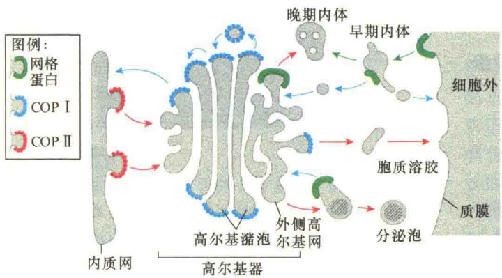
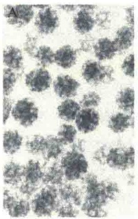
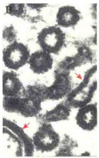
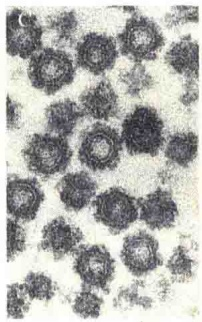
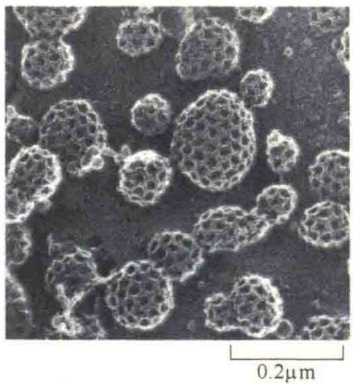
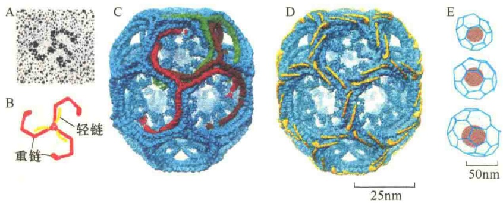
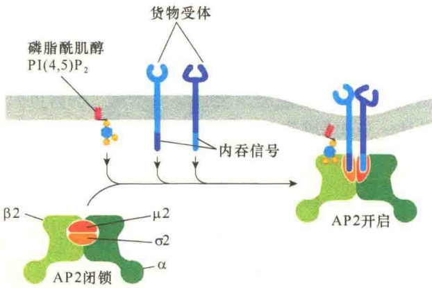

- 10.1 有被小泡的类型、装配因子及信号
- 10.1.1 有被小泡的类型
- 10.1.2 有被小泡的装配因子
- 10.1.3 介导有被小泡形成的信号
- 10.2 有被小泡的形成
- 10.2.1 网格蛋白有被小泡的形成
- 10.2.2 COP 有被小泡的形成
- 10.3 小泡的定向运输、停靠与融合机制
- 10.3.1 Rab 蛋白介导运输小泡寻靶
- 10.3.2 SNARE 蛋白与 NSF 蛋白
- 10.4 细胞分泌
- 10.4.1 从内质网到高尔基体的分泌
- 10.4.2 从反面高尔基网向溶酶体的分泌
- 10.4.3 胞吐作用:从反面高尔基网向细胞外分泌
- 10.5 内吞作用
- 10.5.1 内吞途径
- 10.5.2 受体介导的内吞作用
- 10.5.3 内体的加工与成熟
- 10.5.4 吞噬细胞的吞噬
- 10.5.5 吞饮作用
- 10.6 膜的动态更新
- 10.6.1 膜脂的来源及不对称性分布
- 10.6.2 膜蛋白的更新

我们已经讨论了细胞的内膜系统及通过共翻译进行的蛋白质分选的主要机制，但是，蛋白质进入内质网后如何形成分泌小泡进一步转运呢？另外，在细胞的内吞作用中，细胞质膜通过内陷形成内吞泡，这些内吞泡必须找到正确的靶位点，或是与溶酶体融合，或是与高尔基体融合，或是与另一侧的细胞质膜融合。因此，细胞内存在一种复杂的小泡运输系统，由于这种运输系统通过对膜包裹小泡的转运，不仅完成了“南来北往”的“货物”运输，同时也带动了细胞质膜与内膜系统间的膜流动，因此，将这种运输称为细胞内膜运输（intracellular membrane trafficking）。细胞内膜运输涉及三个关键问题。

第一，运输小泡形成的机制是什么？为什么某些可溶性的内腔（内质网腔、高尔基体腔）蛋白质和某些膜整合蛋白能够被选择性地包入小泡，而其他的蛋白质却不会？

第二，不同类型的运输小泡具有什么样的分子信号？如何依靠这些信号标记引导小泡与特定靶位点膜结合？例如，来自内质网的分泌小泡怎样知道移向顺面高尔基网并与之融合而不会移向反面高尔基网？另外，载有溶酶体酶的分泌小泡是如何识别晚期内体并与之融合而不与细胞质膜融合呢？

第三，运输小泡的膜与靶细胞的膜相互融合的机制是什么？

2013年诺贝尔生理学或医学奖颁给了美国耶鲁大学细胞生物学系主任James E. Rothman、美国加州大学伯克利分校细胞生物学家Randy W. Schekman和德国生物化学家Thomas C. Südhof，以表彰他们对于细胞内小泡运输机制研究方面做出的贡献。诺贝尔奖评选委员会在声明中说，这三位科学家的研究成果解答了细胞如何组织其内部最重要的运输系统之一——小泡运输系统的奥秘。Schekman发现了能控制细胞运输系统不同方面的三类基因，从基因层面上为了解细胞中小泡运输的严格管理机制提供了新线索；Rothman在20世纪90年代发现了一种蛋白质复合物，可以让小泡与其目标细胞膜融合；基于前两位美国科学家的研究，Südhof发现并解释了小泡如何在指令下精确地释放出内部物质。

## 10.1 有被小泡的类型、装配因子及信号

人类社会有着十分发达的交通运输系统，包括海、路、空全方位的交通网络。细胞社会同样有着毫不逊色于人类社会的运输系统，其基本工具就是小泡。

细胞内的小泡转运也有严格的“交通规则”，不同运输小泡不仅有不同的行进路线，而且有醒目的“外包装”标识，确保行程安全。运输小泡外包装的差异，标志着装载的“货物”的差异。

## 10.1.1 有被小泡的类型

已知有三种不同类型的有被小泡（coated vesicle）:网格蛋白有被小泡（clathrin-coated vesicle）、COP I 有被小泡（COP I-coated vesicle）和 COP II 有被小泡（COP II-coated vesicle），这三种小泡分别负责不同区间的运输（图 10-1）。

第一种是网格蛋白有被小泡，承担选择性的物质运输，有两条运输路线:①从反面高尔基网出芽形成选择性的分泌小泡，介导溶酶体酶的运输；②由细胞质膜内吞形成的选择性的内吞泡，主要是细胞质膜中受体介导的内吞作用形成的内吞泡；这类小泡的表面都包裹着由网格蛋白装配的包被。

图 10-1 三类不同类型的有被小泡及其运输路线（引自 Alberts et al., 2015）。网格蛋白有被小泡往返于反面高尔基网—质膜之间（选择性），COPI 有被小泡的运输路线为高尔基体—内质网，以及反面高尔基网—质膜（非选择性），COPII 有被小泡的运输路线为内质网—顺面高尔基网。

第二种是 COP I 有被小泡，介导非选择性的蛋白质运输。COP 是 coat protein 的缩写。有三条运输路线:①顺面高尔基网到内质网的运输；②反面高尔基网到细胞质膜的非选择性运输；③高尔基体中间膜囊间的运输。

第三种是 COPⅡ有被小泡，介导非选择性运输，主要路线是从内质网到顺面高尔基网，即 COPⅡ有被小泡介导所有从内质网出芽输出的蛋白质。

以上三种类型的有被小泡，在电子显微镜下观察，其形态也是可明显区分的（图 10-2）。

网格蛋白

COP I

COP II 100nm

图 10-2 三种类型有被小泡的电子显微镜照片（引自Alberts et al., 2015）。A. 网格蛋白有被小泡；B. COP I 有被小泡及高尔基体潴泡，箭头所指为高尔基体潴泡；C. COP II 有被小泡。

## 10.1.2 有被小泡的装配因子

三种类型有被小泡的包被都是瞬时装配的，其作用就是协助分泌或内吞泡的形成，有被小泡一旦

与母体膜脱离，无论何种类型的有被小泡都要迅速将包被解体。三种类型有被小泡装配时不仅需要包被蛋白，还需要相关的装配因子——GTPase 的帮助（表 10-1）。

## 10.1.3 介导有被小泡形成的信号

虽然不同类型的运输小泡的包被蛋白是不同的，运输路线也各有差异，包被差异的决定因素是被运输的“货物”及“出芽”或内吞膜区域的特性，也就是说，运输公司要根据货主货物的性质决定提供什么样的船，此外还要考虑使用何种级别的港口与码头。所以，不同包被小泡的形成不仅需要信号，同时也需要信号受体。表10-2综合了三种类型运输小泡的一些信号序列、“货物”的类别及相应的信号受体。

表 10-1 三种不同类型有被小泡的装配因子（GTPase）

<table><tr><td>有被小泡类型</td><td>运输方向</td><td>包被蛋白</td><td>相关的GTPase</td></tr><tr><td>COP II</td><td>内质网→顺面高尔基网</td><td>Sec23/Sec24+Sec13/Sec31复合物, Sec16</td><td>Sar1</td></tr><tr><td>COP I</td><td>顺面高尔基网→内质网, 高尔基体潴泡堆间</td><td>包被蛋白复合体含有7个不同的COP亚基</td><td>ARF</td></tr><tr><td rowspan="4">网格蛋白</td><td>反面高尔基网→内体</td><td>网格蛋白+AP1复合物</td><td>ARF</td></tr><tr><td>反面高尔基网→内体</td><td>网格蛋白+GGA(一种衔接蛋白)</td><td>ARF</td></tr><tr><td>质膜→内体</td><td>网格蛋白+AP2复合物</td><td>ARF</td></tr><tr><td>高尔基体→溶酶体、黑素体、血小板膜泡</td><td>AP3复合物(尚不知道是否需要网格蛋白)</td><td>ARF</td></tr></table>

表 10-2 介导蛋白质进入特定运输小泡的分选信号

<table><tr><td>信号序列*</td><td>具信号的蛋白质</td><td>信号受体</td><td>包被蛋白/衔接蛋白</td><td>运输方向</td></tr><tr><td>Lys-Asp-Glu-Leu(KDEL)</td><td>内质网腔内工作蛋白</td><td>CGN膜KDEL受体</td><td>COP I</td><td>顺面高尔基网→内质网</td></tr><tr><td>甘露糖-6-磷酸(M6P)</td><td>在顺面高尔基网中加工形成的溶酶体酶及分泌到细胞外的溶酶体酶</td><td>TGN膜中M6P受体质膜中M6P受体</td><td>网格蛋白/AP1网格蛋白/AP2</td><td>反面高尔基网→细胞质质膜→细胞内</td></tr><tr><td>Lys-Lys-X-X(KKXX)</td><td>内质网膜蛋白</td><td>COP I a和b亚基</td><td>COP I</td><td>高尔基体→内质网</td></tr><tr><td>X-Arg-Arg-X(二精氨酸)</td><td>内质网膜蛋白</td><td>COP I a和b亚基</td><td>COP I</td><td>高尔基体→内质网</td></tr><tr><td>二酸性(如Asp-X-Glu)</td><td>内质网中货物膜蛋白</td><td>COP II Sec24亚基</td><td>COP II</td><td>内质网→反面高尔基网→质膜</td></tr><tr><td>Asn-Pro-X-Tyr(NPXY)</td><td>质膜中低密度脂蛋白受体</td><td>AP2复合物</td><td>网格蛋白/AP2</td><td>质膜→内体→溶酶体</td></tr><tr><td rowspan="2">Tyr-X-X-Φ(YXXΦ)</td><td>反面高尔基网膜蛋白</td><td>AP1(μl亚基)</td><td>网格蛋白/AP1</td><td>内体→反面高尔基网</td></tr><tr><td>质膜蛋白</td><td>AP2(μ2亚基)</td><td>网格蛋白/AP2</td><td>内体→质膜</td></tr><tr><td>Leu-Leu(LL)</td><td>质膜蛋白</td><td>AP2复合物</td><td>网格蛋白/AP2</td><td>内体→质膜</td></tr></table>

$^{*}$ X=任何氨基酸， $\Phi=$ 各种疏水氨基酸；括号中单字母表示氨基酸的单字母缩写；非括号中的单字母不仅表示氨基酸缩写，也表示是膜蛋白的细胞质结构域。

## 10.2 有被小泡的形成

由于不同类型的有被小泡具有不同的包被蛋白，因此装配机制各不相同。

## 10.2.1 网格蛋白有被小泡的形成

典型的网格蛋白有被小泡的直径为50～100nm，它的形成始于网格蛋白有被小窝（图10-3）。在大量进行内吞活动的细胞（如肝细胞、成纤维细胞）中，细胞质膜有许多网格蛋白有被小窝（clathrin-coated pit）。这些有被小窝的形成需要很多衔接蛋白（adapter protein）和网格蛋白，网格蛋白有被小泡最后与质膜的脱离还需要一种称为发动蛋白（dynamin）的GTPase。

图 10-3 网格蛋白有被小窝与膜泡（引自 Alberts et al., 2015）。快速冷冻、深度蚀刻的电镜照片显示培养的成纤维细胞质膜有大量的网格蛋白有被小窝与小泡。

## 10.2.1.1 网格蛋白包被的结构

网格蛋白（clathrin）是一种进化上高度保守的蛋白质，是由分子质量为180kDa的重链和分子质量为35～40kDa的轻链组成的二聚体。三个二聚体形成包被的基本结构单位——三腿蛋白体（triskelion），或称三腿蛋白复合体。许多三腿蛋白复合体再组装成五边形或六边形网格结构，即包被亚基（coat subunit），然后由这些网格蛋白亚基组装成网格蛋白有被小泡（图 10-4）。

## 10.2.1.2 衔接蛋白

在网格蛋白有被小泡的外被中有一种重要的蛋白质，这就是衔接蛋白（adaptor protein）。衔接蛋白位于包被的内层，介于网格蛋白货物与膜之间，是一种在网格蛋白有被小泡形成中起选择作用的蛋白质。

图 10-4 网格蛋白包被的结构（引自 Alberts et al., 2015）。A. 网格蛋白三腿蛋白复合体电子显微镜照片。B. 组成网格蛋白三腿蛋白复合体的三个重链与三个轻链。低温电镜揭示网格蛋白包被由36个三腿蛋白复合体组成12个五边形、6个六边形的网络结构（见图 C、D）。C. 重链在网格蛋白有被小泡中的排列。D. 轻链在网格蛋白有被小泡中的排列。轻链通过与肌动蛋白连接为膜出芽及小泡移动提供动力，通过磷酸化对网格蛋白包被的装配进行调节。E. 根据从牛脑中分离的网格蛋白有被小泡绘制的影像图，小泡形态基本类似，但并非完全相同。

有几种不同的衔接蛋白，最典型的由4个不同亚基组成，其他则为单链的蛋白质。每种衔接蛋白都有各自特异的货物受体。网格蛋白有被小泡从不同的膜区出芽，使用不同的衔接蛋白，因而包装不同受体蛋白与货物分子。

衔接蛋白在膜上的装配受严格地控制，也包括衔接蛋白与其他一些包被成分的相互作用，衔接蛋白AP2就是一个典型例子。当AP2与特异的、磷酸化的磷脂酰肌醇脂结合，改变了AP2的构型，暴露出与膜中货物受体结合的位点，促进了AP2与膜的结合（图10-5）。

图 10-5 脂诱导的 AP2 的构型改变（引自 Alberts et al., 2015）。AP2 衔接蛋白有 4 个亚基: $\alpha$ 、 $\beta_{2}$ 、 $\mu_{2}$ 、 $\sigma_{2}$ 。AP2 与膜脂磷酸肌醇 PI（4，5） $P_{2}$  的细胞质侧部分相互作用，导致 AP2 的构型变化，暴露出与膜受体蛋白结合的位点。每一个 AP2 复合物能够结合 4 个 PI（4，5） $P_{2}$  分子（为简便起见，图中仅显示一个）。开放型的 AP2 复合物中， $\mu_{2}$ 、 $\sigma_{2}$  两个亚基与货物受体的细胞质结构域尾部结合。

除了 AP2 之外，还有 AP1、AP3 等衔接蛋白。

很早就知道细胞质膜中被包装到网格蛋白小窝的受体蛋白的细胞质结构域具有 Tyr-X-X-F 序列或 Leu-Leu 序列（见表 10-2），这种信号序列在有被小泡装配时能够与 AP2 相互作用，质膜上没有该信号序列的蛋白质不能与 AP2 作用，因而不能被包装到网格蛋白有被小泡中。与 AP2 不同的是，衔接蛋白 AP1 参与反面高尔基网的网格蛋白有被小泡的出芽。由于 M6P 受体蛋白既存在于反面高尔基网又存在于细胞质膜，所以这种受体既能与 AP1 作用又能与 AP2 相互作用。

后来在酵母和鼠的研究中又鉴定了一种衔接蛋白——AP3。具有 AP3 突变的酵母，反面高尔基网的某些蛋白质就不能被运输到液泡和溶酶体。

## 10.2.1.3 磷脂肌醇标记细胞器及膜结构域

尽管膜中磷脂肌醇的含量不到总磷脂的 $10\%$ ，但却有重要的调节作用。磷脂肌醇可通过肌醇糖头部基团的 $3^{\prime}$ 、 $4^{\prime}$ 和 $5^{\prime}$ 位的磷酸化与去磷酸化循环快速产生各种类型的磷脂肌醇（phosphoinositide）。磷脂酰肌醇（phosphatidylinositol，PI）与磷脂酰肌醇磷酸（phosphatidylinositol phosphate，PIP）的内部转换是在不同区室完成的:内吞与分泌途径中，不同的细胞器有不同的PI与PIP激酶，以及PIP磷酸酶，形成不同肌醇磷脂，如PI（3）P、PI（4）P、PI（4,5） $\mathrm{P}_2$ 、PI（3,5） $\mathrm{P}_2$ 、PI（3,4,5） $\mathrm{P}_3$ 等。因此，不同细胞器膜中磷脂肌醇则成为小泡形成的标志区域，它招募衔接蛋白与之结合，最终导致衔接蛋白与货物受体结合，促成小泡包被的装配（图10-6）。