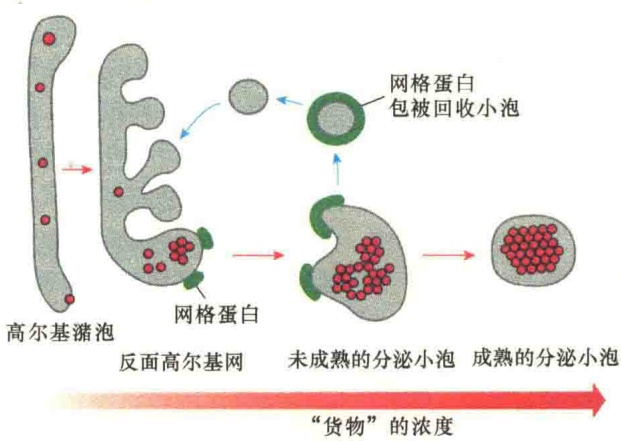
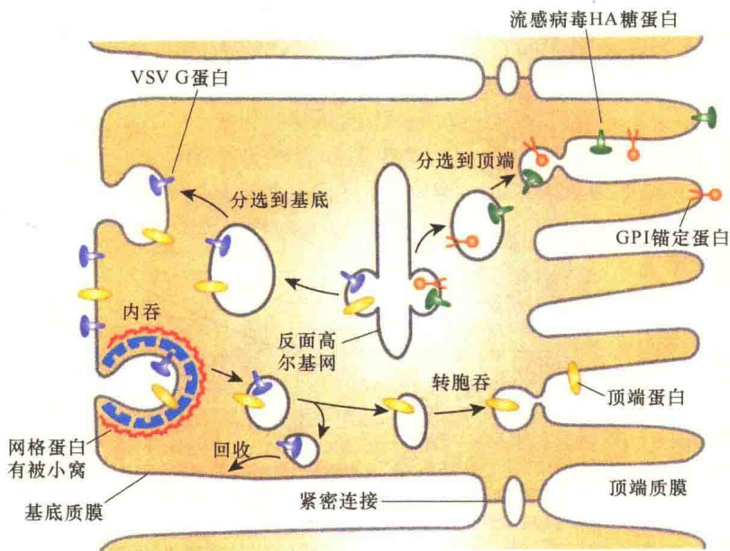
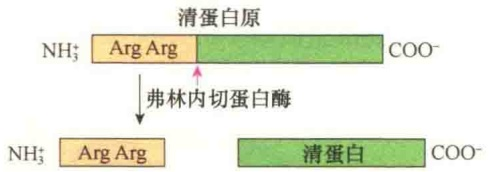
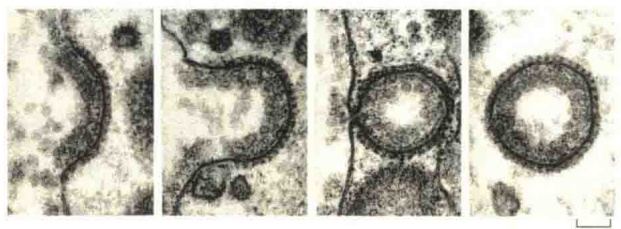
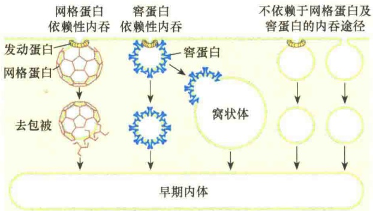
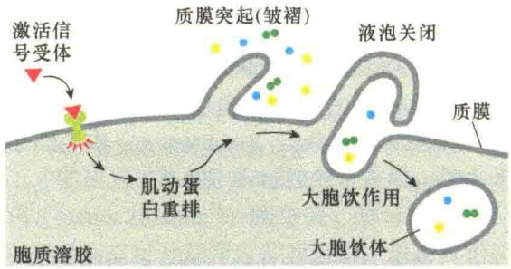
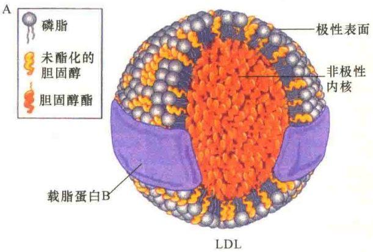
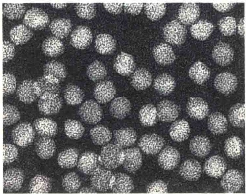

图 10-33 分泌小泡的浓缩（引自 Alberts et al., 2015）。分泌小泡中蛋白质的浓缩有两种机制。第一种机制是通过对反面高尔基网内部环境的酸化，促进分泌蛋白的聚集；第二种机制是网格蛋白被分选返回反面高尔基网时要形成一种不含分泌蛋白的空泡，导致分泌蛋白的浓度提高。

膜，两部分细胞质膜含有不同的膜蛋白和膜脂，糖脂和糖蛋白只存在于顶部细胞质膜中。在这种有极性的细胞中，细胞质膜蛋白的分泌活动具有选择性，通过几种不同的分选机制保证所有的质膜蛋白能够到达正确的位置。

极性细胞质膜蛋白分泌定位的一种机制涉及反面高尔基网对质膜蛋白的分选。研究表明，在反面高尔基网，无论是顶部质膜还是基底侧质膜的蛋白疹病毒的 G 蛋白经高尔基体分选后被转运到基底膜（图 10-34）。如果通过基因技术，将流感病毒编码的 HA 蛋白基因导入未感染的细胞，表达的 HA 蛋白全部积累在顶端质膜，这表明，HA 蛋白的分选信号存在于 HA 蛋白而不是感染病毒表达的其他蛋白质。

## 10.4.3.3 分泌泡中蛋白质的酶解加工

在内质网上合成的蛋白质并非合成之后就有活性。某些分泌蛋白（如生长激素）和某些病毒的膜蛋白（如 VSV G 蛋白）合成后，由蛋白酶从新生肽链上切除内质网信号序列即转变成成熟的有活性蛋白质。但是，对于质膜的蛋白质和大多数分泌蛋白来说，开始合成的是相当长的没有活性的前体，称为前蛋白（preprotein），这些蛋白质需要进一步加工才能成为成熟的、有活性的蛋白质，如血清白蛋白（serum albumin）、胰岛素、酵母的  $\alpha$  交配因子，以及所有的分泌蛋白和膜蛋白，包括流感病毒的 HA 蛋白。

一般说来，前蛋白被酶解转变成成熟的分子是在离开高尔基体后的分泌小泡中进行的。正常情况下，成熟的分泌小泡是由几个不成熟的小泡融合而成的，然后通过加工使蛋白质成熟。

某些前体蛋白，包括前白蛋白（proalbumin）

质都是在一起的，但是却被分别包装到两种不同类型的分泌小泡中，一种小泡运向顶部并与顶部质膜融合，而另一种小泡移到基底侧质膜并与之融合。这些小泡的表面带有不同的运输标识，与不同部位的靶蛋白结合。

MDCK 细胞（Madin-Darby canine kidney cell，马丁-达比犬肾细胞）是上皮极性肾细胞。通过培养的 MDCK 细胞研究了顶端-基底细胞膜蛋白的选择性分选。

流感病毒，其子代病毒是从顶端膜出芽的；而水疱性口炎病毒（vesicular stomatitis virus, VSV），其子代病毒是从基底膜出芽的。出芽部位的差异是由各自蛋白质运输途径不同造成的:流感病毒的 HA 糖蛋白经由高尔基体分选后被转运到顶端膜，而疱在 C 端的某一位点切割一次，产生两个碱性的识别序列，如 Arg-Arg 或 Lys-Arg（图 10-35），另外一些前蛋白在 N 端切除几个氨基酸或在 N 端和 C 端同时切除几个氨基酸。在胰岛素原中，多余的氨基酸称为 C 肽，位于多肽的内部，加工时要将 C 肽切除，并将两端的 A 肽和 B 肽通过二硫键连接起来（图 6-30）才有功能。

图 10-34 极性细胞顶端膜与基底膜蛋白的选择性分选（引自 Lodish et al., 2013）。当培养的 MDCK 细胞同时用 VSV 及流感病毒感染，VSV 的 G 蛋白仅出现在基底膜，而流感病毒的 HA 糖蛋白仅出现在顶端膜。某些细胞蛋白（橙色的圆圈），特别是 GPI 锚定蛋白被直接分选到顶体膜，其他一些蛋白质（未显示）则从反面高尔基网转运到基底膜。

图 10-35 清蛋白原在分泌过程中的加工。清蛋白原在分泌泡中被弗林内切蛋白酶（成对碱性氨基酸蛋白酶）切除 N 端一对 Arg 片段，形成成熟的清蛋白。

## 10.4.3.4 溶酶体与多泡体经过胞吐释放内含物

溶酶体也能够通过分泌作用将未消化的内含物释放到细胞外。对于大多数细胞来说，这种情况是极少发生的，除非是应急情况。但是，某些含有特殊溶酶体的细胞，其溶酶体具有与细胞质膜融合的机制。例如，皮肤的黑素细胞（melanocyte），在其溶酶体中贮存色素，这些含有黑素体（melanosome）的溶酶体需要通过胞吐作用将黑素释放到表皮的细胞外空间。释放的色素被角质形成细胞（keratinocyte）所吸收，产生正常的皮肤色素。在某些遗传病中，由于黑素体的胞吐作用缺陷，阻断了黑素的释放，导致白化（albinism）。

在某些情况下，多泡体也能与细胞质膜融合，这样就会导致腔内泡（intralumenal vesicle）释放到细胞外。在血液中可以观察到这些释放的流动小泡，亦称为外排体（exosome），可以在远距离细胞间进行物质转运，或进行通讯，但其潜在的重要性尚不清楚。有些外排体可直接通过胞吐作用产生。

## 10.5 内吞作用

细胞通过细胞质膜的内陷将细胞外的物质转运到细胞内的过程称为内吞作用（endocytosis）或胞吞作用。包括吞噬作用、吞饮作用、受体介导的内吞作用三种类型。内吞的物质包括细胞质膜成分、液体、溶质、大分子，以及一些特别的物质。内吞的货物包括受体-配体复合物（受体及其结合的物质）、细胞碎片、细菌、病毒，在特殊情况下，甚至是细胞。通过内吞作用，细胞可调节细胞质膜的成分，以应对细胞外环境的变化。

实际上，所有的细胞质膜都在不断地通过质膜形成吞饮泡（pinocytic vesicle）进行营养的吸收。虽然不同类型的细胞间通过吞饮作用（pinocytosis）产生的质膜内化的速度是不同的，但整体速度是惊人的。例如，一个巨噬细胞每小时要摄入自身体积25%的液体，这就意味着巨噬细胞每分钟摄入1%的质膜，或在30min内将自身质膜100%摄入到细胞内；成纤维细胞的摄入速度稍低一些（每分钟摄入自身1%的质膜）。质膜的减少，必须依靠细胞的胞吐作用进行补充，维持细胞体积的稳定。从这个意义上说，内吞作用与胞吐作用是偶联的，即内吞作用与胞吐作用是连续循环的。内吞与胞吐的偶联具有重要意义，尤其是对于具有高度特化的神经末端细胞质膜的快速轮回。

细胞的内吞循环通常从网格蛋白有被小窝开始（图 10-36），产生小窝的特化区域大约占细胞质膜的 2%，而且网格蛋白有被小窝的半衰期很短，大约在产生后 0.5min 左右。观察人工培养的成纤维细胞发现，每分钟大约产生 2500 个网格蛋白有被小泡，有时网格蛋白有被小泡比网格蛋白有被小窝的量还要多，网格蛋白有被小泡从形成到去被再到相互融合仅需几秒钟。

图 10-36 母鸡的卵母细胞质膜形成脂蛋白的网格蛋白有被小泡（引自 Alberts et al., 2015）。电镜照片显示，质膜先形成网格蛋白包被小窝，接着小窝逐渐内陷，最后形成独立的网格蛋白有被小泡。母鸡的脂蛋白（lipoprotein）的内吞网格蛋白有被小泡体积较大，摄入的脂蛋白参与卵黄的形成。

## 10.5.1 内吞途径

在细胞质膜进行内吞的过程中，有三种不同的内吞途径（图 10-37）。①第一种途径是依赖于网格蛋白、由受体介导的内吞，是细胞选择性输入细胞外大分子的重要方式。②第二种途径是依赖于窖蛋白（caveolin）的内吞，这是发生在含有脂筏的质膜微区的内吞作用，也需要受体，同样需要发动蛋白将膜泡与质膜切离，形成的窖蛋白内吞体相互融合，形成大的内吞泡，窖蛋白可循环使用。③第三种途径独立于网格蛋白与窖蛋白的内吞，有些需要发动蛋白，有些不需要发动蛋白。

图 10-37 真核细胞的内吞途径（引自 Nelson and Cox, 2013）。网格蛋白有被小泡与窖蛋白有被小泡是主要的两种途径，这两种途径都需要用 GTP 作为能源，在发动蛋白的作用下将小泡与质膜切离。第三种途径是独立于网格蛋白、窖蛋白的，小泡与质膜的切离有时需要发动蛋白，有时不需要。

除了网格蛋白有被小窝与网格蛋白有被小泡外，在很多细胞质膜上还可见到由窖蛋白包被的胞膜小窝（caveolae），它们参与穿过血管内皮的物质运输，产生的区域是膜的脂筏结构域，该区域富含胆固醇、鞘脂及GPI锚定蛋白等。胞膜小窝中的主要结构蛋白是窖蛋白，是一类较为少见的整合膜蛋白家族，每一个窖蛋白都有一疏水的结构域从细胞质侧插入到质膜，但不会穿过质膜。在它们的细胞质侧，窖蛋白与洞穴蛋白（caving protein）组成复合物，这种结构能够稳定膜洞穴。与网格蛋白有被小泡和COPⅡ有被小泡或COPⅠ有被小泡相比，胞膜小窝是较为稳定的，但是也能够被诱导与质膜脱离成为内吞泡将货物转运给早期内体或极性细胞相对的一侧细胞质膜。某些动物细胞的病毒，如SV40和乳头瘤病毒（papilloma virus），就是通过胞膜小窝形成的小泡进入细胞的。病毒先被转运给早期内体，然后转运到内质网的腔。病毒基因组穿过内质网的膜进入胞质溶胶，然后进入细胞核，开始感染循环。霍乱毒素也是通过胞膜小窝进入细胞，然后进入内质网，最后进入胞质溶胶。

大胞饮作用（macropinocytosis）是既不需要网格蛋白，也不要窖蛋白的内吞作用，所有动物细胞都具有大胞饮作用。在大多数细胞类型中，并非是连续发生大胞饮作用的，只是受到细胞表面的某些货物受体的诱导作用时，在较短的时间内连续发生，如诱导性的生长因子、整合素配体、程序性死亡细胞的残余物，以及某些病毒等。这些配体激活一个复杂的信号转导途径，改变肌动蛋白的动态性，形成一个细胞表面凸起（protrusion），叫做皱褶（ruffle）；当皱褶回折接触到细胞时，就会形成一个大的、充满液体的内吞泡，叫做大胞饮体（macropinosome）。大胞饮作用是一种极好的细胞摄取及消化途径（图10-38）:形成的大胞饮体是酸性的，能够与晚期内体及内吞体融合，也不需要将它的货物返回到细胞质膜。

图 10-38 大胞饮作用（引自 Alberts et al., 2015）。细胞信号转导导致肌动蛋白骨架的重排，引起细胞表面皱褶的产生。当凸起回折与细胞表面相连，形成一个大胞饮体，里面装入的是细胞外液体、非特异性的大分子及一些颗粒。

## 10.5.2 受体介导的内吞作用

受体介导的内吞（receptor-mediated endocytosis）是一种特殊类型的胞吞作用，主要是通过细胞表面的受体摄取细胞外特殊的生物大分子。受体介导的内吞是大多数动物细胞从外部环境中获得特别的大分子的主要途径。

## 10.5.2.1 受体介导内吞的特点

在受体介导的内吞中，被吞入的物质首先要与质膜中的受体结合，与受体结合的物质称为配体（ligand），配体即是经受体介导被内吞的特异性大分子。根据配体的性质及被细胞内吞后的作用可将其分为四大类:①营养物，如运铁蛋白、低密度脂蛋白等；②有害物质，如病原菌；③免疫物质，如免疫球蛋白、抗原等；④信号物质，如胰岛素等多种肽类激素等。

吞入到细胞内的物质可分为三大类:配体（猎物）、受体和膜组分，它们进入细胞后的命运如何呢？一般而言，配体基本被降解，少数可被利用。大多数受体能够再利用，少数受体被降解。通常受体有4种可能的去向。①受体内吞之后，大多数可形成载体小泡重新运回到原来的质膜上再利用，这些受体（如 M6P 受体、低密度脂蛋白受体）主要是通过晚期内体的分拣作用重新回到细胞质膜上，所以晚期内体如同反面高尔基网一样，是内吞途径中的主要分选站。晚期内体内部酸性环境使受体蛋白改变构型，释放出配体。②受体和配体一起由载体小泡运回到原来的质膜上再利用，如运铁蛋白及运铁蛋白受体就是通过这种方式再循环。③受体和配体一起进入溶酶体被降解，如在某些信号转导中，信号分子与受体一起被溶酶体降解，这是进行信号调节的一种方式。④受体和配体一起通过载体小泡被转运到相对的细胞质膜面，这就是转胞吞作用（transcytosis）。

## 10.5.2.2 受体介导的低密度脂蛋白的内吞

低密度脂蛋白是受体介导胞吞作用的一个典型

例子。

胆固醇是动物细胞质膜的基本成分，也是固醇类激素的前体。由于胆固醇是疏水性分子，所以它在血液中是以大的脂蛋白的颗粒被运输的。根据脂蛋白的密度分为4种类型:极低密度脂蛋白（very low density lipoprotein, VLDL）、低密度脂蛋白（low density lipoprotein, LDL）、中等密度脂蛋白（intermediate density lipoprotein, IDL）和高密度脂蛋白（high density lipoprotein, HDL）。

LDL 是一种球形颗粒的脂蛋白（图 10-39），直径为 22nm，核心是 1500 个胆固醇酯；外面由 800 个磷脂和 500 个未酯化的胆固醇分子包裹。由于外被脂分子的亲水头露在外部，使 LDL 能够溶于血液中。最外面有一个分子质量为 55kDa 的蛋白质，叫载脂蛋白 B-100（apolipoprotein B-100, apoB-100），它能够与特定细胞的表面受体结合。

图 10-39 LDL 颗粒结构示意图及电镜照片（引自 Lodish et al., 2013）。A. 由磷脂和未酯化的胆固醇单层构成 LDL 的外膜结构，在外膜上结合一个亲水的 apoB-100 蛋白，该蛋白质可以介导 LDL 与细胞表面的受体结合。B. LDL 电镜照片（180 000×）。

LDL 受体蛋白是一个单链的糖蛋白，由 839 个氨基酸组成，一个很长的 N 端结构域位于细胞外，而位于细胞质面的 C 端较短。穿膜区由 22 个疏水的氨基酸组成，为单次穿膜蛋白。LDL 受体蛋白合成后被运输到细胞质膜，即使没有相应配体的存在，LDL 受体蛋白也会在细胞质膜集中浓缩并形成网格蛋白有被小窝；当血液中有 LDL 颗粒，颗粒上的 apoB-100 即与 LDL 受体结合形成 LDL-受体复合物。

一旦 LDL 与受体结合，就会形成网格蛋白有被小泡被细胞吞入，接着是网格蛋白包被解聚，受体回到质膜再利用，而 LDL 被传送给溶酶体，在溶酶体中蛋白质被降解，释放出游离的胆固醇、脂肪酸及氨基酸。胆固醇被释放出来用于质膜的装配，或进入其他代谢途径（图 10-40）。

血液中 LDL 的水平与动脉粥样硬化（动脉变窄）有极大的关系。动脉阻塞是一个复杂的、尚不十分清楚的过程，其中也包括血管内壁含有 LDL 血斑的沉积。动脉粥样硬化斑块不仅降低血液流通，也是血凝块形成的部位，它可阻塞血管中血液的流通。在冠状动脉中形成的血凝块会导致心肌梗死。LDL 受体缺陷是造成血液中 LDL 水平升高的主要原因。

胆固醇在血液中的运输途径及其通过受体介导的内吞作用被组织吸收的现象最早由 Michael Brown 与 Joseph Goldstein 所发现并证实。他们发现了一种遗传病，叫做家族性高胆固醇血症（familial hypercholesterolemia，FH），患者体内的