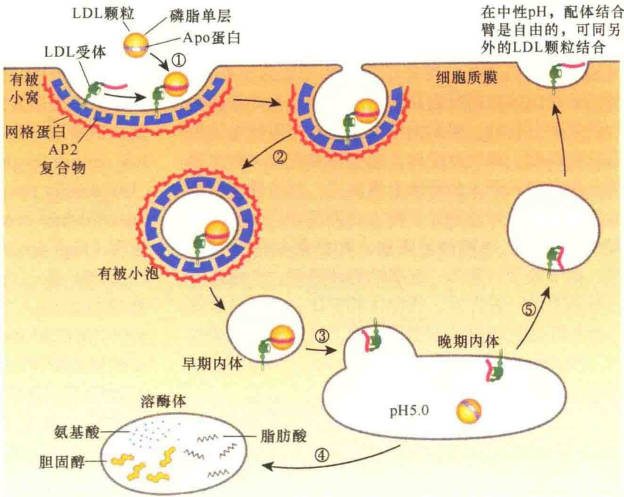
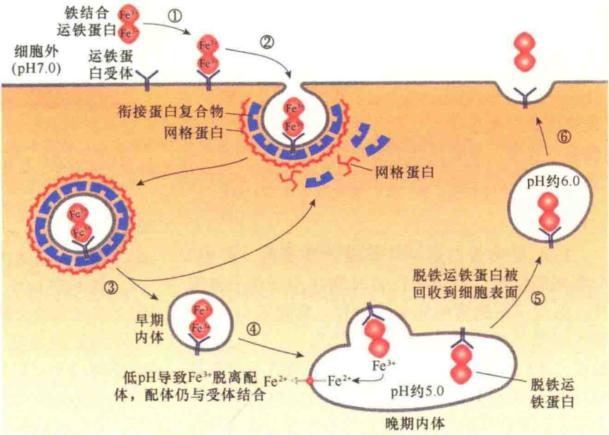
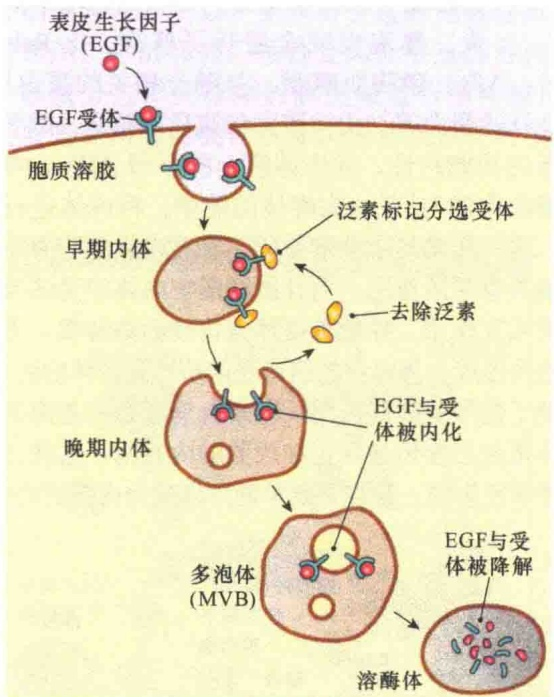
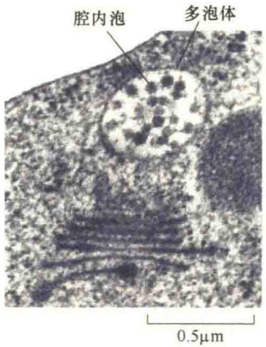
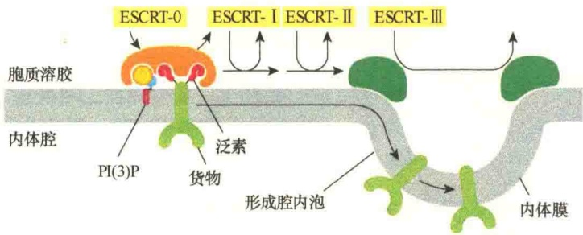
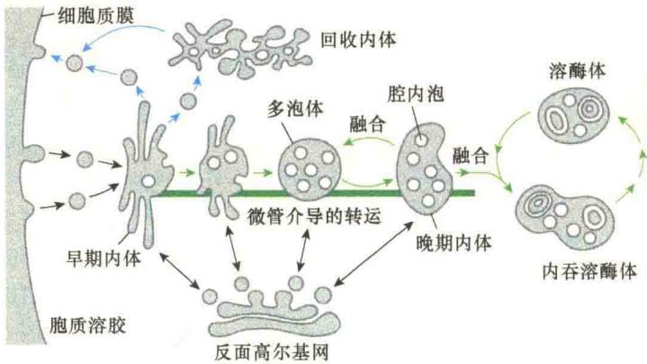
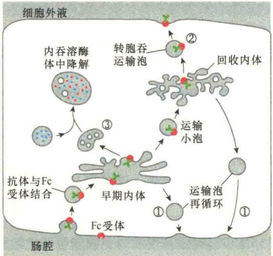
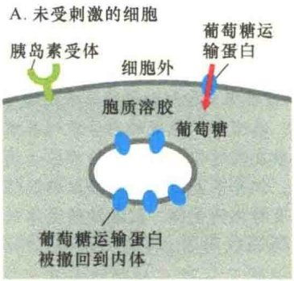
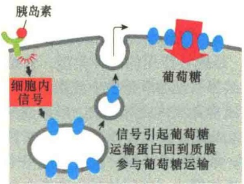

LDL 受体基因发生了突变，导致肝及外周组织不能正常吸收 LDL，结果是患者血液中的 LDL 的浓度极高，从而导致血管堵塞。LDL 受体突变有可能是影响了受体与 LDL 的识别与结合，也有可能是受体细胞内结构域不能与衔接蛋白 AP2 结合，从而影响了网格蛋白有被小泡的装配。

## 10.5.2.3 运铁蛋白结合铁离子的内吞运输

铁是细胞内的金属离子，对细胞的生命活动具有重要作用，它是通过运铁蛋白和受体介导的内吞作用被输入细胞的。

运铁蛋白（transferrin）受体和配体的内吞途径与LDL受体内吞途径不同，在该途径中，受体并不与配体解离，而是一起回到质膜再利用，只是将运铁蛋白结合的铁离子释放出来。运铁蛋白是血液中一种主要的糖蛋白，负责将肝组织（铁贮藏的主要场所）和肠组织的铁向其他细胞运输。没有结合铁的运铁蛋白称为脱铁运铁蛋白（apotransferrin），它能够紧紧结合两个 $Fe^{3+}$ ，此时称为铁结合运铁蛋白（ferrotransferrin）。所有生长中的细胞表面都有铁结合运铁蛋白的受体，在中性pH条件下运铁蛋白与铁结合，然后通过内吞作用进入细胞。在细胞内，在内体的酸性环境下，运铁蛋白释放出铁后仍然与膜受体结合，并与受体一起回到质膜。当细胞外环境变成中性时，运铁蛋白与受体脱离，并自由地结合铁，然后又开始新一轮循环。实际上，运铁蛋白穿梭于细胞外液和内体之间，避开了溶酶体，快速运送细胞生长所需的铁（图10-41）。

图 10-40 受体介导的 LDL 内吞过程（引自 Lodish et al., 2013）。① LDL 在质膜的有被小窝中与受体结合；② 在网格蛋白进一步作用下，有被小窝逐渐向内凹陷成小泡；③ 小泡与质膜切离形成网格蛋白有被小泡，接着脱去包被成为无包被的早期内体，随着 pH 下调，早期内体成为晚期内体，并分选出 LDL 受体；④ 晚期内体与溶酶体融合后，脂蛋白被降解，形成脂肪酸、氨基酸及胆固醇；⑤ 晚期内体分选出的 LDL 受体回到质膜再循环。

图 10-41 生长的哺乳动物细胞中运铁蛋白的循环（引自 Lodish et al., 2013）。①运铁蛋白二聚体各结合一个  $Fe^{3+}$ ，成为铁结合运铁蛋白，在细胞表面与运铁蛋白受体结合；②运铁蛋白受体的尾部与衔接蛋白 AP2 相互作用，并与网格蛋白作用，进行网格蛋白包被的装配，然后形成内吞的网格蛋白有被小泡；③脱去包被，成为无被小泡；④内吞泡与内吞的膜融合，形成晚期内体；⑤在酸性条件下， $Fe^{3+}$  与运铁蛋白解离；⑥脱铁运铁蛋白与受体一起被分选回到质膜，在中性 pH 时，运铁蛋白与受体脱离，在细胞外环境中结合新的  $Fe^{3+}$ 。晚期内体中的  $Fe^{3+}$  通过离子通道进入胞质溶胶。

## 10.5.2.4 细胞质膜信号转导受体的调节性内吞

上面讨论的 LDL 与运铁蛋白受体介导的内吞属于细胞对营养物的摄取，在细胞信号转导中，细胞则通过内吞减少细胞质膜中的信号受体进行信号应答调节，如表皮生长因子（EGF）受体的内吞。EGF 是一种小分子的信号蛋白，可刺激表皮及其他一些组织的细胞分裂。与 LDL 受体不同的是，EGF 受体仅仅是在与 EGF 结合后才会形成网格蛋白有被小窝，而且受体被内吞后要与结合的 EGF 一起被溶酶体降解。EGF 的结合首先激活细胞的信号转导途径，然后导致细胞表面 EGF 受体的减量，通过受体减量调节（receptor downregulation），降低了细胞对 EGF 的敏感性（图 10-42）。

图 10-42 泛素介导的 EGF 受体的降解（引自 Plopper，2016）。结合有 EGF 的受体内吞到细胞后，受体被泛素标记。被泛素标记的受体 -EGF 的膜蛋白被分选到内体的膜，然后进一步内陷，与内体膜切离成为内体中的小泡。最后，小泡膜的受体蛋白连同 EGF 一起被溶酶体水解酶消化。泛素标签在内化之前与膜解离，重新回到胞质溶胶中参与下一轮的反应。

受体的减量调节是受泛素化调控的。与多聚泛素化不同的是，泛素蛋白只是作为要分选到网格蛋白有被小泡后被降解的受体标记，若是只加一个泛素蛋白标记，则称为单泛素化（monoubiquitylation）；若是添加多个泛素，则称为多聚泛素化（multiubiquitination）。

## 10.5.3 内体的加工与成熟

通过前面的讨论，我们已经知道，细胞通过内吞作用形成的内体进入细胞后并非直接转运到溶酶体。在运输途径中，要进行一系列的加工与处理，包括脱去外被、分选受体、调整 pH 等，最后成为成熟的内体与溶酶体融合。

## 10.5.3.1 多泡体

在内体成熟过程中，内体的某些膜区会内陷直至与内体膜脱离形成内体腔内泡（intraluminal vesicle），即小泡中的小泡。含有腔内泡的内体称为多泡体（multivesicular body，MVB）（图 10-43）。

图 10-43 多泡体的电镜照片（引自 Alberts et al., 2015）。大量的膜内陷成为内体腔中的小泡，这些小泡的膜蛋白连同其中的内含物一同被溶酶体的酶消化。

多泡体带有将被消化的细胞质膜，包括通过分选选择出来的要被水解的受体蛋白。它们先形成腔内泡，一个多泡体通常含有多个腔内泡。

上面讨论的 EGF 受体被分选到腔内泡需要先带上泛素蛋白作为标签。泛素蛋白先是在细胞质膜的细胞质面与分选的受体蛋白结合，引导受体蛋白进入到内吞体的膜。被泛素标记的受体蛋白一旦进入到内吞体的膜，泛素标签再次被识别，此时识别泛素标签的是一种大的、称作运输需要的内体分选复合物（endosome sorting complex required for transport, ESCRT）。ESCRT 是一类系列物，包括 ESCRT-0/I/II/III。它们依次与泛素结合，最大限度介导受体膜进入腔内泡。进入多泡体腔内泡还依赖于一种脂激酶，它将磷脂酰肌醇磷酸化成 PI（3）P，为 ESCRT 复合物提供锚定位点，这些复合物与内体膜的结合既需要 PI（3）P，也需要泛素化的货物蛋白的存在。ESCRT-Ⅲ在膜上形成一个大的、多聚的装配体，促使内体膜向内弯曲（图 10-44）。

图 10-44 内吞体的膜蛋白被分选到多泡体的腔内泡（引自 Alberts et al., 2015）。在细胞质中，内吞泡的受体蛋白被泛素标记，接着被 ESCRT-0 结合，此过程需要有 PI（3）P 的存在。之后依次与 ESCRT-I、ESCRT-II 结合，将膜蛋白浓缩到一个向内出芽的区域，最终成为内体中的腔内泡。ESCRT-III 则是装配成一个多聚体结构并介导形成腔内泡的膜向内凹陷。ESCRT 蛋白复合物是水溶性的，存在于胞质溶胶中，一旦有需要，就会依次被招募到内吞体的膜上，腔内泡形成后，ESCRT 蛋白复合物被释放到胞质溶胶。

## 10.5.3.2 内体成熟:从内吞途径到溶酶体

从质膜形成内吞泡有着极其复杂的机制，不仅有不同的分子机制，而且有特别的调节机制。

内吞泡一旦在细胞质膜形成，将会与同样来自质膜的内吞泡相互融合形成早期内体。在早期内体中进行货物分选，某些货物分子或是通过小泡直接回到质膜，或是经由循环内体（recycling endosome）回到质膜，其他要进行降解的物质则进

入茎球状的膜泡。由早期内体到晚期内体有一个内体成熟（endosome maturation）过程，在此过程中主要将某些货物分选出并送回到质膜或细胞外，含有待降解物质的茎球状膜泡结构逐步发展为成熟的晚期内体。由早期内体转变成晚期内体，同时改变了内体膜的蛋白质组成，部分膜区内陷进入内吞体形成腔内泡，而内体自身则从外周向细胞内侧移动。当内体成熟时，就不再将所携带的物质分选到细胞质膜，而是义无反顾地将其所含有的物质进行降解:晚期内体可与晚期内体或溶酶体融合形成内吞溶酶体（endolysosome）；在内吞溶酶体中，由溶酶体的酶将内含物进行降解（图10-45）。

从早期内体到晚期内体是一个逐步成熟的过程。刚刚产生的早期内体相当小，沿着微管来回移动，不断与新产生的早期内体融合。一般而言，一个早期内体在 10min 之内接受一个小泡。在此过程中，受体膜与液体快

速回到质膜与细胞外，早期内体在半衰期前一直在积累某些货物，直至成熟为晚期内体。

早期内体有管状与囊泡状结构域，内体膜的管状结构域占有大部分的膜面积。在内体成熟过程中，管状与囊泡结构域的命运是不同的:囊泡部分被保留，并转化成晚期内体；而管状部分则萎缩。成熟的内体沿着微管向细胞内侧移动。脱去包被的内体将膜受体分选后，与来自TGN的溶酶体小泡融合，内含物被新合成的溶酶体的酶所降解。

在内体成熟过程中会发生很多变化。①形态与位置的变化。管状结构域逐渐丢失，囊泡也完全进行了修饰。②Rab蛋白、磷脂肌醇脂、与融合相关的蛋白质，

以及马达蛋白等与内体膜的细胞质面结合，赋予内体新的功能特性。③内体膜上的V形ATPase将胞质溶胶中的 $\mathrm{H^{+}}$ 泵入内吞体的腔中，将内体进行酸化，这一变化是十分重要的，它对内体中溶酶体水解酶具有激活作用，而且能够影响内体中受体与配体的相互作用，控制着受体是负载还是卸载。④腔内泡的形成，将内吞的信号受体挤压到内体的腔中，限制了信号受体的作用。⑤来自反面高尔基网的溶酶体蛋白直接传递到正在成熟的内吞泡。这些过程是逐渐发生的，最终导致早期内体成为成熟的内体。

图 10-45 内体成熟:从内吞途径到溶酶体（引自 Alberts et al., 2015）。来自细胞质膜及高尔基体的内吞泡和分泌泡相互融合形成分选状态的管状早期内体。早期内体的管状出芽部分将它的部分货物分选送回质膜或高尔基体，经过多次循环，逐渐丢失管状结构转变成晚期内体。晚期内体中将要被降解的蛋白质内化在腔内泡中。发育成熟的晚期内体（又称多泡体），经由微管运向细胞内侧，晚期内体不再进行分选，而是相互融合，并进一步与溶酶体融合，降解内含物。

内体的成熟过程对于溶酶体的成熟与维持也是非常重要的。第一，来自反面高尔基网的溶酶体小泡经过连续转运到成熟的内体，确保了新合成的溶酶体酶的稳定供给。第二，刚刚形成的溶酶体分泌泡中的酶是不成熟的，而是以前体的形式存在，此时的溶酶体的酶叫做酶原（zymogen），它的活性是受到抑制的（如与受体结合在一起、携带磷酸化的磷、pH环境不合适等），直到进入成熟的内体时，溶酶体的酶才完全激活。第三，由于早期内体到成熟的内体有一个过程，使得早期内体有机会将一些工作蛋白（如货物受体）分选出来进行再循环。

## 10.5.3.3 转胞吞作用与再循环内体

在受体介导的内吞途径中，由于受体与配体结合的特异性，所以，受体对于选择性运输具有重要作用。一般而言，这些受体介导选择性内吞后，要被分选回到原来的膜区域进行循环使用，但还有另外两种可能:被降解或转到另外的膜区域（图 10-46）。

图 10-46 内吞的穿膜蛋白可能的命运（引自 Alberts et al., 2015）。图示的是上皮细胞质膜形成的早期内吞体转运的三种命运:①运输泡再循环；②转胞吞作用；③被降解。

转胞吞作用（transcytosis），即胞吞转运作用，是一种特殊的内吞作用，受体和配体在内吞中并未做任何处理，只是经细胞内转运到相反的方向，然后通过分泌作用，将内吞物释放到细胞外。转胞吞作用主要发生在极性细胞中。例如，新生儿为了从母亲的乳汁中获得抗体，肠腔是酸性的（pH6），在低 pH 条件下，乳汁中的抗体与肠的上皮细胞的顶端质膜特异性受体 Fc 结合，抗体-受体复合物经由网格蛋白有被小泡内化进入细胞内，转运到早期内体，然后，抗体-受体复合物一起被分选出内体，后被转运到细胞质膜的基底结构域与质膜融合，在细胞基底面中性（pH7）液体冲洗下，抗体与受体解离进入新生儿的血液中。

在转胞吞作用中，受体从早期内体回到质膜不是直线式、一步到位的。首先，受体通过网格蛋白有被小窝，进入网格蛋白有被小泡，被转运到早期内体，再被转运到再循环内体（recycling endosome），随着运输途径的改变，其中来自早期内体的受体将会在不同的膜位点结合并卸载结合的配体。来自早期内体的一些受体都具有分选信号，指导它们进入合适的运输途径。

细胞能够调节再循环内体的膜蛋白的释放，因此，能够通过转胞吞作用途径，根据需要调节蛋白质的流通。这种未知机制的调节作用，允许再循环内体在调节特殊需要的膜蛋白的浓度方面起重要作用。例如，脂肪细胞与肌细胞内含有非常大的用于穿膜运输葡萄糖的葡萄糖运输蛋白库，这些转运蛋白贮存在再循环内体上，直至胰岛素刺激细胞。在应答胰岛素信号时，再循环内体快速出芽，将大量的葡萄糖转运蛋白转运到细胞质膜，极大地提高了细胞对葡萄糖吸收的速度（图 10-47）。类似地，肾细胞调节水通道蛋白及 V-ATPase 插入到质膜，提

B.胰岛素刺激的细胞

图 10-47 质膜蛋白在再循环内体中的贮存（引自 Alberts et al., 2015）。再循环内体在细胞内可作为特殊蛋白的贮存位点，以备急需之用。图中的例子是胰岛素与受体结合，启动信号转导途径，再循环内体将贮存的葡萄糖运输蛋白分选到质膜，提高葡萄糖运输速度。