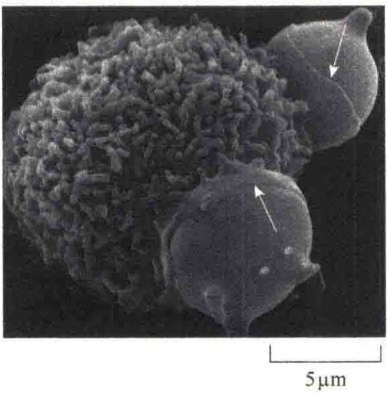

高水与酸的排泄，二者都是信号反应的结果。

## 10.5.4 吞噬细胞的吞噬

吞噬作用（phagocytosis）又称胞吃（cellular eating）。吞噬是一种特殊形式的内吞作用，吞入物通常是较大的颗粒，如微生物、死亡的细胞或细胞残片；形成的内吞泡叫吞噬体（phagosome），直径一般大于250nm。吞噬作用只限于几种特殊的细胞类型，如变形虫（amoeba）和一些单细胞的真核生物通过吞噬作用从周围环境中摄取营养。

在大多数高等动物细胞中，吞噬作用是一种保护措施而非摄食的手段。高等动物具有一些特化的吞噬细胞，包括巨噬细胞和中性粒细胞。它们通过吞噬作用摄取和消灭感染的细菌、病毒，以及损伤的细胞、衰老的红细胞等（图 10-48）。

图 10-48 正在吞噬衰老红细胞的巨噬细胞（引自 Alberts et al., 2015）。吞噬作用形成的内吞泡叫吞噬体。吞噬是一种需信号触发的过程。被吞噬的颗粒必须与吞噬细胞的表面结合，但并不是能结合的颗粒都能够被吞噬。吞噬细胞表面有特化的受体，被激活的受体向细胞内传递吞噬信号。

## 10.5.5 吞饮作用

吞饮作用（pinocytosis）又称胞饮作用（cellular drinking），是胞吞作用的一种类型，它是一种非选择性的连续摄取细胞外基质中液滴的内吞过程。吞入的物质通常是液体或溶解物，所形成的小囊泡的直径小于150nm。吞饮作用通常是从质膜上特殊区域开始的，形成一个小窝，最后形成一个很薄且没有外被包裹的膜泡。细胞外基质中存在的任何分子和颗粒都可以通过胞饮作用被细胞吞入。根据细胞外物质是否吸附在细胞表面，将吞饮作用分为两种类型:一种是液相内吞（fluid-phase endocytosis），这是一种非特异性的固有内吞作用，通过这种内吞作用，细胞把细胞外液及其中的可溶物摄入细胞内；另一种是吸附内吞（absorption endocytosis），在这种吞饮作用中，细胞外大分子和（或）小颗粒物质先以某种方式吸附在细胞表面，因此具有一定的特异性。

大多数细胞都能连续地进行吞饮作用。

## 10.6 膜的动态更新

关于细胞质膜及内膜系统的膜是怎样合成的，曾提出两个模型。一个是自装配模型（spontaneous self-assembly），是指膜利用已有的材料装配合成。为了验证这一模型，用纯化的脂和蛋白质在体外装配时总是形成脂质体，这种脂质体与活细胞膜的一个根本区别是:脂质体总是对称的，而活细胞中膜结构则是不对称的。另一个模型是膜的合成通过不断地将脂和蛋白质插入已有的膜，即由已有的膜生长而来。由于是将脂或蛋白质插入已有的膜上，插入的方式就可以有选择地在膜的一侧或另一侧插入，从而保证了膜结构的不对称性。由于细胞的内吞和分泌作用以及膜泡的转运与融合，使膜处于动态平衡状态，这样膜也就不必重新合成，而是在原有的基础上不断更新。

## 10.6.1 膜脂的来源及不对称性分布

大多数磷脂是在内质网上合成的，可通过两种途径运送给膜性细胞器。第一种途径是通过磷脂转运蛋白，如线粒体、叶绿体、过氧化物酶体等细胞器膜中的脂就是靠这种方式运送的。第二种途径是通过出芽和膜融合，如内质网通过出芽形成分泌小泡运送蛋白质时，膜脂也随之运送到高尔基体，并通过高尔基体形成分泌小泡将膜脂运送到细胞质膜。由于内质网与核膜相连，通过细胞分裂和核膜重建，内质网上合成的膜脂也就被转移到核膜。原核生物没有内质网，它的磷脂是在质膜上合成并由类似于真核生物的转位蛋白调整磷脂在膜上的分布。

如何保持磷脂在膜上的不对称性分布，有几种解释:第一种解释是磷脂交换蛋白对磷脂的运输和插入是选择性的；第二种解释是热动力驱使磷脂的不对称分布，因为膜两侧的环境不同。另外，在内质网膜中有翻转酶，在新的磷脂合成之后，通过翻转酶的作用也会造成磷脂的不对称分布。

## 10.6.2 膜蛋白的更新

我们已经讨论过细胞质膜中有大量的蛋白质，不仅存在方式不同，而且功能各异，有物质运输作用、连接作用或信号转导作用等，因此，蛋白质是膜功能的执行者。由于膜脂是不断更新的，因此，膜蛋白也必然是不断更新的。

## 10.6.2.1 膜整合蛋白和外周蛋白的形成

就蛋白质在膜上的存在方式来说有三种可能，即整合蛋白、外周蛋白和脂锚定蛋白。细胞内蛋白质是在附着核糖体或游离核糖体上合成的，合成的蛋白质通过信号序列被定位到不同的膜性细胞器上。问题是，整合蛋白具有方向性，外周蛋白有膜内、外两侧的分布问题，它们是如何形成的？

用水疱性口炎病毒（VSV）作为模式系统研究了细胞膜整合蛋白和外周蛋白的形成途径。VSV有两种膜蛋白:一种是M蛋白，属于外周蛋白；另一种是VSV糖蛋白，属于膜整合蛋白。用放射性的氨基酸标记蛋白质，然后研究新合成蛋白质的去向，发现M蛋白是在游离核糖体上合成，并以可溶的形式释放到胞质溶胶中，然后再与细胞质膜的胞质溶胶面结合，成为外周蛋白。根据这一发现推测膜内侧的外周蛋白可能都是以这种方式合成并与质膜结合。与M蛋白不同的是，VSV糖蛋白在内质网上合成并插入到内质网的膜中，随小泡转运经高尔基体加工，最后转运到质膜。

膜整合蛋白的运输是通过组成型分泌方式运送到细胞质膜的，由于膜整合蛋白没有溶酶体酶蛋白的特殊信号，所以在加工运输过程中不会被包装到溶酶体或其他调节型的分泌小泡中。另外，膜整合蛋白中的糖蛋白的糖是在内质网腔中添加的，所以在整个小泡运输过程中，糖基都位于腔面，但与质膜融合时，通过外翻，糖的部分位于细胞质膜的外侧。这就是为什么几乎所有质膜上的糖蛋白的糖都是朝向细胞外的原因。

## 10.6.2.2 脂锚定蛋白的形成

蛋白质通过与膜脂的结合成为脂锚定蛋白，有两种可能的机制。

1）糖脂锚定膜蛋白的形成 细胞质膜外的一些蛋白质是与糖基磷脂酰肌醇（GPI）共价结合的，属于这种类型的脂锚定蛋白是在附着核糖体上合成，然后在内质网腔中被连接到内质网膜的GPI上，随后通过小泡运输，经高尔基体出芽形成小泡，最后与质膜融合，含糖的一面外翻朝向细胞外侧。

2）脂肪酸锚定膜蛋白的形成 此类膜蛋白通过与脂肪酸链的共价结合被锚定在质膜的细胞质面。连接的脂肪酸包括豆蔻酸（myristic acid，一种十四碳的饱和脂肪酸）和棕榈酸（palmitic acid，一种十六碳的饱和脂肪酸）。此类蛋白质是水溶性的，在游离核糖体合成后释放到胞质溶胶中，然后才与质膜中的脂肪酸共价结合。

## 本章小结

细胞将在内质网上合成的蛋白质通过运输小泡运向高尔基体及其他膜结构的过程称为细胞分泌, 若是与质膜融合将小泡内的物质释放到细胞则称为胞吐作用。分泌过程分为三个阶段, 涉及三种不同的细胞器和细胞结构: 内质网、高尔基体、细胞质膜。

分泌过程中伴随着蛋白质的加工与分选，如溶酶体的酶蛋白就是在顺面高尔基网中进行了磷酸化修饰，使其带上M6P标记，从而在反面高尔基网被M6P受体识别达到将溶酶体分选出来的目的。同时内质网与高尔基体都有防范其驻留蛋白“外逃”机制。

细胞的分泌活动可分为组成型和调节型两种。前者不需任何信号触发，后者则相反。

根据外被蛋白质的不同，将运输小泡分为:网格蛋白有被小泡、COPⅡ有被小泡和COPⅠ有被小泡。网格蛋白有被小泡的形成需网格蛋白、衔接蛋白和发动蛋白的参与。COPⅠ有被小泡的形成需装配因子ARF和多种包被蛋白复合物的参与。COPⅡ有被小泡的外被蛋白与COPⅠ相似但不相同，构成的亚基有Sec23/Sec24、See13/See31、Sec16等复合物。COPⅡ有被小泡的装配需要的GTPase是Sar1。

内吞作用可分为吞噬作用、吞饮作用和受体介导的内吞作用。有三种不同的内吞途径，包括依赖于网格蛋白的受体介导的内吞、依赖于窖蛋白的内吞，以及独立于网格蛋白与窖蛋白的内吞。受体介导的内吞作用的典型例子是低密度脂蛋白和运铁蛋白结合铁离子的内吞运输。

内吞的膜蛋白在信号的诱导下进行分选。经泛素标记、ESCRT 蛋白复合物的介导，要被降解的蛋白

## 细胞生物学（第二版）

质被分选进入多泡体中的腔内泡，最后被降解，而质膜中的工作蛋白则返回质膜循环使用。

内体是一种动态结构，细胞分泌与内吞都会形成内体。内体分为早期内体与晚期内体。

膜的合成是通过不断地将脂和蛋白质插入已有的膜。磷脂的插入是通过磷脂转运蛋白，或通过出芽和膜融合。膜整合蛋白来源于糙面内质网，细胞内侧的外周蛋白则是由游离核糖体合成的。

## 思考题

（1）简述网格蛋白有被小泡、COP有被小泡是如何进行装配的？

（2）LDL受体胞质面结构域突变将会引起家族性高胆固醇血症，这与受体介导的LDL的内吞有什么关系？

（3）举例说明内质网驻留蛋白“逃逸”后如何被召回？

（4）试述溶酶体的发生过程。该过程的关键事件是什么？

（5）Rab蛋白在小泡定位运输中有什么作用？