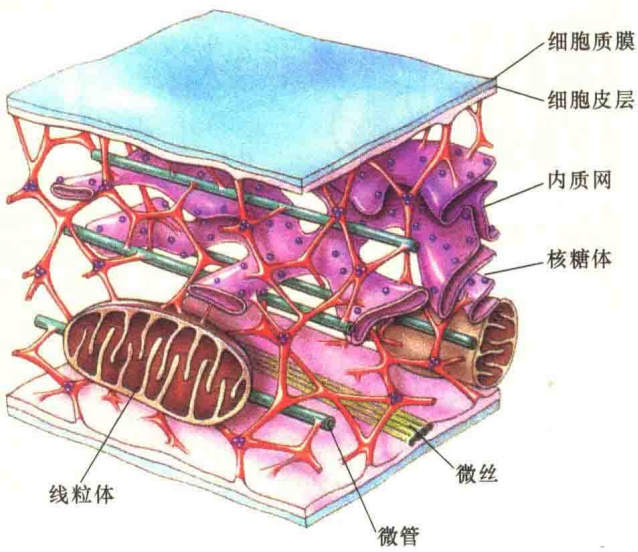
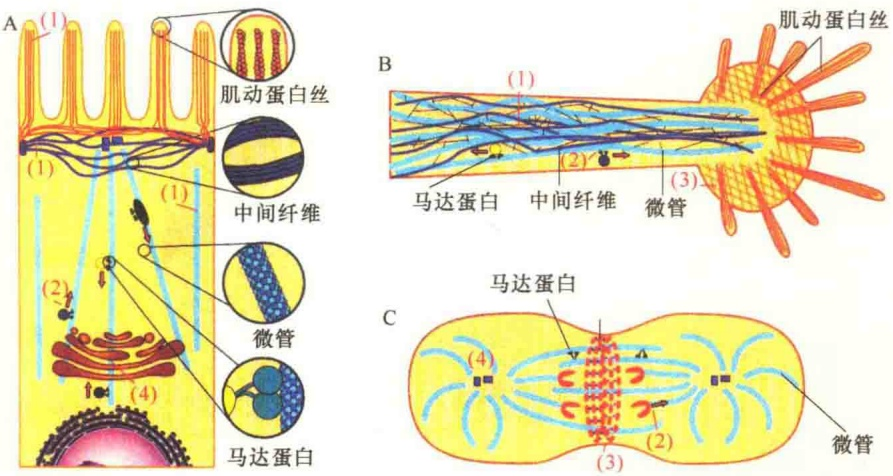
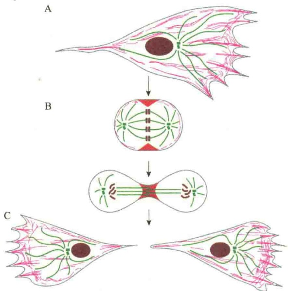
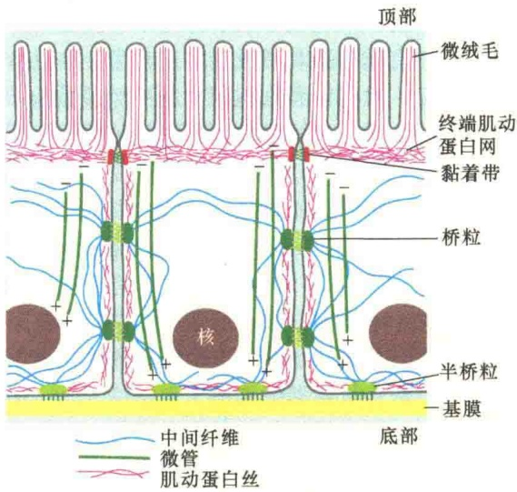

## | 细胞骨架 |

- 11.1 细胞骨架概述
- 11.1.1 细胞骨架的组成和分布
- 11.1.2 细胞骨架的功能
- 11.1.3 细胞骨架的特性
- 11.2 微管
- 11.2.1 微管的结构和类型
- 11.2.2 微管装配的动力学
- 11.2.3 微管结合蛋白
- 11.2.4 微管马达蛋白
- 11.2.5 微管的作用
- 11.2.6 微管与有丝分裂
- 11.3 微丝
- 11.3.1 微丝的化学组成与分布
- 11.3.2 微丝装配的动力学
- 11.3.3 微丝结合蛋白
- 11.3.4 肌球蛋白:基于肌动蛋白的马达蛋白
- 11.3.5 肌细胞:特化的肌收缩功能
- 11.3.6 肌动蛋白和肌球蛋白在非肌细胞中的作用
- 11.3.7 微丝的其他功能
- 11.4 中间纤维与隔蛋白纤维
- 11.4.1 中间纤维蛋白的形态结构与类型
- 11.4.2 中间纤维的装配及动态性
- 11.4.3 中间纤维结合蛋白
- 11.4.4 中间纤维的功能
- 11.4.5 隔蛋白

细胞分泌活动与内吞作用产生的小泡不仅数量巨大，而且“来去匆匆”，这些小泡是如何“漂洋过海”快速到达目的地？不难想象，细胞一定具有错综复杂而又非常发达的交通网络系统。“路通财通”“要致富先修路”，细胞同样如此！另外，细胞每时每刻都在演绎着美丽的生命华章，各种细胞结构与蛋白质都需要有自己施展“才艺”的“舞台”与“空间”，因此细胞一定是规划有序的立体结构，不仅如此，随着细胞周期的变化，细胞经历由小到大，由大变小的往复运动，细胞内的“空间舞台”又必须能够快速安装与拆卸。此外，细胞也不是完全固守一方的，有时必须通过形态的变化从一个地方移向另一个地方，细胞内必须有支持细胞移动而又不导致细胞“散架”的刚性支架！

随着电子显微镜和各种染色技术的发展，揭示细胞除了含有各种各样的膜性细胞器外，在细胞质中还有一个三维的网络结构系统（图 11-1），这个系统被称为细胞骨架（cytoskeleton）。细胞骨架是细胞内最重要的基础设施，编码细胞骨架蛋白的基因也是最为稳定的。

图 11-1 细胞骨架维持细胞的三维结构（引自 Raven and Johnson, 1992）。

## 11.1 细胞骨架概述

细胞除了具有遗传和代谢两个主要特性之外，还有两个特性，就是它的运动性形态的稳定性。细胞的运动是生物进化的重要成就。初始的细胞可能是不动的，只能靠气流带动迁移。随着多细胞生物的进化，形成了可运动的器官。在成年的生物体内，仍有细胞是运动的，如保卫细胞要消灭外来生物的感染，必须能够主动出击。

体内的大多数细胞是稳定的，但是形态要发生很大的变化，如肌细胞的收缩、神经轴的伸长、细胞表面突起的形成、细胞有丝分裂时的缢缩等。大多数运动是发生在细胞内的，如染色体分离、胞质环流和小泡运输等。细胞内外的运动性是生长和分化的基本要素，并且是受严格控制的。细胞所有运动都是机械运动，需要燃料（ATP）和蛋白质装置，将贮存在ATP中的能量转变成动力。细胞骨架是细胞运动的轨道，也是细胞形态维持和变化的支架。

为主要成分的网络结构，主要由三类蛋白质丝构成，包括微管、微丝[又称肌动蛋白丝（actin filament）]、中间纤维（又称中间丝）。每一种蛋白质丝都是由不同的蛋白质亚基组成，如微管蛋白是微管的亚基，肌动蛋白是微丝的亚基，而中间纤维则是由一类丝状蛋白家族组成。各种蛋白质丝都是由上千个亚基装配成线性结构，有时交叉贯穿在整个细胞之中。

## 11.1.1 细胞骨架的组成和分布

微管主要分布在细胞核周围，并呈放射状向胞质四周扩散。微丝主要分布在细胞质膜的内侧，而中间纤维则分布在整个细胞中。虽然各种蛋白质丝在细胞内具有相应的位置，但不是绝对的。在细胞周期的不同时相，各类骨架的分布与功能也发生变化（图 11-2）。

## 11.1.2 细胞骨架的功能

从图 11-2 可以看出，细胞骨架对于维持细胞的形态结构和内部结构的有序性，以及物质运输、细胞运动、信息传递和细胞分裂等方面具有重要作用。

细胞骨架是细胞内以蛋白质丝（protein filament）

1）作为动态的支架（scaffold），细胞骨架为维持细胞的形态提供支持结构。例如，红细胞质膜的胞质面有一个以肌动蛋白丝为主要成分的皮质骨架结构维持着红细胞质膜，这种支架具有对抗外力、维持细胞形态的相对稳定的作用。

图 11-2 细胞骨架的三类主要组成成分及其分布与功能（引自 Karp，2010）。图示上皮细胞（A）、神经细胞（B）及分裂细胞（C）中的细胞骨架分布。在上皮细胞与神经细胞中，细胞骨架的作用是对细胞的立体结构起支撑作用，并且在细胞器的运输中起重要作用。在分裂的细胞中，微管组成的纺锤体及肌动蛋白丝构成的缢缩环将母细胞均等分裂成两个大小、功能相同的子细胞。中间纤维为上皮细胞与神经细胞提供结构支持。微丝为上皮细胞提供微绒毛，并且是神经细胞伸长与分裂装置的组成部分。图中（1）表示结构与支持作用；（2）表示细胞内的运输；（3）收缩与运动；（4）空间组织（spatial organization）。

2）细胞骨架在细胞内形成一个框架（framework），为细胞内的各种细胞器提供附着位点。胞质溶胶中具有各种功能不同的细胞器，而且每种细胞器的数量又多，如果这些细胞器都漂浮在胞质溶胶中，作用时势必会互相干扰，细胞骨架为这些细胞器提供附着位点，让它们有各自的空间定位。在这个意义上说，细胞骨架是胞质溶胶的组织者，将细胞内的各种细胞器组成各种功能体系与区域网络。

3）细胞骨架为细胞内的物质和细胞器的运输及运动提供轨道网络。例如，从内质网产生的小泡向高尔基体的运输，由内吞作用形成的内吞泡向溶酶体的运输等通常都是以细胞骨架作为轨道的；在有丝分裂和减数分裂过程中，染色体向两极的移动、含有神经细胞产生的神经递质的小泡向神经细胞末端的运输都要依靠细胞骨架提供的运输轨道网络。

4）细胞骨架是细胞从一个位置向另一位置移动的动力装置（force-generating apparatus）。一些单细胞的生物能够借助于由微管组成的特别器官——鞭毛和微绒毛通过在固体支持物的表面爬行（crawling），或在水性环境中螺旋前进。多细胞的动物含有许多可运动的细胞，包括精子、白细胞等，它们的运动也是由细胞骨架提供力的支撑。有些利用细胞骨架形成假足，进行类似爬行的运动。

5）细胞骨架为信使 RNA 提供锚定位点，促进 mRNA 的翻译。用非离子去垢剂提取细胞成分可发现细胞骨架相当完整，许多与蛋白质合成有关的成分与不被去垢剂溶解的细胞骨架结合在一起。

6）细胞骨架参与细胞的信号转导。有些细胞骨架成分常与细胞质膜的内表面接触，这对于细胞外环境中的信号在细胞内的转导有重要作用。

7）细胞骨架可装配成细胞分裂的装置。有丝分裂的两个主要事件——核分裂和胞质分裂都与细胞骨架有关，细胞骨架中的微管通过形成纺锤体将染色体分开，而肌动蛋白丝则将细胞一分为二。

细胞骨架的字面意思往往会给人以错觉，认为它是不动的框架结构。其实，它与人类社会所见所闻的框架意义完全不同。首先，细胞骨架不是惰性结构，而是一种高度动态的组织，它们的装配、去装配和再装配都很快。其次，在细胞骨架的诸多功能中，最基本的两个功能是使细胞维持一定的形态和使细胞具有运动的能力，包括机体的运动和细胞器的移动，其他作用都是在这两个功能的基础上拓展的，而细胞骨架的动态性质则是最重要的。

另外，细胞骨架在起作用时需要一些相关蛋白质的参与，这些蛋白质虽然不属于细胞骨架的组成部分，但是对于细胞骨架行使功能具有重要作用。

## 11.1.3 细胞骨架的特性

除了上面讨论的细胞骨架的基本功能外，三类骨架成分各有一些不同的特性，表 11-1 列出了细胞骨架三类蛋白质丝的一些特性。

表 11-1 微管、中间纤维与肌动蛋白丝的特性

| 特性 | 微管 | 中间纤维 | 肌动蛋白丝 |
| --- | --- | --- | --- |
| 装配亚基 | GTP-αβ微管蛋白异二聚体 | 约70种不同的蛋白质 | ATP-肌动蛋白单体 |
| 掺入位点 | +端 | 内部 | +端 |
| 极性 | 有 | 无 | 有 |
| 酶活性 | GTPase | 无 | ATPase |
| 马达蛋白 | 驱动蛋白,动力蛋白 | 无 | 肌球蛋白 |
| 主要结合蛋白 | 微管结合蛋白 | 斑蛋白 | 肌动蛋白结合蛋白 |
| 结构 | 硬的、不能伸展的中空管 | 可伸展的柔性纤丝 | 柔性不伸展的螺旋纤丝 |
| 直径 | 外径25nm | 直径10~12nm | 直径8nm |
| 分布 | 所有的真核生物 | 动物 | 所有的真核生物 |
| 基本功能 | 支架,胞内运输,细胞组织 | 结构支持 | 运动,收缩 |
| 亚细胞分布 | 细胞质 | 细胞质+细胞核 | 细胞质 |

## 11.1.3.1 动态性与稳定性

由于细胞生命是周期性的，所以细胞骨架系统最重要的特性就是动态性与稳定性。动态性体现在细胞骨架系统必须随着细胞周期的变化进行快速的组装与去组装；稳定性体现在，作为细胞生命活动的基础设施，必须确保生命活动的需要，相对稳定地存在。例如，在细胞周期的间期，生命的主要活动是DNA的复制与蛋白质的合成，这个时期持续的时间较长，为确保新合成蛋白质快速、准确运输，需要完善的交通运输网络。此外，从细胞外摄取的营养物需要快速转运给溶酶体消化，也需要稳定的运输网络。而在细胞分裂期，生命的主要活动是形成两个大小相近、功能相同的子代细胞，于是需要一套细胞分裂的装置，这种装置的构件是细胞骨架蛋白，此时细胞骨架的工作重点是形成纺锤体及收缩环将细胞均等分裂，也就是说，细胞进入分裂前，细胞骨架必须快速调整，组装成细胞分裂装置（图 11-3）。

图 11-3 极性成纤维细胞周期中细胞骨架装置的变化（引自 Alberts et al., 2015）。A. 在细胞间期，微管与肌动蛋白都是装配成纤丝网络，一方面作为支架维持细胞的形态，另一方面作为运输网络保证物质运输的畅通；B. 进入分裂期，微管与肌动蛋白组装成分裂装置，参与细胞分裂；C. 形成两个新细胞后，微管与肌动蛋白又装配成纤丝网络。

## 11.1.3.2 骨架网络的整体性

细胞内不仅有众多结构与功能不同的细胞器，还有很多南来北往的“货物”运输，需要细胞进行科学规划与巧妙组织；另外，细胞还要妥善处理相邻细胞的关系，以及决定细胞的极性，这些都有赖于一个完整的骨架网络体系提供结构保障。

首先，细胞骨架系统组成细胞的空间网络结构，并具有较强的抗压能力，确保细胞不会“坍塌”，各种细胞器被骨架系统隔离开，有各自的工作区域，既相对独立又相互合作。其次，微管担任细胞核的保护工作，而肌动蛋白丝与中间纤维通过细胞的锚定连接，使同类细胞形成组织。对于“边远”地区的细胞，细胞骨架系统通过紧密连接，决定了细胞的极性，确保物质单向运输。另外，由细胞骨架系统组成的微绒毛为细胞提供了运动装置；更为巧妙地是，很多细胞质膜的内侧面，由肌动蛋白丝等组装成的皮质骨架增加了细胞质膜的硬度（图 11-4）。

## 11.1.3.3 骨架纤维的可装配性与刚性

细胞骨架的稳定性与动态性是为了适应细胞生命周期变化的需要，那么，细胞骨架的稳定性与动态性是如何实现的？根本原因是骨架纤丝的可装配性，也就是说，细胞骨架是可以组装与拆卸的，长的纤丝是由小的基本构件装配而成，这是细胞骨架最为美妙之处！更令人叹为观止的是，装配与拆卸是可以调节的，按指令行事，令行禁止！

图 11-4 极性上皮细胞中细胞骨架网络（引自 Alberts et al., 2015）。上皮细胞中骨架系统通力合作规划并决定了上皮细胞的特殊形态。肠上皮是面向肠的腔，为了更好地从食物中吸收营养，由肌动蛋白丝组成微绒毛，增加了细胞的表面积；在微绒毛的下方，由肌动蛋白通过细胞间的黏着连接，形成肌动蛋白网，将细胞相互锚定在一起。中间纤维通过桥粒及半桥粒将细胞-细胞、细胞-细胞外基质锚定起来。微管则从顶部贯通到底部，为新合成的物质运输提供了通路。

在三种细胞骨架纤丝中，微管与微丝是随时可以拆卸的；中间纤维则比较稳定，但也并非不能拆卸，需要时，中间纤维也可被快速去装配，如在细胞分裂的核分裂阶段，通过激酶对亚基的磷酸化，使核纤层快速去装配。

微管可以从细胞的一端延伸达另一端，跨度有时高达几百微米，但是，构成微管构件的微管蛋白二聚体的大小仅有几个纳米。正是由于微管蛋白二聚体的体积小，可以在细胞内快速扩散，省去了搬运之力，方便了纤丝在一端装配，而在另一端拆卸，也保证了在需要的地方装配，在不需要的地方拆卸。如在有丝分裂中，动粒微管的快速去装配，确保了姐妹染色单体的正确分离。

微管与微丝两端是不对称的，在装配中，它们的亚基是头-尾结合，指向同一个方向，因此赋予纤丝极性，也导致两端装配速率与特性的不同，并因此导致运输方向的不同。此外，构成微管与微丝的亚基都具有核苷水解酶的活性，分别水解 GTP 与 ATP，并且利用 GTP 与 ATP 水解释放的能进行纤丝的快熟重塑。与微管与微丝不同的是，中间纤