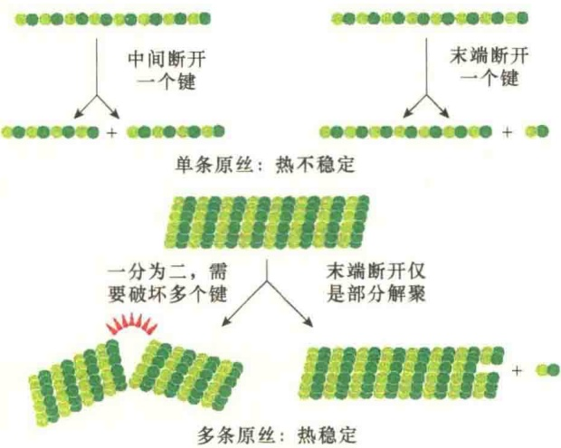
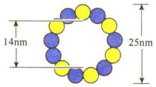
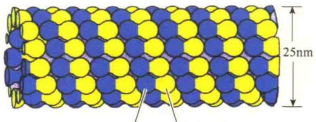
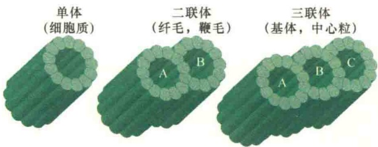
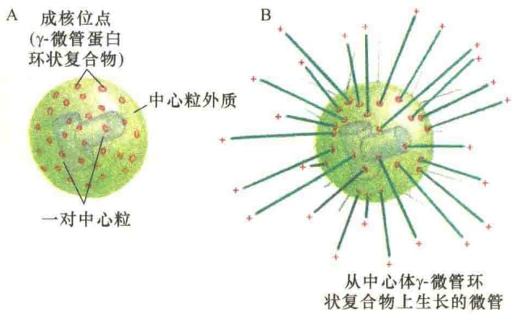
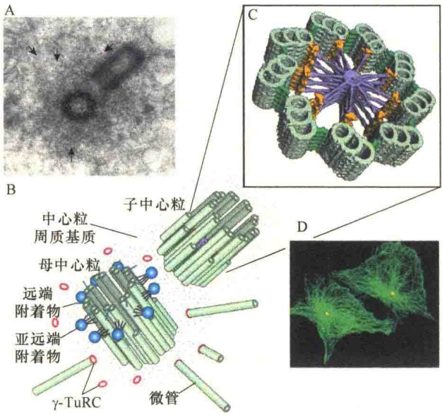
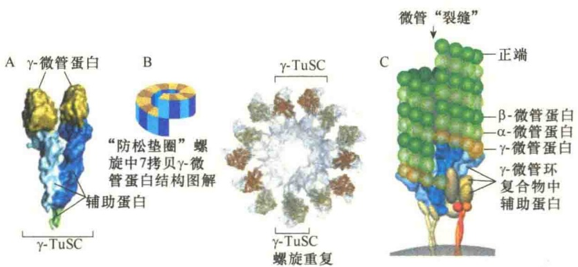

维是没有极性的，两端是对称的，并且也没有水解酶的活性。

虽然细胞骨架纤丝能够快速装配与去装配，但也不是想装配就装配，想拆开就拆开的。装配过程并非是亚基的随便堆砌就可以的，必须符合热力学规律，亚基之间的结合必须非常紧，而且具有一定的硬度强度。由于微管在细胞内作为运输大动脉，并且在细胞分裂中负有重要的使命，为了有足够的强度，微管的装配经过特别的设计，由13条原丝（protofilament）亚基装配成中空的微管，不仅承载力大，而且热力学稳定性好，极大地提高了刚性强度（图11-5）。

图 11-5 微管单条原丝与微管的热力学稳定性比较（引自 Alberts et al., 2015）。仅由亚基构成的单条原丝是热不稳定的，因为使单个亚基间的键断裂的力足以造成原丝的断裂。而由 13 条原丝组成的微管，虽然末端可以发生解聚，但要使其从中间断裂是比较困难的，刚性有极大地提高。

虽然肌动蛋白丝比较细，使其断裂的力也比较小，但是，在细胞内肌动蛋白常常由很多条肌动蛋白丝在一起组成肌动蛋白丝束，具有很高的强度，这就是“团结力量大”的道理。

就中间纤维而言，既没有微管那样“粗壮强悍”，也没有肌动蛋白丝成束的特性，靠什么维持热力学稳定呢？靠的是蛋白质之间相互作用，包括疏水作用和非共价键间的相互作用。中间纤维是由32条纤丝分段交错而成的长纤丝，32条纤丝又是4个一组、共8组靠非共价作用组合到一起的，这种较强的、似杆状的结构，使其既具有强度，又具有可弯曲的韧性，与微管和肌动蛋白丝相媲美。

## 11.1.3.4 结构与功能的可调节性

细胞能够调节细胞骨架纤丝的长度、稳定性、数量，以及在细胞内的空间分布，并且通过对纤丝之间的附着，或是纤丝与细胞器的附着，使得细胞骨架纤丝在细胞内形成一个高度有序而又多变的网络结构。细胞内几百种辅助蛋白通过对细胞骨架的调节作用，决定了纤丝的空间分布、动态性质，以及通过信号转导改变细胞骨架的作用。辅助蛋白通过与纤丝或亚基的结合，决定着新纤丝的装配地点、调节纤丝与亚基间的空间分布、改变纤丝装配与去装配的动力学、提供产生力的能量，以及将纤丝与纤丝之间连接，或是将纤丝与其他的细胞器或细胞质膜连接。通过上述作用，辅助蛋白将细胞骨架的行为控制在细胞内外的信号调控之中，包括细胞周期调控信号对细胞骨架行为的调控。

在与细胞骨架结合的辅助蛋白中有一类称作马达蛋白（motor protein）。此类蛋白质与极性细胞骨架纤丝结合，利用ATP水解提供能量沿骨架纤丝做直线移动。真核细胞中有很多种不同的马达蛋白，与极性纤丝结合担负着运输任务，包括膜性细胞器的运输，如溶酶体、线粒体、分泌泡及高尔基潴泡的运输。马达蛋白还参与肌收缩的滑动、细胞分裂及鞭毛运动。正是这些与细胞骨架结合的马达蛋白的作用，使细胞骨架的作用能够更好地发挥。

## 11.1.3.5 化学抑制剂

虽然细胞骨架纤丝在细胞辅助蛋白及发动蛋白的帮助下，在细胞内发挥重要作用，但有些化学物质与细胞骨架纤丝结合后会抑制细胞骨架的作用，这些化学物质包括与微管、肌动蛋白结合的化学抑制剂（表11-2）。其抑制作用包括影响纤丝的稳定性，抑制聚合作用或是抑制去聚合。事物都是一分为二的，化学物质对细胞骨架稳定性的影响，为我们研究细胞骨架提供了有利的工具。

表 11-2 微管、肌动蛋白的化学抑制剂

<table><tr><td>化学物质</td><td>对纤丝的影响</td><td>机制</td><td>来源</td></tr><tr><td colspan="4">微管</td></tr><tr><td>紫杉醇</td><td>稳定作用</td><td>沿纤丝结合</td><td>紫杉树</td></tr><tr><td>诺可唑</td><td>去聚合作用</td><td>与微管蛋白亚基结合</td><td>合成物</td></tr><tr><td>秋水仙素</td><td>去聚合作用</td><td>在纤丝两端加帽</td><td>秋水仙</td></tr><tr><td colspan="4">肌动蛋白</td></tr><tr><td>红海海绵素</td><td>去聚合作用</td><td>与肌动蛋白亚基结合</td><td>海绵</td></tr><tr><td>细胞松弛素B</td><td>去聚合作用</td><td>纤丝(+)端加帽</td><td>真菌</td></tr><tr><td>鬼笔环肽</td><td>稳定作用</td><td>沿纤丝结合</td><td>鬼笔鹅膏覃</td></tr></table>

## 11.2 微管

微管（microtubule，MT）是细胞质骨架系统中的主要成分，1963年首先在水螅细胞中发现，同年，在植物中也发现了微管。

所有的真核细胞中都有微管蛋白，并且以多种异构体存在。酵母与人的微管蛋白在氨基酸组成上有 $75\%$ 是相同的。在哺乳动物细胞中，至少有6种 $\alpha$-微管蛋白及近似数量的 $\beta$-微管蛋白，每一种都是由不同基因编码。不同类型的微管蛋白非常相似，在试管中混合可聚合成混合微管。但是，它们在细胞与组织中的定位不同，因而具有不同的功能。例如，人的一种特异 $\beta$-微管蛋白基因的突变，使得眼睛神经功能丧失，导致眼睛移动功能瘫痪。还有很多人的神经疾病也与特异的微管蛋白基因突变相关。

## 11.2.1 微管的结构和类型

微管是直径为 24～26nm 的中空圆柱体，外径平均为 25nm，内径为 14～15nm。微管的长度变化不定，在某些特化细胞中，微管可长达几厘米（如中枢神经系统的运动神经元）。微管壁大约厚 5nm，微管通常是直的，但有时也呈弧形。细胞内微管呈网状和束状分布，并能与其他蛋白质共同组装成纺锤体、基体、中心粒、纤毛、鞭毛、轴突、神经管等结构。

## 11.2.1.1 微管蛋白

微管是以微管蛋白（tubulin）异源二聚体为基本构件，每个微管蛋白二聚体头尾相接，形成细长的原丝（protofilament），13条这样的原丝纵向排列组成微管的壁（图11-6）。

组成微管的亚基是  $\alpha$ -微管蛋白（ $\alpha$ -tubulin）和  $\beta$ -微管蛋白（ $\beta$ -tubulin）二聚体，这两种微管蛋白具有相似的三维结构，能够紧密地结合成二聚体，作为微管装配的亚基。

α-微管蛋白和β-微管蛋白都由450个氨基酸组成，它们的分子质量约55kDa。这两种亚基有35%～40%的氨基酸序列同源，表明编码它们的基因可能是由同一原始祖先演变而来。另外，这两种微管蛋白与细菌中一种叫做FysZ的GTPase（分子质量为40kDa）同源，这种酶具有与微管蛋白相似的功能，能够聚合并且参与细胞分裂。

β-微管蛋白 α-微管蛋白

图 11-6 微管的结构（引自 Cooper and Hausman, 2013）。

α-微管蛋白和β-微管蛋白都是直径为4nm的球形分子，所以这种异源二聚体的长度为8nm。

每一个微管蛋白二聚体有两个 GTP 结合位点:一个位于  $\alpha$  亚基，是不可逆的 GTP 结合位点，结合上去的 GTP 不能被水解，也不能被 GDP 替换；另一个位于  $\beta$  亚基上，结合在该位点上的 GTP 能够被水解成 GDP，所以这个位点又称为可交换位点（exchangeable site，E 位点）。

## 11.2.1.2 微管的类型

微管的存在方式有单体、二联体和三联体，它们存在的部位是不同的（图 11-7）。

图 11-7 三种微管及排列方式、存在部位（引自 Lodish et al., 2013）。

在多数情况下，微管都是以简单的单体（singlet）存在，大部分细胞质微管是单体微管，它在低温、 $Ca^{2+}$ 和秋水仙素作用下容易解聚，属于不稳定微管。虽然绝大多数单体是由13条原丝组成的一个管状结构，但在极少数情况下，也有由11条或15条原丝组成的微管，如线虫神经节微管就是由11条或15条原丝组成的。

二联体（doublet）是构成纤毛和鞭毛的周围小管，是运动类型的微管，它对低温、 $Ca^{2+}$ 和秋水仙素都比较稳定。组成二联体的单管分别称为A管和B管，其中A管是由13条原丝组成，B管是由10条原丝组成，所以二联体是由两个单体融合而成的，一个二联体只有23条原丝。

三联体（triplet）见于基体（basal body）、中心粒（centriole），由A、B、C三个单管组成，A管由13条原丝组成，B管和C管都是10条原丝，所以一个三联体共有33条原丝。三联体对于低温、$\mathrm{Ca^{2+}}$ 和秋水仙素的作用是稳定的。

根据微管的稳定性，可将其分成两类:稳定的长寿微管和动态的短寿微管。当微管的结构需要快速装配和去装配的时候，微管就是动态的。例如，细胞在有丝分裂开始时，纺锤体的快速形成即是微管的装配，在有丝分裂结束时，纺锤体的消失就是细胞质微管的快速去装配，所以纺锤体微管是动态的短寿微管。在一些不进行复制的细胞中含有稳定长寿的微管结构，如纤毛中的微管束结构。

## 11.2.2 微管装配的动力学

除了特化细胞的微管外，大多数细胞质微管是不稳定的，能够快速地装配（assembly）与去装配（disassembly）。用低温、高  $Ca^{2+}$  浓度、某些化学试剂处理培养的细胞都会影响细胞质微管的动态性。这些化学试剂与微管蛋白亚基或微管纤丝结合，阻止微管的装配与去装配。

## 11.2.2.1 微管组织中心

存在于细胞质中决定微管在生理状态或实验处理解聚后重新装配的结构叫微管组织中心（microtubule organizing center，MTOC）。在多数情况下 MTOC 是一种中心体，但是某些表皮细胞和新受精的卵细胞有很多 MTOC，它们看起来并不像中心体。尽管如此，在有丝分裂中，仍将中心体看成是微管形成的组织者。

MTOC 的主要作用是帮助大多数细胞质微管装配过程中的成核反应。微管从 MTOC 开始生长，这是细胞质微管装配的一个独特的性质，即细胞质微管的装配受统一的功能位点控制（图 11-8）。

中心体（centrosome）是动物细胞中决定微管形成的一种细胞器，包括中心粒和中心粒周质基质（pericentriolar matrix）。在细胞间期，位于细胞核的附近；在有丝分裂期，位于纺锤体的两极。

中心粒是中心体的主要结构，成对存在，即一个中心体含有一对中心粒，且互相垂直形成“L”形排列。中心粒直径为 $0.2\mu \mathrm{m}$，长为 $0.5\mu \mathrm{m}$，是中空的短圆柱状结构。圆柱的壁由9套间距均匀的三联体组成，三联体是由3个微管组成，每个微管包埋在致密的基质中。9套三联体串联在一起，形成一个齿轮状环形结构（图11-9）。

图 11-8 中心体（引自 Alberts et al., 2015）。A. 动物细胞中主要的微管组织中心——中心体，其内有一对中心粒，周围有很多微管成核反应的位点。该位点的主要成分是 γ- 微管蛋白及辅助蛋白组成的环状复合物。B. 从中心体 γ- 微管蛋白环状复合物上生长出很多微管，（+）端朝向中心体外侧，（-）端被埋在了中心体内。

中心体并非是唯一的 MTOC，基体是纤毛和鞭毛的微管组织中心，不过基体只含有一个中心粒而不是一对中心粒。其他类型的细胞具有不同类型的 MTOC，如真菌的细胞有初级 MTOC，称为纺锤极体（spindle pole body）。

图 11-9 中心粒结构（引自 Lodish et al., 2016）。A. 动物细胞中心体超薄切片电镜照片，显示两个以直角方式排列的中心粒，每个中心粒被中心粒周质基质包围。B. 一对中心粒中，一个是母中心粒，另一个是子中心粒，每个中心粒都是由 9 套三联管组成。中心粒旁质中有很多微管成核的 γ-TuRC 结构。母中心粒与子中心粒是不同的，在母中心粒上有很多远端附着物（球状体）。C. 中心粒的 9 套三联体微管。D. 用中心体蛋白抗体（黄色）揭示的培养的动物细胞中 MTOC 部位及微管排列（绿色）的免疫荧光照片。

MTOC 不仅为微管提供了生长的起点，而且还决定了微管的方向性。靠近 MTOC 的一端由于生长慢而称之为（-）端（minus end），远离 MTOC 的一端的微管生长速度快，被称为（+）端（plus end），所以（+）端指向细胞质基质，常常靠近细胞质膜。在有丝分裂的极性细胞中，纺锤体微管的（-）端指向一极，而（+）端指向中心，通常是纺锤体的（+）端与染色体接触。

神经细胞中微管的指向是一个例外。在树突中，没有明显的MTOC，树突中的微管既有（+）端指向神经细胞体，也有（-）端指向神经细胞体。但是在轴突中，所有微管的极性相同。

植物细胞既没有中心体，又没有中心粒，植物细胞中的 MTOC 是细胞核外被表面的成膜体 (phragmoplast)。

## 11.2.2.2 $\gamma$ -微管蛋白

虽然组成微管的亚基是  $\alpha-$  微管蛋白和  $\beta-$  微管蛋白二聚体，但是存在于中心体的另一种微管蛋白，即  $\gamma-$  微管蛋白对微管的形成具有重要作用。

微管的装配需要很多  $\alpha\beta$ -微管蛋白异二聚体相互作用，但是，装配从何处开始、如何开始就显得至关重要。通过荧光标记实验发现，位于中心体的  $\gamma$ -微管蛋白在装配中起发起者与组织者的作用，这就是微管的成核反应（nucleation）。

细胞中的 $\gamma$-微管蛋白大约有 $80\%$ 是一种25S复合物的一部分，这种复合物是从蛙的卵细胞及果蝇的胚中分离出来的，该复合物被称为  $\gamma$ -微管蛋白环复合物（ $\gamma$ -tubulin ring complex， $\gamma$ -TuRC），成核反应就是从  $\gamma$ -TuRC 开始的（图 11-10）。

## 11.2.2.3 微管的装配过程

细胞内有  $\alpha\beta$ -微管蛋白亚基库，在正常情况下， $\alpha\beta$ -微管蛋白亚基可以装配成完整的微管。但细胞内微管的聚合和解聚在时间上及空间上都受到严格的控制。在间期细胞中，细胞质微管与微管蛋白亚基库处于动态平衡之中。细胞质微管的装配和去装配的动态平衡受细胞周期调控。在分裂前期，细胞质微管网络中微管去装配，游离的微管蛋白亚基组装成纺锤体；分裂末期，发生逆向转变。

离体实验表明，微管蛋白的体外组装分为成核和延长（elongation）两个反应。其中成核反应是微管组装的限速步骤。成核反应结束时，形成很短的微管，此时 $\alpha\beta$ -微管蛋白异二聚体以比较快的速度从两端加到已形成的微管上，使其不断加长。虽然在体外组装过程中二聚体可以在微管的两端添加，然而在大多数体外实验的条件下，二聚体的添加优先在微管的一端，即（+）端进行。

根据体外实验的结果推测所有微管都遵循同一原则由相似的蛋白亚基装配而成。但体内的装配过程要比体外装配复杂，主要装配过程是:第一步，α-微管蛋白和β-微管蛋白形成长度为8nm的αβ-二聚体，αβ-二聚体先沿纵向聚合形成一个短的原丝，这种原丝可能是不够稳定的。第二步是以原丝

图 11-10 γ-TuRC 介导微管成核反应（引自 Alberts et al., 2015）。A. 两个 γ- 微管蛋白与一对 γ- 微管蛋白结合蛋白结合形成一个 γ- 微管蛋白小复合物（γ-tubulin small complex, γ-TuSC）。B. 7 个 γ-TuSC 结合在一起形成一个螺旋状的结构，在螺旋结构中，最后一个 γ- 微管蛋白位于第一个 γ- 微管蛋白的下面，这样，圆环中只有 13 个 γ- 微管蛋白可作为微管原纤维的起点。C. 在很多类型细胞中，γ-TuSC 螺旋与另一些其他辅助蛋白结合形成 γ- 微管蛋白环复合体（γ-TuRC），γ-TuRC 作为成核反应的（一）端。值得注意的是，由于微管是由 13 条原丝组成，装配后往往在第 1 条与第 13 条原丝间有一条裂缝（seam）。

为基础，经过侧面增加二聚体而扩展为弯曲的片状（sheet）结构，这种片状结构的稳定性大大提高。第三步是  $\alpha\beta$ -二聚体平行于长轴重复排列形成原丝。当螺旋带加宽至13根原丝时，即合拢形成微管的壁。游离的、在  $\beta$ -微管蛋白的交换位点结合有 GTP 的  $\alpha\beta$ -微管蛋白二聚体不断加到这一微管的端点使之延长。在同一根微管的13条原丝中，所有  $\alpha\beta$ -二聚体的取向都是相同的（图11-11）。

## 11.2.2.4 微管的动态不稳定性

微管在体外组装时发现有两个因素决定微管的稳定性:①游离微管蛋白的浓度；②GTP水解成GDP的速度。游离微管蛋白浓度