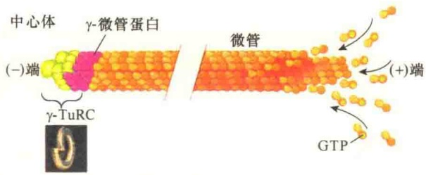
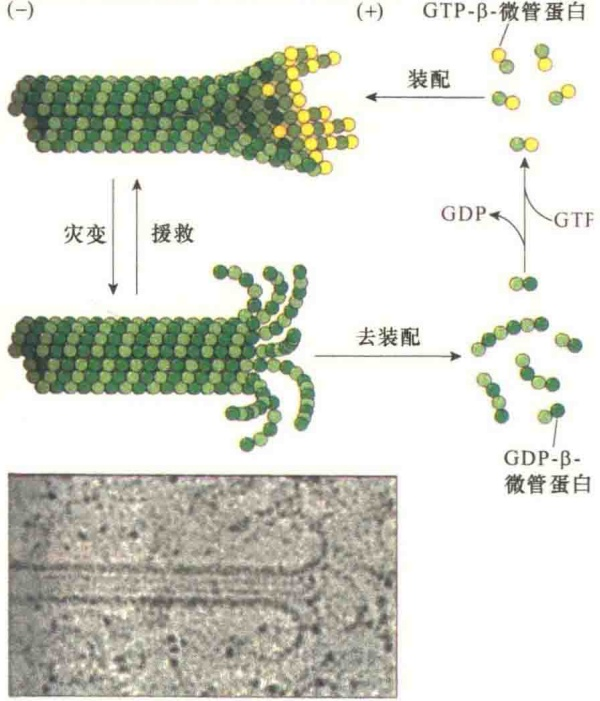
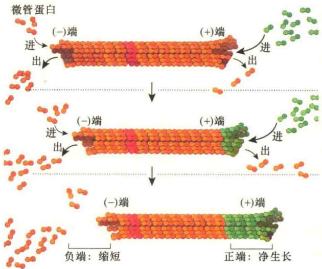
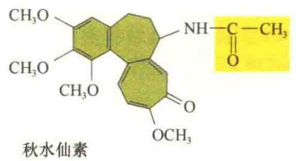
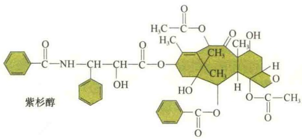
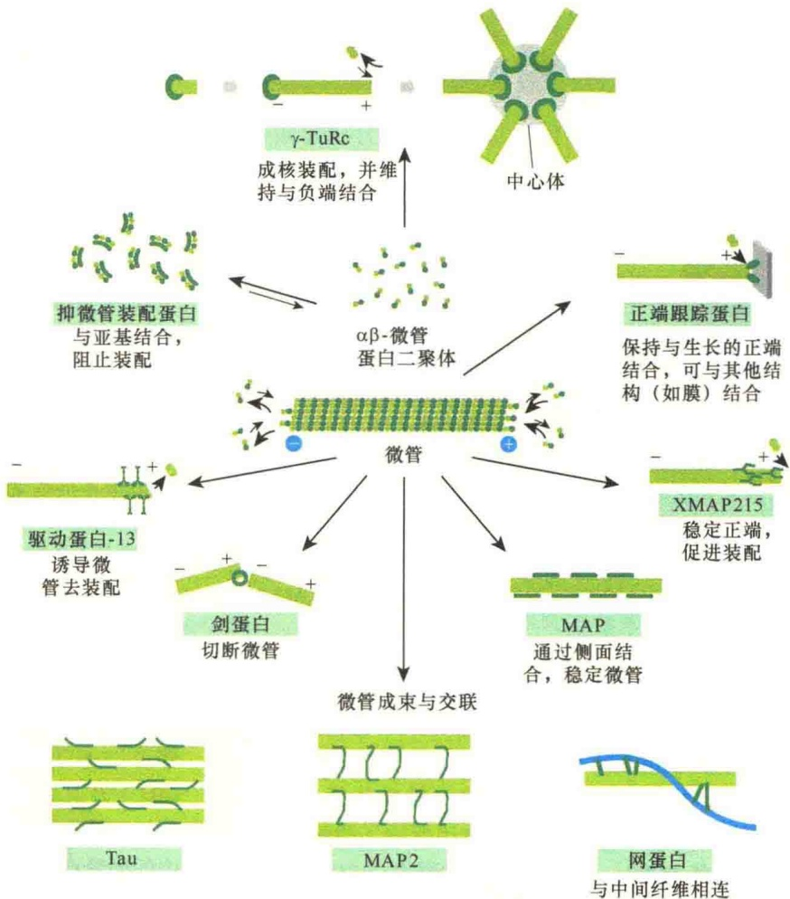
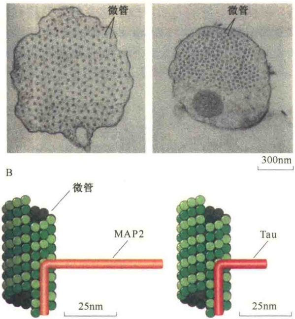
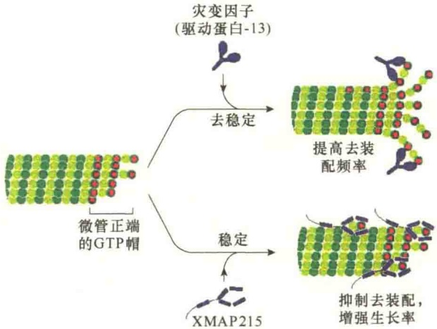

图 11-11 微管的装配起始与生长（引自 Plopper，2016）。先在中心体中由  $\gamma$ -TuRC 介导成核反应，然后  $\alpha\gamma$ -微管蛋白异二聚体以首尾对接方式加到（+）端，进行微管的延长反应。

高，可促进微管的生长；游离微管蛋白浓度低，则促使微管解聚。GTP 的低速水解适合于微管的连续生长，而高速水解造成微管的解聚。

微管的动态性主要受 GTP 结合与水解情况的影响。GTP 的水解仅仅发生在微管蛋白二聚体的 β-微管蛋白中，在游离状态下的微管蛋白二聚体亚基中，GTP 的水解非常慢，但是结合到微管之后，会加速水解。随着 GTP 的水解，游离的磷酸基团被释放，而 GDP 仍然与微管多聚体网格中 β-微管蛋白亚基结合在一起。因此，此时微管结构存在两种不同的亚基结构，一种是 “T 型”（T-form）核苷（GTP）结合的 β-微管蛋白，另一种是 “D 型”（D-form）核苷（GDP）结合的 β-微管蛋白。而 GTP 水解释放的能量以弹性应力（elastic strain）被储存在微管多聚体的网格中。其结果导致 GDP 结合的微管蛋白二聚体更趋向于从微管多聚体解离。

微管两端的微管蛋白亚基是T型还是D型，取决于GTP水解与微管蛋白添加的相对速率。如果微管蛋白亚基添加的速度快，纤丝生长的速度就快，这样就有可能在先添加的微管蛋白亚基的GTP未水解前接着加上一个新的微管蛋白二聚体。在这种情况下，在微管多聚体的顶端，T型微管蛋白二聚体就会形成一个GTP帽（GTP cap）。若是在新微管蛋白二聚体添加前，先加上的微管蛋白二聚体的GTP已经水解，微管纤丝的顶端就是D型。如果微管蛋白亚基在末端的装配与GTP的水解速率相当，那么末端有时会转化成D型。

一般而言，微管纤丝的（-）端是比较稳定的，而在（+）端，T型就会快速生长，D型就会缩短，这种现象被称为微管的动态不稳定性（dynamic instability）（图11-12）。微管的生长（growth）有时又称为援救（rescue），收缩（shrinkage）又称为灾变（catastrophe）。

图11-12 微管的动态不稳定性（引自Lodish et al., 2013）。顶部是生长微管、底部是收缩微管的电子显微镜照片。中间部分是微管装配与去装配的示意图。（+）端的装配是由于GTP-β-微管蛋白的装配快于GTP的水解。若GTP水解成GDP的速度快于装配速度，导致微管（+）端的收缩。

## 11.2.2.5 微管的极性与踏车行为

微管的极性有两层含义。第一层含义是装配的方向性。由于微管是以 $\alpha \beta$ 二聚体作为基本构件进行装配的，并且是以首尾排列的方式进行组装，所以每一条原丝都有相同的极性（方向性），这样，装配成的微管的一端是 $\alpha$-微管蛋白亚基组成的环，而相对的一端是以 $\beta$-微管蛋白亚基组成的环。极性的另一层含义是两端的装配速度是不同的，（+）端生长得快，（-）端则慢，同样，如果微管去组装也是（+）端快、（-）端慢。

踏车（tread milling），又称周转（turnover），是微管组装后处于动态平衡的一种现象（图 11-13）。

微管的两端都可以加上  $\alpha\beta$ -二聚体，或释放  $\alpha\beta$ -二聚体。在（+）端，由于结合有 GTP 帽结构的存在，与二聚体的亲和力高，所以，新结合上去的二聚体比释放出来的快。在（-）端，由于 GTP 已水解成 GDP，与二聚体的亲和力低，释放出来的二聚体比结合上去的快，这样，（+）端生长得快，（-）端生长得慢，结合上二聚体的GTP又不断水解，向（-）端推移。如果（+）端结合上去的二聚体与（-）端释放出来的速度相同，就会形成轮回现象，即微管的总长度不变，但结合上的二聚体从（+）端不断向（-）端推移，最后到达（-）端。造成这一现象的原因除了GTP水解之外，另一个原因是反应系统中游离αβ-二聚体的浓度。当（+）端的游离微管蛋白二聚体的浓度高于临界浓度，而（-）端游离微管蛋白二聚体的浓度低于临界浓度就会发生踏车现象。踏车现象实际上是一种动态稳定现象。

图 11-13 微管的踏车（引自 Plopper et al., 2015）。在某些条件下，微管经历踏车过程:（+）端不断快速添加微管蛋白二聚体，（-）端不断去装配，导致微管蛋白亚基快速周转。

## 11.2.2.6 影响微管装配和去装配的因素

1972 年，Weisenberg 首次在体外装配微管获得成功。他将小鼠脑的匀浆物置于  $37^{\circ}$ C，然后添加  $Mg^{2+}$ 、GTP 和 EGTA（EGTA 是  $Ca^{2+}$  的螯合剂，抑制聚合作用）即可进行微管的装配。他还发现，只要降低或提高反应温度就可以使微管去装配和重装配；若在反应系统中添加微管碎片能够加速微管的装配，加入的微管碎片可起“种子”的作用。

聚合过程需要加入 GTP，因为  $\beta$  亚基能够与 GTP 结合。对于微管的装配来说，不需要 GTP 水解成 GDP，但是发现  $\alpha\beta$ -微管蛋白二聚体加入到微管之后不久所结合的 GTP 就被水解成 GDP。去装配过程中释放出来的  $\alpha\beta$ -微管蛋白二聚体上的 GDP 要与 GTP 交换，使  $\alpha\beta$ -微管蛋白二聚体重新结合上 GTP，才能作为微管装配的组件。由于在装配过程会发生 GTP 的水解，所以微管的装配是一个成本极高的过程。那么在进化的过程中，为什么微管的装配需要花如此大的成本？最合理的解释是这样做有利于控制装配和去装配的速率。

造成微管不稳定性的因素很多，包括 GTP 浓度、压力、温度（最适温度为  $37^{\circ}$ C）、pH（最适 pH 为 6.9）、微管蛋白临界浓度（critical concentration）、药物等。

但是，也有一些因素使微管处于稳定的不解聚状态，包括某些微管结合蛋白、药物及修饰微管的酶。例如，有一些酶在微管装配之后对微管蛋白进行修饰使微管处于稳定状态，典型的例子是微管α亚基的乙酰化和去酪氨酸作用。微管蛋白的乙酰化是由微管蛋白乙酰化酶催化的，它能够将乙酰基转移到微管蛋白特定的赖氨酸残基上；去酪氨酸作用是由微管去酪氨酸酶（detyrosinase）催化的，它能够除去α微管蛋白C端的酪氨酸残基。

## 11.2.2.7 影响微管稳定性的药物

科学家很早就发现有几种药物能够抑制与微管的装配和去装配有关的细胞活动，后来这些药物就成为研究微管功能的有力工具。其主要原因有二:一是这些药物只与微管或微管蛋白二聚体结合；二是它们在细胞中的浓度很容易控制。这些药物中用得最多的是秋水仙素、紫杉醇等（图 11-14）。

图11-14 秋水仙素与紫杉醇的分子结构。

秋水仙素（colchicine）是一种生物碱，能够与微管特异性结合。秋水仙素结合到未聚合的微管蛋白二聚体上。在每一个二聚体上有一个与秋水仙素高亲和结合位点和一个低亲和结合位点，后一个结合位点在秋水仙素浓度较低的情况下可能没有作用。从机制上看，秋水仙素与二聚体结合，形成的复合物可以阻止微管的成核反应。秋水仙素和微管蛋白二聚体复合物加到微管的正、负两端，可阻止其他微管蛋白二聚体的加入或丢失。所以秋水仙素定位到微管的末端，改变了微管装配和去装配稳定状态的平衡，其结果破坏了微管的动态性质。不同浓度的秋水仙素对微管的影响不同。用高浓度的秋水仙素处理细胞时，细胞内的微管全部解聚；但是用低浓度的秋水仙素处理动物细胞和植物细胞，微管保持稳定，并将细胞阻断在中期。将用低浓度秋水仙素处理的细胞用无秋水仙素的溶液洗涤之后，细胞的分裂功能恢复正常，这对于获得同步化的细胞非常有用。

紫杉醇（taxol）是红豆杉属植物中一种复杂的次生代谢产物，也是目前所了解的唯一可以促进微管聚合和稳定已聚合微管的药物。同位素示踪表明，紫杉醇只结合到聚合的微管上，不与未聚合的微管蛋白二聚体反应。细胞接触紫杉醇后会在细胞内积累大量的微管，这些微管的积累干扰了细胞的各种功能，特别是使细胞分裂停止于有丝分裂期，从而影响了细胞的正常分裂。

## 11.2.3 微管结合蛋白

将细胞裂解后分离微管，并在4℃下处理使微管去聚合，将冷处理的样品进行离心，除去不溶性的物质，然后将含有微管蛋白二聚体的上清液于37℃温育，让微管装配。但是，经过多次装配-去装配分离纯化的微管蛋白制品中仍然含有少量的其他蛋白质。有与微管蛋白共纯化的蛋白质存在，说明这些蛋白质是与微管蛋白特异性结合的，而不是非特异蛋白质的污染。免疫荧光显微镜观察培养细胞也发现有与微管蛋白结合的蛋白质存在，后来将这一类微管辅助蛋白统称为微管结合蛋白（microtubule-associated protein, MAP），在微管结构中占10%\~15%。表11-3列出部分主要的细胞内微管结合蛋白及其细胞功能。

表 11-3 部分微管结合蛋白及其细胞功能

| 微管结合蛋白 | 细胞功能 |
| --- | --- |
| γ-微管蛋白环状复合物 | 微管成核反应 |
| XMAP215 | (+)端的聚合作用 |
| 驱动蛋白8,驱动蛋白13 | (+)端的去聚合 |
| CLASP | 拯救作用 |
| Tau, MAP1, MAP2, MAP4 | 维持长度的稳定性 |
| 剑蛋白 | 切断 |

## 11.2.3.1 微管侧向结合蛋白

微管结合蛋白在细胞内广泛参与调节微管的动态行为，包括微管的装配、去装配、稳定微管、切断、成束或交联（图 11-15）。

从微管一侧的表面与微管结合的蛋白质称为微管侧向结合蛋白（side binding protein），与微管结合后，对微管起稳定作用。有几类不同的微管侧向结合蛋白，它们中很多是在特定类型的细胞中表达。研究最为清楚的是 Tau 蛋白家族，包括 Tau 蛋白、MAP2 蛋白及 MAP4 蛋白。其中 Tau 蛋白、MAP2 蛋白是神经蛋白，而 MAP4 蛋白在其他组织中表达，一般不会出现在神经元中。此类蛋白质有两个标准的结构域:第一个结构域含有 3～4 个重复的、带正电的 18 个残基序列，该结构域与带负电的微管表面结合；第二个结构域以直角的形式伸向微管的外侧（图 11-16）。Tau 蛋白被认为对微管起稳定作用，并作为微管间的间隔物。MAP2 蛋白仅存在于神经元的树突中，其作用是在微管间形成纤维状交联桥，并且将微管与中间纤维连接起来。

图 11-15 微管结合蛋白及其对微管动态的调节（引自 Alberts et al., 2015）。MAP 有多方面的功能:①使微管相互交联形成束状结构，也可以使微管与其他细胞结构交联，这些结构包括质膜、微丝和中间纤维等；②通过与微管成核点的作用促进微管的聚合；③在细胞内沿微管转运囊泡和颗粒；④提高微管的稳定性。

A

图 11-16 微管间的间隔取决于微管侧向结合蛋白突出结构域的长度（引自 Lodish et al., 2013）。用 MAP2 或 tau 编码基因转染的昆虫细胞，表达 MAP2 蛋白的臂比 Tau 蛋白的臂长。A. 转染细胞的电镜切片照片，左侧是转染了 MAP2，突出的臂长，微管间的间距就大；而右侧转染了 Tau，突出的臂短，微管间的间距就小。B. MAP2、Tau 与微管结合示意图。

此外，稳定微管的 MAP 蛋白包被在微管的外壁上，可提高微管的生长速度，或者抑制微管灾变的速率。在很多情况下，通过突出结构域的可逆磷酸化对 MAP 的作用进行调节:磷酸化的 MAP 不与微管结合，因此，磷酸化作用促进了微管的去聚合。某些 MAP，如 MAP4 可被周期蛋白依赖性激酶磷酸化，进行细胞周期的调控。

## 11.2.3.2 微管（+）端结合蛋白

细胞含有很多与微管末端结合的蛋白质，调节微管的稳定性与动态性。这些蛋白质常常影响微管生长与收缩的转换速度。例如，驱动蛋白相关的蛋白家族成员中一种叫做灾变因子（catastrophe factor），或叫做驱动蛋白-13（kinesin-13），与微管（+）端结合，可将原丝拉开弯曲，促进原丝收缩。另外一种蛋白，叫做 Nezha 或 Patronin，保护微管（-）端，使其免遭灾变因子的影响。

细胞内与微管（-）端结合的蛋白质很少，而与（+）端结合的蛋白质却非常多。一种普遍存在的蛋白质是XMAP215蛋白（来源于非洲爪蟾的微管结合蛋白，分子质量125Da），从酵母到人类都有同源蛋白。XMAP215蛋白与游离的微管蛋白亚基结合，并将其转移到微管（+）端进行装配，对聚合起促进作用。

图 11-17 是驱动蛋白-13 与 XMAP215 蛋白对微管稳定性的影响。

图 11-17 微管末端结合蛋白对微管稳定性的影响（引自Alberts et al., 2015）。细胞中微管的生长与收缩受多种蛋白质的调节。溃散因子，如驱动蛋白超家族成员的驱动蛋白-13与末端结合，并将原丝撬开，促进微管去聚合。而另一种MAP，即XMAP215蛋白则与微管蛋白二聚体结合，并将其转移到（+）端，促进微管装配。

另一类与（+）端结合的微管结合蛋白叫做 +TIP，专门识别生长中的微管（+）端，帮助微管在细胞中定位。在有丝分裂中，+TIP 帮助生长中的微管（+）端捕获并稳定附着在染色体的动粒部位。+TIP 中的末端结合蛋白-1（end binding-1，EB1）及其系列物都是小的二聚体蛋白质，并且在动物、植物及真菌中都是非常保守的，EB1 帮助生长中的微管在细胞中的定位。EB1 能够识别生长中的微管末端并与其结合。其他一些 +TIP，通过与 EB1 结合，以及相互间、与微管间的相互作用聚集到生长微管的（+）端，产生一种推力，以此帮助生长中的微管定位于纺锤体、染色体、细胞器（图 11-18）。