在一起，形成有4个头的双极性驱动蛋白（图11-25）。双极性驱动蛋白同时分别在相对的两个方向与微管结合，通过微管的滑动，将相对的两个微管分别推向两端。在有丝分裂中，微管的滑动具有特别重要的意义，因为此时的微管是纺锤体的极微管，通过纺锤体极微管的相互滑动，将染色体快速地推向两极，促进了细胞核与细胞质分裂。

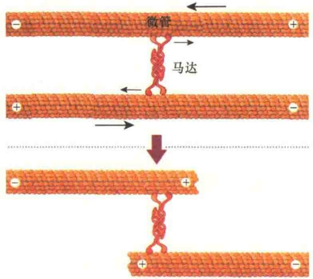

图 11-25 双极性驱动蛋白的形成及微管运输（改自 Plopper et al., 2016）。两个驱动蛋白形成有 4 个头部的双极性驱动蛋白，它们用 4 个头分别在相对方向与微管结合，在驱动蛋白的作用下，引起微管的相对滑动，将微管推向两极。

3）轴突与树突运输 在神经元中，轴突末端到细胞体的距离很长，并且轴突末端要释放大量的神经递质，所以神经元必须不断供给大量的物质，包括蛋白质、膜，以补充因轴突部位的胞吐而丧失的成分。这些新的物质从哪里来？

神经细胞的细胞体是神经细胞的中心，是圆形的部分。细胞体中有细胞核、内质网、高尔基体及其他的细胞器。细胞体中合成的蛋白质有些以分泌小泡的形式向轴突末梢运输，如神经递质等。这些分泌小泡主要是靠驱动蛋白通过微管运向轴突末梢，称作向外运输（outward transport），又称顺向运输（anterograde transport）。轴突末梢膜内吞形成的内吞泡从末梢向细胞体部的运输则是由细胞质动力蛋白沿微管向内运输的，这种方向的运输称为向内运输（inward transport），或称为逆向运输（retrograde transport）。

神经元（neuron）含有复杂的细胞骨架结构。由于细胞骨架的不同，神经元的轴突（axon）能够接受电信号，而树突（dendrite）则传递电信号。神经元的轴突与树突总称为神经突（neurite）。神经突中充满了束状微管，这不仅是神经突的结构特点，也是行驶功能的关键。在轴突中，所有的微管都是以相同的方向排列，（一）端指向细胞体，（+）端指向轴突的末端。但是，微管不会从细胞体一直延伸到轴突的末端，仅有少数微管较长，大多数以相互部分重叠的方式交错排列。这种线性的微管轨道可作为“高速公路”将特殊的蛋白质、含蛋白质的小泡，以及mRNA向轴突末端运输，建构与维持突触（synapse）。人体中，最长的轴突可从脊髓（spinal cord）到达脚，长度超过1m。树突比轴突短，树突中的微管是平行排列的，但是，微管的极性是混合型的，有些微管的（+）端指向树突的顶端，有些微管的（+）端则指向细胞体，这种排列方式类似于纺锤体微管。图11-26是神经元中微管组织及轴突与树突的运输。

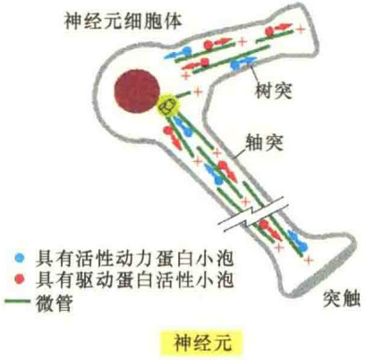

图 11-26 神经元中微管组织结构与物质转运（引自 Alberts et al., 2015）。

4）色素颗粒的转移 许多两栖类生物（如蛙）的皮肤和鱼类的鳞片中含有特化的色素细胞，在神经和激素的控制下，这些细胞中的黑素体可在数秒钟内迅速分布到细胞各处，从而使皮肤颜色变深；又能很快回到细胞中心，而使皮肤颜色变浅，以适应环境的变化。研究发现，黑素体的转移是微管依赖性的，由驱动蛋白和动力蛋白协同完成。

载黑素细胞（melanophore）是脊椎动物的皮肤细胞，含有数百个充满暗黑色色素的颗粒，叫黑素体（melanosome）。载黑素细胞的黑素体既能分散分布，也可以聚集在中央部分。若是散布在细胞中，细胞呈暗黑色；若是聚集在细胞中央，细胞则较为透明（图 11-27），这些变化会改变皮肤的颜色。

黑素体是分散开来还是集中起来受信号调节。在鱼类中，由神经递质介导；而在蛙中，受cAMP的调节。对于鱼类而言，皮肤颜色的变化，可以起伪装作用，保护自己免遭天敌的伤害；对于蛙来讲，皮肤颜色的变化可以增强对环境的适应性。细胞内黑素体的移动受cAMP浓度变化的调节，并且是微管依赖性的。研究表明，黑素体的分散开来需要驱动蛋白-2，而聚集起来则需要细胞质动力蛋白-动力蛋白激活蛋白，通过这两种马达蛋白的协同作用，调节黑素体的存在状态，保护生物更好地适应环境。

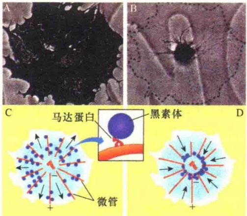

图 11-27 色素细胞中微管马达蛋白对黑素体的运输（引自 Plopper，2016）。A. 黑素体分散的细胞照片；B. 黑素体集中的细胞照片；C. 黑素体通过微管运输分布存在的示意图；D. 黑素体通过微管运回到细胞中央的示意图。

## 11.2.5.3 纤毛和鞭毛及其运动

纤毛（cilia）与鞭毛（flagella）是细胞质膜向外凸起的特化细胞结构，构成的基础是微管，功能是负责各种真核细胞的运动。纤毛和鞭毛并无绝对界限，一般把少而长者称为鞭毛，短而多者称为纤毛。纤毛的分布更为广泛，几乎所有的动物细胞表面都有纤毛。很多细菌也有鞭毛，不过，原核细胞的鞭毛与真核细胞的鞭毛是完全不同的，细菌鞭毛是从细胞表面凸起的蛋白质纤维，而不是由微管支持的细胞质膜凸起。真核细胞的纤毛与鞭毛结构非常相似，但是鞭毛和纤毛在大小、数量和运动方式等方面都是不同的。鞭毛长度可达150mm，数量

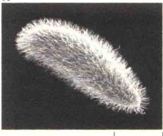

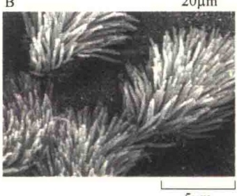

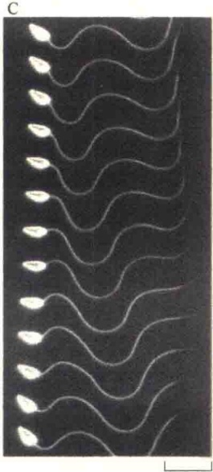

图 11-28 纤毛与鞭毛（引自 Cooper and Hausman，2013）。
A. 草履虫纤毛的电子扫描显微镜照片。
B. 覆盖有纤毛的气管上皮细胞表面扫描电子显微镜照片。
C. 海胆精细胞鞭毛波浪式游动。

毛较短，平均长度为5～10μm，运动的方式比较复杂，且没有规则。很多细胞都是被纤毛所覆盖（图11-28）。纤毛和鞭毛有两个主要的功能:第一是帮助细胞锚定在一个地方，使细胞不易移动；第二是使细胞在液体介质中运动。

1954 年 Fawcett 和 Porter 首次描述了轴丝的结构。轴丝的外面由膜包裹。组成轴丝的微管呈规律性排列，即 9 组二联管在周围成等距离地排列成一圈，中央有两条单管，成为 “9+2” 的微管形式。中央的两条单管之间由细丝相连，外包有中央鞘（内鞘）。周围的 9 套二联管，近中央的一条称为 A 微管，另一条为 B 微管（图 11-29）。

A 微管上有两个短臂，长约 15nm，粗约 5nm，两个短臂之间间隔约 24nm。内臂指向邻近一对微管的 B 微管，组成臂的成分是动力蛋白。纤毛的动力蛋白是一种多亚基的 ATP 酶，能被  $Ca^{2+}$ 、 $Mg^{2+}$  所激活。

中央微管和A微管是完全微管，由13条原

纤毛和鞭毛都含有一个规则排列的、由微管相互连接形成的骨架，称为轴丝（axoneme）。

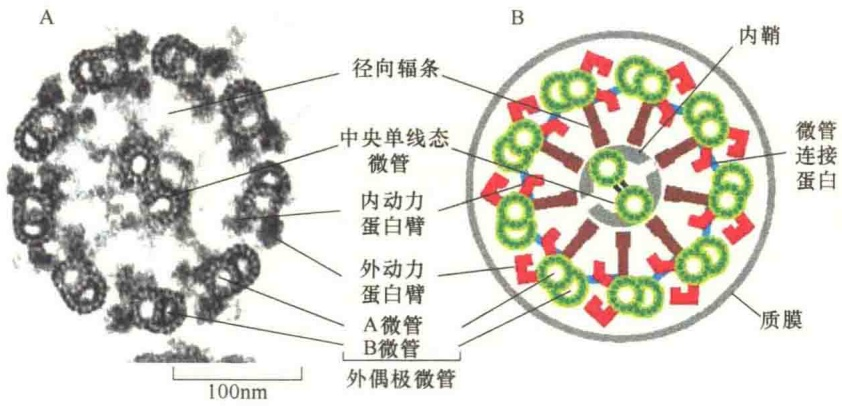

图 11-29 纤毛或鞭毛结构组成（引自 Alberts et al., 2015）。

丝组成。B 微管只有 10 条原丝，有 3 条是同 A 微管共用的，故每组周围微管的原丝共有 23 条。在两个相邻二联管之间有微管连接蛋白（nexin）将相邻微管二联体结合在一起。另外，每个二联管的 A 微管上有放射辐（radial spoke）与中央微管鞘相连。

对组成纤毛的成分进行了分子鉴定。首先逐步降解分离的纤毛，然后通过低速离心除去完整的细胞，分离纤毛之后用去污剂除去质膜，得到轴丝。再用EDTA处理轴丝，当EDTA螯合了 $Mg^{2+}$ 之后，动力蛋白被释放到溶液中，此时用显微镜进行检查，发现每一个二联体的两个臂及一对中央管都不存在了，说明这些结构是由动力蛋白组织的。进一步的实验证明，动力蛋白就是微管的臂而不是二联体微管。

纤毛中的微管排列并不始终如一，在纤毛顶部每组微管逐渐减为一条，达到顶端时，它们就相互融合。每一纤毛的基部起始于细胞浅表部的基体（basal body），基体的结构与中心粒相同，它缺少两根中央微管，而周围9套是三联体（图11-30）。

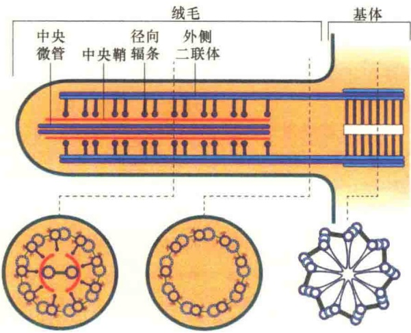

图 11-30 基体与轴丝结构（引自 Karp，2010）。

纤毛动力蛋白（ciliary dynein），又称轴丝动力蛋白（axonemal dynein），是一种多头的马达蛋白（图11-31）。纤毛动力蛋白是很大的蛋白装配体（分子质量接近200万Da），由9～12个多肽链组成，最大的重链超过500 000Da。重链构成球形头和杆的主要部分，有很多较小的链簇拥在杆的基部周围。后生动物（metazoan）纤毛动力蛋白的外侧动力蛋白有两个头，而原生动物纤毛动力蛋白有三个头，每个头都是由自身的重链形成。尾部则紧紧与A管结合，大型的头部有ATP依赖的、与B管结合的位点。当头部水解所结合的 ATP 时，就会朝向微管的（一）端移动。因此在纤毛或鞭毛相邻微管间产生滑动的力。

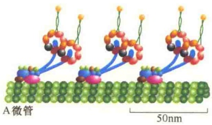

图 11-31 纤毛动力蛋白（引自 Alberts et al., 2015）。重链形成头与杆的主要部分，有很多较小的链簇拥在杆的基部周围。纤毛动力蛋白的头与 A 微管紧紧地结合在一起。

由于纤毛动力蛋白二联管是通过微管连接蛋白连接起来的，因而阻止了二联管间的相互滑动，因此，动力蛋白产生的力转变成弯曲运动（图 11-32）。

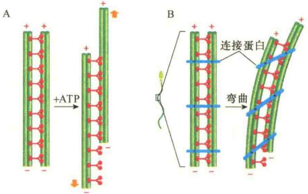

图 11-32 轴丝的弯曲（引自 Alberts et al., 2015）。A. 用胰蛋白酶处理轴丝，连接二联体的微管结合蛋白被水解，然后加入 ATP 激活动力蛋白的头部结构域，并在相邻二联体间产生滑动。B. 在精细胞中，轴丝是完整的，A 微管与 B 微管间有微管连接蛋白，因而限制了微管间做大范围的滑动，代之的是有限的弯曲。

## 11.2.6 微管与有丝分裂

微管在细胞的有丝分裂中起重要作用。有丝分裂涉及许多复杂的力学过程。首先，染色体必须在中期排列到赤道板上，到了后期已经在S期复制的子染色体要分开，分别被移动到母细胞相对的两极。此外，在胞质分裂中，细胞还必须保证每一个子细胞得到适量的母性细胞器和细胞骨架蛋白等。在所有这些过程中，微管均起重要作用。关于纺锤体的形成及染色体运动机制将在第13章“细胞周期与细胞分裂”中讨论。

## 11.3 微丝

微丝是细胞内另一种形式的细胞骨架。作为细胞骨架，微丝与微管有很多相似之处。例如，二者都是由球形蛋白质亚基装配而成，二者都可通过马达蛋白诱导细胞运动；但是，二者又有很大的不同。例如，微丝对细胞形态的影响要比微管大得多，而且在细胞的大剂量的运动方面，如肌收缩，微管是“望尘莫及”的。

## 11.3.1 微丝的化学组成与分布

微丝（microfilament，MF）又称肌动蛋白丝（actin filament），是由肌动蛋白（actin）单体装配而成的纤维。肌动蛋白丝也是一种极性分子，具有两个不同的末端，一个是（+）端，另一个是（-）端。微丝在细胞内的分布十分广泛。

## 11.3.1.1 微丝的化学组成

肌动蛋白是微丝的基本构件，因其是由一条多肽链构成的球形分子，因此称为球状肌动蛋白（globular actin）或G-肌动蛋白（G-actin）。G-肌动蛋白单体是由375个氨基酸残基组成的多肽，并有一个与之紧密结合的ATP或ADP。G-肌动蛋白单体能够装配成纤维状多聚体，称为纤维状肌动蛋白（filamentous actin，F-肌动蛋白）或肌动蛋白纤维（actin fibre）。F-肌动蛋白是由两条链组成的双股螺旋状，螺旋间的距离为36\~37nm。由于F-肌动蛋白双螺旋的直径为7\~9nm，比微管细，故又将F-肌动蛋白称为微丝（图11-33）。

肌动蛋白是真核细胞中最丰富的蛋白质。在肌细胞中，肌动蛋白占总蛋白的10%，即使在非肌细胞中，肌动蛋白也占细胞总蛋白的1%\~5%。肌动蛋白在非肌细胞的胞质溶胶中的浓度为0.1\~0.4mol/L。

在特殊的结构，如微绒毛（microvilli）中，局部肌动蛋白的浓度可达5mol/L。肌动蛋白在细胞中的含量是非常高的，如肝细胞中肌动蛋白的分子数高达 $5\times10^{8}$ 。

肌动蛋白是最保守的蛋白质。肌动蛋白是由一个大的基因家族编码，相同物种内与不同物种间表达的肌动蛋白具有高度保守性。人类有6个肌动蛋白基因，每个基因编码不同的蛋白质异构体。肌动蛋白异构体分为三类:α-肌动蛋白、β-肌动蛋白、γ-肌动蛋白。在脊椎动物中，在特别类型的肌细胞中，有4类肌动蛋白异构体，而在非肌细胞中，有两类肌动蛋白异构体。在这6种异构体中，93%的氨基酸序列是相同的，在总共375个氨基酸中，仅有25个是不同的。虽然它们的氨基酸组成差异不大，但是功能却大为不同:α-肌动蛋白与细胞的收缩结构有关；γ-肌动蛋白是应力纤维中的微丝；β-肌动蛋白在细胞皮层及移动细胞的前缘中特别多。

## 11.3.1.2 微丝在细胞中的分布与作用

微丝比微管细，更具有弹性，通常比微管短。细胞中微丝的数量比微管多，全部微丝加起来，其总长度大约是微管的30倍。微丝在细胞中通常成束存在，这种成束的微丝比单个的肌动蛋白丝的强度大得多。

微丝首先发现于肌细胞中，在横纹肌和心肌细胞中，肌动蛋白成束排列组成肌原纤维，具有收缩功能。微丝也广泛存在于非肌细胞中。在细胞周期的不同阶段或细胞流动时，它们的形态、分布可以发生变化。因此，非肌细胞的微丝同胞质微管一样，在大多数情况下是一种动态结构，以不同的结构形式来适应细胞活动的需要。

微丝在细胞中能够装配成各种不同的结构，每种结构都有其特别的细胞功能。微丝既可成束装配成细长的指形结构，如微绒毛，也可在细胞质膜内侧形成不太有规则的网络结构，如细胞皮层（cell

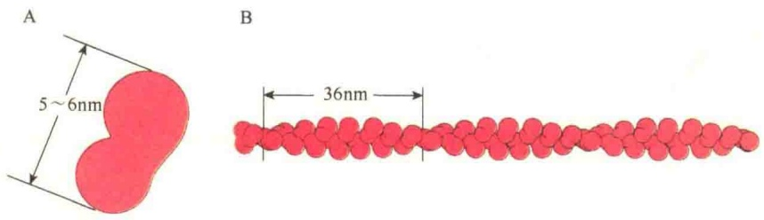

图 11-33 G-肌动蛋白与 F-肌动蛋白（引自 Wolfe，1993）。A. G-肌动蛋白单体，似腰果形，长 5\~6nm，直径 4nm。G-肌动蛋白是由两个裂片（lobe）构成的，像是两扇门，中间有一个裂缝（cleft）。B. F-肌动蛋白（微丝），呈纤维状，是由两股肌动蛋白纤维组成的双螺旋结构，螺距 36nm，直径为 7\~9nm。

cortex），为维持细胞的形态提供支撑及组织作用。在上皮细胞中，微丝围绕细胞形成可收缩的带，叫做黏着带，参与细胞的连接，提高了上皮细胞的强度。在迁移的细胞中，在细胞的前缘可看到由微丝组成的片状伪足（lamellipodium），或称丝足（filopodia）。有些细胞还具有可收缩的纤维，叫应力纤维