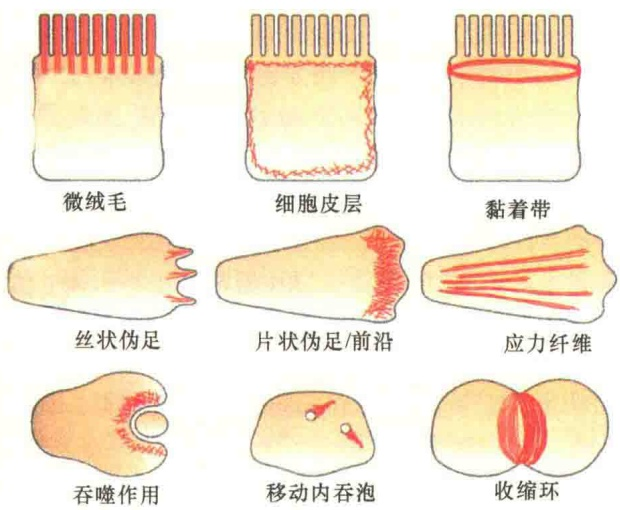
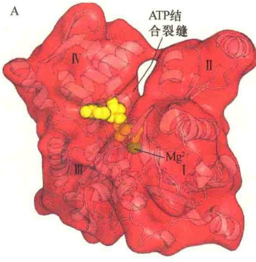
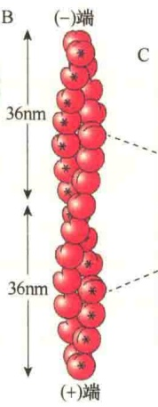
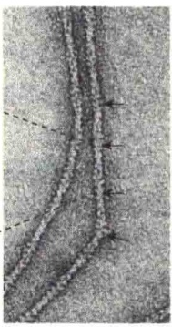
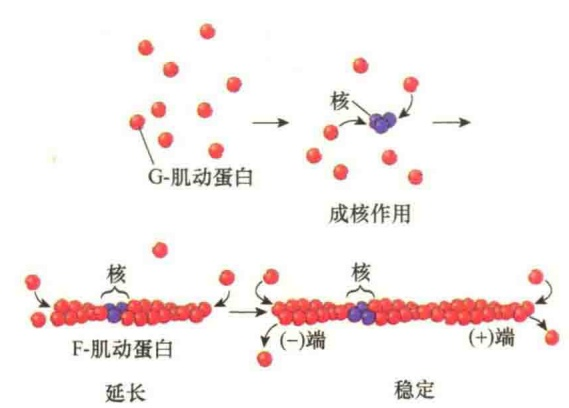
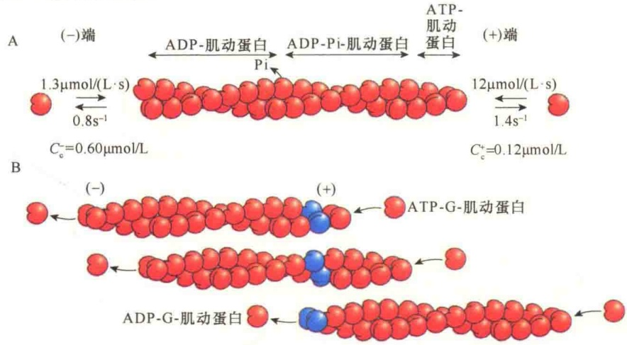
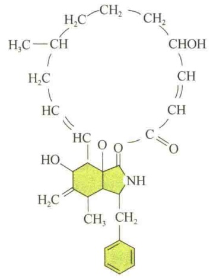
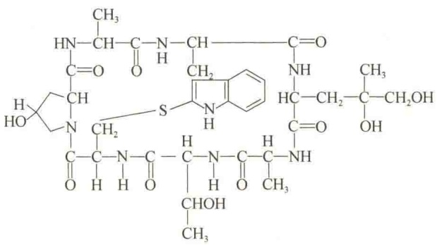
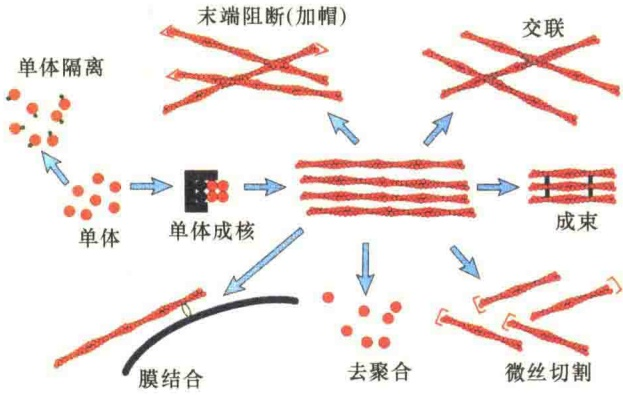
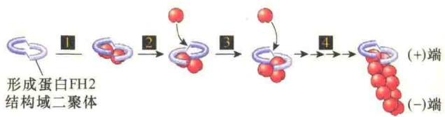

(stress fiber)，主要存在于黏着斑中。一些专业化的细胞，如巨噬细胞，在吞噬物质（如细菌）时，利用可收缩的微丝确保内吞与吞噬物的内化。在细胞质中，微丝还可以与微丝马达蛋白合作，进行物质转运。此外，微丝在胞质分裂中起“助产士”的作用，确保了两个子细胞“呱呱坠地”。在肌细胞中，微丝则组装成细肌丝，作为粗肌丝中肌球蛋白滑动的轨道，进行肌收缩。图 11-34 显示了微丝在不同类型细胞中的分布。

图 11-34 微丝在细胞中的分布（引自 Lodish et al., 2013）。

70% 的肌动蛋白是游离的单体，或者与其他蛋白结合成小的复合物，在游离肌动蛋白分子和微丝之间存在着动态平衡。

## 11.3.2.1 ATP在装配中的作用

在由 G-肌动蛋白装配成 F-肌动蛋白的过程中，ATP 具有重要作用。G-肌动蛋白的两裂片间的裂缝处是肌动蛋白 ATPase 的活性部位，能够结合 ATP 和  $Mg^{2+}$ 。G-肌动蛋白的两个裂片具有弹性，能够开与合。实际上，每一个 G-肌动蛋白通常都是结合有  $Mg^{2+}$  及 ATP 或 ADP 的复合物，因此肌动蛋白通常有 4 种存在状态:ATP-G-肌动蛋白、ADP-G-肌动蛋白、ATP-F-肌动蛋白、ADP-F-肌动蛋白，在细胞中主要是以 ATP-G-肌动蛋白和 ATP-F-肌动蛋白两种形式存在（图 11-35）。当 ATP 或 ADP 与 G-肌动蛋白结合之后，会发生构型的改变。如果没有 ADP 或 ATP 与肌动蛋白结合，则很快变性。

## 11.3.2.2 微丝的装配过程

体外实验表明，微丝的装配分三个时期，并且三个时期是连续进行的（图 11-36）。

第一个时期是成核期（nucleation phase）:G-肌动蛋白慢慢地聚合形成短的、不稳定的寡聚体，该过程较慢。一旦寡聚体达到某一种长度（3～

## 11.3.2 微丝装配的动力学

微丝是由肌动蛋白亚单位组成的螺旋状纤维。通过负染技术，在电子显微镜下观察，发现F-肌动蛋白是一种长的、具有弹性的纤维，直径是可变的，平均为7\~9nm。在体外，将 $Mg^{2+}$ 、 $K^{+}$ 和 $Na^{+}$ 等无机离子加入到溶液中，能够诱导G-肌动蛋白聚合成F-肌动蛋白纤维。这个过程是可逆的，当降低溶液中离子的浓度时，F-肌动蛋白纤维能够解聚成G-肌动蛋白。G-肌动蛋白能够聚合成F-肌动蛋白，F-肌动蛋白也可以解聚成G-肌动蛋白，这是肌动蛋白最为重要的特性。

在体内，有些微丝是永久性结构，如肌细胞中的细丝及上皮细胞微绒毛中的轴心微丝等。有些微丝是暂时性结构，如胞质分裂环中的微丝。

在大多数动物细胞中，大约有

图11-35 G-肌动蛋白单体与F-肌动蛋白的结构（引自Lodish et al., 2013）。A. 肌动蛋白单体的结构（$5.5\mathrm{nm} \times 5.5\mathrm{nm} \times 3.5\mathrm{nm}$），由体积相等的两个部分组成。中间有一个裂缝，可分为4个结构域，用I～IV表示。ATP在裂缝的地方与肌动蛋白结合。N端和C端位于结构域I。B. 肌动蛋白装配成的双股螺旋的肌动蛋白丝，螺距为 $36\mathrm{nm}$ 。结合ATP的一端为（+）端，结合ADP的一端为（-）端。C. 在电子显微镜下观察的经负染的丝状肌动蛋白显示细长的、具柔性的、由珠状亚基扭起来的双链。由于双链扭在一起，纤维的直径看起来有差异，有时细（约 $7\mathrm{nm}$），有时粗（约 $9\mathrm{nm}$），如同箭头所指。

图 11-36 微丝装配的三个时期（引自 Lodish et al., 2013）。

4个亚基），它就可以作为“种子”或者“核”，进入第二个时期——延长期（elongation phase）。在延长阶段，G-肌动蛋白单体快速地从短纤维的两端添加上去。生长期可被已形成的F-肌动蛋白的自发或突然断裂作用所加强，因为断裂的短F-肌动蛋白丝的末端可以作为新的核进行延长反应。可以在反应体系中添加小的F-肌动蛋白丝缩短成核期，或绕过成核作用。随着F-肌动蛋白的不断生长，游离的G-肌动蛋白单体的浓度越来越低，一直到与F-肌动蛋白丝的浓度相平衡。一旦达到这种平衡，F-肌动蛋白的装配进入第三阶段——稳定期（steady-state phase）。之所以称为稳定期，是因为在这个时期，G-肌动蛋白与F-肌动蛋白丝末端上的亚基进行交换，但不改变F-肌动蛋白丝

的总长度。单体的这种平衡浓度即为临界浓度（critical concentration， $C_{c}$ ）。高于临界浓度，G-肌动蛋白倾向于聚合；低于临界浓度，F-肌动蛋白将会解聚。

在肌动蛋白丝的装配过程中，除了受G-肌动蛋白临界浓度的影响，还受一些离子浓度的影响。例如，向G-肌动蛋白溶液中添加 $Mg^{2+}$ 、 $K^{+}$ 、 $Na^{+}$ ，可诱导G-肌动蛋白聚合成F-肌动蛋白。该过程是可逆的，当这些离子的浓度较低时，F-肌动蛋白趋于去聚合，而在 $Mg^{2+}$ 和高浓度 $K^{+}$ 或 $Na^{+}$ 的诱导下，G-肌动蛋白则装配成纤维状肌动蛋白。利用这一特性，可以将肌动蛋白经过几次反复的聚合-解聚循环，从细

胞中提纯出来。

## 11.3.2.3 微丝的极性与踏车

与微管一样，微丝也有结构和功能上的极性（polarity）。由于构成微丝的所有亚基都是从同一个方向，即首尾相连加到多聚体上，所以，微丝的两端是不对称的，即具有极性。结合ATP的一端为（+）端，另外一端为（-）端。而且，两端的生长速度是不同的，（+）端生长快，（-）端生长慢。一般而言，（+）端生长速度比（-）端快5～10倍。当然，微丝的生长速度是由游离的ATP-G-肌动蛋白的浓度决定的。

动力学实验表明，（+）端添加的速度约为 $12\mu mol/(L\cdot s)$ ，而从（-）端添加的速度则是 $1.3\mu mol/(L\cdot s)$ 。这就意味着，如果 $1\mu mol/L$ 游离的ATP-G-肌动蛋白添加到肌动蛋白丝上的话，每秒平均有12个肌动蛋白亚基加到（+）端，而加到（-）端的只有1.3个。那么，从微丝两端丢失亚基的速度又有何不同呢？相对而言，ATP-G-肌动蛋白亚基从两端解离的速度基本相似，约为 $1.4s^{-1}$ （图11-37A）。

肌动蛋白的聚合过程伴随着 ATP 的水解。在聚合过程中，G-肌动蛋白先要结合 ATP，然后 ATP-G-肌动蛋白单体再结合到微丝两端的肌动蛋白上。一旦 ATP-G-肌动蛋白单体结合到微丝上，同肌动蛋白结合的 ATP 就会慢慢降解成 ADP，并释放出 Pi。由于 ATP 的水解，装配成的大多数纤维都是由 ADP-F-肌动蛋白丝构成的，但是在纤维的一端是 ATP-F-肌动蛋白。虽然结合的 ATP 常被水解成 ADP，但是对于微丝的装配来说，ATP 的水解不是必要的过程，因为含有 ADP 或不能水解的 ATP 类似物的 G-肌动蛋白装配后都是稳定的。

图 11-37 微丝的极性与踏车（引自 Lodish et al., 2013）。ATP-肌动蛋白亚基在（+）端集合的速度比（-）端快，导致较低的临界浓度，使微丝处于稳定期，出现踏车。A. ATP-G-肌动蛋白在（+）端添加的速度比（-）端添加的速度快得多，而ADP-G肌动蛋白从两端解离的速度基本相似，这种差异导致（+）端的临界浓度的下降。此时，ATP-G-肌动蛋白优先从（+）端结合，从而在（+）端产生了一个较短的含ATP-G-肌动蛋白纤维区域，以及向（-）端形成一个含ADP-Pi-肌动蛋白及ADP-肌动蛋白的区域。B. 在稳定期，因ATP-G-肌动蛋白优先加到（+）端，而ADP-G-肌动蛋白亚基从（-）端解离，导致亚基踏车。蓝色标记的肌动蛋白亚基作为踏车的参照点。

在微丝装配时，若 ATP-G-肌动蛋白分子添加到微丝上的速率正好等于 ADP-G-肌动蛋白分子从微丝上失去的速率时，微丝净长度没有改变，这种现象称为微丝的踏车（图 11-37B）。微丝踏车是由游离 ATP-G-肌动蛋白的临界浓度决定的，当 G-肌动蛋白的临界浓度处于（+）端和（-）端 G-肌动蛋白浓度之间时，就会出现踏车。

微丝的踏车是由 ATP 水解驱动的。当 ATP-G-肌动蛋白与（+）端结合时，ATP 被水解成 ADP 和 Pi，Pi 将缓慢地从微丝的亚基中释放出来，致使微丝变成不对称，微丝（+）端的 ATP-G-肌动蛋白随 ADP-Pi-肌动蛋白的形成、Pi 的释放，逐渐向（-）端移动。由于 ATP 的水解与 Pi 的释放，引起微丝构型发生变化，导致两端与亚基结合和解离速度的不同，即（+）端结合的速度与（-）端解离的速度相等，从而产生踏车，即纤维的长度不变，而亚基进行了轮换。

发生踏车时，虽然微丝的净长度没有发生变化，但是装配与去装配仍在进行，只不过添加到微丝上的 G-肌动蛋白分子与解离下来的速率相等。

## 11.3.2.4 影响微丝的药物

与微管一样，微丝也受某些药物分子的影响。主要有两种毒素分子:细胞松弛素和鬼笔环肽，它们与肌动蛋白特异性结合，影响着肌动蛋白单体—多聚体间的平衡。

1）细胞松弛素 B（cytochalasin B） 细胞松弛素 B 是第一个用于研究细胞骨架的药物，它是真菌分泌的生物碱（图 11-38）。细胞松弛素 B 及其衍生物在细胞内与微丝的（+）端结合，并引起 F-肌动蛋白解聚，阻断亚基的进一步聚合。将细胞松弛素 B 加入到活细胞后，肌动蛋白丝纤维骨架消失，使动物细胞的各种活动瘫痪，包括细胞的移动、吞噬作用、胞质分裂等。它对微管没有作用，也不抑制肌收缩，因肌纤维中肌动蛋白丝是稳定的结构，不发生聚合与解聚的动态平衡。

2）鬼笔环肽（phalloidin） 鬼笔环肽是从一种毒性菇类中分离的剧毒生物碱（图 11-39），它沿着聚合的微丝侧面与微丝结合，而不与肌动蛋白单体分子结合。它与微丝侧面结合后，抑制了微丝的解聚，因而破坏了微丝的聚合和解聚的动态平衡。用荧光标记的鬼笔环肽对细胞进行染色，可以在荧光显微镜下观察到微丝在细胞中的分布。

图11-38 细胞松弛素B的结构。

图11-39 鬼笔环肽的结构。

## 11.3.3 微丝结合蛋白

纯化的肌动蛋白在体外能够聚合形成肌动蛋白丝，但是这种肌动蛋白丝不具有相互作用的能力，也不能行使某些功能。在显微镜下观察，它们只是杂乱无章地堆积而不像活细胞中肌动蛋白丝能够组织成各种结构，如束状、薄网状等。体外组装的肌动蛋白丝本身与活体中的肌动蛋白丝之间没有差别，只是组织结构不同。体内的肌动蛋白丝是由不同的肌动蛋白结合蛋白（actin binding protein）将肌动蛋白丝组织成各种不同的结构，从而执行不同的功能。

## 11.3.3.1 微丝结合蛋白的种类与功能

肌细胞和非肌细胞中都有微丝结合蛋白，至少已分离出100多种。表11-4是常见的几类主要的微丝结合蛋白及作用。

表 11-4 几类主要的微丝结合蛋白及作用

| 蛋白质 | 细胞内的作用 |
| --- | --- |
| Arp2/Arp3,形成蛋白 | 装配起始与聚合 |
| 伴肌动蛋白,原肌球蛋白 | 微丝的稳定 |
| α-辅肌蛋白,细丝蛋白,丝束蛋白,绒毛蛋白 | 纤维的交联作用 |
| CapZ,原肌球蛋白调节蛋白 | 末端加帽 |
| ADF/丝切蛋白,凝溶胶蛋白,胸腺素 | 纤维切断/去聚合 |
| 前纤维蛋白,双切蛋白 | 单体结合 |
| (肌)营养不良蛋白,血影蛋白,踝蛋白,黏着斑蛋白 | 肌动蛋白丝与其他蛋白相连 |

生活细胞中微丝的结构组成与功能受微丝结合蛋白的调控。微丝结合蛋白通过与肌动蛋白的结合，调节微丝的装配与去装配；同时也增加了微丝结构的多样性，拓展了微丝在细胞生命活动中的作用（图 11-40）。目前所发现的微丝结合蛋白的功能很多，但与肌动蛋白相互作用的方式却十分简单。应该注意的是，有些微丝结合蛋白具有多种调节作用。

图 11-40 肌动蛋白结合蛋白的作用（引自 Karp, 2010）。

## 11.3.3.2 形成蛋白

在所有的真核细胞中都能看到一类叫做形成蛋白（formin）的肌动蛋白结合蛋白。形成蛋白是相当大的一个蛋白家族，在脊椎动物中有7个不同的类别。虽然形成蛋白是多样性的，但是，所有的形成蛋白都有一个共同的特点:都含有相邻的两个结构域，分别是FH1结构域和FH2结构域，即形成蛋白同源结构域1和2（formin homology domains 1 and 2）。来自独立个体的两个FH2结构域可以形成一个面包圈形的复合物，这种复合物能够结合两个肌动蛋白亚基，（+）端朝向FH2，介导微丝的成核反应（图11-41），新的肌动蛋白亚基不断与具有FH2附着的（+）端结合，进行延长反应。形成蛋白介导的微丝的装配，也让我们理解了为什么微丝是由双股螺旋构成的。

图 11-41 形成蛋白 FH2 结构域介导肌动蛋白的成核反应（引自 Lodish et al., 2013）。①具有 FH2 结构域的形成蛋白形成一个二聚体，结合两个肌动蛋白亚基，成为装配的核；②～④单体 G 蛋白从（+）端逐渐添加到核上，进行延长反应，装配成的肌动蛋白丝是不分支的线性结构。

## 11.3.3.3 Arp2/Arp3蛋白复合物

Arp2/Arp3蛋白复合物是一种蛋白质机器，由7个亚基构成，其中有2个肌动蛋白相关蛋白（actin-related protein, Arp）。几乎所有的真核细胞，包括植物、酵母及动物细胞中都有该蛋白质的存在。Arp2/Arp3蛋白复合物几乎不能启动肌动蛋白的成核反应，但是能够介导肌动蛋白丝的分支装配。Arp2/Arp3蛋白复合物不能单独启动分支装配的，需要成核反应促进因子（nucleation promoting factor, NPF）的激活。首先，肌动蛋白亚基与NPF的W结构域结合；然后，结合有肌动蛋白亚基的NPF的A结构域与Arp2/Arp3蛋白复合物结合，NPF与Arp2/Arp3蛋白复合物之间的相互作用引起了Arp2/Arp3蛋白复合物构型的改变，导致Arp2/Arp3蛋白复合物与肌动蛋白的侧面结合，最后，与W亚基结合的肌动蛋白转移到Arp2/Arp3蛋白复合物并与之结合，从而开始了分支肌动蛋白丝的装配。Arp2/Arp3蛋白复合物介导的成核肌动蛋白丝的生长是从（一）端开始的，允许（+）端快速生长，直至有加帽蛋白与（+）端结合。分支肌动蛋白丝分支点的夹角为 $70^{\circ}$ （图11-42）。

Arp2/Arp3 蛋白复合物与形成蛋白介导的肌动蛋白丝的装配部位主要是细胞质膜下的细胞皮质。在大多数细胞中，肌动蛋白丝高度密集的地方是细胞周质（periphery），这一层结构称为细胞皮质。在该区域，微丝决定着细胞表面形态与运动。肌动蛋白丝通过改变自身的形态与硬度，使细胞快速应对外部环境的变化。例如，在细胞内吞过程中，Arp2/Arp3 蛋白复合物介导的分支肌动蛋白丝网络的装配对于内吞小泡的形成与切离具有重要作用（图 11-43）。