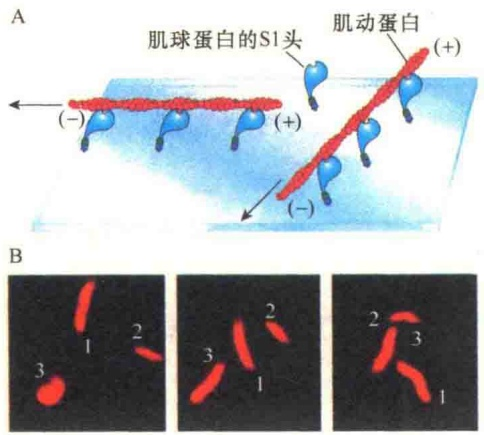
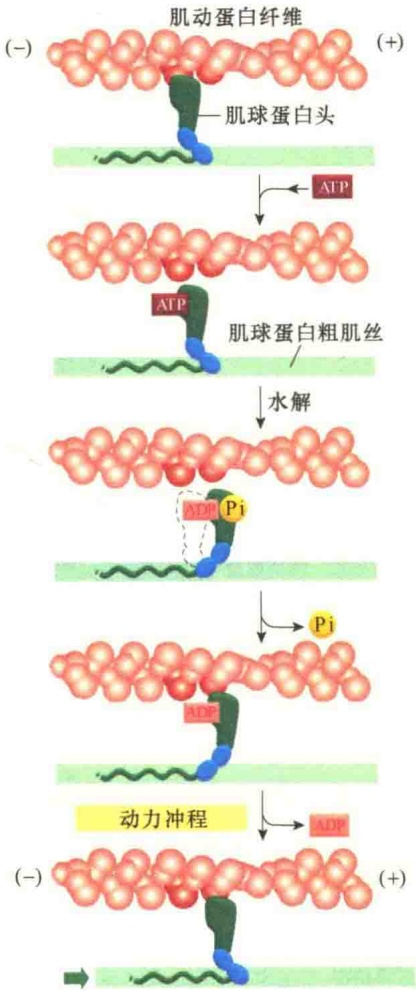
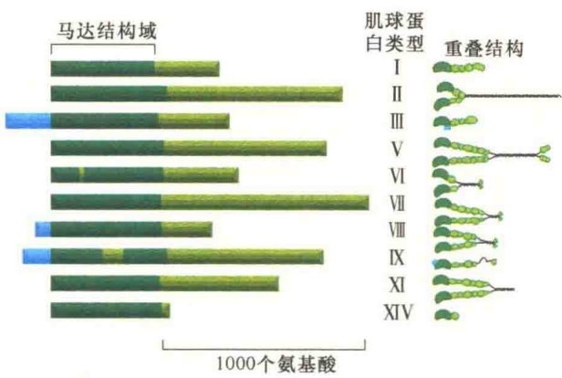
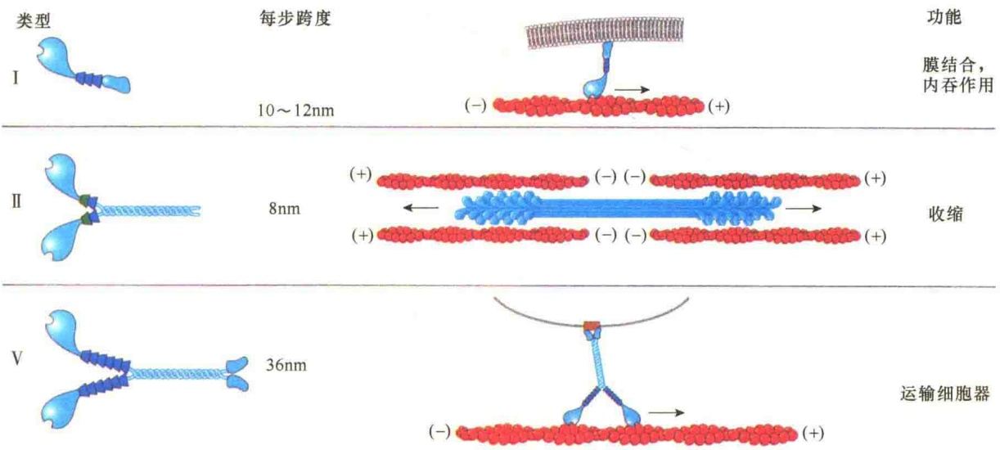
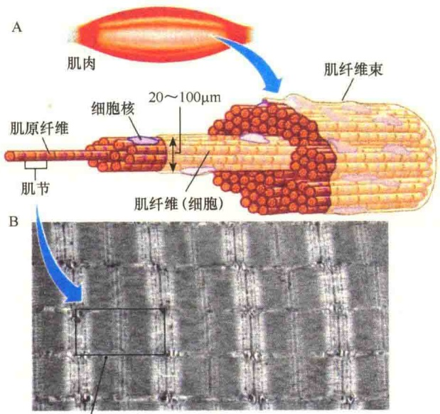
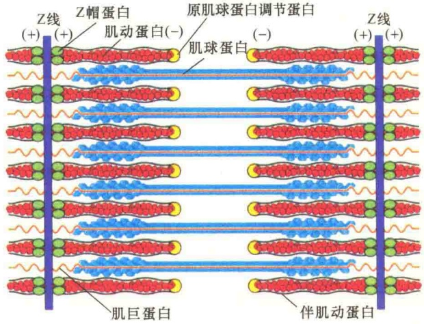

通过体外实验证明了肌球蛋白Ⅱ的S1片段的马达功能（图11-52）。在肌丝滑动分析（sliding filament assay）实验中，将纯化的肌球蛋白Ⅱ的S1片段附着到玻片上，然后加入荧光素鬼笔环肽标记的肌动蛋白丝，让其与S1片段结合。由于肌球蛋白是附着在玻片上，其自身是不能滑动的，因此，由肌球蛋白头部与肌动蛋白丝相互作用产生的力即会引起肌动蛋白丝与肌球蛋白相对移动。如果加入ATP，能够看到肌动蛋白沿玻片滑动；如果没有ATP，看不到肌动蛋白丝的移动。

图 11-52 肌丝滑动丝分析测定肌球蛋白驱动的移动（引自 Lodish et al., 2013）。A. 纯化的肌球蛋白 S1 片段吸附到玻片表面后，除去多余的肌球蛋白 S1，将吸附有肌球蛋白的玻片倒置在另一个玻片上形成一个可流动的小室；加入荧光标记的肌动蛋白丝溶液，若有 ATP，肌球蛋白的头部向肌动蛋白丝的（+）端移动，导致肌动蛋白丝向（-）端移动；若没有 ATP，则看不到移动。B. 标记的三个肌动蛋白丝片段在不同时间的位置变化。

2）肌球蛋白Ⅱ的作用机制 肌球蛋白是怎样将从ATP获得的能量与产生运动的力偶联起来的呢？已经了解，所有肌球蛋白的头都能在肌动蛋白丝上行走，尽管它们的尾部结合点是不同的，这就说明，所有的肌球蛋白运动的机制是相同的。目前较为公认的是滑动模型，认为单个ATP分子的水解与肌球蛋白运动的一次循环相偶联。该模型的核心是肌球蛋白的头部随着ATP的结合和水解不断产生构型的变化，从而引起在微丝上的移动。每一循环包含4个基本步骤（图11-53）。

第一步，肌球蛋白的头是与肌动蛋白丝结合在一起的，其 ATP 结合位点闲置，留下一个空隙，此时一个 ATP 分子与头部闲置的 ATP 结合位点结合。由于 ATP 的结合，使肌球蛋白头部构型发生变化，导致肌球蛋白的头部同肌动蛋白脱离。

第二步，肌球蛋白的头同肌动蛋白脱离之后，

图 11-53 ATP 水解与肌球蛋白沿肌动蛋白丝移动偶联模型（引自 Alberts et al., 2008）。

ATP 被水解产生 ADP 和 Pi，引起肌球蛋白的头部弯曲，在这种新构型下，肌球蛋白的头部与肌动蛋白丝的另一个亚基结合。

第三步，当肌球蛋白头部与肌动蛋白新亚基结合后，释放出 Pi，Pi 的释放使肌球蛋白的头部构型发生变化，并产生滑动的力。

第四步，ADP 从肌球蛋白的结合位点释放出来，肌球蛋白的头部构型恢复到原始状态，循环结束。

在滑动模型中，肌球蛋白沿着肌动蛋白丝行走。然而，行走所产生的结果要根据肌球蛋白或肌动蛋白是如何锚定而定。例如，在双极性的肌球蛋白丝中，肌球蛋白的头部是紧紧锚定在粗肌丝骨架上的，由于粗肌丝的两端都有头部，运动的结果引起肌动蛋白丝向中间移动，这就产生收缩。

## 11.3.4.2 肌球蛋白超家族

肌球蛋白是一个大的超家族，至少有35个不同的家族或类型。有些家族有很多异构体。除了肌球蛋白VI外，所有鉴定的肌球蛋白几乎都是与肌动蛋白丝的（+）端结合。不同的细胞或生物表达的肌球蛋白是非常不同的。例如，酵母表达

3个家族中的5种肌球蛋白，而人类有38个编码肌球蛋白的基因，分属12个家族。表11-5列出18个家族表达的肌球蛋白类型及其细胞功能。

表 11-5 18 个家族肌球蛋白类型及其细胞功能

| 类型 | 生物 | 细胞功能 |
| --- | --- | --- |
| I | 真菌,原生动物,所有后生生物 | 将肌动蛋白骨架与膜脂连接,膜转运,机械信号转导,质膜动态性 |
| II | 真菌,原生动物,所有后生动物 | 心肌、骨骼肌、平滑肌收缩,非肌细胞异构体具有胞质分裂,细胞爬行,形态决定,细胞极性调节 |
| III | 脊椎动物,鲎属,果蝇 | 感官细胞功能包括光受体中信号分子转运、人的异构体突变导致耳聋 |
| IV | 多棘变形虫 | 未知 |
| V | 大多数真核细胞 | 短距离小泡运输,小泡分散,mRNA定位 |
| VI | 后生动物 | 参与内吞与小泡运输,可能参与肌动蛋白骨架结构组织 |
| VII | 后生动物,网柄菌属 | 细胞黏着,吞噬作用,肌动蛋白骨架组织,人类该基因突变导致耳聋 |
| VIII | 植物 | 可能参与细胞内吞及细胞周质肌动蛋白骨架的组织 |
| IX | 脊椎动物,线虫 | 信号活性调节 |
| X | 脊椎动物 | 推测膜结合货物运输;将肌醇磷脂与吞噬作用关联,参与核定位 |
| XI | 植物,网柄菌属 | 参与“货物”转运,与肌球蛋白V类似 |
| XII | 线虫 | 未知 |
| XIII | 伞藻 | 可能在细胞器运输、藻尖生长中起作用 |
| XIV | 弓浆虫属,疟原虫属 | 提供滑动及细胞入侵的力 |
| XV | 脊椎动物,果蝇 | 在富含肌动蛋白结构的形成与维持中起作用,如内耳的感觉毛状细胞,人与鼠中突变导致耳聋 |
| XVI | 脊椎动物 | 在发育的脑细胞中指导靶磷酸酶特殊定位 |
| XVII | 真菌 | 可能在极性细胞壁合成及真菌形态建成中起作用 |
| XVIII | 脊椎动物,果蝇 | 未知 |

除了肌细胞中有大量的肌球蛋白Ⅱ外，非肌细胞也表达肌球蛋白Ⅱ。此外，非肌细胞还表达很多其他类型的肌球蛋白，它们在细胞中具有不同的结构与功能。肌球蛋白Ⅱ发现之后，在淡水的变形虫中发现了第二类肌球蛋白，此类肌球蛋白有不同的尾部结构，以单体发挥作用，所以命名为肌球蛋白Ⅰ（意指一个头），肌球蛋白Ⅱ则是指具有两个头。后来又发现了很多肌球蛋白，它们的共同特点是N端头部结构域具有马达功能，C端尾部结构域则多种多样（图11-54）。

在上述各类肌球蛋白中，有三类研究得比较清楚，并且在动物及真菌中都存在，即肌球蛋白Ⅰ、肌球蛋白Ⅱ、肌球蛋白V。在人的细胞中，有8个基因编码肌球蛋白Ⅰ的重链，14个基因编码肌球蛋白Ⅱ，3个基因编码肌球蛋白V。

肌球蛋白I是仅有一个头的蛋白质，除了含有与肌动蛋白结合的头部外，其尾部含有与细胞质膜结合的位点，因此，在功能上主要是参与细胞结构的组织，特别是从质膜向外凸起结构的形成，如微绒毛。此外，也参与细胞的内吞，帮助内吞泡与质膜的脱离。而肌球蛋白Ⅱ是有两个头的蛋白质，只含有与肌动蛋白结合的头部结构域，尾部不含有结合位点。肌球蛋白Ⅱ通常装配成双极性结构，参与肌收缩。肌球蛋白V具有两条重链，所以有2个头部，每个头部含有与肌动蛋白结合结构域。另外，肌球蛋白V的每个近头部位置有6条轻链。肌球蛋白V的二聚化尾部有与其他细胞器结合的位点，决定与何种细胞器结合并进行转运。在肌球蛋白I、肌球蛋白II、肌球蛋白V三种肌球蛋白中，它们的颈部长度是不同的，因此，移动的速度也不同（图11-55），可见，颈部的长短影响肌球蛋白的移动速度。

图 11-54 肌球蛋白超家族部分成员的结构（引自 Alberts et al., 2015）。图的左侧是某些类型肌球蛋白重链结构域比较。所有的肌球蛋白的马达蛋白结构域相似，但是 C 端的尾部及 N 端外延部分是不同的。图的右侧是某些成员的分子结构。很多肌球蛋白形成二聚体，每个分子有两个马达蛋白结构域；但有些成员是单体（如 I、III、XIV），只有一个马达结构域。肌球蛋白 VI 的独特之处是向肌动蛋白丝的（一）端移动，而其他的肌球蛋白则是向（+）端移动。

图 11-55 常见的三类肌球蛋白（引自 Lodish et al., 2013）。肌球蛋白Ⅰ含有一条重链，在其颈部结合有数量不等的轻链。头部有与肌动蛋白结合的位点，尾部有与质膜结合的位点，不过尾部是与膜脂的相互作用而结合，头部则是蛋白质与蛋白质的相互作用。肌球蛋白Ⅱ有两条重链，在颈部有两条轻链。肌球蛋白Ⅱ也是唯一可装配成双极性的粗肌丝的肌球蛋白。肌球蛋白V有两条重链，每条重链的颈部有6条轻链。它们的尾部与特异的细胞器受体结合。图中显示三种肌球蛋白的移动方向都是肌动蛋白丝的（+）端，但是它们的移动速度明显不同。

## 11.3.5 肌细胞:特化的肌收缩功能

多细胞生物有机体的一切机械运动及各脏器的重要生理功能，如肢体的运动、心脏的跳动、血管的舒缩、肠胃的蠕动、肺的呼吸，以及泌尿生殖的过程都要通过肌收缩与松弛才能实现。使肌收缩所需要的能是由ATP水解提供的。在脊椎动物中，氧化磷酸化产生的ATP，几乎有1/3用于肌收缩。

肌细胞在进化的过程中形成了一种高度特化的功能:肌收缩（muscle contraction）。在肌细胞中，肌动蛋白和肌球蛋白联合组成一种复合物，称为肌动球蛋白（actomyosin），是一种高度有序的结构，并能高效地工作。

## 11.3.5.1 骨骼肌细胞的基本结构

骨骼肌（skeletal muscle）是由一束肌细胞，或称为肌纤维（myofiber）所组成。典型的肌细胞是圆柱形的长细胞（长度可达40μm，宽为

10～50μm），并且含有很多核（可多达100个核）。

每个肌纤维被一层细胞质膜包被，这种细胞质膜称为肌膜（sarcolemma）。扁平的细胞核位于肌膜的下方，并沿细胞的长度多点分布。肌细胞的细胞质中含有很多成束的肌原纤维（myofibril）（图11-56）。肌原纤维与肌长轴相平行，有明暗相间的带，明带称为I带（I band），宽0.8μm；暗带称为A带（A band），宽1.5μm。所谓I带和A带是指:在偏光镜观察时，I带表示单折光带（isotropic band），而A带表示双折光带（anisotropic band）。在I带中有一条着色较深的线，叫Z线。Z线将肌原纤维分成一系列的重复单位——肌节（sarcomere），每一个肌节的长度约2μm。

## 11.3.5.2 骨骼肌中的蛋白质组成

骨骼肌由两种稳定的结构蛋白（肌动蛋白与肌球蛋白），以及一些维持结构蛋白稳定的支架蛋白所构成。

在电子显微镜下揭示肌原纤维是由两种类型的长纤维构成，一种是细肌丝（thin filament），由肌动蛋白及其结合蛋白所构成，直径为6nm；另一种是粗肌丝（thick filament），由肌球蛋白Ⅱ构成，直径为15nm。明带只含有细肌丝，所以比较亮，而暗带之所以暗，是因为有粗肌丝和细肌丝的重叠。粗肌丝的长度占据整个A带，而细肌丝没有伸展到A带的中央区，所以A带的中央区也比较明亮，该区叫H带。H带的中线叫M线。

图 11-56 骨骼肌细胞结构（Plopper，2016）。A. 骨骼肌组成示意图；B. 肌节的显微照片，可见平行排列的肌球蛋白束与肌动蛋白束的排列。

由于肌纤维是特化的结构，它必须稳定，而且能适收缩时长度的快速变化。所以，其结构特别的精细，除了肌动蛋白构成的细肌丝与肌球蛋白Ⅱ构成的粗肌丝外，还有多种结合蛋白构成的支架（图 11-57）。

1）粗肌丝 用盐溶液抽提骨骼肌，除去粗肌丝之后，引起A带的消失，但是细肌丝和I带仍然存在；生化分析揭示被除去的是肌球蛋白而不是肌动蛋白，说明肌球蛋白是粗肌丝的主要结构成分。由于构成粗肌丝的肌球蛋白是首尾排列的，所以粗肌丝是双极性的。头部露在外部，成为与细肌丝接触的桥，头部激活后有ATP酶的活性，引起肌收缩。估计每个粗肌丝由250～300个肌球蛋白构成。肌巨蛋白（titin）横穿粗肌丝并附着到Z线。

2）细肌丝 肌节中的I带是细肌丝，在同一个I带中的所有细肌丝的长度都相等，但是不同的肌细胞中可能不相同。生化分析表明细肌丝由三种蛋白质组成，主要成分是肌动蛋白。它约占肌原纤维的总蛋白的 25%。电子显微镜检查发现所有细肌丝的极性相同，一端与 Z 线相连，另一端靠近肌节的中心，（+）端靠近 Z 线。另两种蛋白是原肌球蛋白和肌钙蛋白。细肌丝的两端分别与两个不同的肌动蛋白加帽蛋白结合，一个是 Z 帽蛋白（CapZ 蛋白），另一个是原肌球蛋白调节蛋白（tropomodulin）。

图 11-57 骨骼肌肌节中的蛋白质（引自 Lodish et al., 2013）。除了由肌动蛋白组成的细肌丝和由肌球蛋白组成的粗肌丝外，还有一些辅助蛋白:Z 线（+）端有 Z 帽蛋白，原肌球蛋白调节蛋白在肌动蛋白丝的（-）端。肌巨蛋白横穿粗肌丝并附着到 Z 线。伴肌动蛋白与肌动蛋白亚基结合，并决定细肌丝的长度。

3）Z线（Z disk） Z线是纤维网状结构，它们的主要功能是锚定肌动蛋白纤丝的（+）端。至于肌动蛋白纤丝是如何与Z线结合的，尚不清楚，推测CapZ蛋白和α-辅肌动蛋白（α-actinin）都有作用。α-辅肌动蛋白是Z线提取物中的主要成分，它很可能在I带中将细肌丝交联成束。

4）肌巨蛋白与伴肌动蛋白 在肌节中除了上述的蛋白质成分外，还有两种重要的蛋白质，即肌巨蛋白和伴肌动蛋白（nebulin），它们是骨骼肌纤维中的第三类丰富的蛋白质，是巨型分子，分子质量为2700kDa（25 000多个氨基酸），长度为1μm，约占肌节的一半。肌巨蛋白是粗肌丝的支架蛋白，横穿粗肌丝并附着到Z线。伴肌动蛋白是存在于肌节中的另一种大的蛋白质，分子质量为700kDa。伴肌动蛋白形成长的非弹性纤维，具有多个重复的肌动蛋白结合结构域，并且从Z线开始，沿细肌丝向中心区伸展。每个伴肌动蛋白纤维的长度与相邻的肌动蛋白长度相等，因此推测，伴肌动蛋白纤维相当于一把分子尺，调节肌纤维成熟时肌动蛋白单体装配成细肌丝的长度。用肌动蛋白切断蛋白处理肌细胞，证实了伴肌动蛋白的存在。