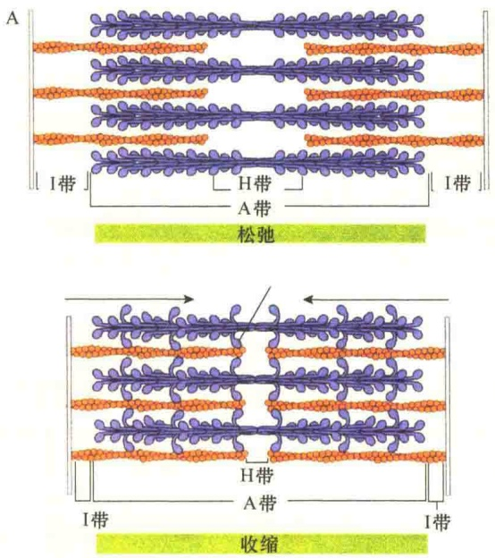
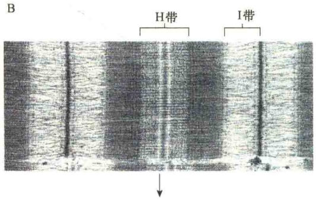
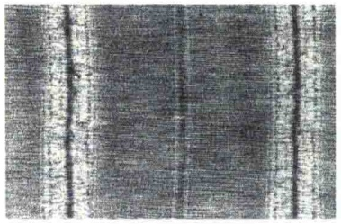
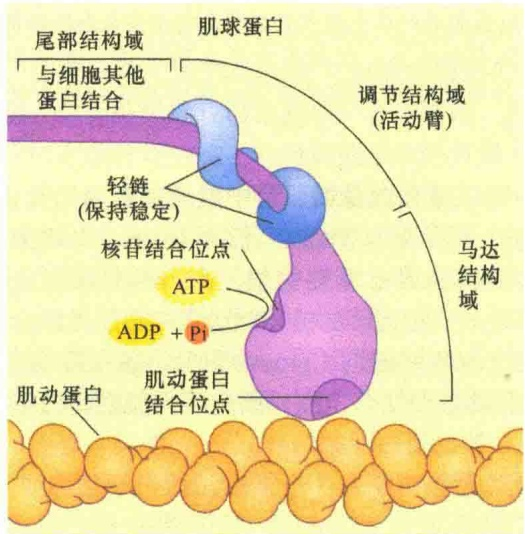
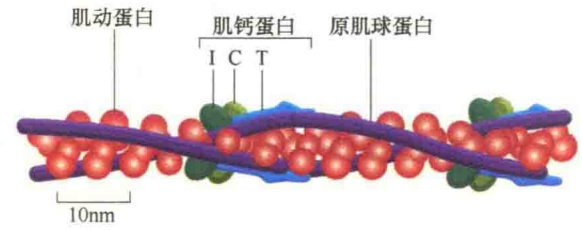
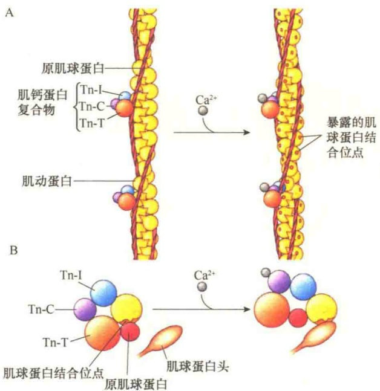
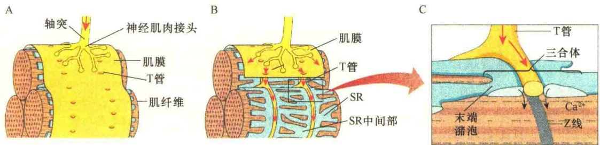
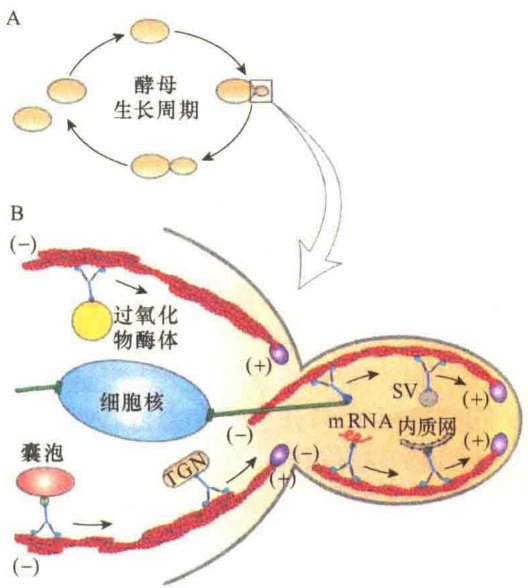
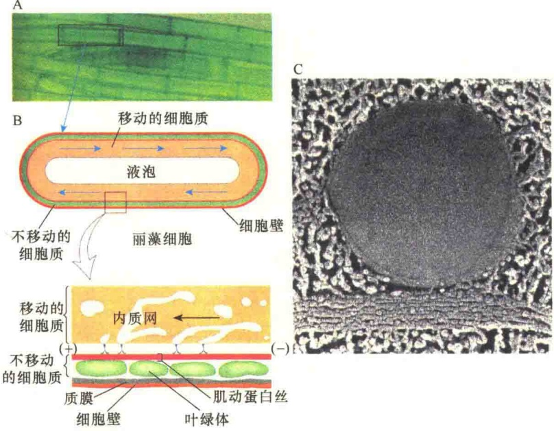

## 11.3.5.3 肌收缩的肌丝滑动模型及分子基础

关于肌动蛋白和肌球蛋白是怎样相互作用引起肌收缩问题的研究，在20世纪50年代初取得了关键性的突破。当时有几个实验室各自独立地对肌收缩进行了分析，并得到收缩的不同阶段骨骼肌所显示的带型。他们的测量结果表明:在肌收缩过程中，肌节几乎缩短50%，但是肌节的A带的长度并没有发生变化。肌节的缩短只是伴随着I带的缩短，在整个收缩的肌纤维中，I带几乎消失了。

根据这些观察，两个英国研究小组的科学家们提出了一个大胆的模型解释肌收缩的机制。他们推测:肌节的缩短并不是因肌丝的缩短而引起，而是由肌丝互相滑动所致。细肌丝向肌节中央滑动，肌丝滑进了A带之中导致重叠部分增加，使得I带和H带的宽度缩小，其结果是缩短了肌节，减少了肌纤维的长度（图11-58），这就是肌收缩的肌丝滑动模型（sliding filament model）。这一模型很快被接受，并不断被完善。

按照前面讨论的肌球蛋白Ⅱ的工作原理，粗

图 11-58 肌收缩时肌节的收缩（引自 Karp，2010）。A. 肌收缩时肌节长度变化及肌节结构差异示意图。在肌收缩时，肌球蛋白的交联桥与周围的细肌丝接触，细肌丝被推动滑向肌节的中心。B. 肌收缩时的电子显微镜照片。

肌丝与细肌丝之间的滑动必然要涉及粗肌丝中肌球蛋白Ⅱ的头部与肌动蛋白细肌丝接触，产生细肌丝与粗肌丝之间的交联桥（cross bridge），才能产生滑动。肌丝滑动模型提出之后，科学家的注意力很快转移到肌球蛋白，并研究肌球蛋白的头是如何作为肌纤维中产生力的成分起作用。很快发现在收缩时，每个肌球蛋白的头都向外伸出，并与细肌丝紧紧地结合，形成细肌丝与粗肌丝间的交联桥。每一条肌球蛋白丝的头能够与周围6条肌动蛋白丝相互作用。一旦与细肌丝结合，肌球蛋白的头部就会快速向中心部位弯曲，使细肌丝沿粗肌丝向肌节中央移动5～15nm。1993年Rayment等提出旋转杠杆臂（swinging lever arm）假说，解释肌球蛋白与肌动蛋白之间滑动的机制（图11-59）:ATP水解释放出的能量诱导肌球蛋白头部构型发生少许改变，然后通过旋转使肌球蛋白  $\alpha$  螺旋的颈部伸展。按照这一假说，肌球蛋白的颈部作为强度极高的杠杆臂（lever arm），引起肌动蛋白丝快速的远距离滑动。而结合在颈部的两条轻链则对杠杆臂起加固作用。旋转杠杆臂假说得到很多实验的支持。

图 11-59 肌球蛋白颈部作为旋转杠杆臂开关的模型（引自 Plopper，2016）。

## 11.3.5.4  $Ca^{2+}$  与肌动蛋白结合蛋白对骨骼肌收缩的调节

按照滑动模型，粗肌丝与细肌丝之间的滑动需要肌球蛋白的头部与肌动蛋白细肌丝接触，产生细肌丝与粗肌丝之间的交联桥。但是，在静息状况下，肌球蛋白Ⅱ的头部是不能与肌动蛋白结合的，因为此时肌动蛋白丝的结合点被封闭了，要想将其打开，需要“扳道工”，而“扳道工”又是按指令行事的，所以，肌收缩受到严格调控。

1）原肌球蛋白与肌钙蛋白 原肌球蛋白（tropomyosin，Tm）和肌钙蛋白（troponin，Tn）是肌动蛋白丝的两个“贴身护卫”，它们都是肌动蛋白结合蛋白。与前面介绍的加帽蛋白、肌巨蛋白不同，Tm与Tn负责对肌动蛋白丝的功能进行调节（图11-60）。

图 11-60 静息状态下原肌球蛋白、肌钙蛋白与肌动蛋白丝结合位置（引自 Alberts et al., 2008）。每一个原肌球蛋白可以与 7 个肌动蛋白亚基结合，恰好是一个螺旋。此时结合的原肌球蛋白正好封闭了肌动蛋白与肌球蛋白Ⅱ头部结合的位点，肌钙蛋白复合物同样沿肌动蛋白丝长轴结合，它可以调控原肌球蛋白与肌动蛋白丝的结合位点。

原肌球蛋白是细肌丝中肌动蛋白的结合蛋白，它的分子质量为 70kDa，长为 41nm，由两条平行的多肽链组成  $\alpha$  螺旋构型，每条原肌球蛋白首尾相接形成一条连续的链与肌动蛋白细肌丝结合，正好位于双螺旋的沟（groove）中。每一条 Tm 含有 7 个肌动蛋白结合位点，因此可与肌动蛋白细肌丝中 7 个肌动蛋白亚基结合。

肌钙蛋白是由3个多肽，即肌钙蛋白T（Tn-T）、肌钙蛋白I（Tn-I）、肌钙蛋白C（Tn-C）组成的复合物，分子质量约80kDa。Tn-T是一种长形的纤维状分子，长度大约是原肌球蛋白的1/3，

Tn-I 和 Tn-C 都是球形分子。Tn-I 能够与肌动蛋白及 Tn-T 结合，它同肌动蛋白的结合抑制了肌球蛋白与肌动蛋白的结合。Tn-C 是肌钙蛋白的  $Ca^{2+}$  结合亚基，在序列上与钙调蛋白及肌球蛋白的轻链相类似，Tn-C 控制着原肌球蛋白在肌动蛋白纤维表面的位置。在细肌丝上，大约每隔 40nm 就结合有一个肌钙蛋白。

2） $Ca^{2+}$ 对肌收缩的调节作用 由于细肌丝的肌动蛋白上结合有两种蛋白质，其中的原肌球蛋白能够与7个肌动蛋白单体结合，并封闭了肌动蛋白上同肌球蛋白结合的位点，在这种情况下，肌节中的粗肌丝和细肌丝之间不可能形成交联桥，因为肌动蛋白上与肌球蛋白头部结合的位点被原肌球蛋白封闭了。只有解除原肌球蛋白对肌动蛋白纤维的抑制，才有可能形成交联桥。

细胞中  $Ca^{2+}$  浓度能够调节原肌球蛋白对肌动蛋白的抑制作用，因为高浓度的  $Ca^{2+}$  能够与肌钙蛋白的 Tn-C 亚基结合，改变原肌球蛋白与肌动蛋白结合的位置，解除原肌球蛋白对肌动蛋白的抑制，露出与肌球蛋白头部结合的位点（图 11-61）。

图 11-61  $Ca^{2+}$  对原肌球蛋白与肌动蛋白结合的影响（引自 Cooper and Hausman, 2013）。A. 当  $Ca^{2+}$  浓度很低时，肌动蛋白上与肌球蛋白结合的位点被原肌球蛋白占据； $Ca^{2+}$  浓度高时，通过与肌钙蛋白 Tn-C 亚基的结合，改变原肌球蛋白在肌动蛋白纤维中的结合部位，暴露出与肌球蛋白结合的位点。B. 剖视图。

3）$\mathrm{Ca^{2+}}$ 浓度调节:肌收缩与神经兴奋相偶联

如同其他一些细胞活动，肌收缩也是由胞质溶胶中  $Ca^{2+}$  浓度的升高所引起。在正常情况下， $Ca^{2+}$在胞质溶胶中的浓度很低，在  $0.1 \mu mol/L$  以下。非肌细胞靠细胞质膜中的  $Ca^{2+}$ -ATPase 维持胞质溶胶中  $Ca^{2+}$  的低浓度，它可将胞质溶胶中的  $Ca^{2+}$  泵到细胞外。而肌细胞维持胞质溶胶中低  $Ca^{2+}$  浓度则是依靠肌质网（sarcoplasmic reticulum，SR）中的  $Ca^{2+}$ -ATPase 的作用，它将胞质溶胶中的  $Ca^{2+}$  不断输入肌质网中。肌质网是肌细胞中的管状网络结构，它是肌细胞中的  $Ca^{2+}$  库。

在骨骼肌细胞中， $Ca^{2+}$ 浓度的变化受运动神经信号调节，也就是说，肌收缩受神经控制，这种控制是通过细胞内信号分子 $Ca^{2+}$ 来传递的。当神经冲动到达骨骼肌细胞时，引起细胞质膜膜电位的变化（去极化）。骨骼肌细胞能够将这种电信号（去极化）很快转变成胞质溶胶中的化学信号，即提高胞质溶胶中的  $Ca^{2+}$  浓度，由  $Ca^{2+}$  启动肌收缩。这条信号途径的一个结构上的特点就是要通过细胞质膜向胞质溶胶内陷所形成的横小管（transverse tubule，T 管），而 T 管的末端靠近肌质网。这样，神经信号最后是通过 T 管传到肌质网。

由此可以推测，神经系统的电信号传递是以膜电位的形式沿着神经细胞传递的，这种膜电位叫动作电位（action potential）。当动作电位到达神经细胞末梢时，它触发神经递质扩散，穿过轴突，并与相邻靶细胞的质膜结合，使细胞质膜去极化，最后信号通过与肌质网相邻的T管激发肌质网向胞质溶胶释放储存的 $Ca^{2+}$ ，从而使胞质溶胶中的 $Ca^{2+}$ 浓度快速升高，使电信号转变成化学信号（图11-62）。

图 11-62 神经信号对肌细胞的刺激（引自 Jeff et al., 2012）。A. 动作电位沿神经元的轴突向下移动直至神经肌肉接头，在肌肉细胞与神经元之间有突触；B. 轴突末端去极化，导致肌细胞表面与乙酰胆碱受体结合的神经递质释放，引起肌细胞去极化；C. 去极化作用经由 T 管扩散到肌细胞内部，刺激 SR 末端潴泡中 Ca$^{2+}$通道开放从而释放出 Ca$^{2+}$，使胞质溶胶中 Ca$^{2+}$浓度升高，进行肌收缩调节。

释放出来的  $Ca^{2+}$  与肌钙蛋白结合，解除原肌球蛋白对肌动蛋白的抑制，使粗肌丝肌球蛋白的头部得以同肌动蛋白接触，形成交联桥。然后再由 ATP 同肌球蛋白头部的 ATP 结合位点结合，并通过 ATP 的水解提供能量及肌球蛋白头部构型的变化，引起粗肌丝与细肌丝间的滑动，产生肌收缩。

## 11.3.6 肌动蛋白和肌球蛋白在非肌细胞中的作用

在非肌细胞中，肌动蛋白丝与肌球蛋白结合，参与多种多样的细胞活动，包括胞质分裂、胞质环流、吞噬作用、小泡运输、细胞黏着、细胞连接、细胞内吞作用、血小板的活性、轴突生长、细胞形态改变及细胞移动等。在讨论肌球蛋白的作用时已经介绍了在非肌细胞中部分作用，下面再讨论一些典型的作用。

## 11.3.6.1 黏着斑和微绒毛中的束状肌动蛋白丝

当将细胞放在培养瓶中进行培养时，细胞需要与培养瓶底接触，并平铺在基底生长，这种结合通常需要形成一种特殊的、紧密的黏着斑。在黏着斑的细胞质膜下方有肌动蛋白成束状排列，这种结构叫应力纤维（stress fiber）。

应力纤维是收缩肌动蛋白丝束，支撑很多细胞质膜表面突出来形成特化区域，以便与相邻的细胞、细胞外基质或其他物质（如培养器皿的表面）接触。应力纤维是真核细胞中广泛存在的一种较为稳定的束状纤维结构，与骨骼肌中肌原纤维非常相像。应力纤维由大量平行排列的肌动蛋白组成，此外还含有其他在肌细胞鉴定过的蛋白质，包括肌球蛋白Ⅱ、原肌球蛋白、α-辅肌动蛋白和细丝蛋白（filamin）。例如，在细胞的黏着斑连接中，应力纤维中的肌动蛋白纤维由α-辅肌蛋白交联成收缩束，并通过黏着斑蛋白、踝蛋白介导与细胞质膜的整联蛋白连接（见图4-39）。

微绒毛（microvilli）是一些动物细胞表面的指状突起，每一微绒毛（指状凸起）由一束纤维状肌动蛋白稳定，其中含有绒毛蛋白（villin）和丝束蛋白（fimbrin），不含肌球蛋白Ⅱ、原肌球蛋白和  $\alpha$ -辅基蛋白，因而无收缩作用。

一个肠细胞表面有几千个微绒毛，它们的存在大大增加了肠上皮表面积，有利于吸收营养物质。微绒毛的长度为1\~3μm，直径为0.1μm，由几十个成束平行排列的肌动蛋白丝支持并定向。微绒毛中肌动蛋白丝的排列方向相同，（+）端指向微绒毛的尖端。

## 11.3.6.2 细胞内运输作用

微丝与微管一样，在细胞内可以作为分子马达进行物质运输的轨道。例如，小泡的运输，可通过肌球蛋白I与微丝结合，将小泡沿微丝的（一）端向（+）端移动。另外，肌球蛋白I的尾部与质膜结合，利用其头部可将微丝从一个部位运向另一个部位。最典型的例子是芽殖酵母出芽中，肌球蛋白V的运输作用（图11-63）。芽殖酵母的这种运输作用非常重要，因为芽殖酵母一旦开始出芽，就必须不断地由母体提供出芽生长所必需的生活物质。

## 11.3.6.3 胞质环流

肌球蛋白V除了具有强大的运输功能外，在大型绿藻，如丽藻（Nitella）中制造了蔚为壮观的胞质环流（cytoplasmic streaming, cyclosis）。

胞质环流是菌类、藻类和高等植物细胞中非常活跃的运动现象。在植物细胞中，细胞质的流动是围绕中央液泡进行的环形流动模式，这种流动称为胞质环流。在胞质环流中，细胞皮质区（cortical region）的细胞质是相当稳定的且不流动的，只是靠内层部分的胞质溶胶在流动。在能流动和不流动的细胞质层面有大量的微丝平行排列，与叶绿体锚定在一起。胞质环流是由肌动蛋白和肌球蛋白V相互作用引起的。在胞质环流中，肌动蛋白的排列方向是相同的，正向朝向流动的方向，肌球蛋白V可能是沿着肌动蛋白丝的（-）端向（+）端快速移动，引起细胞质的流动。胞质环流对于细胞的营养代谢具有重要作用，能够不断地分配各种营养物和代谢物，使它们在细胞内均匀分布（图11-64）。

图 11-63 肌球蛋白 V 在芽殖酵母中的运输作用（引自 Lodish et al., 2013）。A. 芽殖酵母的细胞周期。B. 正在出芽的芽殖酵母中肌球蛋白 V 的运输作用，包括向子细胞中运输各种必需的细胞结构，如高尔基体、内质网、过氧化物酶、囊泡、分泌小泡（secretory vesicle, SV），以及选择性运输一些 mRNA。肌球蛋白的尾部还能与微管的末端结合，帮助有丝分裂时核分裂定向。TGN:反面高尔基网。

图 11-64 圆柱形巨型藻类细胞中的胞质环流（引自 Lodish et al., 2013）。

A. 丽藻细胞。丽藻是夏季池塘中常见的一种淡水藻类，它的细胞质流动非常“壮观”，并且可在显微镜下观察到。

B. 丽藻细胞的中央有一个充满液体的大液泡，周围有一层可流动的细胞质（箭头所示）。外面是一层不能移动的细胞周质，其中排列着很多叶绿体，内侧则是肌动蛋白丝束，并且都是以相同的极性排列。肌球蛋白 V 的尾部结合内质网片段，沿肌动蛋白丝移动，从而带动整个细胞质流动。

C. 具有中央大液泡的丽藻细胞电镜照片。