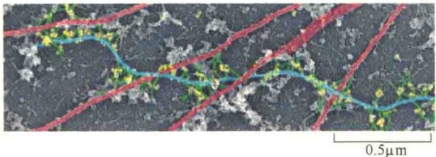
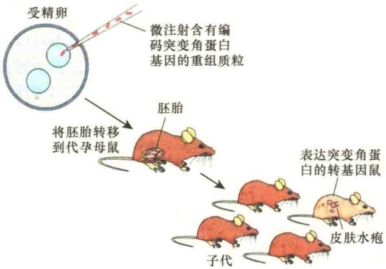
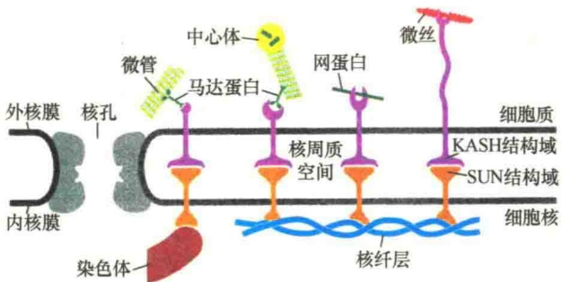
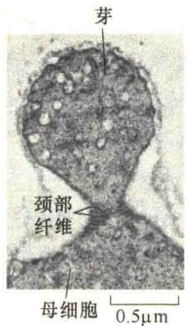
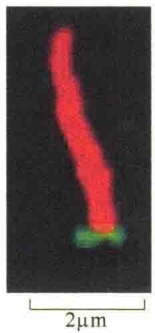

束。与微丝结合蛋白、微管结合蛋白不同，没有发现有中间纤维切割蛋白、加帽蛋白，也没有发现与中间纤维有关的马达蛋白。IFAP 的一个可能作用是将中间纤维与微丝、微管交联起来形成大的细胞骨架网络。一些常见的 IFAP 列于表 11-7。

表11-7 一些中间纤维结合蛋白及其功能

| 名称 | 分子质量/kDa | 存在部位 | 功能 |
| --- | --- | --- | --- |
| BPAG1* | 230 | 半桥粒 | 将中间纤维同致密斑交联 |
| 斑珠蛋白(plakoglobin) | 83 | 桥粒 | 将中间纤维同致密斑交联 |
| 桥粒斑蛋白I(desmoplakin I) | 250 | 桥粒 | 将中间纤维同致密斑交联 |
| 桥粒斑蛋白II(desmoplakin II) | 215 | 桥粒 | 将中间纤维同致密斑交联 |
| 网蛋白(plectin) | 300 | 皮层 | 波形蛋白交联接头,与MAP1、MAP2及血影蛋白交联 |
| 锚蛋白(ankyrin) | 140 | 皮层 | 波形蛋白与膜交联 |
| 聚丝蛋白(filaggrin) | 30 | 细胞质 | 角蛋白交联 |
| 核纤层蛋白B受体(lamin B receptor) | 58 | 核 | 核纤层蛋白与核内表面交联 |

\* 大泡性类天疱疮抗原 1（bullous pemphigoid antigen 1）。

如同微管、微丝，中间纤维结合蛋白拓展了中间纤维在细胞中的作用。在肌动蛋白结合蛋白中有一类结合蛋白家族叫斑蛋白（plakin），该家族的成员能够将中间纤维网络与其他的骨架网络连接起来。斑蛋白是一个大的家族，各成员间结构不尽相同，而且含有多个结构域，分别与不同的骨架结合。例如，斑蛋白家族成员中的网蛋白，它除了与束状中间纤维结合之外，还能够与微管、微丝，以及肌球蛋白Ⅱ连接起来。另外，网蛋白还能介导中间纤维参与细胞的连接。

## 11.4.4 中间纤维的功能

人们对中间纤维的功能了解较少，主要原因是迄今没有找到一种能够与中间纤维结合的药物。对中间纤维功能的研究主要是通过基因工程手段，特别是通过基因敲除，获得丧失合成某种中间纤维蛋白的工程小鼠，或者是合成某种中间纤维突变蛋白并研究其对小鼠生存能力的影响。

## 11.4.4.1 与微管、微丝共同维持细胞的强度与整体性

从细胞水平看，中间纤维在细胞质内形成一个完整的支撑网架系统。它通过整联蛋白与细胞质膜和细胞外基质相连，在内部与细胞核表面和核基质直接结合；中间纤维可通过中间纤维结合蛋白与微管、微丝及其他细胞器相连形成骨架网络，赋予细胞一定的强度和机械支持力。例如，网蛋白可将中间纤维与细胞质骨架交联成一个精细的网络，这种网络与质膜或微管锚定在一起（图 11-70）。

图 11-70 通过网蛋白形成的多种骨架纤维的交联（引自 Alberts et al., 2015）。绿色是网蛋白，红色是微管，蓝色是中间纤维。黄色的点状颗粒是与网蛋白连接的抗体。

虽然多年来一直认为中间纤维对细胞的形态提供机械支持，但没有直接的实验证据。直到1991年，通过转基因技术才真正获得中间纤维确实为细胞的形态提供机械支持的完整证据。研究者将一个突变的编码角蛋白（keratin）的基因克隆到质粒载体，然后通过微注射的方法将重组质粒DNA注射到鼠受精卵的细胞核中，将转基因的受精卵培养成囊胚后转入代孕母鼠的子宫，让其发育成鼠。在子代中出现了因角蛋白基因突变致使角蛋白中间纤维不能正确组装，从而出现皮肤水疱的转基因鼠（图11-71）。

## 11.4.4.2 通过 SUN-KASH 复合物连接细胞核与细胞质骨架

网蛋白和其他的斑蛋白能够与细胞质骨架-核纤层蛋白连接的 SUN-KASH 复合物相互作用，从而将细胞质骨架与核膜连成一个整体。SUN-KASH复合物的 SUN 和 KASH 结构域在核被膜的腔内相互结合。SUN 蛋白位于内核膜，能够与核内的核纤层或染色体结合；而 KASH 蛋白是外核膜蛋白，能够与细胞质中的微管、微丝、发动蛋白及网蛋白结合（图 11-72）。

图 11-71 角蛋白功能的实验证明（引自 Cooper and Hausman, 2004）。

图 11-72 SUN-KASH 蛋白复合物通过 SUN-KASH 结构域将细胞核与细胞质连成一体（引自 Alberts et al., 2015）。SUN 蛋白的 SUN 结构域在核被膜的周质空间与 KASH 蛋白的 KASH 结构域结合，SUN 蛋白能够与核纤层、染色体结合，KASH 蛋白能够与细胞质骨架、马达蛋白、网蛋白结合，因此，在 SUN-KASH 蛋白复合物的作用下，细胞质骨架细胞核骨架连为一体。

## 11.4.4.3 参与细胞连接及维持核膜的稳定

一些器官和皮肤的表皮细胞是通过桥粒和半桥粒连接在一起的。桥粒介导细胞与细胞的黏着，半桥粒介导细胞与细胞外基质的黏着。中间纤维参与黏着连接中的桥粒连接和半桥粒连接，在这些连接中，中间纤维在细胞中形成一个网络，既能维持细胞形态，又能提供支持力。详见第4章的4.3“细胞连接”相关内容。

在细胞核内膜的下面有一层由核纤层蛋白组成的网络，对于细胞核形态的维持具有重要作用，而核纤层蛋白是中间纤维的一种。组成这种网络结构的核纤层蛋白A和C，它们交联在一起，然后通过核纤层蛋白B附着到内核膜上，在内核膜上有核纤层蛋白B的受体。详见第12章12.1“核被膜”部分。

## 11.4.4.4 与微丝、微管的比较及协同作用

与微管和微丝相比，中间纤维在结构和功能上至少有三个方面的差异。第一，中间纤维是相当稳定的结构，即使用含有去垢剂和高盐溶液处理细胞，中间纤维仍然保持完整无缺。在这种条件下，微管和微丝则要去聚合并溶解在溶液中。实际上，大多数分离纯化中间纤维的方法都是先去除其他的蛋白质，然后用尿素处理使其变性，再用离子交换来纯化中间纤维。第二，中间纤维在体积上与微管和微丝是不同的，微管的直径为24nm，微丝的直径则是7nm，而中间纤维是10nm。形态上也不相同，微管是由 $\alpha\beta$ -微管蛋白二聚体组装成的中空管状，微丝是由球形亚基装配成的 $\alpha$ 螺旋纤维，而中间纤维是由 $\alpha$ 螺旋杆状亚基装配成似杆状的结构。第三，中间纤维的亚基并不与核苷酸结合，而微管的亚基与GTP或GDP结合，微丝的亚基则与ATP或ADP结合，但对于中间纤维装配的许多细节尚不清楚。表11-8将三种细胞骨架的一些主要特点进行了比较。

表 11-8 微管、微丝和中间纤维的主要特性比较

<table><tr><td>项目</td><td>微管</td><td>微丝</td><td>中间纤维</td></tr><tr><td>蛋白质组成</td><td>微管蛋白异二聚体</td><td>球形肌动蛋白</td><td>6类中间纤维蛋白</td></tr><tr><td>分子质量 /Da</td><td> $50 \times 10^{3}$ </td><td> $43 \times 10^{3}$ </td><td> $40 \times 10^{3} \sim 200 \times 10^{3}$ </td></tr><tr><td>细胞内分布</td><td>靠近细胞核</td><td>细胞质膜内侧</td><td>整个细胞</td></tr><tr><td>纤维直径 /nm</td><td>24</td><td>7</td><td>10</td></tr><tr><td>纤维结构特点</td><td>13条原纤维组成空心管状纤维</td><td>2条原纤维组成双股螺旋</td><td>32条原纤维组成非空心的多级螺旋</td></tr><tr><td>极性</td><td>有</td><td>有</td><td>无</td></tr><tr><td>单体蛋白库</td><td>有</td><td>有</td><td>无</td></tr><tr><td>踏车现象</td><td>有</td><td>有</td><td>无</td></tr><tr><td rowspan="4">特异性药物</td><td>秋水仙素</td><td>细胞松弛素B</td><td>无</td></tr><tr><td>紫杉醇</td><td>鬼笔环肽</td><td></td></tr><tr><td>长春花碱(vinblastine)</td><td>swinholide</td><td></td></tr><tr><td>nocodazole(有丝分裂抑制剂)</td><td>latrunculin</td><td></td></tr><tr><td>结合蛋白</td><td>有</td><td>有</td><td>有</td></tr><tr><td>主要功能</td><td>轴丝;细胞游动细胞质;动物细胞形态的组织与保持;染色体分离;细胞器的分布与转移</td><td>肌收缩;变形运动;胞质环流;细胞爬行;胞质分裂;保持动物细胞的形态</td><td>支持结构;保持动物细胞的形态;形成核纤层和核骨架;提高神经细胞轴突的强度;保持肌纤维的稳定(结蛋白)</td></tr></table>

## 11.4.5 隔蛋白

隔蛋白（septin）是一种 GTP 结合蛋白，由隔蛋白形成的纤维是一类特别的、不同于微管、微丝、中间纤维的纤维系统，除了陆生植物外，其他真核细胞中都有隔蛋白纤维。隔蛋白装配成无极性的纤维，并形成环状或似笼形结构。这种结构可作为支架，将膜分隔成不同的结构域，或者招募并组织肌动蛋白与微管骨架。最早是在芽殖酵母中鉴定到隔蛋白，发现隔蛋白纤维位于出芽的母细胞与正在生长的子细胞之间的颈部。颈部的隔蛋白纤维阻止了蛋白质从一侧移向另一侧，有利于子细胞的生长（图 11-73A）。隔蛋白也招募肌动蛋白-肌球蛋白形成胞质分裂所需的收缩环。在动物细胞中，隔蛋白在细胞分裂、迁移、小泡运输中都发挥作用。在初级纤毛中，隔蛋白在纤毛的基部装配成一个环状结构（图 11-73B），作为膜扩散的障碍，限制了膜蛋白的移动，建立了特异的纤毛膜区域。如果降低隔蛋白的水平，则会影响初级纤毛的形成与信号转导。

A

B

图 11-73 隔蛋白对细胞的分隔作用（改自 Alberts et al., 2015）。A. 隔蛋白在芽殖酵母的颈部形成纤维；B. 荧光揭示的纤毛基部隔蛋白装配的“领结”（绿色）。

酵母中有 7 个、人类有 13 个隔蛋白编码基因，根据序列相关性，可分为 4 类。将隔蛋白分离纯化后置于测试管中，发现它们可装配成对称的异六聚体或异八聚体，并装配成非极性成对的纤维。在隔蛋白多聚体的折叠中需要 GTP 的结合，但是 GTP 的水解对隔蛋白的功能有何意义尚不得而知。在细胞内，隔蛋白进行装配与去装配，但它们不像微丝、微管那样频繁变化。

## 本章小结

细胞骨架是细胞内以蛋白质纤维为主要成分的网络结构，包括微管、微丝和中间纤维，具有多种功能。

微管主要分布在核周围，它由微管蛋白异源二聚体组成。微管有单体、二联体和三联体，其中单体主要存在于细胞质，是多态性最大的微管；二联体存在于纤毛、鞭毛；三联体存在于基体、中心粒。三者都是比较稳定的微管。

微管的组装分为成核和延长两个过程，其中成核反应是限速步骤，$\gamma$-微管蛋白在成核反应中起关键作用。微管从微管组织中心（MTOC）开始生长，起始端为（一）端，生长端为（+）端，因此微管具有极性。影响微管体外装配稳定性的因素有GTP浓度、压力、温度、pH、微管蛋白临界浓度、药物等。细胞内的微管处于动态不稳定状态，具有踏车现象。微管通过与微管结合蛋白（MAP）的结合扩展其功能。影响微管稳定性的药物有秋水仙碱与紫杉醇。

微管的功能有支架作用，作为细胞内物质运输的轨道，纤毛和鞭毛的构件，参与细胞的有丝分裂和减

数分裂等。

微丝又称肌动蛋白丝，由两条肌动蛋白纤维组成。微丝的装配分三个阶段:成核、延长和稳定，其中需ATP的参与。这一过程受G-肌动蛋白临界浓度和一些离子浓度的影响。肌动蛋白也有踏车现象。微丝的稳定性受细胞松弛素和鬼笔环肽的影响。

分子马达是一类利用 ATP 供能，产生推动力，进行细胞内物质运输或运动的蛋白质。分子马达有肌球蛋白家族、驱动蛋白家族和动力蛋白家族等。其中驱动蛋白和动力蛋白是以微管作为运行的轨道，而肌球蛋白则是以微丝作为运行的轨道。分子马达的运输是单方向的、逐步行进的。驱动蛋白在神经细胞中的功能是将物质从神经细胞的胞体运向轴突末端，并沿微管的（一）端向（+）端移动。细胞质动力蛋白的移动方向则相反，它是有丝分裂中染色体运动的力的来源，也参与小泡和膜性细胞器的运输。

肌球蛋白是一种肌动蛋白纤维的分子马达，研究的较为清楚的有肌球蛋白Ⅰ、肌球蛋白Ⅱ和肌球蛋白V。肌球蛋白Ⅱ为肌收缩和细胞质分裂提供力，肌球蛋白Ⅰ和肌球蛋白V则涉及细胞骨架与膜之间的相互作用。

肌收缩是细胞在进化过程中形成的一种高度特化的功能。它是由肌动蛋白装配的细肌丝与肌球蛋白Ⅱ装配的粗肌丝之间的相互滑动实现的，这一过程受运动神经及钙离子浓度的调节。

中间纤维是三种骨架纤维中最复杂的一种，它的装配分三个过程:由单体形成二聚体，再由二聚体形成四聚体，最后由8个四聚体组成原丝。中间纤维的功能有:为细胞提供机械强度、参与细胞连接，是核骨架的主要成分并维持细胞核膜的稳定。

隔蛋白形成的纤维是一类特别的，且不同于微管、微丝、中间纤维的纤维系统。隔蛋白纤维没有极性，可形成环状或似笼形的支架结构，将膜分隔成不同的结构域。

## 思考题

（1）微管有哪些类型和功能？

（2）什么是马达蛋白？有哪些类型？

(3) 举例说明, 除马达蛋白以外的微丝结合蛋白是如何发挥辅助作用的?

(4) $\mathrm{Ca}^{2+}$ 与肌动蛋白结合蛋白是如何调节骨骼肌收缩的？

（5）什么是隔蛋白？举例说明隔蛋白的作用？