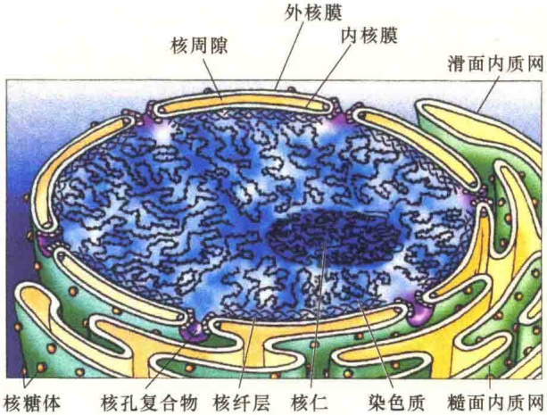
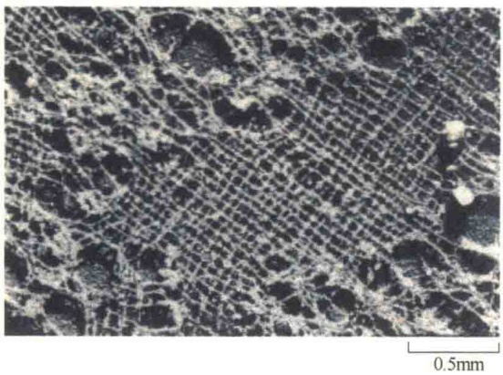
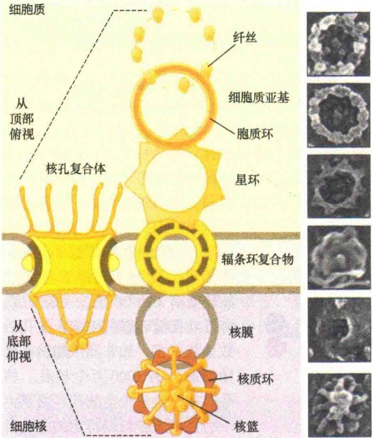
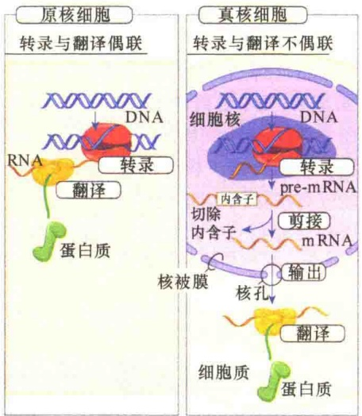

# 细胞核与染色体

## 12.1 核被膜

12.1.1 核被膜的结构

12.1.2 核被膜的功能

12.2 核孔复合体的运输作用

12.2.1 核孔复合体运输的一般特点

12.2.2 信号与受体

12.2.3 蛋白质与RNA的核运输机制

## 12.3 分子伴侣

12.3.1 分子伴侣的发现及特点

12.3.2 分子伴侣的功能和作用机制

## 12.4 染色质

12.4.1 染色质 DNA

12.4.2 组蛋白与非组蛋白

12.4.3 染色质的基本结构——核小体

## 12.5 染色体

12.5.1 染色质压缩成染色体

12.5.2 中期染色体的形态结构

12.5.3 巨型染色体

12.6 核仁与核基质

12.6.1 核仁

12.6.2 核基质与核骨架

细胞核（cell nucleus）是细胞内储存遗传物质的场所。除了成熟的红细胞和植物成熟的筛管没有细胞核外，真核生物的细胞都有细胞核。细胞核主要有两个功能:一是通过遗传物质的复制和细胞分裂保持细胞世代间的连续性（遗传）；二是通过基因的选择性表达，控制细胞的活动（图 12-1）。

A. 遗传信息在细胞世代间传递 B. 细胞内的遗传信息:遗传信息表达

图 12-1 细胞的遗传信息流（引自 Jeff et al., 2012）。图中显示的是真核细胞核的作用。原核细胞没有真正的细胞核，但同样通过 DNA 的复制与细胞分裂保持世代间的稳定，以及通过基因表达控制细胞的生命活动。A. 细胞世代间的遗传信息流。上一代细胞通过核内 DNA 的复制及细胞核与细胞质的分裂，进行细胞世代间的信息流。B. 细胞内的遗传信息流。遗传物质在细胞核内转录，在细胞质中表达成蛋白质，参与细胞的生命活动。

一般教科书上见到的细胞核通常是球形的，位于细胞中央的一个大型膜包被的细胞器。实际上，在不同类型的细胞中，细胞核的形态、大小和位置是不同的，通常是球形，但也有长形、扁平和不规则的形态。典型的细胞核的体积为细胞体积的5%～10%，但在某些情况下，细胞核的体积占细胞总体积的80%或更多。细胞核大小的变化是由细胞核所含有的DNA，以及细胞生理状态决定的。

细胞核的直径范围从  $1 \mu m$  到几百微米不等，平均为  $5 \sim 15 \mu m$ 。细胞核在细胞中的位置也是多变的，并不都是位于细胞的中央。一般来说，一个细胞只有一个细胞核，有些特殊的细胞含有多个细胞核。例如，脊椎动物的骨骼肌细胞，这种细胞很长，可达几个微米，甚至几个厘米，其中含有几十个甚至几百个独立的细胞核。

在细胞间期观察到典型的真核生物细胞核的结构有三个主要组成部分（图 12-2）。①由双层膜组成的核被膜，它将细胞核物质与细胞质分开，核被膜上有孔，内核膜下有核纤层。②一个或多个球形的核仁，这种结构与核糖体的合成有关。③似液态的核质（nucleoplasm），它是细胞核内除了核仁以外的空间部分，其中含有可溶性的核物质，包括DNA纤维，当它展开存在于细胞核中时称为染色质，组成致密结构时称为染色体；多种RNA、蛋白质分子，以及为细胞核提供骨架网络的核基质（nuclear matrix）等。

图 12-2 间期细胞核的形态结构（引自 Alberts et al., 2015）。A. 人的成纤维细胞切片观察的细胞核。B. 核外膜与内质网相连，核旁有一个中心体，是微管生长的地方。

原核生物没有真正的细胞核，而只有拟核（nucleoid）。在细胞水平上，原核和真核有三个方面的主要差别。①核膜:真核细胞有核膜；原核细胞没有核膜，称之为拟核。②核仁:真核细胞有核仁，原核细胞无核仁。③核内遗传物质的存在状态:真核细胞内DNA与组蛋白结合，有染色体结构；近年发现原核DNA也同蛋白质结合，但无染色体结构。

## 12.1 核被膜

真核生物的细胞核是在细胞周期的间期才能见到的细胞内的结构，此时的染色质被膜包被，因此，核被膜（nuclear envelope，NE）是细胞核的界膜，它将细胞核的内溶物与细胞质分隔开来，并为细胞核提供结构框架。两层核膜可作为障碍物，阻止细胞分子在细胞质与细胞核之间自由通过，以便维持细胞核作为细胞内的特殊区室，行驶独特的功能。细胞核与细胞质之间的唯一通道是核膜上的核孔，它能够调控细胞质与细胞核之间的分子交换，并且能够选择性运输蛋白质与RNA，这不仅保证了细胞核内组分的特殊性，同时也调节了基因表达。

## 12.1.1 核被膜的结构

核被膜是细胞核的界膜，对 DNA 具有保护作用。但是，由于细胞核是细胞内的“首脑机关”，要不断地发出“指令”，所以，细胞核被膜的结构既要确保核内遗传物质的安全，又要保证细胞核与细胞质之间的物质与信息交流畅通。

## 12.1.1.1 基本结构

核被膜的基本结构包括外核膜、内核膜、核周隙、核孔复合物和核纤层5个部分（图12-3）。

核被膜由内、外两层核膜组成，外核膜与内核膜相连，表面附有大量的核糖体颗粒。内核膜面向核质；内、外核膜间有15～30nm的透明腔，称为核周隙，膜上有孔。

1）外核膜（outer nuclear membrane）外核膜面向细胞质基质，常附有核糖体，有些部位与内质网相连，因此在形态和性质上与内质网相似。实际上，外核膜可以看成是内质网膜的一个特化

区。另外，细胞骨架成分，包括微管、肌动蛋白丝和中间纤维常常与外核膜相连，起着固定细胞核并维持细胞核适当形态的作用。

图 12-3 间期细胞核的染色质及核被膜（引自 Cooper and Hausman, 2004）。

2）内核膜（inner nuclear membrane） 内核膜面向核基质，与外核膜平行排列，其表面没有核糖体颗粒。

3）核纤层（nuclear lamina） 在与核质相邻的核膜内表面有一层网络状蛋白质，叫核纤层，对核被膜起支撑作用。

核纤层位于内核膜的下方。在某些细胞中，核纤层在内核膜的内侧形成连续的网层，而有些细胞中的核纤层蛋白则形成一片片的网状结构。（图 12-4）。

图 12-4 非洲爪蟾（Xenopus laevis）卵母细胞的核膜下方核纤层网状结构（引自 Cooper and Hausman, 2016）。

核纤层由三种分子质量为 60～80kDa 的核纤层蛋白亚基 A、B、C 纤维装配而成。核纤层蛋白属于细胞骨架中的中间纤维，但仅存在于细胞核。如同细胞质中间纤维，核纤层蛋白纤维可以相互结合，组装成高级结构（图 12-5）。

核纤层并非独立于内核膜，而是与内核膜结合在一起的。结合的方式有两种:一种方式是通过翻译后在 C 端半胱氨酸残基上添加脂，实际上这是一种 C 端半胱氨酸残基的异戊二烯化作用；另一种方式则是与核纤层蛋白 B 亚基的受体结合（图 12-6）。

图 12-6 核纤层与内核膜的结合（引自 Cooper and Hausman, 2016）。内核膜含有几种整合膜蛋白，如埃默蛋白（emerin）、核纤层蛋白 B 受体（lamin B receptor, LBR），以及 SUN 蛋白等，这些蛋白质都能与核纤层相互作用。SUN 蛋白还能与外核膜中 KASH 蛋白结合，形成一个连接复合体。此外，核纤层通过埃默蛋白、LBR 与染色质结合，使染色质在内核膜上有了“依靠”。

4）核周隙（perinuclear space）又称核周间隙，是两层核膜之间的间隙，宽15～30nm，其中充满不定形物质。由于外核膜与糙面内质网相连，所以核周隙常与内质网的腔相通。

## 12.1.1.2 核被膜的特殊结构:核孔复合体

核被膜的一个重要功能是运输作用。但是，在核膜中没有运输蛋白，所有的大分子及蛋白质的选择性运输都是通过核孔进行的。

核被膜上有许多孔，称为核孔（nuclear pore），是细胞核膜上沟通核质与胞质的开口，由内、外两

图 12-5 核纤层装配（引自 Cooper and Hausman, 2016）。首先，两条核纤层多肽通过  $\alpha$  螺旋区形成二聚体；然后，二聚体通过首尾相连形成线性多聚体；最后，线性多聚体间通过侧面相连，形成高度有序的结构。

层膜的局部融合而成，核孔的直径为80～120nm。一个典型的哺乳动物的核膜上有3000～4000个核孔，相当于每平方微米的核膜上有10～20个。一般来说，合成功能越旺盛的细胞，核孔的数量就越多，如非洲爪蟾的一个卵细胞就有1000万个核孔。核孔并非仅是一个空的孔，而是由一组蛋白质颗粒以特定的方式排布形成的立体结构，被称为核孔复合体（nuclear pore complex, NPC）（图12-7）。

研究发现，NPC的结构十分复杂（图 12-8）。电子显微镜照片揭示 NPC 是一个围绕中央通道的 8 对称圆柱形结构，含有多个环与辐条，在核孔处，内核膜与外核膜融成一体，至于融合的机制尚不清楚。核孔的中央部分有 8 个环形辐条（spoke）装配成的辐条环（spoke ring），在辐条环的细胞质面有胞质环（cytoplasmic ring），并且在胞质环上有伸向细胞质的胞质丝（cytoplasmic filament）；在辐条环的核质面有核质环（nucleoplasmic ring），在核质环上有 8 条伸向核质的纤丝，形成核篮（nuclear basket）。核质环伸向核质形成篮似的核笼形结构，由于核孔的结构像鱼笼，所以有人称之为鱼笼模型。

图 12-7 非洲爪蟾卵母细胞核被膜的核孔复合体（引自 Cooper and Hausman, 2016）。从非洲爪蟾卵母细胞核被膜的表面可见到大量的核孔复合体。

图 12-8 核孔复合物的结构模型（引自 Plopper，2016）。核孔是由 8 个辐条连接核质环与胞质环装配成的复合结构。辐条环围绕中央通道进行装配。左侧是示意图，右侧是电镜照片。

2018 年，美国研究人员首次获得酵母 NPC 的近乎完整的三维结构，他们使用一种新的整合建模（integrative modeling）方法确定了核孔复合物的 552 个蛋白质在通道内的位置，这个通道的形状有点像带有 8 个主辐条的货车车轮，这些主辐条将核心支架连接到更灵活的中央通道区域上。

## 12.1.2 核被膜的功能

核被膜是真核生物和原核生物之间的重要区别，具有十分重要的作用。

## 12.1.2.1 基因表达的时空隔离

在原核生物中，基因表达是连续进行的，即mRNA的转录和蛋白质的翻译相偶联（图12-9），主要是因为原核生物的基因转录物无须经过剪接；真核生物的结构复杂，而且大多数基因都有内含子，转录后需要经过复杂的加工，所以核膜的出现为基因表达提供了时空隔离的屏障，便于DNA在核内活动的多样性和DNA转录形成RNA的多样性，从而导致细胞的多样性。

图 12-9 真核生物细胞核对基因表达的时空隔离（引自 Plopper，2016）。原核细胞没有细胞核，基因的转录与蛋白质合成相偶联，真核细胞的基因转录在细胞核，蛋白质合成在细胞质。

## 12.1.2.2 保护性屏障

细胞核是在进化过程中形成的。在细胞的遗传信息储存量越来越丰富、由遗传信息所指导的代谢规模越来越大的情况下，有必要将携带遗传信息的