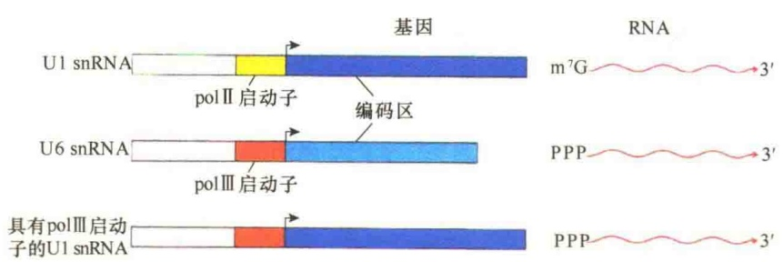
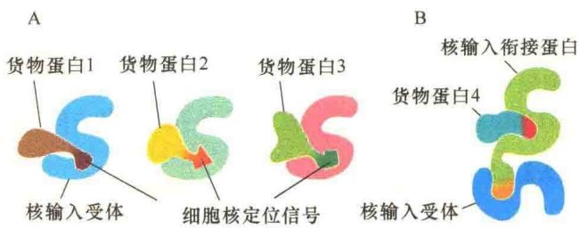

染色质与细胞的其他部分隔离开来。核膜的出现，为细胞遗传信息的保存、复制、传递及发挥其对细胞代谢和发育的指导作用创造了特定的微环境，使细胞核处于微环境中，提高了上述各项活动的效率；避免直接受细胞内其他各种生命活动干扰，并防止细胞中这个指挥中心的功能轻易地随环境条件的变化而变化，以保持其相对的稳定性，这些都是核膜出现的进化意义。

## 12.1.2.3 染色体的定位和酶分子的支架

核膜是染色体和酶分子的支架及固着部位。每一条染色质通过其端粒部分与核膜连在一起，形成各自的染色体领域（chromosome territory），每个染色体领域的直径大约 $2\mu \mathrm{m}$ 。染色质这种分布，使之多而不乱，保证了有序性（图12-10）。另外，核内的一些酶是以膜蛋白的形式存在的，这就有利于核内生化反应的区域化，从而提高了催化反应的效率。

图 12-10 通过荧光反应显示单个染色体在细胞核中占据不同领域（引自 Plopper，2016）。

## 12.2 核孔复合体的运输作用

核被膜虽然将基因组与细胞质分隔开来，将DNA转录与蛋白质合成进行了时空隔离，但是，核内的DNA复制与转录加工等生命活动都需要蛋白质的参与，同时，所需的能源及各种必需品都要从细胞质中运进来；此外，细胞核内加工成熟的各类RNA也需要从细胞质中运到细胞质中发挥作用。更重要的是，核糖体的大小亚基都是在细胞核内装配的，这涉及核糖体蛋白质的输入及核糖体亚基的输出问题。因此，核被膜必须具有精妙绝伦的运输机构与机制，确保运输畅通。物质进出细胞核的唯一通道就是NPC，也就是说NPC的功能就是

进行物质运输。

## 12.2.1 核孔复合体运输的一般特点

NPC 进行的物质运输是细胞内最为复杂的运输。既有主动运输，又有被动运输；既有从细胞质向细胞核的运输，又有从细胞核向细胞质的运输。

## 12.2.1.1 主动运输与双向运输

1965 年，Feldherr 将各种不同大小的金颗粒注射到变形虫的细胞质中，然后检查这些颗粒进入细胞核的情况。结果发现，金颗粒很快进入了细胞核，但体积越大，进入的速度就越慢，大于 10nm 的金颗粒进不了细胞核，由此推测，NPC 可作为水性的运输通道，允许小分子的物质自由扩散出入细胞核。

大多数的蛋白质与 RNA 都是通过主动运输出入细胞核的。主动运输需要通过核孔复合体对运输物质的识别及孔径的调节。像核糖体亚基这样大的复合物也能够通过核孔运输，这说明 NPC 的孔径是可调节的。主动运输所需要的能量，由 ATP 及 GTP 提供。

NPC 运输的另一个重要特点就是双向性。由于真核生物细胞中的基因表达是时空隔离的，所以，NPC 不仅要将 RNA、组装好的核糖体亚基从细胞核转运到细胞质，同时也要将染色质结构的维持、DNA 复制和转录所需的酶，以及帮助 DNA 装配的一些蛋白质从细胞质运进细胞核，这些蛋白质均是在细胞质的游离核糖体上合成的（图 12-11）。

图 12-11 NPC 的运输作用（引自 Plopper，2016）。

## 12.2.1.2 NPC运输的选择性

由于细胞核在细胞生命活动中的特殊作用，不难想象，通过 NPC 进出细胞核的生物分子一定是严格控制的。推测所有能够出入细胞核的生物分子一定持有特别的“通行证”。总体上说，出入细胞核的是两大类分子:RNA 与蛋白质，研究表明它们带有特殊的信号。

1）RNA的核输出 在生理状态下，RNA的输出需要信号标识。在RNA聚合酶Ⅱ指导下合成的RNA（mRNA和snRNA），当其5'端具有 $m^{7}GpppG$ 帽子结构时，即被定位于细胞质；若无帽子结构，则定位在细胞核。将游离的、具有帽子结构的类似物 $m^{3}GpppG$ 二核苷酸向核内进行连续注射，发现可抑制新转录的具有 $m^{7}G$ 帽子的U1 snRNA的核输出；而注入 $m^{7}GPPPG$ 却没有这种效应，说明5'端 $m^{7}G$ 帽子结构对于mRNA及U1 snRNA的核输出具有信号标识作用，这种现象称为帽结合活性（cap binding activity，CBA）。在细胞核中由RNA聚合酶Ⅱ合成的U1 snRNA、U2 snRNA、U4 snRNA和U5 snRNA在合成之后立即在5'端加上 $m^{7}G$ 的帽子结构，然后这些加工过的snRNA被运输到细胞质中与相应的蛋白质组装成snRNP，再运回到细胞核参与RNA的剪接。但是，由RNA聚合酶Ⅲ合成的U6 snRNA的5'端没有 $m^{7}G$ 的帽子结构，只有一个三磷酸核苷，所以它不会被运送到细胞质中。后来有人将RNA聚合酶Ⅲ的启动子与U1 snRNA连接起来，转录成的U1 snRNA也不能被运送到细胞质（图12-12）。

2）蛋白质的核输入与输出 由于蛋白质是在细胞质核糖体上合成的，所以，细胞核的生命活动所需的蛋白质都是来自细胞质。实际上，通过NPC进入细胞核的蛋白质不仅量大，而且种类繁多，大体分为三类:核蛋白（nuclear protein）、参与NPC运输的运输蛋白，以及核糖体蛋白质。核蛋白是指在细胞质中合成，然后运输到核内起作用的一类蛋白质，如各种组蛋白、DNA合成酶类、RNA转录和加工的酶类、各种起调控作用的蛋白因子等。参与NPC运输的蛋白质包括核输入蛋白和核输出蛋白，它们在运输中可在细胞核与细胞质间进行穿梭。核糖体结构蛋白由于需要到细胞核中与rRNA汇聚装配成核糖体亚基，所以需要经过NPC的运输作用进入细胞核，装配成核糖体的亚基后再运回到细胞质参与蛋白质的合成。上述三类蛋白质的氨基酸序列中都有特殊的入核或出核信号标识。

## 12.2.2 信号与受体

我们已经知道线粒体蛋白、叶绿体蛋白、过氧化物酶体蛋白，以及内质网蛋白的转运与定位都需要信号序列介导，并需要相应的受体。同样，NPC运输的蛋白质也要有信号介导，以及与信号序列识别与结合的受体。

## 12.2.2.1 核定位信号

能够引导蛋白质进入细胞核的信号称为核定位信号（nuclear localization signal，NLS），是另一种形式的信号肽，具有以下特征:①在多数核蛋白中，NLS由一个或两个富含正电荷的赖氨酸和精氨酸的短序列（4～8个氨基酸）组成；②这种信号肽序列可以位于多肽序列的任何部分，通常会在蛋白质表面形成一个环或斑；③NLS的作用是帮助核蛋白进入细胞核，由NPC来鉴别；④NLS是蛋白质的永久性部分，在进入细胞核后，并不被切除，可以反复使用，有利于细胞分裂后核重建时蛋白质重新输入核；⑤在任何复合物中，只要复合物中有一个亚基带有NLS，该复合物就能整体进入到细胞核。

NLS 的种类很多，第一个被确定的 NLS 序列的蛋白质是 SV40 的 T 抗原（分子质量为 92kDa），它在细胞质中合成后很快积累在细胞核中，是病毒 DNA 在核内复制所必需的蛋白质。其野生型的信号肽序列为 Pro-Pro-Lys-Lys-Lys-Arg-Lys-Val，即使单个氨基酸突变所产生的突变型 NLS（Pro-Pro-Lys-Thr-Lys-Arg-Lys-Val）也能阻止这种蛋白质进入细胞核而

图 12-12 U1 snRNA 从细胞核向细胞质运输需要 5' 帽子结构的实验证明（引自 Lodish et al., 1995）。

停留在细胞质中（图 12-13）。如果将这种信号接到非核蛋白的随机 Lys 的侧链上，则非核蛋白也能转变成核蛋白。

SV40 病毒的 T 抗原只含有一段短序列作为 NLS，称为单信号；而有些核蛋白则有两段序列构成 NLS，称为二重信号，如核质蛋白（图 12-14）。

图 12-13 NLS 的功能证明（引自 Alberts et al., 2015）。免疫荧光照片显示含具有正常及突变 NLS 的 SV40 病毒 T 抗原在细胞中的定位。A. 具有正常 NLS 的 T 抗原出现在细胞核。B. NLS 突变后的 T 抗原停留在细胞质中。

图 12-14 NLS（引自 Cooper and Hausman，2016）。SV40 T 抗原具有一段序列作为 NLS，核质蛋白则有两段序列作为 NLS。

## 12.2.2.2 核输入受体

仅有 NLS 的蛋白质自身不能通过核孔复合体，它必须与水溶性的核输入受体（nuclear import receptor）结合才可穿过核孔复合体进入细胞核。核输入受体又称为输入蛋白（importin），是由相关的基因家族编码的，分布在胞质溶胶中。不同的核输入受体能够识别带有不同 NLS 的货物蛋白并将其转运到细胞核（图 12-15A）。核输入受体并非都是直接与核输入蛋白结合，而是需要一个衔接蛋白在核输入蛋白的 NLS 与核输入受体间形成一个桥，才能被转运（图 12-15B）。

核输入受体是可溶性的细胞质蛋白，不仅能够与 NLS 结合，也能与位于核孔通道中央的核孔蛋白中无定型结构域部分的苯丙氨酸-甘氨酸重复片段结合，并借此逐渐移动，转运进入细胞核。

## 12.2.2.3 核输出信号与核输出受体

细胞核内的一些大分子，如核糖体亚基、RNA等的输出细胞核也需要依赖于选择性的运输系统。这一系统需要核输出信号（nuclear export signal，NES）作为核内物质输出细胞核的信号，同时也需要核输出受体（nuclear export receptor），核输出受体又称输出蛋白（exportin）。核输出受体是细胞核中能够识别核输出信号并与之结合的蛋白质，它同时能够与核孔复合物结合，以此帮助核内物质通过核孔复合体输出到细胞质。

在结构上，一些核输出受体与核输入受体是密切相关的，它们是由相同的核运输受体（nuclear transport receptor）基因编码的。核运输受体又称核周蛋白（karyopherin）。在酵母中有14个基因编码核周蛋白，动物中编码核周蛋白的基因数量更多。表12-1是部分核周蛋白的作用。

图 12-15 核输入受体（引自 Alberts et al., 2015）。A. 不同的核输入受体与不同的 NLS 及货物蛋白结合。B. 货物蛋白 4 通过核输入衔接蛋白与核输入受体形成复合物。核输入衔接蛋白在结构上与核输入受体相关，并能识别货物蛋白中的 NLS。核输入衔接蛋白也含有一个 NLS，并通过 NLS 与核输入受体结合。不过，只有当核输入衔接蛋白与货物蛋白结合后，核输入衔接蛋白中的 NLS 才会裸露出来并与核输入受体结合。

表 12-1 部分核周蛋白的作用

<table><tr><td>核周蛋白</td><td>运输的物质</td></tr><tr><td colspan="2">核输入</td></tr><tr><td>输入蛋白(Kapα/Kapβ1二聚体)</td><td>含有碱性氨基酸核定位信号的蛋白质(如核质蛋白)</td></tr><tr><td>核内小核糖核蛋白输入蛋白/Kapβ1</td><td>snRNP(U1,U2,U4,U5)</td></tr><tr><td>转运蛋白/Kapβ2</td><td>mRNA结合蛋白,核糖体蛋白</td></tr><tr><td>输入蛋白7/Kapβ1二聚体</td><td>组蛋白1,核糖体蛋白质</td></tr><tr><td colspan="2">核输出</td></tr><tr><td>Crm1</td><td>富含亮氨酸核输出信号的蛋白质核内小核糖核蛋白输入蛋白,snRNA,核糖体亚基</td></tr><tr><td>CAS</td><td>Kapα</td></tr><tr><td>输出蛋白-1</td><td>tRNA</td></tr><tr><td>输出蛋白-2</td><td>miRNA</td></tr></table>

## 12.2.3 蛋白质与RNA的核运输机制

## 12.2.3.1 核运输中的RanGTPase

在核孔运输中，一种单体 G 蛋白 Ran 起重要作用。如同其他的 GTPase 一样，Ran 也是一种分子开关，能够以两种状态存在:Ran-GDP 或 Ran-GTP。两种 Ran 特异的调节蛋白触发 Ran 的两种状态的改变:一种细胞质 GTPase 激活蛋白（GTPase-activating protein，GAP）触发 GTP 水解，将 Ran-GTP 转变成 Ran-GDP；而鸟苷交换因子（guanine exchange factor，GEF）促使 GDP 转换成 GTP，从而将 Ran-GDP 转换成 Ran-GTP。由于 Ran-GAP 定位于细胞质，而 Ran-GEF 定位于细胞核，并且与染色质结合在一起，因此细胞质中仅有 Ran-GDP，细胞核中含有 Ran-GTP（图 12-16）。由此可见，Ran-GTPase 的作用是控制着蛋白质经核孔运输的方向。

## 12.2.3.2 蛋白质的核输入机制

根据上面的讨论，可以推测蛋白质入核的运输机制:当细胞质中的输入蛋白识别一个含有 NLS 的货物蛋白并与之结合后，开始了核输入之旅。货物蛋白 / 输入蛋白复合体与核孔复合体的细胞质纤维结合，然后经过与 NPC 通道的中央蛋白相互作用后，逐渐向细胞核转运；货物蛋白 / 输入蛋白一旦进入细胞核，Ran-GTP 立即与输入蛋白结合，由于 Ran-GTP 的结合，改变了输入蛋白的构型，从而将货物蛋白从复合物中释放到细胞核（图 12-17）。

图 12-16 Ran-GDP 与 Ran-GTP 的空间隔离（引自 Alberts et al., 2015）。

图 12-17 蛋白质经 NPC 输入到细胞核（引自 Cooper and Hausman，2106）。货物蛋白的 NLS 被输入蛋白识别后即开始了运输过程。货物蛋白 / 输入蛋白复合体与 NPC 的细胞质纤维结合，并逐渐穿过核孔进入细胞核。细胞核中的 Ran-GTP 与输入蛋白结合，导致输入蛋白的构型发生变化，释放出货物蛋白。输入蛋白与 GTP 结合形成输入蛋白-Ran-GTP 复合物后，通过核孔复合物返回到细胞质。输入蛋白-Ran-GTP 进入细胞质后，结合在 NPC 体细胞质纤维上的 GTPase 激活蛋白（Ran GAP）将输入蛋白-Ran-GTP 中的 GTP 水解，形成 Ran-GDP，并释放出输入蛋白。释放的输入蛋白开始新的运输作用，而 Ran-GDP 与其受体核转运因子 2（nuclear transport factor 2，NTF2）结合，并一起进入细胞核。结合在染色质上的 Ran-GEF 激发 Ran-GDP 中的 GDP 与 GTP 交换，形成 Ran-GTP，从而维持细胞核中较高浓度的 Ran-GTP，为蛋白质的核输入提供保障。