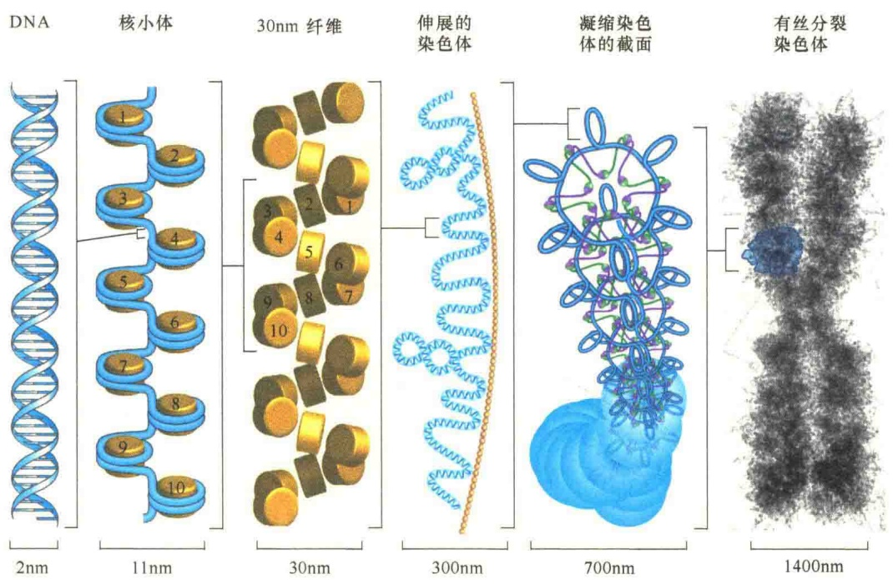
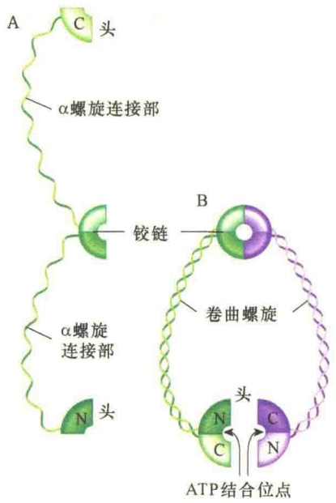
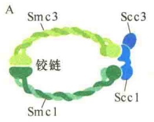
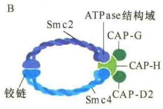
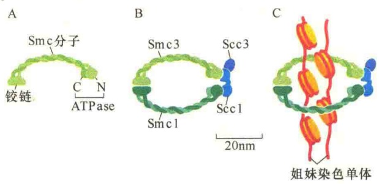
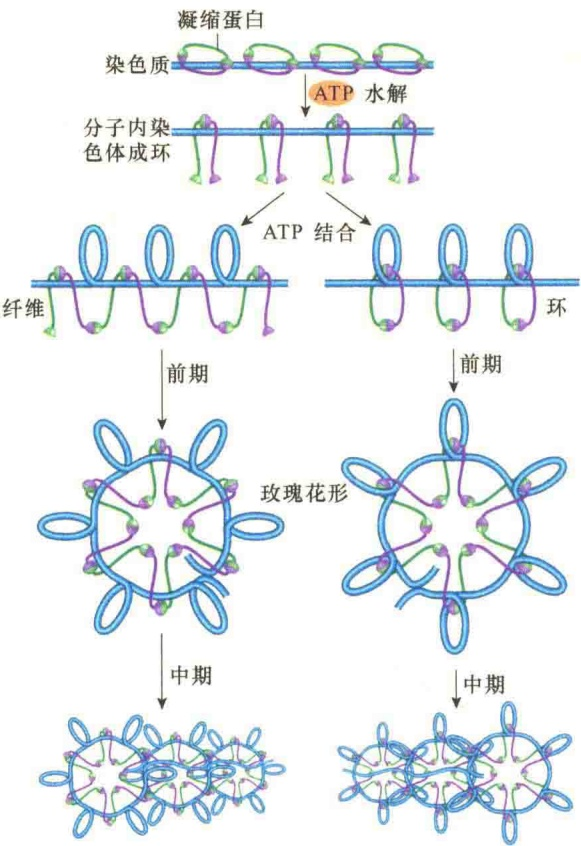
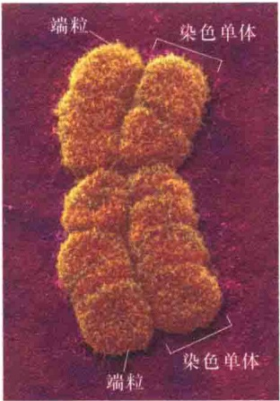
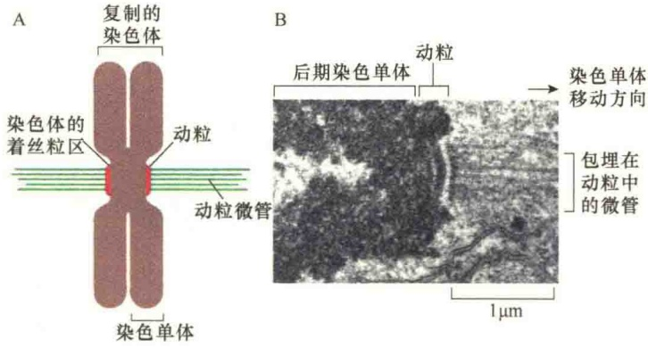
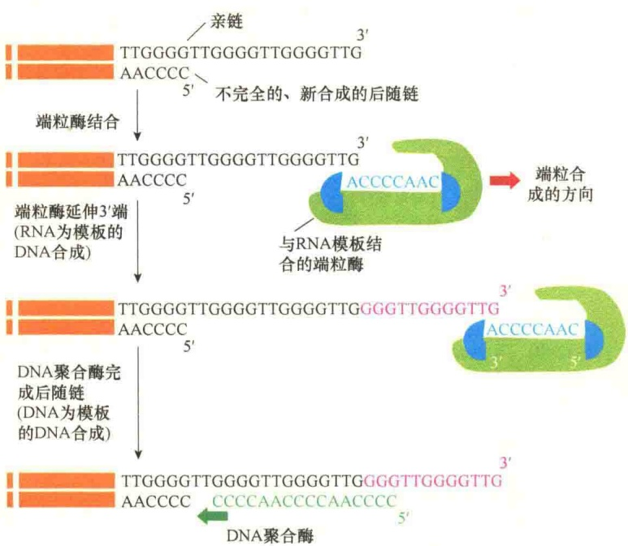

图 12-34 真核染色体的包装（引自 Nelson and Cox，2013）。

图 12-35 SMC 蛋白的结构（引自 Nelson and Cox, 2013）。单体 SMC 蛋白有 5 个结构域（A）:其氨基端（N 端）与羧基端（C 端）都是球形结构域，并且，N 端与 C 端结构域都含有与 ATP 结合的位点，中间是一个铰链结构域，通过两个  $\alpha$  螺旋连接结构域，将 N 端、C 端与铰链连接起来。SMC 蛋白通常以二聚体形式存在（B），每一个单体的两个  $\alpha$  螺旋结构域相互扭曲旋转，两个单体的铰链连接起来，整个二聚体形成一个 V 形结构。在 V 形的游离端，两个 N 端与两个 C 端各形成一个完整的 ATP 水解位点。

图 12-36 黏连蛋白与凝缩蛋白的结构（改自 Alberts et al., 2015）。A. 黏连蛋白由 4 个亚基组成的复合物:Smc1、Smc3、Scc1、Scc3。Smc1 与 Smc3 形成一个二聚体，头部具有 ATPase 结构域。另外两个亚基 Scc1、Scc3 与头部结构域相连接，形成一个封闭的环状结构。B. 凝缩蛋白是由 5 个亚基组成的复合物，结构上与黏连蛋白相似。Smc2、Smc4 形成一个二聚体的 V 形结构，在 ATPase 的头部有另外 3 个亚基（CAP-G/CAP-H/CAP-D2）与之结合，形成一个封闭的环。

(图 12-37)，这种连接对于在有丝分裂时确保姐妹染色单体的正确分离是极为重要的。试想 S 期合成的姐妹染色体若不被黏连蛋白圈起来，在有丝分裂时还能及时将它们召集到一起吗？可见细胞多么富有远见！

凝缩蛋白则是协助染色质压缩包装成染色体，使细胞顺利进入有丝分裂。凝缩蛋白与DNA结合，使DNA围绕核小体进行弯曲，便于染色质从核小体压缩成超级螺旋管的染色体（图12-38）。

图 12-37 黏连蛋白的作用（改自 Alberts et al., 2015）。黏连蛋白是具有 4 个亚基的复合物。A. 两个 Smc 亚基:Smc1 与 Smc3。它们都是螺旋-卷曲的结构，并且在一端都具有 ATPase 结构域。B. 另外两个亚基是 Scc1 与 Scc3，它们与 Smc 的头部结构域 ATPase 相结合，形成一个环状结构。C. 黏连蛋白环将复制的姐妹染色单体圈套在一起，直至有丝分裂。

图 12-38 凝缩蛋白在染色体压缩中可能的作用（引自 Nelson and Cox, 2013）。最初，染色体在 Smc 蛋白的铰链处弯曲，进而形成一个内部的 Smc 环。ATP 与 Smc 的头部结合，在弯曲的 DNA 处形成一个超螺旋的环。再经过头-头部相互作用与重排，形成玫瑰花形压缩的 DNA，进而压缩成染色体。图中显示的是两个近代模型。

## 12.5.2 中期染色体的形态结构

在细胞周期的有丝分裂中期，染色体的形态结构比较稳定，所以，一般所描述的染色体的形态结构都是中期染色体（图 12-39）。

图 12-39 中期染色体的扫描电镜照片（引自 Lodish et al., 2013）。染色体已经复制完成，形成两个姐妹染色单体。每个单体各有两个端粒，着丝粒位于中间的收缩处（主缢痕），还可见一些次缢痕。

染色体有种属特异性，随生物种类、细胞类型及发育阶段的不同，染色体在数量、大小和形态上存在着差异。大多数生物的体细胞具有12～50条染色体。例如，果蝇有8条染色体，而人的染色体为2n=46条。染色体的长度为0.2～50μm，一般为1～10μm。

## 12.5.2.1 着丝粒和动粒

着丝粒（centromere）是染色体中连接两个染色单体，并将染色单体分为短臂（p）和长臂（q）的结构。由于着丝粒处的染色质较细、内缢，又叫主缢痕（primary constriction）。此处DNA具高度重复，为碱性染料所深染。着丝粒有两个基本功能:第一个是在有丝分裂前将两条姐妹染色单体结合在一起；第二个功能是为动粒装配提供结合位点。着丝粒含有结构性异染色质，人的染色体着丝粒含有大约170bp的重复DNA（称为α卫星DNA），随机重复的次数达2000～30000次。

动粒（kinetochore）是由着丝粒结合蛋白在有丝分裂期间特别装配起来的、附着于主缢痕外侧的圆盘状结构，内层与着丝粒结合，外层与动粒微管结合。每一个中期染色体含有两个动粒，位于着丝粒的两侧（图 12-40）。

通过对酵母着丝粒的研究发现，酵母着丝粒区具有突变的核小体组蛋白，因此赋予着丝粒独特的性质，并在染色质上形成显著的标记。在整个细胞间期，着丝粒一直被埋在特殊的着丝粒染色质的深处，直到有丝分裂时，着丝粒才介导纺锤体与之附着，并将染色单体的 DNA 分开。着丝粒染色质含有突变的 H3 组蛋白，称为 CENP-A（centromere protein-A），再加上其他的一些蛋白质将核小体包装成特别密集的列阵，最后形成动粒，这种特别的结构是有丝分裂纺锤体附着所必需的。

在裂殖酵母中，大约 125 个核苷酸对的 DNA 序列就可以构成一个着丝粒。尽管该序列很小，但足以让十多个蛋白质，包括 CENP-A 组蛋白 H3 突变体在该 DNA 序列上装配特异的核小体组蛋白的核。附着在酵母着丝粒上的其他蛋白质可介导一个独立的纺锤体微管与之结合（图 12-41）。

图 12-41 简约的着丝粒结构模型（引自 Alberts et al., 2015）。A. 裂殖酵母着丝粒中具有着丝粒特异的组蛋白 H3 突变的核小体，核小体中 CENP-A 取代了正常的 H3 组蛋白。B. 突变的组蛋白介导其他一些蛋白质装配成动粒。酵母的动粒较小，一般只能捕获一条纺锤体微管，而人具有很大的着丝粒，能够形成大的动粒，可捕获多条纺锤体微管。

## 12.5.2.2 次缢痕与核仁组织区

次缢痕（secondary constriction）是染色体上的一个缢缩部位，由于此处部分的 DNA 松解，形成核仁组织区，故此变细。它的数量、位置和大小是某些染色体的重要形态特征。每种生物染色体组中至少有一条或一对染色体上有次缢痕。

核仁组织区（nucleolar organizing region, NOR）是细胞核特定染色体的次缢痕处，含有rRNA基因的一段染色体区域，与核仁的形成有关，故称为核仁组织区。核仁是NOR中的基因活动而形成的可见的球体结构。具有核仁组织区的染色体数目依不同细胞种类而异，人有5对染色体，即13、14、15、21、22号染色体上有核仁组织区。

图 12-40 有丝分裂中的着丝粒与动粒（引自 Alberts et al., 2015）。
A. 着丝粒区与动粒。B. 后期微管与染色单体动粒附着的电镜图。

## 12.5.2.3 端粒与端粒酶

端粒（telomere）是真核细胞染色体末端的特殊结构。人的端粒由6个碱基重复序列（TTAGGG）和结合蛋白组成。端粒的功能是保持线性染色体的稳定，即不环化、不黏合、不被降解。端粒酶（telomerase）是细胞中负责端粒延长的一种酶，属于逆转录酶，可将端粒DNA加至真核细胞染色体末端。该酶自身含有一个RNA分子，可作为延长DNA末端合成的模板，合成的方向是 $5'\rightarrow3'$ （图12-42）。

## 12.5.2.4 核型

核型（karyotype）又叫染色体组型，是指染色体组在有丝分裂中期的表型，是染色体数目、大小、形态特征的总和。在对染色体进行测量计算的基础上，进行分组、排列、配对，并进行形态分析的过程叫核型分析。图12-43是通过染色体涂染（chromosome painting）技术——一种改良的荧光原位杂交（fluorescence in situ hybridization，FISH）获得的人染色体核型。

## 12.5.3 巨型染色体

某些生物的细胞中，特别是在发育的某些阶段，可以观察到一些特殊的染色体，它们的特点是体积巨大，细胞核和整个细胞体积也大，所以称为巨大染色体（giant chromosome），包括多线染色体和灯刷染色体。

## 12.5.3.1 多线染色体

核内 DNA 多次复制产生的子染色体平行排列，并通过同源染色体配对，紧密结合在一起，从而阻止了染色体纤维进一步凝缩，形成体积很大的、由多条染色体组成的结构叫多线染色体（polytene chromosome）。多线化的细胞处于永久间期，体积也相应增大，它存在于双翅目昆虫的幼虫组织内，如唾液腺、气管等。

图 12-42 端粒合成（引自 Alberts et al., 2015）。图中显示的是真核生物染色体的末端（端粒）重复序列的合成反应。亲代 DNA 链的 3' 端通过以 RNA 为模板的 DNA 合成来延伸，然后再通过 DNA 聚合酶 α（该酶含有一个 DNA 引物酶亚基）合成互补链。

图 12-43 人的男性染色体核型（引自 Lodish et al., 2013）。
A. 用染色体涂染技术鉴定的人的染色体。
B. 涂染染色体经计算机处理排列出的正常男性的染色体核型。

图 12-44 果蝇幼虫唾液腺多线染色体（引自 Karp, 2010）。光学显微镜下观察的果蝇唾液腺染色体，观察到染色体上约有几千个不同的、染色很深的带，这些带是不同的基因位点。

多线染色体来源于核内有丝分裂（endomitosis）。对幼虫果蝇唾液腺细胞的染色体分析发现比其他类型的细胞中的染色体粗100倍。在幼虫发育期间，这些细胞停止了分裂，但体积不断增大，DNA继续进行复制，以维持细胞的高分泌活性。复制的DNA链并不分开而是平行排列，产生的巨型染色体中所含DNA链是正常染色体的1024倍（图12-44）。

在光镜下观察染色的多线染色体，可见一系列交替分布的带和间带（interband）。同一种属中的不同个体间多线染色体的带型基本一致，但不同种果蝇的多线染色体的带型差别很大。后来发现带型与基因有关，不仅如此，多

线染色体的带在遗传分析中有重要作用，如比较不同种多线染色体的带型可进行进化的研究。另外，多线染色体并非是细胞内的惰性结构，而是动态的，含有很多在发育的特定阶段形成胀泡（puff）的区域，是DNA转录成RNA的结果。

## 12.5.3.2 灯刷染色体

灯刷染色体（lampbrush chromosome）是卵母细胞进行第一次减数分裂时，停留在双线期的染色体。它是一个二价体，含4条染色单体，由轴和侧丝组成，形似灯刷（图12-45）。染色体轴由染色粒（chromomere，是指染色质凝缩而成的颗粒）轴丝构成，每条染色体轴长 $400\mu m$ ，从染色粒向两侧伸出两个相类似的侧环，伸出的环是对称的，一个平均大小的环约含100kb DNA。

灯刷染色体的形态与卵子发生过程中营养物储备是密切相关的。大部分 DNA 以染色粒形式存在，没有转录活性；而侧环是 RNA 转录活跃的区域，一个侧环往往是一个大的转录单位，有的是由几个转录单位构成的。灯刷染色体侧环上的 RNA 主要是 mRNA，mRNA 与蛋白质结合形成无活性的 RNP 颗粒，这些颗粒储存在卵母细胞中，以便受精之后使用。与 DNA 结合并储存起来的蛋白质主要是转录因子，如 FRGY2，在卵母细胞生长过程中可选择性地调节基因表达。