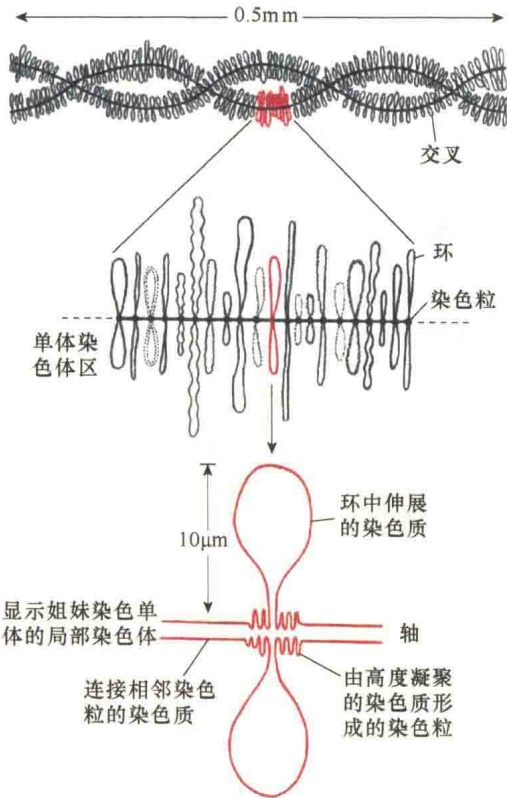
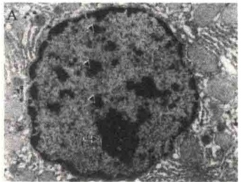
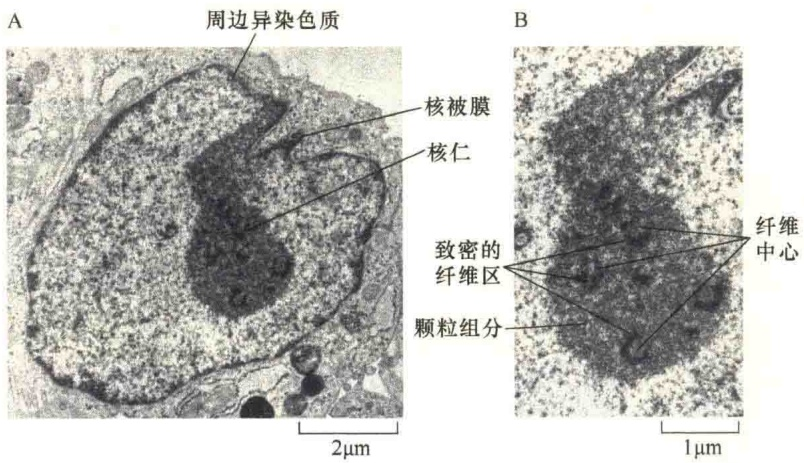
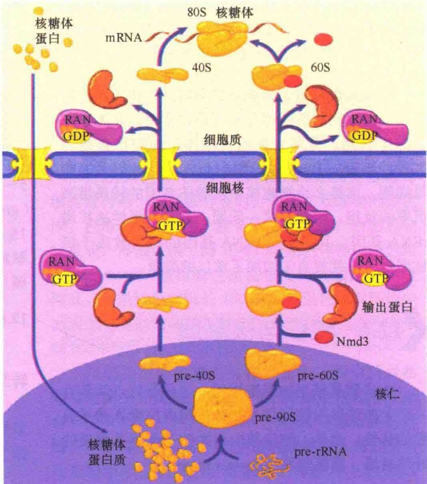
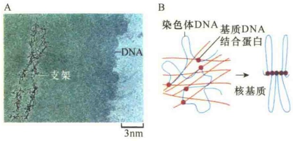

图 12-45 灯刷染色体的形态结构（引自 Kleinsmith and Kish, 1995）。灯刷染色体在染色粒轴丝上间隔形成侧环，环是成对的，但是由不同的染色质产生，环上还有 RNA 覆盖。

灯刷染色体除了具有合成和储存的作用外，对于卵子发生期的核糖体合成有重要作用。在卵子发生的生长期，需要大量的核糖体；细胞核必须将大量的核糖体RNA供给细胞质体积已经很大的卵母细胞，这势必给细胞核中核糖体基因的转录带来沉重的负担。为缓解这一问题，需要选择性地扩增rRNA基因，其结果是rRNA基因的拷贝数成千倍地增加，这就相当于增加了核仁的数量。

## 12.6 核仁与核基质

大多数真核生物细胞核的一个显著特点就是有一个大的球形的核仁存在，是细胞内核糖体亚基装配的部位。此外，细胞核中有类似于细胞质骨架的纤维网络，即核基质（nuclear matrix）。

## 12.6.1 核仁

## 12.6.1.1 核仁的形态

核仁（nucleolus）呈圆形或卵圆形，无界膜包

被，是由多种组分形成的一种网状结构。

核仁的大小、形状和数目随生物的种类、细胞类型及细胞代谢状态而变化。蛋白质合成旺盛、代谢活跃的细胞，如分泌细胞、卵母细胞的核仁大，可占核体积的25%。不具蛋白质合成能力的细胞，如休眠的植物细胞，其核仁很小。大多数细胞只含有1\~2个核仁，但也有少数细胞含有几十个乃至几千个核仁（图12-46）。

图 12-46 单核仁、多核仁与异染色质（改自 Cooper and Hausman，2013）。A. 异染色质与核仁。长箭头所指是单个核仁，短箭头所指是细胞核内的异染色质。B. 爪蟾卵母细胞核中进行 rRNA 扩增的多个核仁，有时多达几千个，满足细胞核内积累的  $10^{12}$  个核糖体。

## 12.6.1.2 核仁的基本结构

从形态上看，核仁是由三个球形的区域构成:纤维中心、致密纤维组分、颗粒区。①纤维中心（fibrillar center, FC）呈浅染区，位于核仁的中央部位，直径2\~3nm，能被RNA酶消化，由DNA和RNA组成。②致密纤维组分（dense fibrillar component, DFC）位于浅染区周围，直径为5\~10nm，含有正在转录的RNA分子。③颗粒区（granular component, GC）呈致密的颗粒，直径为15\~20nm，位于周边，代表已合成的核糖体前体颗粒。图12-47是人的成纤维细胞超薄切片的电镜照片。

## 12.6.1.3 核仁的功能

核仁是细胞合成核糖体的工厂，涉及 rRNA 的转录加工和核糖体大小亚基的装配。

核仁中的 rRNA 是由专一的 RNA 聚合酶 I 转录的。真核细胞中，rRNA 基因存在于特定的染色体上，并且有恒定的拷贝数。

每个 rRNA 基因转录单位由 RNA 聚合酶 I 转录，产生相同的初始转录物——前 rRNA。负责前 rRNA 加工的酶是 RNase，在人的 45S rRNA 前体上有 110 多个甲基化位点，这些甲基化的核苷酸序列全部进入加工后成熟的 rRNA 分子中。据此认为，这些甲基化位点可能是加工过程中酶的识别标记。

图 12-47 人成纤维细胞中核仁的电子显微镜照片（引自 Alberts et al., 2008）。A. 完整的细胞核。B. 正在进行 rRNA 基因转录的核仁，显示了三个不同的区域。

实际上，核仁中 rRNA 的合成、加工与核糖体的装配是同步进行的。核糖体亚基的装配是一个十分复杂的过程。研究表明，30min 内，首先是核糖体小亚基在核仁中成熟产生，很快出现在细胞质中；而 28S rRNA、5.8S rRNA 和 5S rRNA 组装成

大亚基需要 1h。图 12-48 是核糖体亚基在核仁中的装配与运输。

60S 核糖体亚基的输出需要受体运输蛋白，根据对酵母突变体的研究，发现 60S 核糖体亚基的受体蛋白是 Crm1。Crm1 不能直接与 60S 亚基结合，需要一种称为 Nmd3 的衔接蛋白介导。此外，60S 核糖体亚基的输出至少还需要另外两个受体:Mtr2/Mex67。40S 的核糖体亚基的输出受体也是 Crm1，但不需要衔接蛋白 Nmd3。无论是 60S 亚基还是 40S 亚基的输出，都需要 Ran-GTP。

由于核糖体是合成蛋白质的机器，只要控制了核糖体的合成和装配，就能有效地控制细胞内蛋白质的合成速度，调节细胞生命活动的节奏。因此，从某种意义上说，核仁实际上调控着蛋白质的合成。

## 12.6.2 核基质与核骨架

组成染色质纤维的 DNA 和蛋白质占细胞核总质量的 80%\~90%，因此推测只要去除细胞核内的染色质纤维，细胞核就会解体。令人惊讶的是，1974 年 Berezney 和 Coffey 首次用 DNase 和去垢剂处理细胞核，除去了 95% 的核物质后，剩下的竟是水不溶的纤维网络，这种结构称为核基质。

## 12.6.2.1 核骨架的结构与化学组成

由于一开始不知道细胞核内有蛋白质纤维的存在，所以核基质就成为细胞核内除染色质及核仁外所有物质的总称，后来在核内发现了蛋白质纤维，并发现细胞核内的蛋白质纤维与细胞质骨架在结构组织与功能上有相似之处，从而将其称为细胞核骨架。此时，核基质自然被理解为核骨架，即核基质与核骨架混同，其概念可以互用。

严格地说，核基质与核骨架的概念是不同的，核基质包括细胞核内的

液体（核液）和蛋白质纤维两个部分；细胞核骨架（nuclear skeleton）是细胞核内所有由蛋白质组成的纤维网络结构，包括染色体装配支架、与内核膜相连的核纤层。核骨架通过内、外核膜穿膜蛋白的连接作用，与细胞质骨架连成一个整体（图 12-49）。

图 12-48 核糖体亚基在核仁中装配与运输（引自 Plopper，2016）。细胞质中合成的核糖体蛋白质输入细胞核后，与核仁中转录加工的 pre-rRNA 装配成 90S 的前体核糖体，进一步加工形成大小不同的两个核糖体前体亚基:pre-40S 与 pre-60S。经核孔转运到细胞质后，加工成成熟的 40S 与 60S 两个亚基，参与蛋白质的合成。

图 12-49 细胞质与细胞核骨架网络（引自 Karp, 2010）。用高盐和 DNase 去除了 DNA，并用去垢剂抽提的鼠成纤维细胞的电子显微镜局部照片所显示的细胞骨架网络结构。C 表示细胞的细胞质区域，N 表示细胞核。可见细胞核与细胞质间有明显的界限，C 区是细胞质骨架，N 区是细胞核骨架。

核骨架主要是由一些目前还不太了解的蛋白质纤维组成，在纤维装配时也不像细胞质骨架那样有序，但是，在核骨架蛋白纤维形成时，RNA似乎具有重要作用，因为当用去垢剂、DNase和高盐处理细胞后可得到不溶性的蛋白质纤维，若是再加上RNase处理抽提细胞就不再有蛋白质纤维了。

前面讨论的 DNA 由 30nm 染色质纤维包装成超螺线管时，染色质要在蛋白质骨架上形成放射环结构，后来发现这种蛋白质骨架中有拓扑异构酶的存在，推测该酶也是核基质的组成成分。

核纤层的化学本质是中间纤维蛋白，有一定的结构。

## 12.6.2.2 核骨架的功能

由蛋白质纤维组成的核基质分布在整个细胞核内，参与和支持 DNA 的各种功能，包括 DNA 复制、转录、加工、接收外部信号及维持染色质的结构等，作用方式主要是提供作用位点。

1）染色体装配支架 在染色体包装时需要非组蛋白作为染色体支架（chromosome scaffold）。在间期，染色质以30nm纤维的形式存在于细胞核中，这需要在染色体骨架上将核小体10nm纤维进行压缩。为了证明染色体骨架的存在，可分离有丝分裂前的染色体，并用溶液溶解组蛋白和大多数主要的非组蛋白，然后在电子显微镜下观察，可见一完整的染色体框架（framework）或支架（scaffold）（图12-50A）。推测染色体支架是细胞核中的核基质蛋白。当细胞进入有丝分裂前期时，非组蛋白的染色体骨架形成中心轴，染色质通过染色质结合蛋白在染色体支架上进一步压缩包装，形成放射环（图 12-50B）。

图 12-50 染色体装配支架及放射环（引自 Karp，2010）。
A. 用除去了大多数组蛋白和非组蛋白后剩下的染色体支架。
B. 染色质沿染色体支架轴形成放射环。

采用不同荧光标记的探针与人的间期细胞DNA进行原位杂交证实了染色质纤维环的存在。实验中，探针的使用是一个关键，这些探针的作用位点最好是靠近推测的特定DNA序列，即支架结合区[(scaffold-associated region, SAR)，又称基质结合区（matrix-associated region, MAR)]。SAR是位于转录的活性基因两端（或放射环两端）的DNA序列，富含AT。SAR中含有拓扑异构酶Ⅱ的作用位点。通过SAR与拓扑异构酶结合，从而将染色质锚定于核骨架上，并形成染色质纤维环（图12-51）。原位杂交分析染色质放射环的原理是:由于各探针在活性DNA上作用位点间的距离都在几百万碱基对，如果这些位点都在同一个放射环上，那么杂交后显示的距离就很近。

图 12-51 间期染色质纤维环的实验证明（引自 Lodish et al., 2000）。图中的 A～H 表示不同的探针，其中 A 和 B 的杂交位点在同一个环，其他的在另一相同环内。

2）核内酶促反应装置及锚定 细胞核内重要的生命活动是DNA复制、RNA转录、RNA加工，这些活动都需要有工作的平台，如DNA复制需要有复制小体（replisome），RNA转录需要有RNA聚合酶Ⅱ全酶（holoenzyme）复合物，RNA的剪接需要形成剪接体（spliceosome）。研究揭示，这些酶促反应装置都是附着在蛋白质纤维上（图12-52），细胞核内的蛋白质纤维显然就是核骨架了。这就意味着，当复制、转录、剪接发生时，这些蛋白质的酶促装置被锚定在核骨架，核酸就可以沿着反应复合物进行移动。

图 12-52 核内酶促反应装置的锚定（引自 Plopper, 2016）。核基质为酶促反应装置提供锚定位点，使得各种酶促反应装置互不干扰。图中显示的 DNA 复制时形成的复制体与转录过程中形成的剪接体分别锚定在不同区域的核基质中，保持了它们各自的独立性。

3）核纤层在核膜结构维持与重建中的作用 核纤层位于内核膜的下方，是一种纤维网络，为细胞核提供结构支持。核纤层是由核纤层蛋白单体组装起来的多聚体纤维。组装的第一步是由两个核纤层蛋白多肽链通过各自的α螺旋区相互缠绕形成螺旋化的螺旋（coiled coil）；第二步是二聚体通过头-尾连接形成长的多聚体；第三步是多聚体之间通过侧向连接形成核纤层。核纤层蛋白可以通过两种方式与内核膜相连:第一种方式是在核纤层蛋白翻译后在C端的一个半胱氨酸残基上添加脂，然后通过脂锚定的方式将核纤层蛋白结合到内核膜；第二种方式是核纤层蛋白与内核膜的膜蛋白结合，结合的内核膜蛋白将核纤层蛋白组织成为网络结构，并介导与内核膜结合。

核纤层蛋白装配成核纤层纤维网络后附着在内核膜上，成为膜骨架，极大地增强了核膜的机械强度，实际上为细胞核的形态与功能提供了结构支持（structural support）。细胞核内的染色质通常要组成大的染色体环，核纤层为染色质提供锚定位点，从而介导了染色体环的形成。

在有丝分裂前期，细胞核需要拆除，核孔复合物与核纤层都需要去装配，而核被膜则被片段化。在细胞核拆除过程中，至少有部分核孔蛋白及核纤层蛋白被有丝分裂激活的周期蛋白依赖性激酶磷酸化。此时，某些NPC蛋白与核输入受体结合在一起，这些蛋白质在以后的细胞核重建中起重要作用。与核孔复合物解离的核被膜蛋白、核纤层蛋白，以及染色质散布在整个细胞中。通过对细胞核膜的拆除，染色质与细胞质之间的“隔离墙”解体，使得不再与膜或染色体结合的核蛋白完全与细胞质蛋白质混合在一起。在有丝分裂后期，核膜片段与分离开的子染色体重新装配成新的细胞核（图12-53）。此外，在核孔运输中发挥了关键作用的Ran-GTPase，在有丝分裂与细胞核的重建过程中也具有重要作用。

图 12-53 有丝分裂中核被膜与核纤层的解离和重建（引自 Alberts et al., 2015）。核纤层蛋白的磷酸化，触发核纤层的去装配。核纤层的去装配引起核被膜的断裂。核纤层蛋白的去磷酸化，则触发相反的过程，即核被膜的重建。某些核孔蛋白、内核膜蛋白发生类似的磷酸化与去磷酸化循环。在核被膜的重装配过程中，还涉及其他一些蛋白质的去磷酸化。核被膜的重新装配是从单个凝缩的染色体开始的，即核被膜片段先将单个凝缩的子代染色体包裹起来，最后融合成新的细胞核。