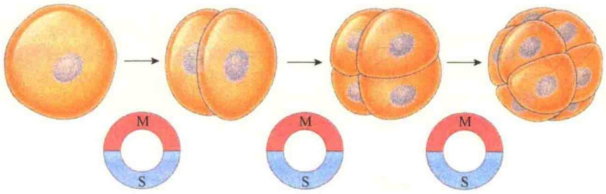
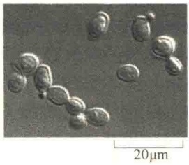

13.1 细胞周期时相及研究方法

13.1.1 细胞周期的时相及细胞类型

13.1.2 细胞周期各时相的合成活动

13.1.3 细胞进程与同步化研究

13.2 细胞周期调控

13.2.1 细胞周期调控系统

13.2.2 有丝分裂促进因子的发现与鉴定

13.2.3 裂殖酵母细胞周期调控

13.2.4 芽殖酵母的细胞周期调控

13.2.5 哺乳动物细胞周期的控制

13.2.6 CDK与细胞周期调控

13.2.7 细胞周期关卡

13.3 有丝分裂

13.3.1 有丝分裂过程

13.3.2 有丝分裂机制

13.4 减数分裂

13.4.1 减数分裂I与减数分裂Ⅱ的形态变化

13.4.2 减数分裂过程中的遗传重组及其机制

13.4.3 减数分裂与有丝分裂的比较及意义

生长和增殖是生物的基本特性，无论是单细胞的生物还是多细胞的生物，每个细胞都必须进行生长和分裂。细胞通过分裂形成的新细胞必须具有与亲代细胞相似的遗传性，因此，细胞分裂的前提是遗传物质的复制、各种细胞器及生物大分子的倍增与细胞体积的增大。细胞通过分裂，将复制的遗传物质均等地分配到两个子细胞中，保证了细胞遗传的稳定。

## 13.1 细胞周期时相及研究方法

人们习惯于用“周期”一词来思考生物学过程，包括生命周期、代谢周期、生理周期。生命是从一代向下一代传递的连续过程，因此是一个不断更新、不断从头开始的过程。就一代细胞而言，细胞的生命开始于产生它的母细胞的分裂，结束于它的子细胞的形成，或是细胞的自身死亡。通常将通过细胞分裂产生的新细胞的生长开始到下一次细胞分裂形成子细胞结束为止所经历的过程称为细胞周期（cell cycle）（图13-1）。在这一过程中，细胞的遗传物质复制并均等地分配给两个子细胞。

## 13.1.1 细胞周期的时相及细胞类型

细胞周期是一个相当复杂的过程，不同类型的细胞周期持续的时间不完全相同，且细胞的分裂状态也各不相同。

## 13.1.1.1 细胞周期的时相

根据光学显微镜所观察到的细胞分裂时的活动，将细胞周期分为两个主要的时期:有丝分裂期（mitotic phase）和间期（interphase）。有丝分裂期简称为 M 期（M phase）。

M 期包括细胞的核分裂和胞质分裂两个过程。在有丝分裂的过程中，复制的染色体被分配到两个子细胞核中；胞质分裂则是将整个细胞一分为二，形成两个子细胞。M 期所持续的时间较短，一般为 30～60min；分裂间期的时间跨度较长，根据细胞的类型和所处的条件不同而不同，有几小时、几天、几周或更长。

间期实际上是新细胞的生长期，根据新细胞从开始生长起到分裂前止的分裂间隔期中的生理和生化变化，可分为 $G_{1}$ 期（gap1 phase）、S期（synthetic phase）、 $G_{2}$ 期（gap2 phase）。细胞周期所持续的时间一般为12～32h；人的细胞周期约为24h，其中分裂期0.5h， $G_{1}$ 期9h，S期10h， $G_{2}$ 期4.5h。

不同生物的细胞周期时间是不同的，同一系统中不同细胞的细胞周期时间也有很大的差异。一般说来，S期、 $G_{2}$ 期、M期的时间变化较小，而 $G_{1}$ 期持续时间的差异可能很大。例如，小鼠食管和十二指肠上皮细胞同属于消化系统，但它们的细胞周期时间却明显不同，分别为115h和15h。这种差异主要是由 $G_{1}$ 期的不同造成的，因为食管上皮细胞的 $G_{1}$ 期长达103h，而十二指肠上皮细胞的 $G_{1}$ 期仅为6h。由此看来，细胞周期的长短主要取决于 $G_{1}$ 期的长短。

卵受精后产生的胚胎细胞周期比较特别，不仅短（30min或以下），而且没有 $G_{1}$ 期与 $G_{2}$ 期，仅有M期与S期，并且都非常之短（图13-2）。

与快速分裂的早期胚胎细胞相反，成年动物的某些细胞会停止分裂（如神经细胞），还有一些细胞处于停止分裂状态，只是在有需要的情况下才进行分裂，如因细胞损伤或死亡，需要产生新细胞

进行取代或补充。此类细胞包括皮肤的成纤维细胞、某些内部器官（如肝细胞）等。这些停止分裂的细胞脱离了 $G_{1}$ 期，处于一个相对静止的时期—— $G_{0}$ 期，在该时期，细胞保持代谢活性，但不再进行增殖。某些 $G_{0}$ 期的细胞在合适的环境信号的召唤下重新进入细胞周期，但有些类型的细胞，包括成年动物中大多数分化的细胞则是永久性脱离了细胞周期，不再进行分裂。

图 13-1 细胞周期及染色体行为（引自 Lodish et al., 2013）

## 13.1.1.2 细胞周期和细胞类群

在正常的情况下，一个完整的细胞周期应包括4个时相，细胞沿着 $G_{1}\rightarrow S\rightarrow G_{2}\rightarrow M$ 期的路线运转，通过M期，母细胞一分为二产生两个子细胞。但在细胞社会中，不仅细胞彼此分工不同，分裂行为也有所差异。根据细胞的分裂行为，可将真核生物细胞分为以下三类。

1）持续分裂细胞又称周期性细胞，即在细胞周期中连续运转的细胞。肌体内某些组织需要不断地更新，组成这些组织的细胞就必须通过不断分裂产生新细胞。此类细胞的分裂周期非常正常，有丝分裂的活性很高。例如，性细胞（包括卵母细胞和精原细胞）不断地产生配子；造血干细胞不断地产生红细胞和白细胞；上皮基底层细胞通过分裂不断补充表面老化死亡的细胞；植物的根茎尖端细胞通过分裂进行生长等。这些类型的细胞都是具有正常周期的持续分裂细胞。

图 13-2 胚胎细胞周期（引自 Cooper and Hausman，2016）。在早期细胞胚胎周期中，卵细胞质（egg cytoplasm）快速分裂成小细胞。此时细胞不会生长，缺少  $G_{1}$  期、 $G_{2}$  期，只有短的 S 期与 M 期。

2）终端分化细胞 即永久性失去了分裂能力的细胞，它们不可逆地脱离了细胞周期，但保持了生理活性机能。这些细胞都是高度特化的细胞，如哺乳动物的红细胞、神经细胞、多形性白细胞、肌细胞等，这些细胞一旦分化，就永远保持这种不分裂状态直到死亡。

3） $G_{0}$  细胞又称休眠细胞，暂时脱离细胞周期，不进行 DNA 复制和分裂，也称静止细胞群。但这类细胞可在某些条件的诱导下重新开始 DNA 合成，进行细胞分裂。例如，外科手术切除部分肝组织后可以诱导肝细胞进行细胞分裂，淋巴细胞可通过与抗原的相互作用诱导增殖。

在胚胎发育早期（卵裂期），所有的细胞均为周期性细胞，以后随着发育成熟，某些细胞进入了 $G_{0}$ 期，某些细胞分化后丧失分裂能力。到成体时，只有少数细胞处于增殖状态，它们的增殖仅作为补充丢失的细胞，或对外界信号的应答。

## 13.1.2 细胞周期各时相的合成活动

在细胞周期的不同阶段中，生化合成反应是不同的。

1） $G_{1}$ 期  $G_{1}$ 期是从有丝分裂完成到DNA复制前的一段时期，又叫合成前期。此期主要合成rRNA、蛋白质、脂类和糖类。在 $G_{1}$ 期的后期，DNA合成酶的活性大大增加。

$G_{1}$ 期进入S期与S期激活因子有关。如将S期和早 $G_{1}$ 期细胞融合，S期细胞可以诱导 $G_{1}$ 期细胞提前进入S期，表明早 $G_{1}$ 期细胞尚未出现S期激活因子。

2）S期 S期即DNA合成期（DNA synthesis phase）。细胞周期中S期是最重要的一个时期，在此期，除了DNA合成外，同时还会合成组蛋白，DNA复制所需的酶都在这一时期合成。

组蛋白的合成主要是在 S 期。在 S 期，组蛋白的 mRNA 水平可增加 50 倍。也就是说，DNA 的合成和组蛋白的合成在时间上是同步的，在密度上是相应的，从而使新合成的 DNA 得以及时包装成核小体。另外，推测组蛋白具有 DNA 复制延长因子的作用，没有组蛋白，DNA 的复制就会停止。

此外还发现 DNA 复制时，不同的序列复制先后顺序不同，具有时序性，即常染色质复制在先，异染色质在后；能转录的 DNA 先复制，不能转录的 DNA 后复制；GC 含量高的 DNA 复制在先，AT 含量高的在后。

3） $G_{2}$ 期  $G_{2}$ 期是DNA合成的后期。在这一时期，主要是大量合成ATP、RNA、蛋白质，包括微管蛋白和促成熟因子等，为有丝分裂做准备。

4）分裂期 分裂期包括核分裂和胞质分裂，并形成两个子细胞的过程。这一时期的主要特点是染色体凝缩，并且在纺锤体的作用下，两个姐妹染色单体被均等地分配到两个子细胞。虽然M期在整个细胞周期中的时间很短，但过程很复杂，分为有丝分裂与胞质分裂两个阶段，而有丝分裂又分为5个时期（图13-3）。

## 13.1.3 细胞进程与同步化研究

细胞各不同时相的生化合成活动是随着细胞生命的进程而变化。如同人类社会，在细胞群体中并非都是整齐划一的处于同一个时期，因此，研究细胞进程及获得同步化的细胞十分重要。

图 13-3 真核细胞分裂期的主要事件（引自 Alberts et al., 2015）。在显微镜下很容易观察到真核细胞有丝分裂与胞质分裂，包括有丝分裂的 5 个过程。

## 13.1.3.1 细胞进程的研究

在细胞学的研究中，如何知道细胞处于细胞周期的哪一个阶段？最简单的方法就是在显微镜下观察。培养的哺乳动物细胞中隆起且变圆的细胞就是处于有丝分裂的细胞（图 13-4A）；如果是芽殖酵母，在显微镜下更容易观察，通过其大小的变化就可以推测处于细胞周期的哪一个阶段（图 13-4B）。

图 13-4 显微镜下观察培养细胞的进程（引自 Alberts et al., 2015）。A. 培养的大鼠成纤维细胞的扫描显微镜照片。左下部位隆起变圆的就是进行有丝分裂的细胞。B. 芽殖酵母的形态:未出芽的是  $G_{1}$  期细胞，根据形态推测其他一些细胞是 S 期、M 期细胞。

在培养的哺乳动物细胞群体中，所有的细胞都在快速增殖，但不是同步的。一般而言，在非同步培养的细胞群体中有30%～40%的细胞是处于S期，可以通过免疫荧光标记进行分析，也可以通过对DNA含量测定推测细胞所处的时期。可用与DNA结合的荧光染料处理细胞后，用流式细胞仪（flow cytometer）快速检测DNA的含量，若DNA的量加倍，则细胞处于S期。还可以用流式细胞仪测定非同步生长的细胞群体的DNA含量，推测细胞的 $G_{1}$ 、S和 $G_{2}+M$ 期的长度（图13-5）。

## 13.1.3.2 细胞同步化研究

通过细胞的体外培养和分析，发现处于细胞周期不同阶段的细胞，其形态学和生化特点有所不同，对辐射、药物、病毒的感染、酶诱导的敏感性也都有差异。由于M期较短，在一个培养的群体中，无论何时检查，只看到极少数细胞处于分裂状态。为了研究细胞周期不同阶段的生化特性，必须获得细胞周期一致性的细胞，这就是细胞的同步化（synchronization），同步化的细胞都处于细胞周期的同一个时相。

图 13-5 流式细胞仪分析检测的非同步生长的细胞群体中各个时期的细胞数及 DNA 含量（引自 Lodish et al., 2013）。检测的结果揭示了该群体中处于 G₁ 期、S 期，以及 G₂ 期 + M 期细胞的数量与 DNA 含量。

细胞同步化分为自然同步化和人工同步化。

自然同步化是自然界存在的现象，在动物、植物细胞都有发现，它们不受人为条件的干扰，因而有可能在接近自然的条件下进行观察，但自然同步化的细胞群体受到诸多条件的限制，对结果有很大的影响。人工同步化是利用细胞培养的方法，用各种理化因素处理获得同步化生长的细胞，常用的细胞人工同步化的方法分为选择同步化、诱导同步化或者两者的结合。

1）诱导同步法 诱导同步法（induction synchrony）是通过控制培养条件，将非同步培养中的所有或大部分细胞暂时性地阻止在细胞周期的某个阶段，最终使所有细胞达到同步化生长。常用的方法有改变温度、添加代谢抑制剂等，将细胞阻止在细胞周期的某一阶段。

（1）胸腺嘧啶阻断技术。高浓度的胸腺嘧啶能够阻断DNA合成所需的核苷酸的合成。因此，将细胞群体培养在具有高浓度的胸腺嘧啶的培养液中时，非同步化的细胞能够正常地通过 $G_{1}$ 期，但到达S期时，因DNA的合成被阻断，这些细胞不能顺利通过S期进入 $G_{2}$ 期。经过对S期的短暂阻断，再改变胸腺嘧啶的浓度，解除抑制，所有的细胞都开始DNA的合成，即获得处于同步生长的细胞。

(2) 中期阻断法。某些药物可抑制微管的聚合, 因而抑制有丝分裂器的形成, 将细胞阻断在有丝分裂的中期。与 DNA 合成阻断法相比, 中期阻