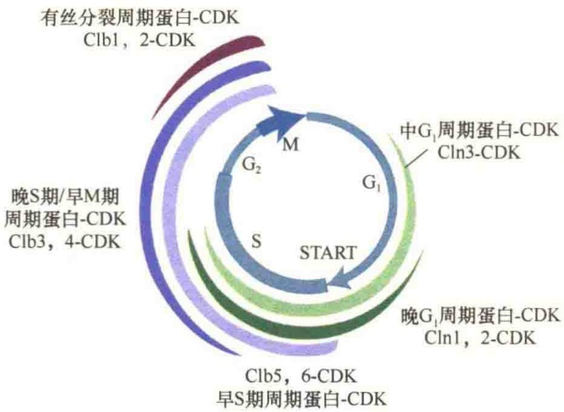
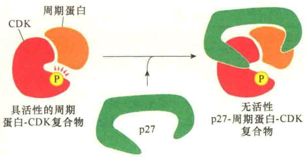

合二聚体，即 SPF 的存在。

在芽殖酵母中，当S期周期蛋白-CDK异二聚体（SPF）在 $\mathrm{G}_{1}$ 期后期积累时，它们立即被Sic1蛋白结合而失活。Sic1是一种抑制蛋白，属于周期蛋白依赖性激酶抑制蛋白（cyclin-dependent kinase inhibitor，CKI），该蛋白质在有丝分裂期末及 $\mathrm{G}_{1}$ 期早期表达。由于 Sic1 特异性抑制 S 期、M 期 CDK，而不抑制  $G_{1}$  期 CDK、 $G_{1}/S-CDK$  复合物，因此 Sic1 是 S 期的抑制剂。 $G_{1}/S-CDK$  将 Sic1 磷酸化（Sic1 至少有 6 个位点被磷酸化），磷酸化的 Sic1 被蛋白酶体降解。一旦 Sic1 被降解，S 期周期蛋白-CDK 复合体就会诱导 DNA 复制（图 13-19）。

图 13-19 芽殖酵母通过对 S 期抑制蛋白 Sic1 的蛋白酶解的调节进行 S 期的控制（引自 Lodish et al., 2013）。 $G_{1}$  期开始积累 S 期周期蛋白 -CDK 复合物，但是其活性受 Sic1 的抑制。这种抑制作用阻止了 DNA 复制，直至细胞完成了  $G_{1}$  期所有事件。①装配的  $G_{1}/S-CDK$  在  $G_{1}$  期末将 Sic1 磷酸化；②磷酸化的 Sic1 被多聚泛素化，从而被蛋白酶体降解；③激活的 S-CDK 招募并激活与 DNA 复制相关的蛋白质，启动 DNA 复制。

## 13.2.4.4 芽殖酵母与裂殖酵母细胞周期调控的比较

裂殖酵母和芽殖酵母在细胞周期进程的调控中都只有一种CDK，前者是Cdc2，后者是Cdc28；二者控制的主要时期是不同的，裂殖酵母主要是控制从 $\mathrm{G}_2$ 期进入M期，由MPF调控；芽殖酵母主要是控制从 $\mathrm{G}_1$ 期进入S期，由SPF调控。裂殖酵母不仅只有一种CDK，而且也只有一种细胞周期蛋白，即Cdc13；而芽殖酵母细胞周期不同阶段受多种周期蛋白调控蛋白激酶活性，除Cln1、Cln2、Cln3三种 $\mathrm{G}_1$ 周期蛋白外，还有Clb1、Clb2、Clb3、Clb4、Clb5和Clb66种周期蛋白。芽殖酵母的9种周期蛋白分为5组，与CDC形成复合物在细胞周期进程中先后起调节作用（图13-20）。

## 13.2.5 哺乳动物细胞周期调控

在多细胞的真核生物发育和生长过程中精确控制细胞的周期是决定组织大小和形态的关键。细胞的生长与分裂是受复杂的信号网络控制的，大多数细胞都是在细胞周期的  $G_{1}$  期转入  $G_{0}$  状态。某些分化的细胞，如成纤维细胞和淋巴细胞等能够在诱导条件下重新进入细胞周期进行分裂，但神经细胞不会再进入细胞周期进行分裂。

## 13.2.5.1 哺乳动物细胞周期中的限制点

哺乳动物细胞体外培养时，需要添加多肽生长因子促进细胞的分裂。如果缺少生长因子，就会被阻止在  $G_{0}$  状态；一旦在培养基中添加了生长因子，这些细胞在 14～16h 后进入 S 期，再过 6～8h，完成余下的细胞周期过程。因此推测，阻止细胞从  $G_{0}$  状态进入 S 期间有一个限制点（restriction point），若将这些细胞在完全通过限制点之前从含有生长因子的培养基转移到没有生长因子的培养基上，这些细胞不能进入 S 期，也不能完成细胞周期。但是，细胞一旦通过了限制点，这些细胞就能够进入 S 期并完成其后的细胞周期过程。限制点是哺乳动物细胞控制  $G_{1}$  期进入 S 期的调节点，相当于酵母的 START，限制点受生长因子调控（图 13-21）。

图 13-20 控制芽殖酵母细胞周期进程的细胞周期蛋白 -CDK 复合物的作用（引自 Lodish et al., 2007）。芽殖酵母只有一种 CDK，但是在细胞周期的不同阶段，受不同时期合成的周期蛋白 -CDK 调控。

图 13-21 生长因子调节动物细胞周期（引自 Cooper and Hausman, 2016）。

## 13.2.5.2 多种CDK和多种周期蛋白的协同

在裂殖酵母和芽殖酵母的细胞周期调控中，都是由单一的CDK调节的，而哺乳动物的细胞周期受一个小分子（30～40kDa）CDK家族的调节。在哺乳动物细胞周期中起作用的有9种CDK，依据它们被发现的先后顺序分别被命名为CDK1、CDK2、CDK3……其中CDK1、CDK2、CDK4、CDK6这4种CDK在细胞周期进程中的调控作用研究得比较清楚。它们与不同的细胞周期蛋白结合，共同促进不同细胞周期进程的转换。CDK4、CDK6是 $G_{1}$ 期CDK，促进细胞进入细胞周期；CDK2属于 $G_{1}/S$ 期与S期CDK；CDK1是有丝分裂CDK。由于历史原因，从酵母细胞周期调控研究命名的细胞周期蛋白依赖性激酶的名称与脊椎动物细胞周期研究对细胞周期蛋白依赖性激酶的命名是不同的，根据细胞周期进程，更为通俗的名称分别是 $G_{1}$ 期CDK、 $G_{1}/S$ 期CDK、S期CDK、有丝分裂CDK（表13-1，图13-22）。

表 13-1 哺乳动物细胞中的周期蛋白与 CDK 的名称和作用

| CDK | 周期蛋白 | 功能 | 属性名称 |
| --- | --- | --- | --- |
| CDK1 | 周期蛋白A,周期蛋白B | 有丝分裂 | 有丝分裂CDK |
| CDK2 | 周期蛋白E,周期蛋白A | 进入细胞周期S期 | $G_{1}/S$期CDK;S期CDK |
| CDK4 | 周期蛋白D | $G_{1}$进入细胞周期 | $G_{1}$期CDK |
| CDK6 | 周期蛋白D | $G_{1}$进入细胞周期 | $G_{1}$期CDK |

## 13.2.6 CDK与细胞周期调控

通过对裂殖酵母、芽殖酵母及哺乳动物细胞周期调控研究，揭示细胞周期控制系统中最关键蛋白质分子就是 CDK。CDK 必须与不同周期蛋白结合形成复合物才能在细胞周期进程中起调控作用。此外，CDK 还受激活性与抑制性磷酸化（activating and inhibitory phosphorylation）的调控。

图 13-22 哺乳动物细胞周期调控的模式图（引自 Lodish et al., 2007）。处于静息状态的  $G_{0}$  细胞在生长激素的诱导下进入细胞周期，在不同的阶段受不同的细胞周期蛋白-CDK 的调控。

## 13.2.6.1 周期蛋白-CDK复合物

CDK 的活性随着细胞周期进程上升与下降，从而影响细胞内与细胞周期主要事件相关蛋白质的磷酸化状态。例如， $G_{2}/M$  期转换的 CDK 活性的提高，会提高控制染色质凝缩、核被膜断裂、纺锤体装配，以及其他与有丝分裂相关的蛋白质的磷酸化。CDK 活性的周期性变化是由细胞内的一些酶与蛋白质复合物控制的，其中最重要的就是细胞周期蛋白。因为周期蛋白在细胞内的浓度是随细胞周期的变化而变化，而周期蛋白依赖性激酶的浓度则是恒定的，所以，细胞周期蛋白水平的周期性变化导致周期蛋白-CDK 复合物（cyclin-CDK complex）在细胞周期特定阶段进行周期性装配与激活，从而调控细胞周期进程（图 13-23）。

根据细胞周期进程，将细胞周期蛋白分为4类，它们在细胞周期的不同阶段与CDK结合，并行使功能。

1） $G_{1}$  周期蛋白  $G_{1}$  周期蛋白帮助激活  $G_{1}/S$  周期蛋白，促进细胞通过  $G_{1}$  期的 START。

2） $G_{1}/S$ 周期蛋白 $G_{1}/S$ 周期蛋白在 $G_{1}$ 后期激活CDK，触发细胞通过START，确保细胞正式进入细胞周期。 $G_{1}/S$ 周期蛋白的浓度水平在S期急剧下降。

3）S 周期蛋白 S 周期蛋白在细胞通过 START 后快速与 CDK 结合，并帮助触发染色体复制。S 周期蛋白浓度水平持续上升直至有丝分裂。

图 13-23 细胞周期控制系统中周期蛋白-CDK 复合物（引自 Alberts et al., 2015）。细胞周期中三种主要周期蛋白的浓度各有不同的振幅，而 CDK（图中未显示）的浓度维持不变，并且超过周期蛋白的浓度。在 G₁ 后期，G₁/S 周期蛋白的水平升高导致 G₁/S-CDK 复合物的形成，促进细胞通过 START 点。在 S 期开始时，形成 S-CDK 复合物，并触发 DNA 复制、启动 M 期的初始阶段事件。G₂ 期形成 M-CDK，但是处于非活性状态，这些复合物在 G₂ 期结束时被激活，并触发 G₂/M 期转换，进入 M 期。一种独立的调节复合物 -APC/C 启动有丝分裂中期与后期的转换。

S 周期蛋白也参与调控早期有丝分裂的某些事件。

4）M 周期蛋白 M 周期蛋白激活那些在  $G_{2}/M$  期转换中发挥作用的 CDK。M 周期蛋白的浓度水平在有丝分裂中期滑落。

大多数真核细胞都需要  $G_{1}$  周期蛋白帮助激活  $G_{1}/S$  周期蛋白，促进细胞通过  $G_{1}$  期的 START，仅有少数真核细胞不需要  $G_{1}$  周期蛋白。其他三类周期蛋白是所有真核生物细胞都需要的。

在裂殖酵母细胞中只有一种 CDK 与一种周期蛋白相互作用。在芽殖酵母细胞中只有一种 CDK 与 9 种不同的周期蛋白结合，通过与不同周期蛋白的结合启动不同的细胞时相进程。在脊椎动物细胞中有 4 种 CDK，其中 2 种与 G₁ 周期蛋白相互作用，1 种与 G₁/S 周期蛋白、S 周期蛋白相互作用，1 种与 S 周期蛋白、M 周期蛋白相互作用。表 13-2 总结了脊椎动物与芽殖酵母中主要的周期蛋白与 CDK。

表 13-2 哺乳动物细胞细胞周期蛋白与周期蛋白依赖性激酶

<table><tr><td rowspan="2">周期蛋白-CDK复合物</td><td colspan="2">脊椎动物</td><td colspan="2">芽殖酵母</td></tr><tr><td>周期蛋白</td><td>匹配 CDK</td><td>周期蛋白</td><td>匹配 CDK</td></tr><tr><td> $G_1$ -CDK</td><td>周期蛋白  $D^*$ </td><td>CDK4,CDK6</td><td>Cln3</td><td>CDK 1**</td></tr><tr><td> $G_1/S$ -CDK</td><td>周期蛋白 E</td><td>CDK2</td><td>Cln1,Cln2</td><td>CDK1</td></tr><tr><td>S-CDK</td><td>周期蛋白 A</td><td>CDK2,CDK1**</td><td>Clb5,Clb6</td><td>CDK1</td></tr><tr><td>M-CDK</td><td>周期蛋白 B</td><td>CDK1</td><td>Clb1,Clb2,Clb3,Clb4</td><td>CDK1</td></tr></table>

\* 哺乳动物细胞中有三种 D 型周期蛋白:D1，D2，D3。

\*\*CDK1 即裂殖酵母、脊椎动物中 Cdc2，芽殖酵母中的 Cdc28。

CDK与周期蛋白三维结构研究揭示，在缺少周期蛋白时，CDK蛋白的活性位点被一个蛋白质环占据了一部分，像是一块石头堵住了洞穴的入口（图13-24A），周期蛋白的结合可导致蛋白质环离开活性位点，恢复CDK酶的部分活性（图13-24B）。当另一个独立存在的激酶——CDK-激活激酶（CAK）将CDK活性位点附近的一个氨基酸磷酸化，周期蛋白-CDK复合物才会具有完全的活性。CAK将CDK特定位点的磷酸化，引起CDK的构型改变，因此进一步激活CDK（图13-24C）。

## 13.2.6.2 CDK活性的抑制

在细胞周期中，周期蛋白水平的升降主要是由 CDK 活性决定的。而 CDK 的活性在细胞周期的不同阶段具有不同的调控机制。在激酶的活性位点上有一对位点，它们的磷酸化可抑制周期蛋白-CDK 复合物的活性。这些位点的磷酸化是由 Wee1 蛋白激酶催化的，磷酸化后则对 CDK 的活性起抑制作用。经 Wee1 磷酸化的位点可被磷酸酶 Cdc25 去磷酸化，而去磷酸化则提高 CDK 的活性（图 13-25）。这一调控机制对于有丝分裂期 M-CDK 活性的调控特别重要。

CDK 抑制蛋白（CDK-inhibitor protein，CKI）与周期蛋白-CDK 复合物结合，可抑制 CDK 的活性。周期蛋白-CDK-CKI 复合物的三维结构研究揭示 CKI 的结合引起 CDK 活性位点结构的重排，导致 CDK 失活（图 13-26）。细胞使用 CKI 主要是协助调控细胞周期早期 G₁/S 和 S-CDK 的活性。

## 13.2.6.3 CDK的蛋白酶解与细胞周期转换

细胞通过对细胞周期蛋白依赖性激酶的磷酸化作用，驱动细胞通过START及 $G_{2}/M$ 期转换，但是，细胞进程中的有丝分裂中期向后期的转换则是通过对蛋白激酶的降解驱动的。细胞有丝分裂中期向后期转换的关键因子是后期促进复合物（anaphase-promoting complex/cyclosome, APC/C），该复合物是一种泛素连接酶（E3）。

图 13-24 CDK 激活的结构基础（引自 Alberts et al., 2015）。此图是通过 X 射线晶体学鉴定的人 CDK2 和周期蛋白 A 的三维结构。图中标明了 ATP 结合的部位。A. 在非活性状态，没有周期蛋白结合，活性位点被一个称为 T 环（T-loop）的蛋白质区堵住了。B. 由于周期蛋白的结合，导致 T 环移出活性位点，致使 CDK2 具有部分活性。C. CAK 将 T 环的苏氨酸残基磷酸化，改变了 T 环的状态，从而进一步将 CDK2 激活。

图 13-25 磷酸化对 CDK 活性的调节（引自 Alberts et al., 2015）。蛋白激酶 Wee1 将 CDK 中活性位点上方相邻的两个位点磷酸化后，抑制了 CDK 的活性。磷酸酶 Cdc25 将 Wee1 磷酸化的两个磷酸脱磷酸后，激活周期蛋白-CDK 复合物的活性。为简便起见，只显示了 Weel 磷酸化的一个位点。

图 13-26 CKI 对周期蛋白-CDK 复合物的活性抑制（引自 Alberts et al., 2015）。根据 CKI p27 结合人 CDK2 和周期蛋白 A 的三维结构 X 射线结晶学绘制的示意图。p27 是一种 CKI，能够与周期蛋白-CDK 复合物中的两个成员结合，破坏了 CDK 的活性位点。p27 还能插入到 CDK 中的 ATP 结合位点，进一步抑制了酶的活性。

APC/C 催化两种主要类型的蛋白质泛素化及降解。第一种是分离酶抑制蛋白（securin），该蛋白质在有丝分裂早期维持姐妹染色单体的配对连锁中起保护作用。分离酶抑制蛋白在有丝分裂中期的降解激活了姐妹染色体分离的酶，促进细胞周期进入有丝分裂后期。APC/C 催化降解的第二种主要的靶蛋白是 S 周期蛋白与 M 周期蛋白，这些周期蛋白的降解导致细胞中大多数 CDK 的失活。随着这些 CDK 的失活，一些在 S 期及早有丝分裂期被 CDK 磷酸化的蛋白质在后期细胞中被各种磷酸酶去磷酸化。CDK 靶蛋白的去磷酸化则是完成 M 期进程所必需，包括顺利完成有丝分裂的最后过程及胞质分裂。APC/C 的活性自有丝分裂期中段被激活起，一直维持到 G₁ 期，以确保该段时期内 CDK 的失活。当 G₁/S-CDK 在 G₁ 后期被激活时，APC/C 失活，周期蛋白又在下一个细胞周期中进行积累。

参与细胞周期调控的还有另一个泛素连接酶SCF，该酶在细胞内有很多作用，但是在细胞周期中的主要功能是将 $G_{1}$ 后期的某些CKI蛋白泛素化，帮助调控S-CDK的活性及DNA的复制。SCF也负责S期初期的 $G_{1}/S$ 周期蛋白的降解。

APC/C、SCF都是多亚基组成的复合物，并且亚基间有很大的相关性，但是它们的调控机制是不同的。APC/C在细胞周期中的活性改变主要缘于与其结合的活性亚基的活性变化:有丝分裂中期是Cdc20亚基，而从晚期有丝分裂向早 $\mathrm{G}_{1}$ 期行进则是Cdh1亚基。这些亚基帮助APC/C识别靶蛋白。与APC/C不同，SCF的活性依赖于一种称为F盒蛋白（F-box protein）的底物结合亚基，F盒蛋白