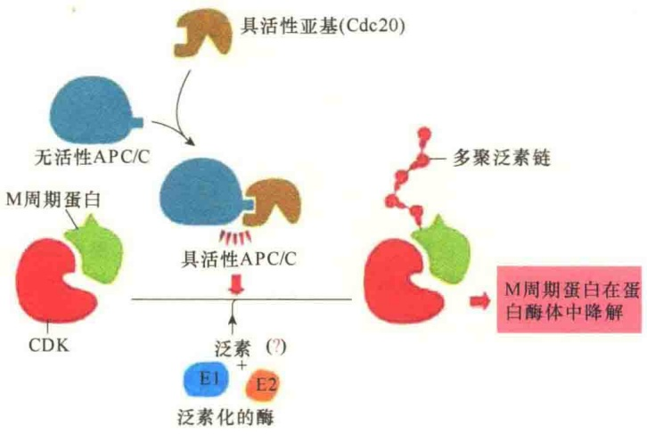
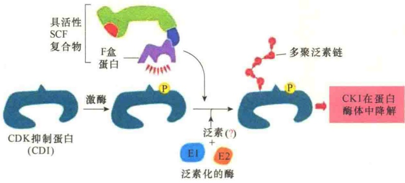
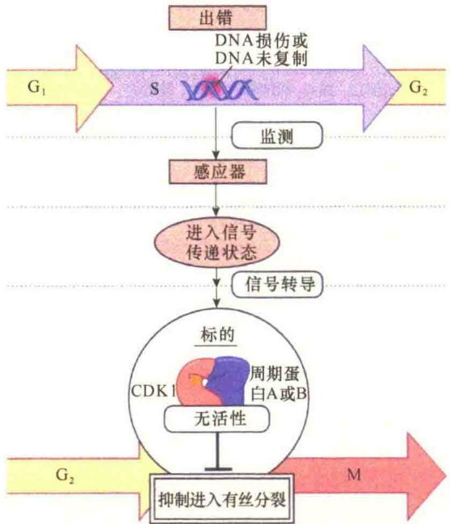
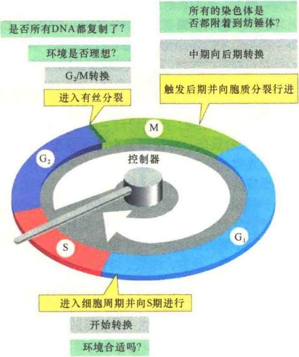
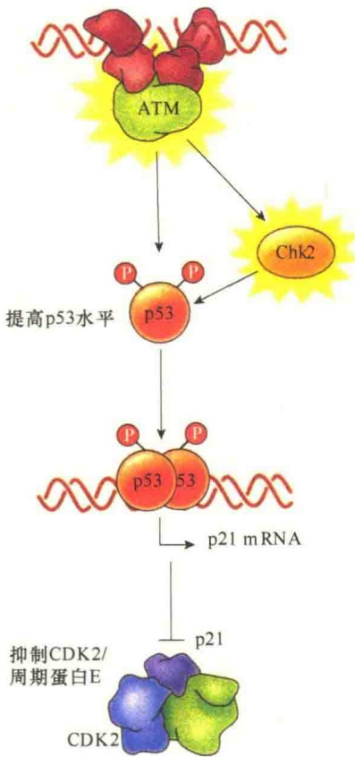

有很多不同类型。而且，SCF 的活性在整个细胞周期都是恒定的。SCF 的泛素化作用受靶蛋白磷酸化状态的调控，因为 F 盒亚基仅能识别磷酸化的蛋白质（图 13-27）。

A. APC/C控制的蛋白酶解

B. SCF控制的蛋白酶解

图13-27 在细胞周期期间APC/C、SCF蛋白酶解调控（引自Albertset al., 2015）。A. 在有丝分裂中，APC/C与Cdc20结合而激活。激活的APC/C可识别M周期蛋白及其他一些靶蛋白中特殊的氨基酸残基。在E1和E2的帮助下，APC/C将靶蛋白进行多聚泛素化，多聚泛素化的靶蛋白被蛋白酶体识别并降解。B. 泛素连接酶SCF的活性依赖于底物结合亚基:磷酸化的靶蛋白（如图中CDI）能够被特异的F盒蛋白亚基所识别，进而被多聚泛素化并被蛋白酶体降解。

## 13.2.6.4 细胞周期是一个由蛋白质控制的调控网络

从上面的讨论中可清楚地看出，细胞周期调控系统是由周期蛋白依赖性激酶、周期蛋白及各种不同的激活与抑制蛋白组成的生化开关控制的网络。表 13-3 总结了参与细胞周期调控的主要的蛋白质。

表 13-3 参与细胞周期调控的主要蛋白质

<table><tr><td>通用名称</td><td>功能与组分</td></tr><tr><td colspan="2">修饰CDK的蛋白激酶与蛋白质磷酸酶</td></tr><tr><td>CAK激酶</td><td>磷酸化CDK中一个磷酸化位点,激活CDK</td></tr><tr><td>Wee1激酶</td><td>磷酸化CDK中的抑制位点,抑制CDK</td></tr><tr><td>Cdc25磷酸酶</td><td>除去抑制CDK的磷酸,激活CDKS;哺乳动物有三个家族成员(Cdc25A、CdcB、CdcC),主要涉及有丝分裂起始的Cdk1的活性调控</td></tr><tr><td>Cdc14磷酸酶</td><td>激活Cdh1去降解有丝分裂周期蛋白</td></tr><tr><td colspan="2">CDK抑制蛋白(CKI)</td></tr><tr><td>Sic1(芽殖酵母)</td><td>在G1期抑制CDK的活性;G1期末被CDK1磷酸化后结构被破坏</td></tr><tr><td>p27(哺乳动物)</td><td>在G1期抑制G1/S-CDK与S-CDK的活性;当细胞发生终端分化时帮助细胞退出细胞周期;被CDK2磷酸化后触发SCF对其泛素化</td></tr><tr><td>p21(哺乳动物)</td><td>当DNA发生损伤时抑制G1/S-CDK与S-CDK的活性</td></tr><tr><td>p16(哺乳动物)</td><td>在 $G_1$ 期抑制 $G_1$ -CDK的活性;在癌细胞中常常是失活的</td></tr><tr><td>INK4</td><td>与 $G_1$ -CDK结合并抑制其活性</td></tr><tr><td>Rb</td><td>与E2F结合,阻止多种细胞周期基因的转录</td></tr><tr><td colspan="2">泛素连接酶及其激活子</td></tr><tr><td>APC/C</td><td>催化那些退出有丝分裂期的调节蛋白的泛素化,包括分离酶抑制蛋白、S周期蛋白与M周期蛋白;APC/C的活性受激活亚基Cdc20或Cdh1的结合调节</td></tr><tr><td>Cdc20</td><td>在所有的细胞中作为APC/C的激活亚基;在有丝分裂中期向后期转换中触发APC/C初始活性,诱导B型周期蛋白降解,启动后期</td></tr><tr><td>Cdh1</td><td>APC/C激活亚基,维持APC/C在分裂后期及整个 $G_1$ 期活性</td></tr><tr><td>SCF</td><td>催化参与 $G_1$ 期调控的调节蛋白的泛素化,包括某些CKI(如芽殖酵母中的Sic1,哺乳动物中的p27);这些作用都需要靶蛋白先进行磷酸化</td></tr></table>

在真核生物的细胞周期中，CDK、周期蛋白、细胞周期中的抑制蛋白，以及泛素连接酶及其激活子等众多蛋白质的协同作用，保证了细胞周期的正常运行（图 13-28）。

图 13-28 真核生物细胞周期的主要事件（引自 Lodish et al., 2013）。细胞周期分别由依赖于细胞周期蛋白的 G₁ 期、S 期和有丝分裂期的蛋白激酶复合物所控制。这些蛋白激酶复合物都是由一个调节性的细胞周期蛋白亚基和一个催化性的依赖于细胞周期蛋白的蛋白激酶亚基所组成。在有丝分裂后期，CDK 复合物都是通过对一些特异底物，包括 S 期抑制物、后期抑制物及有丝分裂细胞周期蛋白的泛素化，并利用蛋白酶体将这些底物降解，进而调节细胞周期。

## 13.2.7 细胞周期关卡

细胞周期的进程十分有序，是基因有序表达的结果。与细胞分裂有关的基因称为细胞分裂周期（cell division cycle, cdc）基因。这些基因表达的有序性，受到一些控制系统的监测。例如，酵母细胞在 DNA 合成开始的稍前部位有启动点，在哺乳类细胞中称为 R 点或限制点，亦称为关卡（check point）。这些关卡严格地监视着细胞周期事件的发生、发展过程是否严格按程序进行。例如，DNA 损伤未修复前不能进入 S 期，S 期 DNA 合成未完成不能进入 M 期，如果 M 期的纺锤体和染色体连接不正常则不能进入后期，正是这一套监控系统保证了细胞周期的正常进行。

## 13.2.7.1 细胞周期关卡途径

细胞的监理机制（surveillance mechanism）是由关卡途径（checkpoint pathway）进行管控的。通过关卡的管控，确保了在上一个细胞周期没有完成之前不能启动下一个细胞周期的事件。关卡途径由感应器（sensor）、信号级联反应（signaling cascade）和效应物（effector）组成。感应器监测特殊的细胞事件，信号级联反应负责“通风报信”，效应物则“叫停”细胞进程，并激活必要的修复途径（图13-29）。

由关卡途径监控的细胞周期事件包括细胞生长、DNA复制、DNA损伤、动粒与有丝分裂纺锤体的附着（图13-30）。关卡途径的监控确保了细胞的正常分裂，特别是确保了子代细胞具有完整的染色体。各种关卡途径的功能是通过调控周期蛋白-CDK复合物中的蛋白激酶的活性实现的:不同的蛋白激酶调控周期蛋白的合成与降解、CDK抑制位点的磷酸化、调控使周期蛋白-CDK复合物失活的CKI的合成与稳定，以及对APC/C泛素蛋白连接酶的调控等。

在典型的细胞周期中，控制系统是通过细胞周期的关卡来进行调节的。控制系统至少有三个关卡: $G_{1}$  关卡（靠近  $G_{1}$  末期）、 $G_{2}$  关卡（在  $G_{2}$  期结束点）、中期关卡（在中期末）。在每一个关卡，由细胞所处的状态和环境决定细胞能否通过此关卡进入下一阶段（图 13-31）。

## 13.2.7.2 细胞周期中 DNA 损伤关卡

除了上述三个主要的细胞周期关卡外，还有一个重要的细胞周期关卡是DNA损伤关卡（DNA damage checkpoint）。在细胞周期中对DNA质量的监控是最为重要的，因为细胞的内外环境中的一些物理与化学因素随时都有可能对DNA造成损伤，对DNA损伤若不能及时监测与修复，后果极为严重。所以，细胞对DNA损伤的监控是全周期的，一旦监测到DNA损伤，无论在细胞周期的哪个时相，都要立即停止进程，启动修复机制。

图 13-29 关卡途径三部分的协同作用（引自 Plopper et al., 2015）。感应器感受到 DNA 损伤，发出 DNA 损伤信号，经放大后传递给效应物，停止细胞进程，启动修复机制进行修复。

在 DNA 损伤关卡中，细胞周期的阻断是由两个蛋白激酶，即 ATRATM 介导的，这两种蛋白激酶在 DNA 受到损伤时被激活，并立即启动 DNA 损伤应答:一方面中止细胞周期，另一方面激活 DNA 修复，在某些情况下，甚至启动细胞程序性死亡机制。

ATM 与 ATR 分别作为两类识别 DNA 损伤或未复制 DNA 复合物的组分（图 13-32）。ATR 是被

图 13-30 细胞周期调控系统概览（引自 Alberts et al., 2015）。图中显示细胞周期进程中影响周期蛋白-CDK 复合物活性的限制性环境因素，包括合适的外部环境与内部环境。在内部环境中，DNA 的损伤、DNA 的复制完成程度、染色体与纺锤体的附着等是主要的监控关卡。

图 13-31 细胞周期关卡及调节信息（引自 Alberts et al., 2015）。图中显示  $G_{1}$  关卡、 $G_{2}$  关卡、中期关卡三个关卡控制的主要事件。

图 13-32 细胞周期中止在 DNA 损伤关卡（引自 Cooper and Hausman，2016）。识别损伤 DNA 复合物中 ATR 与 ATM 蛋白激酶被激活，ATR 被单链或未复制 DNA 激活，而 ATM 主要是被断裂的双链所激活。激活的 ATR 与 ATM 激酶分别将 Chk1、Chk2 磷酸化，并将它们激活。激活的 Chk1、Chk2 将磷酸酶 Cdc25 磷酸化并将其失活。失活的 Cdc25 不能激活 CDK2、CDK1，致使细胞周期暂时中止在 DNA 损伤关卡。

单链或未复制的 DNA 链激活，而 ATM 是被双链 DNA 断裂所激活。一旦被 DNA 损伤激活，ATR 与 ATM 分别将关卡蛋白激酶 Chk1、Chk2 磷酸化并激活。激活的 Chk1 与 Chk2 通过将 Cdc25 磷酸化从而抑制 Cdc25 的活性或诱导 Cdc25 降解，最终导致细胞周期中止。Cdc25 磷酸酶是 CDK2、CDK1 激活所必需的，因为 Cdc25 磷酸酶在细胞周期调控中，通过除去 CDK2 与 CDK1 上抑制性的磷酸而控制细胞周期进程。如果 DNA 损伤导致 CDK2 失活，细胞就会中止在 G₁ 期和 S 期；若是导致 CDK1 的失活，细胞就会中止在 G₂ 期。

在哺乳动物细胞中，p53蛋白在细胞DNA损伤的监测与控制中发挥关键作用。p53蛋白可被ATM及Chk2磷酸化，磷酸化的p53蛋白非常稳定（若不磷酸化则会快速降解），其结果导致DNA损伤的细胞内p53蛋白的浓度快速升高。p53蛋白是一种转录因子，高浓度的p53蛋白可诱导CDK抑制蛋白p21的合成。p21蛋白抑制CDK-周期蛋白E或CDK-周期蛋白A的活性，从而将DNA损伤的细胞周期中止在DNA损伤关

图 13-33 p53 蛋白中止细胞周期进程的作用（引自 Cooper and Hausman，2016）。在哺乳动物细胞周期调控中，p53 蛋白监测并中止 DNA 损伤的细胞周期进程。p53 蛋白可被 ATM、Chk2 磷酸化，磷酸化的 p53 蛋白稳定性提高，导致 DNA 损伤细胞中 p53 蛋白的浓度水平提高，p53 蛋白激活编码 CDK 抑制蛋白 p21 的基因表达。p21 蛋白抑制了 CDK-周期蛋白 E 或 CDK-周期蛋白 A 复合物的活性，从而中止了细胞周期。