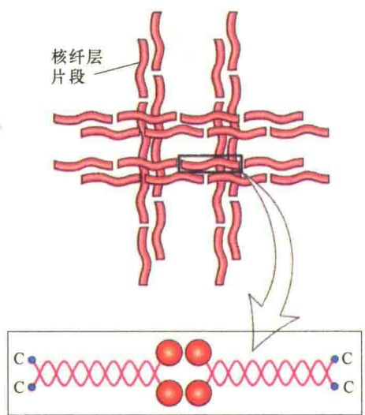
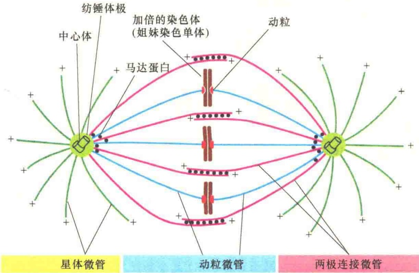
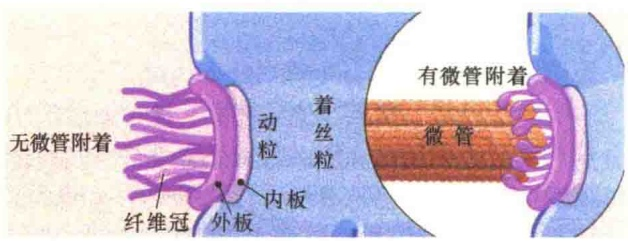
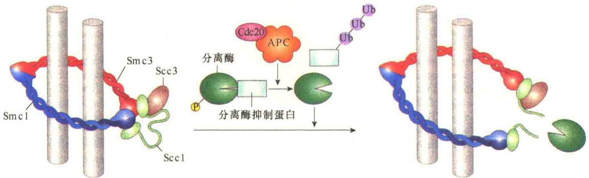
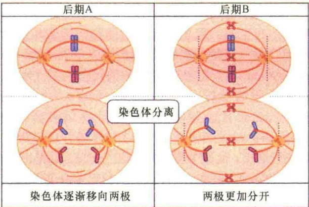
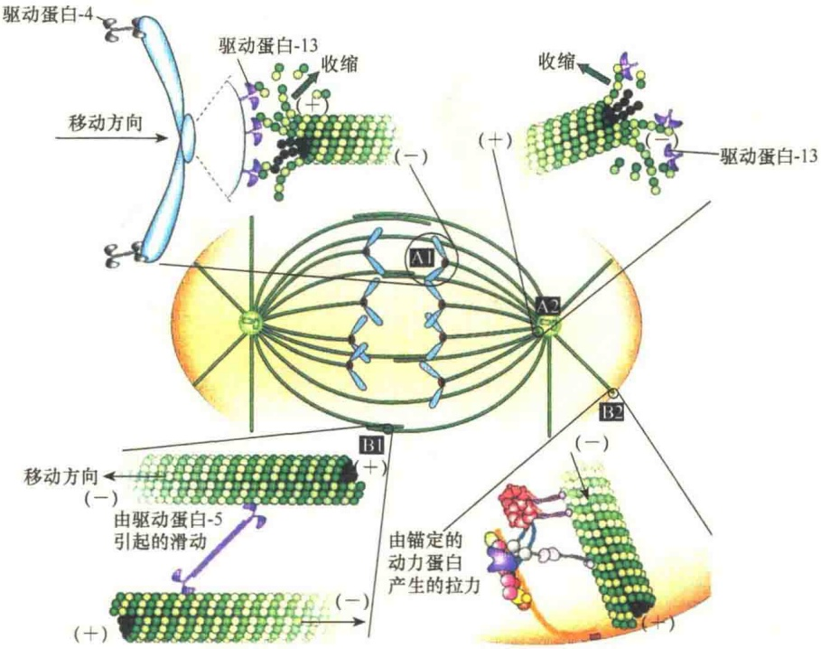
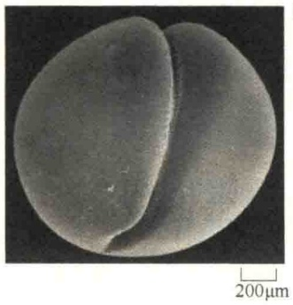

图 13-40 磷酸化作用导致核纤层断裂（引自 Lodish et al., 2013）。图的上部是核纤层网络结构。中间部分显示的是核纤层螺旋二聚体结构。大圆点表示 N 端，小圆点是 C 端。底端部分是 M-CDK 对 N 端、C 端特异的丝氨酸残基的磷酸化导致核纤层纤维的断裂，进而导致核被膜的破裂。

纺锤体是有丝分裂器（mitotic apparatus）的核心装置，它从中心粒形成各种双极性微管，包括动粒微管（kinetochore microtubule）、两极连接微管（interpolar microtubule）、星体微管（astral microtubule）等（图13-41），这些微管在有丝分裂后期协同将两套染色体均等分开，确保子细胞能够获得整套完整的染色体。

在纺锤体的装配与功能发挥中都有马达蛋白的参与，发挥作用的部位包括动粒、染色体的臂、纺锤体的极，以及极交互纺锤体微管。另外，有的马达蛋白只在一个部位起作用，有些马达蛋白在多个部位起作用（图 13-42）。

## 13.3.2.5 前中期染色体捕获与会集

有丝分裂中期的主要特点是让所有复制加倍的染色体能够“一字”排列到赤道板（metaphase plate），涉及纺锤体动粒微管对染色体的捕获，以及通过马达蛋白与动粒微管的动态变化将染色体定向引导到赤道板。

动粒是在早中期开始装配的，并且每一个姐妹染色单体的着丝粒处各装配一个，姐妹动粒附着部位各自朝向相反的一极。

动粒是纺锤体微管在染色体上的附着部位，是由蛋白质装配起来的复合物，分为三个部分:内板（inner plate）、外板（outer plate）、纤维冠（fibrous corona）（图13-43）。内板主要由三类着丝粒蛋白（centromere protein）组成，包括CENP-A、CENP-C、CENP-G。内板是动粒装配的组织者，并起稳定动粒的作用。组成外层的蛋白质主要是CENP-E、CENP-F、CENP-I等，主要功能是与微管结合，并为染色体的移动提供极向的力。动粒最外侧的部分是纤维状的冠，构成纤维冠的蛋白质包括CENP-E、马达蛋白等。纤维冠的功能是捕获微管。

前中期装配的动粒是如何捕获纺锤体微管的？由于从纺锤体的极形成的微管是高度动态的，动粒对微管的捕获有可能是通过微管的侧向，也有可能是通过微管的末端（图 13-44A 中步骤 1A，1B）。微管被动粒捕获后，通过降低微管去聚合的速率，使微管趋于稳定。研究发现，在此过程中，Ran-

图 13-41 动物细胞中期有丝分裂纺锤体（引自 Alberts et al., 2015）。有三种类型的有丝分裂纺锤体微管:①动粒微管是两极生长的微管，正端分别与一侧的动粒结合；②两极连接微管是来自两极微管的正端分别越过了中期板，并有部分交互重叠；③星体微管是由中心体生长出较短的放射性微管，其正端是自由的。动粒微管与极交互微管都有马达蛋白的结合。

双极性马达蛋白:与相邻的两个相同极性微管结合位于染色体臂上的马达蛋白将染色体推向细胞的极

位于动粒上的马达蛋白抓住微管，并通过去聚合微管，将染色体拉向细胞极

锚定在细胞皮质上的马达蛋白能够拉动星体微管

微管锚定马达蛋白:锚定微管并调节每一个极的动力学

双极性马达蛋白:与相邻相反极性的微管结合，并通过相互滑动推开染色体

图 13-42 有丝分裂相关微管马达蛋白（引自 Plopper et al., 2015）。通过马达蛋白与纺锤体微管的相互作用产生染色体移动的力。

在有丝分裂后期，为了将姐妹染色单体分开，首先要解决的问题是如何将束缚姐妹染色体的黏连蛋白解开，或是将其“切开”。黏连蛋白是在S期DNA复制时结合上去的，目的是防止新合成的两个子代染色单体分离，这种连锁作用确保了姐妹染色单体共同行动直至一起排列到中期的赤道板上。细胞进入有丝分裂后期，黏连蛋白完成了历史使命，需要将其移除，因为此时的黏连蛋白成为染色

## 13.3.2.6 姐妹染色单体的分离

已复制染色体一侧的动粒一旦与微管附着，与动粒结合的马达蛋白就会牵引复制染色体向纺锤体的极移动，并最终到达纺锤体微管的极（图13-44A中步骤2）。由于此染色体的另一个动粒是闲置的，因此可捕获来自相反极的纺锤体微管，从而将微管拉向相反的一极（图13-44A中步骤3）。染色体两侧动粒都结合有纺锤体的染色体称为双定向（bi-oriented）染色体，此时的染色体两侧都捕获有微管，因此受到来自两侧动粒微管的拉力，处于“惊惶不安”的状态。当有一个或少数几个染色体处于双向平衡状态时（位于赤道板），其他染色体会以此为“参照”逐渐移到纺锤体的中央部位，染色体的这种定向是由驱动蛋白-7（即CENP-E）介导的（图13-44A中步骤4）。

双定向的染色体向赤道板移动的过程称为染色体中板集合（chromosome congression），在此过程中，双定向的染色单体对来回振荡（oscillate），最终到达赤道板。染色体振荡涉及几种微管马达蛋白与微管装配与去装配调节蛋白的协同作用，逐渐将染色单体对排列到赤道板上（图 13-44B）。调节蛋白位于动粒上，但不是动粒的组成成分。

GTP 也有重要作用。

图 13-43 脊椎动物动粒的结构组成（引自 Plopper et al., 2015）。

单体分离的障碍。

由于黏连蛋白是由 Smc1、Smc3 组成的环，并由 Scc1 将它们锁定在一起，所以，要解除黏连蛋白对姐妹染色单体分离的阻碍作用，必须将 Scc1 这把锁解开，这一任务是由 APC/C 发动的。

在有丝分裂后期初始阶段，M-CDK 触发了 Cdc20 与无活性的 APC/C 结合，从而将 APC/C 激活。激活的 APC/C 将抑制分离酶（separase）的分离酶抑制蛋白泛素化而降解（图 13-45）。

## 13.3.2.7 染色体分离的两个阶段:后期 A 与后期 B

随着后期黏连蛋白的降解，通过有丝分裂纺锤体产生的力将姐妹染色单体拉向细胞相对的两极，这一过程称为染色体分离（chromosome segregation）。染色体的后期分离可分为两个独立而又重叠的阶段:后期A（anaphase A）和后期B（anaphase B）。后期A起始于染色体极向移动（poleward movement），这一过程伴随着动粒微管的逐渐缩短。后期B是纺锤体极分离（spindle pole segregation），它开始于子染色单体已经分开并且已离开了一段距离（图13-46）。

后期 A 的染色体极向移动依赖于两种力的作用:第一种力是由微管在动粒部位的去聚合，导致与动粒结合的驱动蛋白“背着”子染色体向纺锤体极移动，通过驱动蛋白与微管的作用产生拉力将染色体单体逐渐拉向细胞的两侧（图13-47A1）；第二种力是由微管流（microtubule flux）产生的，这是一种微管向纺锤体极的极向移动，是通过动粒微管负端去聚合及极驱动蛋白与动粒微管相互作用产生的拉力（图13-47A2）。

后期 B 的纺锤体极分离依赖于马达蛋白驱动（motor protein driven）机制，该机制中马达蛋白产生两种力，驱动纺锤体极向细胞两端移动。首先，正端走向的双极性驱动蛋白在两极连接微管的正端重叠区将微管进行交联，由于极微管在正端添加微管二聚体进行聚合延长，使两极的极微管产生重叠带延长，双极性的驱动蛋白通过向负端移动保持重叠区的长度恒定，因

图 13-44 前中期染色体捕获及会集（引自 Lodish et al., 2016）。A. 已经复制加倍的染色体两侧的姐妹动粒都被两极的纺锤体捕获，成为双极性染色体，在驱动蛋白及调节蛋白的协同作用下，通过微管的聚合与去聚合，染色体来回振荡，被逐渐集合到赤道板。B. 显示图 A 中 3 染色体通过左侧一极纺锤体微管的聚合产生的推力，以及右侧一极微管去聚合产生的拉力，逐渐向赤道板移动。

图 13-45 黏连蛋白降解的调控（引自 Lodish et al., 2013）。切割黏连蛋白复合物 Scc1 亚基的分离酶在进入后期前是受到双重抑制的:一方面，与分离酶抑制蛋白结合在一起；另一方面，被 M-CDK 进行了磷酸化。当所有的动粒都与纺锤体结合，并且纺锤体装置装配正确而又有序时，Cdc20 与 APC/C 结合并将其激活，激活的 APC/C 通过将分离酶抑制蛋白泛素化而降解。随着分离酶抑制蛋白的降解、M-CDK 活性下降导致分离酶去磷酸化，分离酶恢复活性并将 Scc1 降解，解除了枷锁的姐妹染色单体可被动粒微管拉向两极。

图 13-46 后期姐妹染色单体被分开的两个过程:后期 A 与后期 B（引自 Plopper et al., 2015）。

而产生了将纺锤体推向两极的推力（图 13-47B1）。其次，将星体微管锚定在细胞皮层的动力蛋白通过星体微管的去聚合产生的拉力将纺锤体极拉向细胞的一侧（图 13-47B2）。

## 13.3.2.8 胞质分裂机制

一旦染色体分离到细胞的两极，随即通过胞质分裂产生两个子细胞。所以胞质分裂既是有丝分裂的最后一个过程，也是新细胞形成的开始过程。在大多数细胞中，在有丝分裂之后紧接的是胞质分裂，但也有极少数细胞，如早期果蝇的胚胎细胞及某些动物的肝细胞等在有丝分裂中是没有胞质分裂的，因为这些细胞需要很多细胞核。

图 13-47 后期染色体运动与纺锤体极的分离（引自 Lodish et al., 2013）。后期 A 的染色体运动是由驱动蛋白在动粒（A1）与纺锤体极（A2）等两个部位微管的不断收缩所产生的两种力驱动的。在这两个部位，由于驱动蛋白将动粒微管的正端锚定在动粒、负端锚定在纺锤体极，微管的去聚合导致染色体向纺锤体极运动。后期 B 的纺锤体极分离也是两个方面的力驱动的:一种是双极性驱动蛋白在反向平行极微管间的滑动产生的推力（B1），另一种是由位于细胞皮层的动力蛋白与星体微管产生的拉力（B2）。

在动物细胞的胞质分裂中最先看到的现象是在细胞表面出现卵裂沟（cleavage furrow），卵裂沟快速加深直至分成两个细胞（图 13-48）。

A

B

图 13-48 胞质分裂的形态变化（引自 Alberts et al., 2015）。
A. 在较低倍数下，蛙卵细胞的胞质卵裂沟扫描电镜照片。
B. 在较高倍数下，蛙卵细胞的胞质卵裂沟的扫描电镜照片。

如同染色体的分离，胞质分裂不仅需要有丝分裂纺锤体，同时也需要装配新的结构:中间体（midbody）与收缩环（contractile ring）（图13-49）。中间体是后期形成的，其中有大量平行的微管束，这些微管束位于分离染色体之间，属于纺锤体微管。收缩环是由肌动蛋白纤维、肌球蛋白Ⅱ纤维，以及其他一些结构与调节蛋白装配起来的一种动态结构，有丝分裂后期，在细胞质膜的下方开始装配收缩环。

有丝分裂纺锤体如何确定胞质分裂的细胞部位？也就是说，收缩环装配的位点是如何确定的？据推测，有三种可能的机制，对于大多数细胞而言，这三种可能的机制会联合使用。第一种是星体刺激模型（astral stimulation model）:按此模型，星

图 13-49 胞质分裂中间体与收缩环（引自 Plopper et al., 2015）。胞质分裂中间体是一个大的微管结构，它是在有丝分裂后期，由聚集在分离染色体之间的微管束所形成。与此同时，在分裂细胞的中间部位由肌动蛋白纤维、肌球蛋白Ⅱ纤维等形成一个紧密的带，中间体决定环的位置，便于将细胞一分为二。