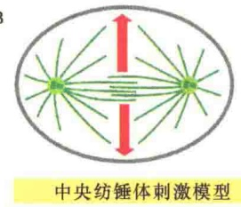
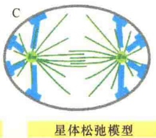
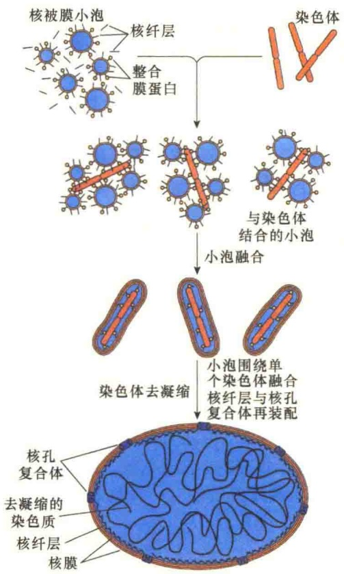
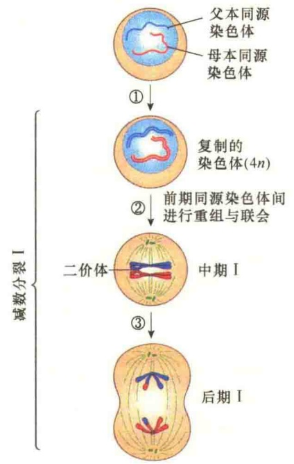
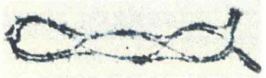
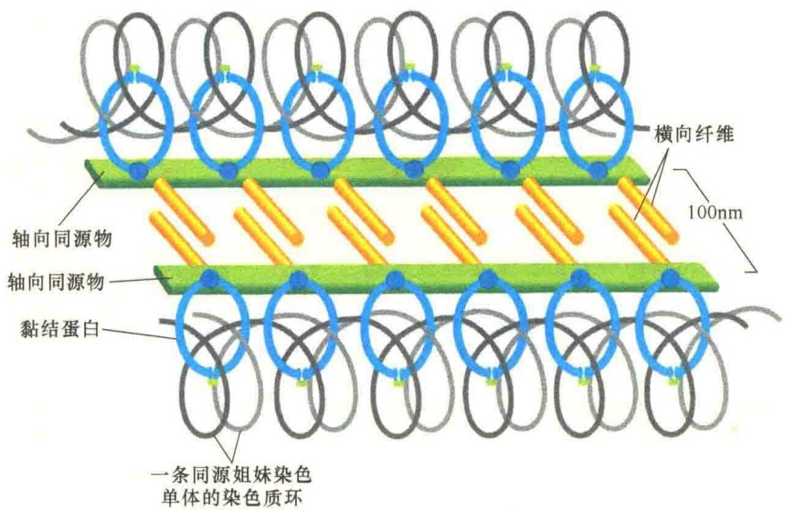

体微管携带有沟诱导信号，该信号主要是确定细胞皮质装配收缩环的位置，即两个纺锤体极中部部位。第二种可能的机制是中央纺锤体刺激模型（central spindle stimulation model）:该模型认为，中央纺锤体产生了诱导在细胞皮层特异部位形成沟的信号。极微管的中央重叠部分结合很多信号蛋白，包括可以刺激Rho A的蛋白质；通过果蝇突变体的研究，发现这些蛋白质缺陷将不能进行胞质分裂。第三种可能的机制假设在某些类型的细胞中，星体微管可以促进细胞皮层肌动蛋白-肌球蛋白束局部松弛，这种机制称为星体松弛模型（astral relaxation model）。在纺锤体赤道部位的皮层松弛十分轻微，因此促进了在该位点进行皮层收缩。例如，在线虫早期胚胎细胞中，丧失了星体微管则导致整个细胞皮层的收缩活性提高，这一结果支持了星体松弛模型。图13-50是这三种可能的模型示意图。

如同染色体分离，胞质分裂也分为几个过程。第一是在细胞皮质确定收缩环装配的部位，该反应发生在后期的初始阶段，收缩环装配部位的确定，也就确定了细胞的分裂面。第二是在确定部位进行收缩环的装配，随着收缩环的装配，环不断进行收缩。第三是收缩环收紧，形成卵裂沟。第四是将中间体切断，分裂成两个子细胞。收缩环的收缩过程是肌球蛋白介导的肌动蛋白纤维不断滑动的结果。

高等植物细胞的胞质分裂与动物细胞的胞质分裂完全不同，这是因为植物细胞有坚硬的细胞壁。植物细胞的胞质分裂不是靠肌动蛋白收缩环，而是靠细胞内新细胞壁的形成。新细胞壁的位置精确地决定了子细胞与相邻细胞的位置和关系。在新细胞壁形成过程中，携带有细胞壁前体物质的高尔基体膜泡（其内充满细胞壁基质所需的多糖和糖蛋白），沿着微管运向有丝分裂的中期板，并相互融合形成大的、由膜包裹的、圆盘状结构，其内含有的多糖装配成新细胞壁基质，称为早期细胞板（early cell plate)，并不断向两侧扩大直到与原有的细胞质膜结合，同时也将细胞质分成两半（图 13-51）。

## 13.3.2.9 核重建机制

胞质分裂之后，必须在子细胞中进行核重建，欲重建核，首先要重建核被膜。片段化的核被膜如何重新建立？通过对非洲爪蟾卵细胞提取物的研究和对各种生物温度敏感突变体的分析发现:核被膜的重建需要一些特异蛋白质的去磷酸化，这些蛋白质的磷酸化作用可能与MPF有关。在细胞周期的后期，当细胞周期蛋白B被降解之后，MPF很快失活，但一些磷酸酶很快激活并将核纤层蛋白脱磷酸，导致核被膜的重建。

核重建是核解体的相反过程。后期末，子代染色体已经分成相等的两组，分别移到了纺锤体的两极。在有丝分裂的末期，前期核解体时形成的核被膜小泡此时又围绕染色体聚集和融合形成两个子代细胞核被膜（图 13-52）。在核被膜重建过程中，同样要重新装配核孔复合体。此外，前期磷酸化的核纤层蛋白经去磷酸化后重装配成核纤层。

核被膜重建之后，由于核解体而散布在细胞质中的核蛋白通过核定位信号经由核孔的选择输入进新的细胞核中。有了核被膜和核蛋白，染色体进行去凝缩，一些 rRNA 基因首先开始转录，一个生机盎然的细胞踏上了新的细胞周期之旅。

## 13.4 减数分裂

在细胞进行有丝分裂过程中，产生的两个子细胞含有来自亲代细胞的相同数目的染色体。因此，有丝分裂是细胞增殖，产生具有相同遗传特性的细胞群体的过程。在有性生殖的生物中，有性生殖是通过两个配子的融合产生新的生物个体的过程，这两个配子一个来自父本（雄配子），另一个来自母本（雌配子），配子是通过减数分裂（meiosis）产生的。

图 13-50 胞质分裂收缩位点确定的三种可能机制（引自 Alberts et al., 2015）。图中显示的是后期纺锤体微管产生的信号对收缩位置影响的三种现代模型。需要说明是，任何单一的模型都不能解释所有观察到的现象，或许卵裂沟的确定需要这三种模型共同作用。

减数分裂是生殖细胞产生配子的分裂，包括两次连续的减数分裂，形成4个单倍体的子细胞。相继的两次分裂分别称为减数分裂Ⅰ和减数分裂Ⅱ。在减数分裂Ⅰ与减数分裂Ⅱ之间有一个很短的间隔期，但此间隔期不进行DNA的合成，因而也不发生染色体的复制。由于细胞核分裂了两次，而染色体只是在减数分裂前的间期复制了一次，所以细胞经过减数分裂导致染色体组数目减少一半（图 13-53）。

图 13-51 高等植物细胞胞质分裂的特征（引自 Alberts et al., 2015）。在 M 期之前，由微管束和肌动蛋白丝束在皮质层建立一个分裂面。染色体分离后末期刚开始，在细胞内侧、原有纺锤体的赤道处起始新细胞壁的装配:保留至末期的有丝分裂纺锤体的两极连接微管形成成膜体（phragmoplast），作为细胞壁填充料的高尔基体膜泡沿着微管转运至成膜体，相互融合成为新的细胞壁组分，并不断向外延伸达到细胞质膜及原有的细胞壁。细胞质膜与膜包围的新细胞壁融合，将两个子细胞分开。

图 13-52 核被膜的重建（引自 Cooper and Hausman，2004）。随着胞质分裂，核被膜小泡也与染色体一起分进子细胞。在子细胞中，核被膜小泡围绕染色体的表面形成包裹染色体的小泡。紧接着，染色体核被膜小泡相互融合，形成包裹有所有染色体的细胞核。在此过程中，要重新组装核孔复合体。

## 13.4.1 减数分裂Ⅰ与减数分裂Ⅱ的形态变化

减数分裂Ⅰ的核心目标是同源染色体的分离，有两个主要特点:①一对同源染色体分开之前要进行配对，此时的DNA会发生交换和重组；②在染色体组中，同源染色体的分离是随机的，也就是说染色体组要发生重组合。减数分裂Ⅰ分为前期Ⅰ、中期Ⅰ、后期Ⅰ与末期Ⅰ4个时期。减数分裂Ⅱ的核心目标是将一对同源染色体的4个姐妹染色单体分开，使其各进入一个子

细胞，因此，通过连续的两轮分裂，使染色体组减半，产生4个单倍体的子细胞。

## 13.4.1.1 前期I的形态变化

前期Ⅰ变化最为复杂，呈现许多减数分裂的特征性变化，如持续时间长、细胞核显著增大、同源染色体进行配对和交换等。该期可分为细线期、偶线期、粗线期、双线期、终变期等（图13-54）。

1）细线期 细线期（leptotene stage）又称凝缩期（condensation stage），此期在光学显微镜下可逐渐见到染色体，染色质在凝缩前已复制，但仍呈单条细线状，看不到成双的染色体。在电子显微镜下，可观察到此期的染色体是由两条染色单体构成的。

2）偶线期 偶线期（zygotene stage）又称配对期（pairing stage）。此期的主要特点是染色质进一步凝缩，同源染色体（homologous chromosome）发生配对，称为联会（synapsis），并形成联会复合体（synaptonemal complex，SC）。

3）粗线期 粗线期（pachytene stage）又称重组期（recombination stage）。该阶段开始于同源染色体联会之后，染色体明显变粗、变短，结合紧密，此期染色体形态是一个明显的四分体。

4）双线期 双线期（diplotene stage）的染色体长度进一步变短，SC因发生去组装而逐渐消失，紧密配对的同源染色体相互分开，而在非姐妹染色单体之间的某些部位上，可见其相互间有接触点，称为交叉（chiasma）（图13-55）。交叉被认为是粗线期交换发生的细胞形态学证据，其数目取决于物种类型及染色体长度，如人类平均每对染色体的交叉数为2\~3个；若染色体较长，则其交叉也较多。

图13-53 减数分裂过程（引自Lodish et al., 2013）。减数分裂经过连续的两次分裂，产生4个单倍体的配子。

图 13-54 前期 I 的染色体行为（引目 Karp，2010）。

5）终变期 终变期（diakinesis）又称再凝缩期（recondensation stage），是前期Ⅰ的最后一个阶段，此期染色质又被包装压缩成染色体。双线期结束，染色体变成紧密凝缩状态，大多数核仁消失，四分体均匀地分布在核中。染色体交叉逐步向染色体端部移动，称为端化（terminalization）。最后四分体只靠端部交叉使其结合在一起，姐妹染色单体通过着丝粒连接在一起。

当前期Ⅰ即将结束时，像有丝分裂一样，中心粒已经加倍，中心体移向两极并形成纺锤体，核被膜破裂和消失，标志着前期Ⅰ的结束。

## 13.4.1.2 中期Ⅰ至末期Ⅰ的形态变化

中期Ⅰ至末期Ⅰ的形态变化比前期Ⅰ要简单。

1）中期Ⅰ 纺锤体侵入核区，分散于核中的四分体开始向中部移动；此时四分体上有4个动粒，一侧纺锤体只和同侧的两个动粒相连，最后染色体排列在赤道板上。

在大多数真核生物中，中期Ⅰ仍然能够见到排列在中期板上同源染色

体的交叉，实际上，交叉能够将同源染色体作为二价体结合在一起。在人和其他脊椎动物中，每对同源染色体至少有一个交叉，较长的染色体通常有2～3个交叉。推测可能有一种机制保证最短的染色体也有一个交叉。

2）后期Ⅰ 进入后期Ⅰ后，同源染色体在两极纺锤体的作用下分开，并逐渐移向两极。由于每条染色体仍含有两条染色单体，因而每个极仍含有两套染色体。不同的同源染色体对向两极的移动是随机的、独立的，所以父方、母方来源的染色体此时会发生随机组合，即染色体组的重组，这种重组有利于减数分裂产物的基因组变异。

A

C

图 13-55 双线期的染色体交叉（引自 Karp，2010）。A 和 B.光学显微镜下的蝗虫减数分裂前期Ⅰ中见到的双线期发生的交叉。C.沙漠蝗虫减数分裂Ⅰ的双线期扫描电镜照片，可见到三个交叉（箭头所指）。

3）末期Ⅰ及分裂间期 在末期Ⅰ，每一个极接受一套随机组合的染色体组，但在自然界中，有两种类型的末期Ⅰ，一种是没有明显可见的染色体去凝缩，另一种是完全逆转到间期核的状态。后者染色体要去凝缩、重新形成核被膜。两次减数分裂之间的时期称为分裂间期（interkinesis），是一个极短的时期。在动物中，处于分裂间期的细胞被称

## 13.4.2 减数分裂过程中的遗传重组及其机制

两极的纺锤体微管结合。在后期Ⅱ，两个动粒分开，姐妹染色单体被拉向两极。在末期Ⅱ，染色体完全移到两极，开始去凝缩，并重新形成核被膜。

在减数分裂过程中发生了两种方式的遗传重组:同源染色体间的交换重组和同源染色体分离时染色体组的重组。

## 13.4.2.1 同源染色体间的交换重组

同源染色体间的交换重组发生在减数分裂 I 的前期 I，是在同源染色体配对形成联会复合体时发生的。

1）联会与联会复合体 联会是在减数分裂的偶线期两条同源染色体侧面紧密靠近并进行配对的现象。联会时的配对是特异的，可以同时发生在同源染色体分散的几个点上。电子显微照片揭示，染色体联会伴随一种复杂的结构——联会复合体的形成。

SC 是一种梯状结构（图 13-56），两侧各有一个沿姐妹染色单体的长轴，并且相互平行。是什么原因将两条长轴拉到一起？一种可能的解释就是靠一种大的蛋白质机器，叫重组复合体（recombination complex），它在同源物的断裂处进行装配，在同源区附近与配对的 DNA 序列结

为次级精子细胞或次级卵细胞，因为它们只含有一套染色体，所以是单倍体；由于两个姐妹染色单体没有分开，实际上它们携带两套基因组。

## 13.4.1.3 减数分裂Ⅱ的形态变化

通过分裂间期即进入减数分裂Ⅱ，减数分裂Ⅱ的染色体行为与有丝分裂相似。减数分裂Ⅱ分为前期Ⅱ、中期Ⅱ、后期Ⅱ、末期Ⅱ，最后形成4个单倍体细胞。

如果在末期Ⅰ重新形成了核被膜，则在前期Ⅱ要将核被膜解体，重新进行染色质凝缩。在中期Ⅱ，染色体排列在赤道板，姐妹染色单体中的动粒被

图 13-56 联会复合体的结构（引自 Alberts et al., 2015）。每一个同源染色体围绕一个长轴组织起来，当一对同源的长轴通过杆状的横向纤维连接起来时，就形成了联会复合体。每一条同源的长轴都与将姐妹染色单体控制在一起的黏结蛋白复合物相互作用，从而成为一个整体。