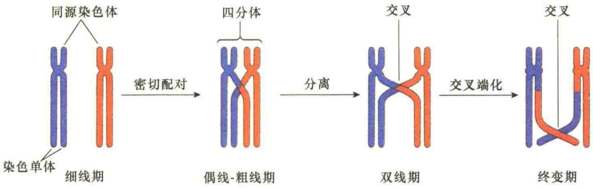

合，并以这种方式形成突触状结构。同源物这种突触前排（presynaptic alignment）形成之后就是联会，在联会中两条平行的长轴通过横向纤维（transverse filament）紧密连接起来形成联会复合体。

2）染色体重组:交换与交叉 在同源染色体联会期间，同源染色体要发生断裂和重接，在此过程中发生同源染色体间的交换，随着双线期的进行，交叉开始远离着丝粒，并逐渐向染色体臂的端部移动（图13-57），称为交叉端化（terminalization）。交叉是交换的结果，因为交换是在联会时发生的，即同源染色体紧密结合在一起时发生的，无法观察，所以观察到交叉时，同源染色体已经完成了交换并开始分离了。

图 13-57 同源染色体联会时的交换和交叉（引自 Kleinsmith and Kish, 1995）

## 13.4.2.2 染色体组的重组

生殖细胞在形成配子时，染色体要减半，由二倍体生成单倍体。二倍体中的两套染色体组分别来自双亲，但是在形成单倍体时，染色体组要进行重组合，也就是说在新形成的单倍体的生殖细胞中，每一套染色体组中既含有母本的染色体，又含有父本的染色体，它们是随机组合的，这样形成的配子基因型既不同于父本又不同于母本，而是一种新的组合，这是生物界遗传重组的主要方式。

染色体组的重组发生在减数分裂Ⅰ的中期Ⅰ，此时染色体组中的每对同源染色体由于配对，所以在中期Ⅰ的赤道板上的排列就有两种可能的方式（图13-58），这样，在一套基因组中由于染色体在赤道板上排列的随机性，就会有不同的自由组合方式，也就是重组。由于重组是随机的，重组的结果不一定都是有利的，需经过自然选择。

图 13-58 减数分裂中染色体组的自由组合(引自 Jeff et al., 2012)。简便起见，假定只有两对染色体的基因组，在中期 I，在赤道板上就有两种可能的排列，左侧是亲组合，右侧是重组合。

## 13.4.3 减数分裂与有丝分裂的比较及意义

## 13.4.3.1 减数分裂与有丝分裂的比较

减数分裂与有丝分裂的共同点都是通过纺锤体与染色体的相互作用进行细胞的分裂，但二者之间有许多差异（图13-59）。①有丝分裂是体细胞的分裂方式，减数分裂是生殖细胞产生配子的过程（生殖细胞也有有丝分裂）。②有丝分裂是一次细胞周期，DNA复制一次，分裂一次，染色体由 $2n\rightarrow 2n$ ；减数分裂是两次细胞周期，DNA复制一次，细胞分裂两次，染色体由 $2n\to n$ 。③有丝分裂中，每条染色体独立活动；在减数分裂中，染色体要配对、联会、交换和交叉。④有丝分裂之前，经DNA合成，进入 $G_{2}$ 期后才进行有丝分裂；减数分裂之前，DNA合成时间很长，一旦合成，即进入减数分裂期， $G_{2}$ 期短或没有。

图 13-59 有丝分裂与减数分裂的比较（引自 Alberts et al., 2015）。

## 13.4.3.2 减数分裂的生物学意义

有性生殖是生物在长期进化历程中较无性生殖更为进步的一种繁殖方式。雌雄配子的融合，把不同遗传背景的父母双方的遗传物质结合在一起，其结果既稳定了遗传，又添加了诸多新的遗传变异，大大增强了生物对千变万化环境的适应能力。然而，如果没有一种机制使精卵细胞染色体数减少

一半，那么精卵细胞的融合将使染色体数倍增下去，细胞的体积也就不断地膨胀，细胞将不能适应环境而遭淘汰。减数分裂保证了生殖细胞在细胞周期中染色体的单倍化，然后通过受精作用还原为二倍体。没有减数分裂，有性生殖将是不可能的。

减数分裂保证了有性生殖生物在世代交替中染色体数目的恒定，生成配子时先减半成单倍体（n）；合子形成时，又恢复为二倍体（2n）。

减数分裂也是遗传变异产生的主要原因。在生物进化过程中，如果没有遗传变异，生物就不能适应环境的变化，就会失去长期生存的能力。在减数分裂过程中，有两种方式发生遗传重组:第一种是通过亲代染色体在单倍体细胞中的自由组合，产生的配子所含的染色体在组成上既有父本的也有母本的；第二种方式是同源染色体配对时发生DNA交换，这种遗传重组过程产生的单个染色体中既有父本的也有母本的基因，既有基因间的重组，也有基因内的重组。减数分裂就是通过这样两种机制产生遗传上独特的4个单倍体细胞，每个细胞都含有新重组的遗传信息。

## 本章小结

生长和生殖是生物的基本特性，通常将通过细胞分裂产生的新细胞的生长开始到下一次细胞分裂形成子细胞结束为止所经历的过程称为细胞周期，在这一过程中，细胞的遗传物质复制并均等地分配给两个子细胞。

将细胞周期分为两个主要的阶段:有丝分裂期（M期）和分裂间期。间期是细胞生长期，可分为 $G_{1}$ 期、S期、 $G_{2}$ 期。M期是细胞分裂期，分为核分裂与胞质分裂两个阶段。

通过染色体超前凝聚实验发现有促进染色质凝缩的因子，孕酮注射实验证明处于  $G_{2}$  期的蛙卵母细胞中有类似于孕酮的因子。通过对酵母的研究，发现了 MPF 与 SPF:MPF 是促进  $G_{2}$  期裂殖酵母细胞进入有丝分裂的因子，称为有丝分裂促进因子；SPF 是促进芽殖酵母通过  $G_{1}$  期进入 S 期的因子，MPF 与 SPF 都是由周期蛋白与周期蛋白激酶组成的异二聚体。

哺乳动物细胞周期调控较为复杂，受多种 CDK 和周期蛋白的调控，包括多种 CDK 与多种周期蛋白。真核生物细胞周期调控系统是由周期蛋白依赖性的蛋白激酶、周期蛋白，以及各种不同的激活与抑制蛋白组成的生化开关控制的网络。

细胞的生存机制由关卡途径进行监测。通过关卡的管控，确保在上一个细胞周期没有完成之前不能启动下一个细胞周期的事件。DNA损伤关卡在整个周期内对DNA进行监控，一旦发现DNA损伤，立即停止周期进程。

有丝分裂是细胞周期的分裂期（M期）进行的分裂活动。在这个时期，通过纺锤体的形成和运动，将在S期已经复制好了的DNA平均分配到两个子细胞，以保证遗传的连续性和稳定性。这一时期的主要特征是出现纺锤体。

有丝分裂包括核分裂和胞质分裂两个过程，一般在核分裂之后随即发生胞质分裂。M期持续的时间很短，但形态变化很大，根据形态变化的特征，通常将核分裂分为前期、前中期、中期、后期和末期。

减数分裂是生殖细胞产生配子的分裂，包括两次连续的分裂，形成4个单倍体的子细胞。相继的两次分裂分别称为减数分裂Ⅰ和减数分裂Ⅱ。由于细胞核分裂了两次，而染色体只是在减数分裂Ⅰ前的间期复制了一次，所以细胞经过减数分裂导致染色体数目减少一半。

减数分裂Ⅰ可分为前期Ⅰ、中期Ⅰ、后期Ⅰ、末期Ⅰ。减数分裂Ⅱ可分为前期Ⅱ、中期Ⅱ、后期Ⅱ、末期Ⅱ。减数分裂是遗传重组产生的主要原因，重组的两个事件分别发生在前期Ⅰ和后期Ⅰ。

## 思考题

（1）何谓细胞同步化？如何获得同步化的细胞？

（2）何谓早熟染色体凝聚？

（3）裂殖酵母 MPF 与芽殖酵母的 SPF 有什么不同？

（4）什么是关卡途径？DNA损伤关卡是如何工作的？

（5）前中期染色体是如何被捕获并集中到赤道板的？

（6）什么机制确保细胞周期是单向行进的而不会可逆行进？这些机制的分子基础是什么？